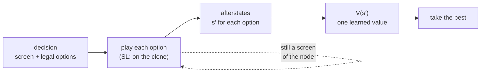

import { Aside } from '@astrojs/starlight/components';

The **macro brain** makes every decision outside combat: which map point to go to next, which rewards to claim, which card to take, what to buy, which option to pick at an event, a rest site or a treasure chest. It runs in the decision process next to the [combat brain](/en/arch/combat-brain/). Harness sends it every surface that is not a combat ([Harness: routing, budgets and seeds §1](/en/arch/harness/routing/#sec-1)).

Its method fits in one sentence: play each option, look at the situation right after it, ask a learned value function V how good that situation is, and take the best. This chapter explains each part of that sentence from first principles: what the options are, what "the situation right after" means, how the options are played, what V reads and computes, where its training labels come from, and how each new V is accepted or refused.

<Aside title="Status">

L0 exists: `MacroBrain` in Brain, played with `run --macro l0` ([Simulator: whole runs §5](/en/arch/simulator/runs/#sec-5)). It answers every macro surface and the card prompts outside combat, and values options with V, read from a net file ([The value network](/en/arch/macro-brain/network/)). In SL, with `--afterstates clone`, L0 plays each option on the node's clone and searches on through the node's screens ([Search §2](/en/arch/macro-brain/search/#sec-2)); in NoSL it predicts each afterstate from the screen ([Search §1](/en/arch/macro-brain/search/#sec-1)). For self-play, `--explore ε` draws a share ε of its decisions evenly ([Self-play §3](/en/arch/macro-brain/selfplay/#sec-3)). Planned: afterstates from run worlds and multi-step search in NoSL, the L1 rollout check, and the `IMacroBrain` interface ([Next steps §2](/en/arch/macro-brain/next/#sec-2)).

</Aside>

## 1. What it decides

The decision screens (*surfaces*) the macro brain handles. "Randomness after choice" is what is revealed only once the option is taken. "Consequence horizon" is how far the effect of the choice reaches ("run" means the rest of the run).

| surface | options | randomness after choice | consequence horizon |
|---|---|---|---|
| map (next point) | 1–4 | `?` roll, encounter, rewards | rest of act |
| rewards (claim order / skip) | ≤6 | none (gold, potion, relic shown) | run |
| card reward | 3–4 + skip/reroll | reroll result | run |
| deck prompts: upgrade / remove / enchant | deck size | none | run |
| transform | deck size | result card | run |
| choose-a-card / bundle | ≤3 | none | run |
| event / ancient option | 1–4 | event outcome, next page | run |
| shop | stock + removal + leave | none (stock visible) | run |
| rest | rest/smith/lift/dig/… | dig etc. | run |
| treasure | relic choice/skip | none | run |
| potion full | discard/use/skip | none | short |

What these surfaces have in common: few options, a long horizon, cheap to apply, hard to value. A combat turn can have thousands of action sequences; here a decision has a handful of options, and each can be tried in a simulated world at almost no cost. The hard part is that the effect of a choice shows up many floors later. A card taken on floor 2 is still in the deck at the act 3 boss; a rest site skipped on floor 43 to fight one more monster may decide whether the run reaches floor 48.

A run has many of these decisions, 174 in one won run, all sharing the one outcome of their run. That ratio, many decisions to one outcome, is the central difficulty of learning V ([From hazards to value §3](/en/arch/macro-brain/value/#sec-3)).

## 2. The method in one picture

1. **Options.** The legal actions of the screen, as Harness lists them.
2. **Afterstates.** Each option is applied, and the situation right after it, before anything random happens, is its *afterstate* ([Afterstates §1](/en/arch/macro-brain/afterstates/#sec-1)). In SL the option is played in the real game on a clone of the current node; where the game then shows another screen of the same node (a shop after a purchase, the next page of an event), the search goes on through it ([Search §3](/en/arch/macro-brain/search/#sec-3)).
3. **One value.** V reads an afterstate and returns one number. The same V scores every option of every surface, so a card, a relic, an upgrade, a heal and a path on the map are compared on one scale, without exchange rates written by hand ([Afterstates §2](/en/arch/macro-brain/afterstates/#sec-2)).
4. **Best.** L0 takes the option with the highest value, the first legal one on a tie. Self-play sometimes draws another on purpose, to learn what it would have led to ([Self-play §3](/en/arch/macro-brain/selfplay/#sec-3)).

V itself is a neural network that reads only what the run is (the ids of its cards, relics, potions, act and bosses, and the points of the map ahead), a card's grown numbers, a relic's counter and status, the cards a relic keeps, and nine raw numbers (the game's rule among them), and predicts, for every floor, the chance that the run ends there; together those give the chance to win ([The value network](/en/arch/macro-brain/network/), [From hazards to value §2](/en/arch/macro-brain/value/#sec-2)). It learns from self-play: each decision's label is how its run really ended ([From hazards to value §3](/en/arch/macro-brain/value/#sec-3)).

## 3. This chapter

| section | what it explains | figures |
|---|---|---|
| [Afterstates and one value function](/en/arch/macro-brain/afterstates/) | why the brain values the state after an option, why one V serves every surface, NoSL and SL | – |
| [Search](/en/arch/macro-brain/search/) | predicting afterstates from the screen; L0 on the SL clone: beam, probes, card prompts, no way back | – |
| [The value network](/en/arch/macro-brain/network/) | the net from input to output: every input tensor, the deck's set network, the bags of relics, potions, context and map, the cards the relics keep, the MLP body, the hazard head, its sizes and limits | the architecture; a fork on the map; one real run through every layer |
| [From hazards to value](/en/arch/macro-brain/value/) | what V means, the hazards and P(win); a logged decision as a sample, its labels and the loss; training and the report | – |
| [Self-play](/en/arch/macro-brain/selfplay/) | whole runs and runs of the auto-win rule, even draws and a softmax, the dataset file, generations, the gate on paired wins | – |
| [Weaknesses and next steps](/en/arch/macro-brain/next/) | what is known to be weak, what is planned but not built, open questions | – |
