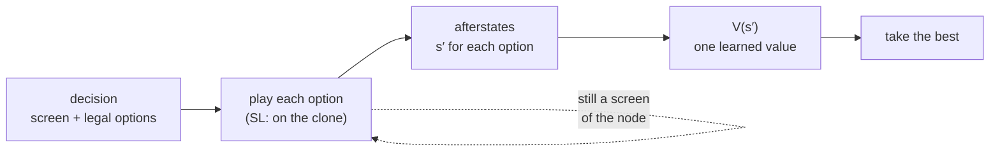

import { Aside } from '@astrojs/starlight/components';
import RunTrajectory from '../../../../../components/v/RunTrajectory.svelte';

The **macro brain** makes every decision outside combat: which map point to go to next, which rewards to claim, which card to take, what to buy, which option to pick at an event, a rest site or a treasure chest. It runs in the decision process next to the [combat brain](/en/arch/combat-brain/). Harness sends it every surface that is not a combat ([Harness §4](/en/arch/harness/#sec-4)).

Its method fits in one sentence: play each option, look at the situation right after it, ask a learned value function V how good that situation is, and take the best. This chapter explains each part of that sentence from first principles: what the options are, what "the situation right after" means, how the options are played, what V reads and computes, where its training labels come from, and how each new V is accepted or refused.

The figure follows one run that the current V won, a whole SL run on seed `0SSL7NS01MU6`. At each of its 181 macro decisions it plots V's value of the answer that was played, in V's own unit (the expected *progress*: roughly, the floor the run is expected to reach, [The value network](/en/arch/macro-brain/network/)), and below it the share of max HP the player held. V starts at 33 and climbs as the run survives each act; the run ended where V ends, on the last boss's floor, won (progress 49). The four marked decisions are the chapter's running examples.

<RunTrajectory client:visible lang="en" />

<Aside title="Status">

L0 exists: `MacroBrain` in Brain, played with `run --macro l0` ([Simulator: whole runs §5](/en/arch/simulator/runs/#sec-5)). It answers every macro surface and the card prompts outside combat, and values options with V: V v0 (hand-written), or V v2 or pure V from a net file ([Learning §1](/en/arch/learning/#sec-1)). Both champions' V is the pure V net v6-3-2 since 2026-10-30. In SL, with `--afterstates clone`, L0 plays each option on the node's clone and searches on through the node's screens ([Search §2](/en/arch/macro-brain/search/#sec-2)); in NoSL, where run worlds do not exist yet, it predicts each afterstate from the screen ([Search §1](/en/arch/macro-brain/search/#sec-1)). For self-play, `--explore ε` draws a share ε of its decisions evenly ([Self-play §2](/en/arch/macro-brain/selfplay/#sec-2)). The encoders' net, which reads the loadout with self-attention and the map as a graph, is built and not trained yet ([The value network §4](/en/arch/macro-brain/network/#sec-4)). Planned: afterstates from run worlds and multi-step search in NoSL, the L1 rollout check, and the `IMacroBrain` interface ([Next steps §3](/en/arch/macro-brain/next/#sec-3)).

</Aside>

## 1. What it decides

The decision screens (*surfaces*) the macro brain handles. "Randomness after choice" is what is revealed only once the option is taken. "Consequence horizon" is how far the effect of the choice reaches ("run" means the rest of the run).

| surface | options | randomness after choice | consequence horizon |
|---|---|---|---|
| map (next point) | 1–4 | `?` roll, encounter, rewards | rest of act |
| rewards (claim order / skip) | ≤6 | none (gold, potion, relic shown) | run |
| card reward | 3–4 + skip/reroll | reroll result | run |
| deck prompts: upgrade / remove / enchant | deck size | none | run |
| transform | deck size | result card | run |
| choose-a-card / bundle | ≤3 | none | run |
| event / ancient option | 1–4 | event outcome, next page | run |
| shop | stock + removal + leave | none (stock visible) | run |
| rest | rest/smith/lift/dig/… | dig etc. | run |
| treasure | relic choice/skip | none | run |
| potion full | discard/use/skip | none | short |

What these surfaces have in common: few options, a long horizon, cheap to apply, hard to value. A combat turn can have thousands of action sequences; here a decision has a handful of options, and each can be tried in a simulated world at almost no cost. The hard part is that the effect of a choice shows up many floors later. A card taken on floor 2 is still in the deck at the act 3 boss; a rest site skipped on floor 43 to fight one more monster may decide whether the run reaches floor 48.

A run has many of these decisions. The run above made 181; in the elite gauntlet, where V is trained ([Self-play §1](/en/arch/macro-brain/selfplay/#sec-1)), a run made 108 on average in generation 1 and 146 in generation 3, all sharing the one outcome of their run. That ratio, many decisions to one outcome, is the central difficulty of learning V ([From hazards to value §2](/en/arch/macro-brain/value/#sec-2)).

## 2. The method in one picture

1. **Options.** The legal actions of the screen, as Harness lists them.
2. **Afterstates.** Each option is applied, and the situation right after it, before anything random happens, is its *afterstate* ([Afterstates §1](/en/arch/macro-brain/afterstates/#sec-1)). In SL the option is played in the real game on a clone of the current node; where the game then shows another screen of the same node (a shop after a purchase, the next page of an event), the search goes on through it ([Search §3](/en/arch/macro-brain/search/#sec-3)).
3. **One value.** V reads an afterstate and returns one number. The same V scores every option of every surface, so a card, a relic, an upgrade, a heal and a path on the map are compared on one scale, without exchange rates written by hand ([Afterstates §2](/en/arch/macro-brain/afterstates/#sec-2)).
4. **Best.** L0 takes the option with the highest value, the first legal one on a tie. Self-play sometimes draws another on purpose, to learn what it would have led to ([Self-play §2](/en/arch/macro-brain/selfplay/#sec-2)).

V itself is a neural network that reads only what the run is (the ids of its cards, relics, potions, act, bosses and the map ahead) and six raw numbers, and predicts, for every floor, the chance that the run ends there ([The value network](/en/arch/macro-brain/network/), [From hazards to value §1](/en/arch/macro-brain/value/#sec-1)). It learns from self-play: each decision's label is how its run really ended ([From hazards to value §2](/en/arch/macro-brain/value/#sec-2)).

## 3. This chapter

| section | what it explains | figures |
|---|---|---|
| [Afterstates and one value function](/en/arch/macro-brain/afterstates/) | why the brain values the state after an option, why one V serves every surface, NoSL and SL | four real decisions, valued live by V |
| [Search](/en/arch/macro-brain/search/) | L0 v0's predictions from the screen; L0 on the SL clone: beam, probes, card prompts, no way back | a search, step by step |
| [The value network](/en/arch/macro-brain/network/) | what V reads (ids and raw state only), the set encoder over the deck, the bags, the body; the encoders' net (self-attention over the loadout, the map as a graph) | the tokens and the map; the whole forward pass, editable; both architectures as diagrams; the route encoder's rounds |
| [From hazards to value](/en/arch/macro-brain/value/) | the hazard head, expected floor, progress and P(win); the labels and the loss; training | hazards and survival; one sample's labels |
| [Self-play](/en/arch/macro-brain/selfplay/) | the elite gauntlet, even-draw exploration against softmax, generations and gates, with the measured numbers | exploration on real decisions; the generations |
| [Weaknesses and next steps](/en/arch/macro-brain/next/) | what the whole runs show, the next plan, and what is planned but not built | – |

Every interactive figure runs the champion's V, v6-3-2, in the page: its real weights, read from its net file at build time, and a forward pass in TypeScript that `pnpm check` verifies against the trainer's values ([The value network §2](/en/arch/macro-brain/network/#sec-2)). Cards, relics and potions show the game's own names, with the id the net reads in brackets.

## 4. Where it stands

On 300 whole SL runs (the seeds `promotion-1-300`, the SL champion's combat planner at medium effort), v6-3-2 reaches floor 33.56 on average and wins 23 runs (7.7%), the first V that wins at all ([Evaluation §5](/en/arch/evaluation/#sec-5)). Its lineage, each step measured in its own setting:

| V | what it is | whole SL runs (floor) |
|---|---|---|
| V v0 | 17 hand-written features times weights in HP | – (NoSL champion until 2026-10-28) |
| n2-b0.03 | a net that also read V v0's features, pulled towards V v0's choices | 28.25 on promotion-1 |
| pure-1-g | pure V: ids and raw state only, trained on whole runs | 25.69 on promotion-1 |
| v6-2 | pure V trained in the elite gauntlet, generations 1–2 | 31.37, 1 won of 300 |
| v6-3-2 | generation 3, going on from v6-2's weights | 33.56, 23 won of 300 |

The gauntlet's generations are in [Self-play §3](/en/arch/macro-brain/selfplay/#sec-3); why V does well at bosses and still loses runs between them is in [Weaknesses and next steps §1](/en/arch/macro-brain/next/#sec-1).
