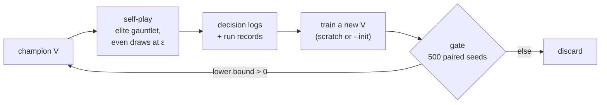

import { Aside } from '@astrojs/starlight/components';
import DecisionBars from '../../../../../components/v/DecisionBars.svelte';
import Generations from '../../../../../components/v/Generations.svelte';

V learns from runs the champion plays by itself. This section describes the loop as it ran in plan v6: the game the runs are played in (the elite gauntlet), how self-play explores, and how each generation's net was trained and gated. The general loop, and the combat net's side of it, are in [Learning: the loop](/en/arch/learning/loop/).

## 1. The elite gauntlet

The **elite gauntlet** (`run --gauntlet`) is a simplified run. Every macro decision is made as usual, by L0 on the node's clone. A plain monster combat is won at its start, with its rewards. Elites and bosses are fought by the SL combat planner, HP and potions carried in and out, and a death ends the run. Events, shops, rest sites and the map are the game's own.

Why this game:

- **Bosses and elites kill most runs.** The SL champion's whole runs then died at a boss in 134 of 200, while a plain monster combat cost 3% (act 1) to 18% of max HP on average.
- **It is cheap.** A gauntlet run takes 45–53 s of one process at the training budget, a fraction of a whole SL run.
- **Elites are fought.** A first version that also won elites at their start was dropped before it ran: V would have learned that more elites are always better.

**Budget.** The SL planner plays at its low budget (`--effort low --nodes 150 --beam 4 --easy-beam 0 --loss-plans 0 --replan 0`). Before choosing it, 515 boss doors were fought at full HP: two seeds at the low budget correlated 0.83, and the low and the medium budget on the same seed 0.94. So the cheap budget ranks loadouts as well as a second seed of the same budget does.

**Progress.** A gauntlet run's target is its progress: the floor reached, plus, for a run lost in a combat, the share of the enemies' HP taken in it; a won run ends on its last floor with its last boss all taken (+1). That is why the gauntlet's V has a share head ([From hazards to value §1](/en/arch/macro-brain/value/#sec-1)). A whole run's V refuses gauntlet runs, and the gauntlet's V refuses whole runs.

The price of this game is that V learns one in which monster fights are free. That is the main weakness it carries into whole runs ([Weaknesses and next steps §1](/en/arch/macro-brain/next/#sec-1)).

## 2. Exploration: even draws

V learns only from what the runs did. If self-play always took V's best option, the data would never show what the other options lead to, and V could never find out it was wrong about them. Self-play therefore sometimes plays another option on purpose. How it picks that option matters.

**Even draws** (`run --explore ε`). With chance ε, a macro decision's answer is drawn uniformly among its options, whatever V says; otherwise L0 takes V's best. With $n$ options and V's best $a^\ast$:

$$
P(a) = (1 - \varepsilon)\,[a = a^\ast] + \frac{\varepsilon}{n} .
$$

This covers every decision outside combat: a card reward's outcome among its cards and skipping (a skip drawn is never opened, a card drawn is opened and taken); a card prompt's picks (how many, evenly, then which); and every other screen's options, but the potion belt's and those that would come back to a state already decided ([Search §5](/en/arch/macro-brain/search/#sec-5)). ε is fixed per run. Every drawn answer is marked `explored` in the decision log, the champion's name ends in `eps ε`, and the gate refuses an exploring challenger.

**Softmax**, the alternative, draws each option with chance

$$
P(a) = \frac{\exp\big((V(a) - V(a^\ast))/T\big)}{\sum_b \exp\big((V(b) - V(a^\ast))/T\big)},
$$

so options near the best are tried often, poor ones seldom. It was V's exploration before the elite gauntlet, and it has two flaws for learning V:

- **It explores where V's options lie close, not where V may be wrong.** Card picks often lie within a small fraction of a floor of each other; rest sites and shop choices lie further apart. A softmax tries card picks far more often than rest sites at any temperature.
- **It follows V's own beliefs.** An option V thinks poor is almost never tried, so the data never holds the counterexample that would correct V. With V v0, at 75% HP, a softmax at T = 2 took smithing over a rest worth 18 HP more about once in 8,000.

Even draws have neither flaw: what is drawn depends neither on V nor on how well the run is going, so the drawn decisions' outcomes are causal evidence about the options, and every kind of decision is drawn as often. The figure compares the two on the running example's real decisions: at the n2-b0.03-era temperature T = 0.006 floors, the softmax almost never leaves V's best when the options lie apart, while ε = 0.15 draws each option with the same chance.

<DecisionBars client:visible lang="en" explore start="card_reward" />

**The tiers.** Each generation's runs are split into three tiers of ε, a third of the runs each: 1.0, 0.5 and 0.15 in generations 1–2, then 0.3, 0.15 and 0.05 from generation 3. At ε = 1.0 a run barely depends on V (progress 21.8 with pure-1-g, 21.2 with v6-1, while at ε = 0.15 it rose from 31.9 to 34.1), and about 69% of the training weight sat in act 1, whose boss the champion already beat 95% of the time. At ε = 0.15 a gauntlet run has about 102 decisions that can be drawn, and 15 of them are; rewards screens take more than half of the draws, card rewards and the map about an eighth each.

<Aside>

**A label carries the later draws.** A decision's label is how its run ended, and that includes the draws made after it. V is not told the run's ε: in generation 3's second box the three tiers reached a progress of 32.8, 36.4 and 39.1. The same state is thus labelled lower in a run that explores more. A cut point per run would remove this (draws before it, V's best after it, training only on the decisions after it), and is not done yet ([Weaknesses and next steps §4](/en/arch/macro-brain/next/#sec-4)).

</Aside>

## 3. Generations

A *generation* is one turn of the loop: the champion plays a batch of runs, a net is trained on them, and the net is gated. Plan v6 ran three:

| generation | played by | runs (decisions) | ε tiers | trained on | net | progress |
|---|---|---|---|---|---|---|
| 1 | pure-1-g | 5,775 (624,955) | 1.0 / 0.5 / 0.15 | generation 1 | v6-1, from scratch | 36.07 ± 0.34 |
| 2 | v6-1 | 6,080 | 1.0 / 0.5 / 0.15 | generations 1–2 (11,855 runs) | v6-2, from scratch | 40.69 ± 0.38 |
| 3 | v6-2 | 14,828 (2,160,792) | 0.3 / 0.15 / 0.05 | generation 3 alone | v6-3-1, from scratch | 42.42 ± 0.43 |
| | | | | generation 3 alone | v6-3-2, from v6-2's weights | 43.36 ± 0.38 |

Generation 3 was trained on its own runs alone: a weaker V's runs label states lower than the champion would now play them. Its two nets test where to start from, the same data from scratch and from the previous net's weights (`--init`); going on from v6-2 won by +0.94 ± 0.49.

The generations also changed how V plays. In the gauntlet pure-1-g, trained on whole runs, fought 2.37 elites a run and died in one in 95 of its 500 evaluation runs; v6-1, one generation later, fought 1.21 and died in 39. In the gauntlet's training runs every elite cost HP and every kind of decision was drawn evenly, so the outcomes of fighting an elite or not were in the data.

## 4. Gates

A new V replaces the champion only through a gate. In the gauntlet, the challenger plays the 500 evaluation seeds 300000–300499, with no exploration, at the training budget, on the clone; the champion's runs on the same seeds are already there. The runs are paired by seed: for seed $i$, $d_i$ is the challenger's progress minus the champion's, and with $n$ pairs

$$
\bar d = \frac{1}{n}\sum_i d_i, \qquad \mathrm{SE} = \frac{\mathrm{sd}(d)}{\sqrt n}, \qquad \text{promote if } \bar d - 1.645\,\mathrm{SE} > 0,
$$

that is, when the 95% one-sided lower bound of the mean difference is above 0. A seed fixes the map, the encounters and the rewards up to where the two policies diverge, so most of a run's luck is shared by both sides and cancels in $d_i$ (common random numbers). `learn/gauntlet.py` computes this; a gate takes 16–20 minutes on the hosts ([Evaluation: gates §11](/en/arch/evaluation/gates/#sec-11)).

<Generations client:visible lang="en" />

The dots are the mean progress on the 500 evaluation seeds, the whiskers 95% confidence intervals (±1.96 standard errors); the first table gives each act's boss beaten, as a share of the runs that reached it, and the runs won. Each generation passed its gate: v6-1 +1.60 ± 0.44 against pure-1-g (lower bound +0.88), v6-2 +4.62 ± 0.46 against v6-1 (+3.86), v6-3-2 +2.67 ± 0.49 against v6-2 (+1.87). The reference lines are n2-b0.03 (33.71) and every decision drawn evenly (21.89): V's choices are worth about 21 floors of progress over random ones.

**In whole runs** (the second table: SL, 300 seeds of `promotion-1-300`, the SL champion's planner at medium effort, on the clone), v6-3-2 reaches floor 33.56 and wins 23 runs, beating the bosses of acts 1–3 in 95%, 55% and 35% of the runs that reach them. On 2026-10-30 it became the V of both champions by this report ([Evaluation: champions and baselines §4](/en/arch/evaluation/champions/#sec-4)).

## 5. Where the gauntlet's order did not carry over

The gauntlet ranks V's by progress in a game where monsters are free. Whole runs do not always agree:

| | gauntlet progress | whole runs: floor | whole runs: won of 300 |
|---|---|---|---|
| v6-3-1 against v6-2 | +1.73 ± 0.54 | −0.26 ± 0.70 | 13 against 1 |
| v6-3-2 against v6-2 | +2.67 ± 0.49 | +2.20 ± 0.62 | 23 against 1 |

v6-3-1 is clearly better in the gauntlet and wins far more whole runs, yet reaches no higher a floor on average. Floors and wins disagree, and the gauntlet measures neither directly. That is one reason the next plan trains and gates V in whole runs, on wins ([Weaknesses and next steps §2](/en/arch/macro-brain/next/#sec-2)).
