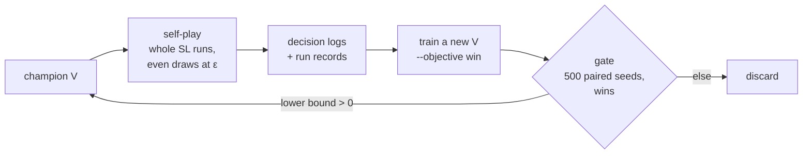

import { Aside } from '@astrojs/starlight/components';

V learns from runs the champion plays by itself. This section describes that loop for V: the runs, how they explore, how a generation trains a net, and how the net is judged. The general loop, and the combat net's side of it, are in [Learning: the loop](/en/arch/learning/loop/).

## 1. The loop



## 2. The runs

Self-play plays the whole game, SL: every macro decision is made by L0 on the node's clone ([Search §2](/en/arch/macro-brain/search/#sec-2)), and every combat, plain monster fights included, is fought by the SL combat planner with its combat net.

```text
run --env SL --policy plan --macro l0 --afterstates clone --workers 4 --effort medium --asc 10 \
    --combat-net weights/silent/c8-3.json --value weights/silent/V.json --explore ε --macro-explore 0.03 --seed 1
```

**Budget.** The newest generation, `v8g2`, plays at the champion's medium effort, which gates play too, at about 290 s per run. `v7g1` played at the planner's low budget, at about 45–85 s of one slot per run. A cheap budget gives far more runs for the same compute, and it ranks loadouts about as well: on 515 boss doors fought at full HP, the low and the medium budget on one seed correlated 0.94, and two seeds of the low budget 0.83 ([The SL planner: budget, cost and results §2](/en/arch/sl-planner/budget/#sec-2)).

## 3. Exploration: even draws

V learns only from what the runs did. If self-play always took V's best option, the data would never show what the other options lead to, and V could never find out it was wrong about them. Self-play therefore sometimes plays another option on purpose.

**Even draws** (`run --explore ε`). With chance ε, a macro decision's answer is drawn uniformly among its options, whatever V says; otherwise L0 takes V's best. With $n$ options and V's best $a^\ast$:

$$
P(a) = (1 - \varepsilon)\,[a = a^\ast] + \frac{\varepsilon}{n} .
$$

This covers every decision outside combat: a card reward's outcome among its cards and skipping (a skip drawn is never opened, a card drawn is opened and taken); a card prompt's picks (how many, evenly, then which); and every other screen's options, but the potion belt's and those that would come back to a state already decided ([Search §5](/en/arch/macro-brain/search/#sec-5)). ε is fixed per run. Every drawn answer is marked `explored` in the decision log, the champion's name ends in `eps ε`, and the gate refuses an exploring challenger.

**Why even.** What is drawn depends neither on V nor on how well the run is going, so the drawn decisions' outcomes are causal evidence about the options, including the ones V thinks poor, and every kind of decision is drawn as often. A draw weighted by V's own values would try options V already likes, and seldom the counterexamples that would correct it.

**The tiers.** A generation's runs are split into three tiers of ε: 0.3, 0.15 and 0.05 in `v7g1`; 0.15, 0.08 and 0.03 in `v7g2`; 0.06, 0.03 and 0.01 in `v8g2`. In the last two a softmax draws the decisions ε leaves to V ([Learning: the loop §9](/en/arch/learning/loop/#sec-9)). A higher ε covers more options per run; a lower one reaches the late floors, where the decisions that win a run are.

<Aside>

**A label carries the later draws.** A decision's label is how its run ended, and that includes the draws made after it. V is not told the run's ε, so the same state is labelled lower in a run that explores more ([Weaknesses and next steps §1](/en/arch/macro-brain/next/#sec-1)).

</Aside>

## 4. A generation

A *generation* is one turn of the loop.

1. **Play.** The champion plays one time-boxed job per tier, side by side. The number of runs is not fixed: every slot keeps playing until a deadline, which sits in a file on each host and can be moved while the job runs. Train seeds come from a block entered in the ledger before the job starts, far more per tier than can be played (20,000), and never overlap the gate's seeds.
2. **Train.** A new V is trained on this generation's runs alone. Runs played by a weaker V label states lower than the champion would now play them, so older generations are not mixed in. It goes on from the previous net's weights (`--init`) when there is one of this structure, and starts from scratch otherwise ([From hazards to value §5](/en/arch/macro-brain/value/#sec-5)).
3. **Gate.** The new V faces the champion ([§5](#sec-5)).
4. **Promote.** A net that passes replaces the V of both champion files ([Evaluation: champions and baselines §1](/en/arch/evaluation/champions/#sec-1)), and the next generation plays with it.

The size of a generation, from the latest one played:

| ε | runs |
|---|---|
| 0.06 | 3,603 |
| 0.03 | 3,283 |
| 0.01 | 3,152 |
| **all** | **10,038**, of which 165 won and none failed |

Failed runs are dropped when the samples are read ([From hazards to value §3](/en/arch/macro-brain/value/#sec-3)).

## 5. The gate

A new V is judged by a gate. v8-3, the champion's V, passed its gate at ascension 10 by paired wins, over both combat nets ([Evaluation: champions and baselines §2](/en/arch/evaluation/champions/#sec-2)). The challenger plays the 300 seeds of `promotion-1-300` with no exploration, at the champion's medium planner budget, on the clone, and the champion's runs on the same seeds are its record, played where it lacks them. It also plays the same seeds at the low budget, a reference that decides nothing. The runs are paired by seed: for seed $i$, $d_i$ is 1 or 0 for the challenger's win less 1 or 0 for the champion's, and with $n$ pairs

$$
\bar d = \frac{1}{n}\sum_i d_i, \qquad \mathrm{SE} = \frac{\mathrm{sd}(d)}{\sqrt n}, \qquad \text{promote if } \bar d - 1.645\,\mathrm{SE} > 0,
$$

that is, when the 95% one-sided lower bound of the mean difference is above 0. A seed fixes the map, the encounters and the rewards up to where the two policies diverge, so most of a run's luck is shared by both sides and cancels in $d_i$ (common random numbers). At 500 seeds this takes about 2–3 percentage points more wins. If two nets pass, the one with more wins goes on.

At ascension 10 the gate plays the first 200 of those seeds, and reads the same paired wins with the floors listed beside them.

`learn/gauntlet.py --against` computes it ([Evaluation: gates §10](/en/arch/evaluation/gates/#sec-10)). Its report also keeps what the wins do not show: the mean floor, each act's boss reached and beaten, where the lost runs died (boss, elite, monster or outside combat, per act), the elites per run, the rest sites' choices and the map's choices between a monster and a rest site by HP share, and what the shops sold.
