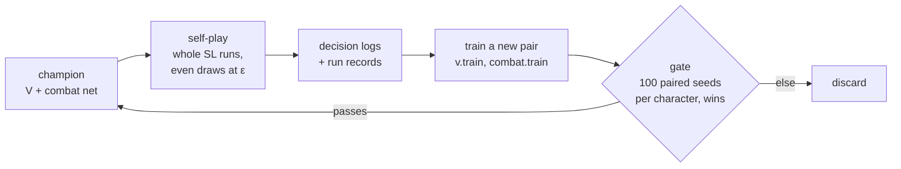

import { Aside } from '@astrojs/starlight/components';

V learns from runs the champion plays by itself. This section is that procedure, step by step: the runs, how they explore, how a generation is played and trained, and how the new nets are judged. The general loop, and the combat net's side of it, are in [Learning: the loop](/en/arch/learning/loop/).

## 1. The loop



## 2. The runs

Self-play plays the whole game, SL: every macro decision is made by L0 on the node's clone ([Search §2](/en/arch/macro-brain/search/#sec-2)), and every combat, plain monster fights included, is fought by the SL combat planner with its combat net. It plays the champion as it is, with one option added, `--explore`:

```text
run --champion eval/champions/sl.json --character CHARACTER --asc N --workers 4 \
    --explore ε --seed 1 --start K --n RUNS --log DIR/log.jsonl --records DIR/rec.jsonl
```

- `--champion` takes the champion file's options: SL, the planner at the medium budget, L0 on the clone, the champion's V and combat net ([Evaluation: champions and baselines §1](/en/arch/evaluation/champions/#sec-1)). An option given on the command line wins over the file's.
- `--character` and `--asc` are the job's: every character, at every ascension from 0 to 10 ([§4](#sec-4)).
- `--explore ε` is the share of macro decisions drawn evenly ([§3](#sec-3)).
- `--seed 1 --start K --n RUNS` plays the train seeds with indices K to K + RUNS − 1 ([§4](#sec-4)).
- `--log` and `--records` write the decision log and the run records, one JSON line per decision and one per run ([Harness: the decision log](/en/arch/harness/decision-log/), [Evaluation: metrics, seeds and reports §8](/en/arch/evaluation/metrics/#sec-8)). `DIR` is the job's folder under `data/CHARACTER/sl/` ([Learning: reference §3](/en/arch/learning/reference/#sec-3)).
- `--workers` is how many search processes a run uses (by default 8).

How to build and start the simulator is in [Simulator: reference §1](/en/arch/simulator/reference/#sec-1).

**Budget.** Self-play plays at the champion's own budget, medium, the one it is judged at. V is the chance to win under the champion's play ([From hazards to value §1](/en/arch/macro-brain/value/#sec-1)), so its labels come from runs played as the champion plays them.

## 3. Exploration: even draws

V learns only from what the runs did. If self-play always took V's best option, the data would never show what the other options lead to, and V could never find out it was wrong about them. Self-play therefore sometimes plays another option on purpose.

**Even draws** (`run --explore ε`). With chance ε, a macro decision's answer is drawn uniformly among its options, whatever V says; otherwise L0 takes V's best. With $n$ options and V's best $a^\ast$:

$$
P(a) = (1 - \varepsilon)\,[a = a^\ast] + \frac{\varepsilon}{n} .
$$

This covers every decision outside combat: a card reward's outcome among its cards and skipping (a skip drawn is never opened, a card drawn is opened and taken); a card prompt's picks (how many, evenly, then which); and every other screen's options, a potion's among them, but those that would come back to a state already decided ([Search §5](/en/arch/macro-brain/search/#sec-5)). A potion's options are those L0 weighs: a potion usable out of combat (Fruit Juice, Blood Potion, Entropic Brew, Ambergris, the Foul Potion at a merchant), and a discard only where it makes room for a potion the screen offers ([Search §1](/en/arch/macro-brain/search/#sec-1)). ε is fixed per run. Every drawn answer is marked `explored` in the decision log, the champion's name ends in `eps ε`, and the gate refuses an exploring challenger.

**Why even.** What is drawn depends neither on V nor on how well the run is going, so the drawn decisions' outcomes are causal evidence about the options, including the ones V thinks poor, and every kind of decision is drawn as often. A draw weighted by V's own values would try options V already likes, and seldom the counterexamples that would correct it.

**The tiers.** A generation's runs are split into three tiers of ε, a third of the runs each: 0.3, 0.1 and 0.02. A higher ε covers more options per run; a lower one reaches the late floors, where the decisions that win a run are.

<Aside>

**A label carries the later draws.** A decision's label is how its run ended, and that includes the draws made after it. V is not told the run's ε, so the same state is labelled lower in a run that explores more ([Weaknesses and next steps §1](/en/arch/macro-brain/next/#sec-1)).

</Aside>

## 4. A generation

A *generation* is one turn of the loop: one dataset, played by one champion.

1. **Play.** The champion plays one job per character, tier and ascension (5 × 3 × 11 jobs), side by side, each with the command of [§2](#sec-2). The number of runs is not fixed: a job may be given more seeds than it plays, and the generation is the runs its jobs finished.
2. **Seeds.** Train seeds are `run --seed 1 --start K`, the seed of index K. Each generation takes a block of 100,000 indices of its own, and each job plays its own range in it, so no two runs of a generation share a seed. The evaluation's seed files are made from other bases, and the trainers refuse a list that holds an evaluation job's runs (`common.train_lists`), so a train seed never meets a test seed ([Learning: reference §5](/en/arch/learning/reference/#sec-5)).
3. **List.** The jobs' decision logs and run records go into a list pair, `PREFIX-logs.txt` and `PREFIX-recs.txt`, one file per line, line i of one the log of the records on line i of the other ([Learning: reference §4](/en/arch/learning/reference/#sec-4)).
4. **Train.** A new V and a new combat net are trained on this generation's runs alone, each going on from the champion's file (`--init`), run from `learn/`:

   ```text
   uv run python -m v.train --list PREFIX --name NAME --init ../VALUE
   uv run python -m combat.train --list PREFIX --env SL --name NAME --init ../COMBAT_NET
   ```

   `VALUE` and `COMBAT_NET` are the champion file's `value` and `combat-net`, paths from the repository's root; `NAME` is a new name, never one already used ([Learning: reference §6](/en/arch/learning/reference/#sec-6)). Each writes `weights/all/NAME.json` ([From hazards to value §5](/en/arch/macro-brain/value/#sec-5), [Learning: the combat net §4](/en/arch/learning/combat-net/#sec-4)). Runs played by a weaker champion label states lower than the champion would now play them, so older generations are not mixed in.
5. **Gate.** The new pair faces the champion's ([§5](#sec-5)).
6. **Promote.** A pair that passes replaces the V and the combat net of both champion files ([Evaluation: champions and baselines §1](/en/arch/evaluation/champions/#sec-1)), and the next generation plays with it.

Failed runs are dropped when the samples are read ([From hazards to value §3](/en/arch/macro-brain/value/#sec-3)).

## 5. The gate

A new V is judged together with the combat net trained on the same data: the champion's pair of nets and the new pair both play the same 100 seeds of `promotion-1-100` with every character, with no exploration, and each character's runs are paired by seed and compared by wins. The five characters are read together, since one champion plays them all. The procedure, its commands and its rule are in [Evaluation: gates §10](/en/arch/evaluation/gates/#sec-10).

The gate plays because no held-out score can decide: the Brier score measures how well V tells apart states of different runs, not whether it orders one state's options correctly ([From hazards to value §6](/en/arch/macro-brain/value/#sec-6)).
