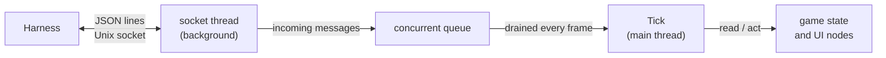

import { Aside, Badge, FileTree } from '@astrojs/starlight/components';

The mod is the AI's host inside the real game. The game's own mod loader loads it into the game process. It observes the game through GameBridge, asks Harness (in the separate decision process) for a recommendation over a local socket, and then either shows the answer to the player (assist mode, see [Output](/en/arch/output/)) or executes it (auto-play), logging every step. Search, learning and strategy all live in the decision process; the mod only connects the game to it.

<Aside title="Status">

Assist mode is built for every surface, in both environments: `src/Sts2Ai.Mod` loads in the real game (v0.111.0, started from Steam), connects to the brain, asks about each decision once the screen on top is idle (combat, card prompts, map, rewards, card reward, bundle, event, shop, rest site, treasure, crystal sphere), and shows the answer in a text panel with the game's names ([§3](#sec-3), [§5](#sec-5)). A box on the panel picks SL or NoSL assist. In SL the mod sends the node's checkpoint and every step taken in the node, so the brain plans each combat on the node's clone ([§6](#sec-6)); in the real game 89 of 90 SL decisions replayed on their clones asked the same decision, and the other one's cause is fixed ([§12](#sec-12)). It has not been watched through a whole real run yet. Planned: the executor adapters ([§4](#sec-4)), the auto-run driver ([§7](#sec-7)) and the decision log ([§8](#sec-8)). Earlier research is in the local notes `tmp/notes/mod-research.md` and `tmp/notes/output-design.md`.

</Aside>

## 1. Role

The mod is a thin host in the real game. It does four things: observe the game (through GameBridge), ask Harness over a socket, render the answer ([Output](/en/arch/output/)) and/or execute it, and log. It runs no search, no learning and no strategy inside the game process. It supports single-player only and is disabled in multiplayer.

The project is `src/Sts2Ai.Mod`. It builds against the game DLLs (plus GodotSharp, the C# API of the Godot engine) and compiles in the sources of GameBridge and Protocol ([§2](#sec-2)). It does not reference Brain.

## 2. Loading

How the game finds and starts a mod. Everything in this section was read in the game source and holds for the mod in the game on this machine <Badge text="verified" variant="success" />.

The game scans its `mods/` folder recursively for manifests, and loads the DLL named `<id>.dll` that sits next to each manifest (`Modding/ModManager.cs`). The game folder on this machine is `~/.local/share/Steam/steamapps/common/Slay the Spire 2`. Inside it:

<FileTree>

- mods/
  - Sts2Ai/
    - Sts2Ai.json the manifest
    - Sts2Ai.dll the mod itself (`<id>.dll`), with GameBridge and Protocol inside

</FileTree>

- **Manifest** fields: `id`, `version`, `has_dll:true`, `has_pck:false` (no Godot resource pack), `affects_gameplay:false`, `min_game_version:"0.111.0"`. `affects_gameplay` only matters for the multiplayer handshake, and the mod refuses multiplayer anyway.
- **Consent:** the player agrees to mod loading once, with a click in the game. The answer, `PlayerAgreedToModLoading`, is stored in `settings.save` as `mods_enabled`. Mods are loaded at startup only.
- **Profile:** modded runs use a separate profile folder, `modded/`, copied from the vanilla (unmodded) profile on first use.
- **Entry point:** a static method marked `[ModInitializer(nameof(Init))]`. It runs before `ModelDb.Init`, so any work that touches game models is deferred to the first frame or to `RunStarted`.
- **Version guard:** if the game version differs from the pinned one, the mod refuses to activate and shows the reason in the panel.
- **One DLL:** the loader lists the mod's types (`Assembly.GetTypes`) before it calls the entry point, and the game's assembly load context (the .NET mechanism that decides where an assembly's dependencies are found) does not look in the mod's folder. A type that needs a DLL shipped next to `Sts2Ai.dll` fails that listing, and the mod is not loaded; a resolver installed by `Init` comes too late. So the mod project compiles the sources of GameBridge and Protocol into `Sts2Ai.dll`.
- **Install:** `dotnet build src/Sts2Ai.Mod/Sts2Ai.Mod.csproj -t:Install` builds the mod and copies `Sts2Ai.json` and `Sts2Ai.dll` into `mods/Sts2Ai/`. The game picks up a new mod at the next start, enabled.

## 3. Main-thread loop and idle

**One thread for the game.** Godot, like most game engines, expects game state and UI nodes to be touched only from its main thread. So every game read and write happens inside one per-frame callback, `Tick`, attached with `GetTree().ProcessFrame += Tick`. `ProcessFrame` is a plain C# event raised once per frame, so the mod needs no Godot source generators. Waiting on a socket would stall the frame, so socket IO runs on a background thread, which puts incoming messages into a concurrent queue; `Tick` drains that queue every frame. This is the pattern of STS2MCP (MIT license, [§11](#sec-11)).



**The loop.** A *surface* is the kind of decision screen being shown: combat, map, shop, a card prompt and so on. Each frame, `Tick` applies three rules:

| on this frame | the mod |
|---|---|
| the surface has been idle for at least 3 frames in a row, and `obs_hash` changed | sends `decision` |
| a `recommendation` arrived whose hash matches the current one | renders and/or executes it ([§4](#sec-4)) |
| the hash changed | sends `cancel` (the state moved on, so the brain drops that search) |

`obs_hash` is a hash of the observation (FNV-1a 64 over its canonical JSON, [Protocol §2](/en/arch/protocol/#sec-2)), so a new hash means something visible changed.

**One decision in flight.** The brain answers decisions in order, one at a time. So the mod keeps at most one decision open: when the state moves on before the answer comes, it sends `cancel` and waits for that answer (and drops it) before it asks about the new state. A slow brain then never falls behind a player who acts faster than it thinks.

**Idle.** "Idle" means the game UI is really ready for the player's input: the game logic is waiting, no queued actions remain, nothing is still being played out, and no other screen covers the one being decided. A decision sent earlier would describe a state that is about to change, and a click might not land. Headless, GameBridge's `CombatActions.WaitingForInput` is enough; in the real game it is not ([GameBridge §2](/en/arch/gamebridge/#sec-2)). So the mod reads the screen the player is looking at from the game's own `ActiveScreenContext.GetCurrentScreen()`: the open modal, the map if open, the top of the overlay stack, else the current room. Its type picks the surface <Badge text="verified" variant="success" />. The decision must then hold for at least 3 frames, so that a moment that looks idle only briefly does not count.

| screen on top | surface | idle when |
|---|---|---|
| `NCombatRoom` (also an event's combat) | combat | `CombatActions.WaitingForInput`, `ActionQueueSet.IsEmpty`, `Hand.CurrentMode == Play && !InCardPlay` |
| `NCombatRoom`, hand in a select mode | card prompt | `NPlayerHand.IsInCardSelection` |
| a grid select screen, `NCombatPileCardSelectScreen`, `NChooseACardSelectionScreen` | card prompt | on top: the game waits on it inside an action, so the queue is not checked |
| `NCardRewardSelectionScreen`, `NChooseABundleSelectionScreen` | card reward, bundle | on top |
| `NRewardsScreen`, `NCrystalSphereScreen`, `NMapScreen` with travel enabled | rewards, crystal sphere, map | on top, and `ActionQueueSet.IsEmpty` |
| `NEventRoom` (and the fake merchant's screens), `NMerchantRoom` or its inventory, `NRestSiteRoom`, `NTreasureRoom` once the relics are shown | event, shop, rest, treasure | on top, and `ActionQueueSet.IsEmpty` |

A surface is asked as the simulator asks it (`RunSession`), with the same GameBridge calls, so the brain sees the same observations and legal actions in both. The potion belt's actions are offered on the same screens: everywhere but the card reward, the bundle and card prompts. What a screen offers is read from the screen node's private fields, which hold exactly what it shows: the rewards set, the card reward's cards and buttons, the bundles, the prompt's cards and `CardSelectorPrefs`. The hand's select mode and a combat pile prompt filter a pile instead, so the mod applies their filter to the pile.

**Card prompts.** The prompt's options are put in canonical order (`CardChoices.Canonical`) with a fixed tie-break seed, so the observation and its hash hold still from frame to frame. Its context comes from `ChoiceContexts.Last` ([GameBridge §5](/en/arch/gamebridge/#sec-5)): the screen opens after the entry's first await, when `Current` is already gone. Each prompt (a new screen node, or a new hand selection) takes the latest context once. When that context was already used by an earlier prompt, the prompt came without one: the mod logs it and leaves the prompt to the player.

**Answers.** An answer is for one observation hash and one set of legal actions: a rest site can allow leaving with the same observation once an option has been used. In combat the panel names the plan up to the turn's end; the SL planner plans the whole combat, and its later turns, which play cards not drawn yet, are only counted. The panel describes the action with names from the game's localization tables (cards, relics, potions, monsters, event options, rest options, the map legend's room names), falling back to ids. On the map it also draws the route: a pulsing purple ring on the recommended point, and a purple line along each path of the route the brain plans after it, up to the boss. Both are in the mod's own layer and follow the game's nodes (the points, and each path's dots) as the map scrolls ([Output §3](/en/arch/output/#sec-3)).

**Unknown surface.** In assist mode, a screen that asks nothing the mod knows (a modal, the deck view, a chest still closed) shows only the status line; the closed chest adds "open the chest". For auto-play: if no adapter matches, or the idle check holds but there are no legal actions, the mod pauses auto-play, the panel says "manual needed", and the mod logs a coverage bug. It never falls back to a random action.

## 4. Executor adapters

An adapter connects one surface's protocol actions to the Godot nodes on screen. GameBridge never touches Godot nodes ([GameBridge §1](/en/arch/gamebridge/#sec-1)), so this node-side work lives in the mod. One interface serves both output modes: highlighting asks where an action is on screen, auto-play asks the adapter to perform it.

```csharp
// One adapter per surface; highlight and auto-play share the action → node mapping.
interface ISurfaceAdapter
{
    string Surface { get; }
    bool Matches();                       // current screen/room is this surface
    Control? AnchorFor(string action);    // node to highlight; null = panel only
    bool Execute(string action);          // same entry point a human click reaches
}
```

What `Execute` calls on each kind of surface:

| surface | `Execute` |
|---|---|
| combat | `CombatActions.Start` (GameBridge); ends the turn only if `CanTurnBeEnded` |
| buttons | calls the button's handler, but only after checking `IsEnabled && IsVisibleInTree()`. `ForceClick` checks neither <Badge text="verified" variant="success" /> |
| shop | `entry.OnTryPurchaseWrapper(inv)`. `ForceClick` on merchant nodes does nothing |
| map | `NMapScreen.OnMapPointSelectedLocally(point)` |
| card prompts | clicks the card holders, then confirm. This UI path keeps `PlayerChoice` in the replay record ([GameBridge §4](/en/arch/gamebridge/#sec-4)) |

After `Execute`, the mod expects the hash to change within a timeout: 10 s by default at game speed Fast, 3 s at Instant. If it does not change, the mod observes again. After 3 failures in a row it pauses and logs.

For each surface, the mod path and the matching simulator path are listed side by side in [GameBridge §4](/en/arch/gamebridge/#sec-4).

## 5. Brain link

- **Socket:** the Unix domain socket `~/.local/state/sts2ai/brain.sock` (under `$XDG_STATE_HOME` when that is set), carrying JSON lines ([Protocol §2](/en/arch/protocol/#sec-2)). The mod is the client and Harness is the server. Harness is started by the user, or spawned by the mod from a configured path; the mod never runs search itself. The server exists: SimWorker's `brain` command listens there, and `run --brain` already hosts simulated runs against it ([Simulator §5](/en/arch/simulator/#sec-5)).
- **Steam's container:** Steam starts the game inside its Linux runtime container (pressure-vessel), which shares the home directory with the host but has its own `$XDG_RUNTIME_DIR`. A socket there cannot be reached from the game, so the socket lives under the home directory. The brain creates its folder readable by the user only.
- **Environment:** the panel's SL box picks it: ticked is SL, otherwise NoSL ([Environments](/en/arch/environments/)). The box starts ticked; the choice is kept in `~/.local/state/sts2ai/env`, beside the socket and outside the game's profile. `hello` carries it, and it holds for the run as the brain sees it: switching in the middle of a run sends `run_end` (`aborted`) and a new `hello`, so the brain starts a new run at that point. One brain serves both: `brain` plays NoSL hosts with the combat brain of `--policy` (the champion's PIMC) and SL hosts with that of `--sl-policy` (the SL planner by default), with the same macro brain ([Harness §4](/en/arch/harness/#sec-4)).
- **Brain unreachable:** in assist mode the panel says "no brain"; in auto-play the mod pauses. The link tries again every 2 s; a new connection starts again from `hello`.
- **Brain error:** an `error` answer (the brain refused the run, or could not answer) turns the mod off for the rest of that run; the panel shows the message.

## 6. SL export

In SL the brain plans a combat on an exact clone of the current node ([Environments §6](/en/arch/environments/#sec-6)). A worker builds the clone from the node's checkpoint and every decision taken in the node since, named as the simulator's own trace names them ([Simulator §7](/en/arch/simulator/#sec-7)). The mod keeps both in memory (`NodeRecord`) in both environments, so ticking the SL box works in the room the player is in; only SL sends them.

- **Checkpoint:** taken with GameBridge's `Checkpoint.Take` when the game saves on arrival at a map point: a prefix on `SaveManager.SaveRun` when its finished room is null, the moment the simulator takes it too. Run start enters its first point the same way. A continued run enters its saved point again without saving (`RunManager.LoadIntoLatestMapCoord`): saved on arrival, the checkpoint is taken there; saved later in the room (after its fight, after an ancient), the room's start is gone and the node has no clone. The mod never writes `current_run.save`, which is cloud-synced, or any other file under the profile.
- **Steps:** each of the player's decisions is read where the game commits it, at the entry points the simulator calls too ([GameBridge §4](/en/arch/gamebridge/#sec-4)), so the step is known exactly, before the game plays it. This settled open question 1 for hooks rather than a diff of the states before and after: a diff cannot tell two copies of a card apart, and misses the actions a player queues faster than the screen settles.

| the player | hooked (Harmony prefix) | step |
|---|---|---|
| plays a card, uses or throws away a potion, ends the turn, travels | `ActionQueueSynchronizer.RequestEnqueue` with `PlayCardAction`, `UsePotionAction`, `DiscardPotionGameAction`, `EndPlayerTurnAction`, `VoteForMapCoordAction` | `combat play:…`, `combat potion:…`, `combat end_turn`; outside combat the belt's `potion:S` or `discard_potion:S` on the screen it is used on; `map map:C,R` |
| answers a card prompt, a card reward, a bundle | `PlayerChoiceSynchronizer.SyncLocalChoice` | `card_choice I,J` (the game's own indexes), `card_reward card:I` or `card_alt:ID`, `bundle bundle:I` |
| picks an event option, a rest option | `EventSynchronizer.ChooseLocalOption`, `RestSiteSynchronizer.ChooseLocalOption` | `event event:I`, `rest rest:ID` |
| takes a reward, proceeds from the rewards | `RewardsSetSynchronizer.SelectLocalReward`; on a rewards screen `SkipLocalRewardsSet`, `ProceedFromTerminalRewardsScreen`, `ActChangeSynchronizer.SetLocalPlayerReady` | `rewards reward:I`, `rewards rewards_done` |
| takes or skips a chest's relic | `TreasureRoomRelicSynchronizer.PickRelicLocally` | `treasure relic:I`, `treasure relic_skip` |
| buys, removes a card | `MerchantEntry.OnTryPurchaseWrapper`, `MerchantCardRemovalEntry.OnTryPurchaseWrapper` | `shop buy:I`, `shop remove` |
| divines | `CrystalSphereMinigame.CellClicked` | `crystal_sphere big:X,Y`, `crystal_sphere small:X,Y` |
| leaves an event, a shop, a rest site | the map asking for the travel | `event proceed`, `shop leave`, `rest leave` |

A card play's card comes from the action's `NetCombatCard`: the action looks its card up only once it runs. A target is kept only for the cards and potions that pick one, as the legal actions name them. A purchase or a divination that changes nothing (too little gold, a cell already uncovered) is no step. The same calls that leave a chest, or a fight without rewards, are no step either: only those on a rewards screen are. An event option, a rest option, a reward, a purchase and a divination run as the game's own tasks, and the screen shows a step's result only once its task ends; until then the mod asks nothing on that surface, as the simulator waits for its running tasks.
- **Broken record:** a step the simulator has no decision for ends the record for the rest of the node: a potion thrown away in combat, a turn end taken back, a card reward closed unanswered, a choice on a screen the mod does not read. Then, and in a node without a checkpoint, SL combat decisions are not asked: the panel says why, and the next node has a clone again. Card prompts and the decisions outside combat are still asked, as their brains need no clone. A hook never lets an exception reach the game: it breaks the record instead, and logs.
- **Sending:** before each decision in SL the mod sends the node's checkpoint once (`node_checkpoint`), then the steps the brain has not had yet (`node_action`, numbered from 0 in the node, [Protocol §2](/en/arch/protocol/#sec-2)). Steps after the node's last decision, such as its travel, are never needed and not sent. Nodes are numbered from the first node the game entered while the mod ran.
- **NoSL:** the record is kept but never sent. Any `node_checkpoint` in a NoSL log makes the run invalid.

## 7. Auto-run driver

The driver plays whole runs by itself in the real game. It exists for R4 evaluation: R4 is the real-game rung of the [sim-to-real ladder](/en/arch/evaluation/#sec-1).

- **Seeded start:** call `NGame.StartNewSingleplayerRun(character, shouldSave:false, acts, modifiers, seed, GameMode.Standard, asc)` (`Nodes/NGame.cs:1137`) with the act selection the lobby would make ([Simulator §5.1](/en/arch/simulator/#sec-5.1)). The alternative is to set `NGame.DebugSeedOverride` before the Confirm button is pressed (`AutoSlayer.cs:500-502`).
  With `shouldSave:false`, `current_run.save` stays untouched, as the parameter doc says (`NGame.cs:1130`) <Badge text="verified" variant="success" />. Run history and progress are probably still written <Badge text="inferred" variant="caution" />, so auto-runs use the modded profile only.
- **Run end:** detect death (all players dead) or `WinRun`; record `run_end`; return to the main menu; take the next seed from the pre-registered list.
- **Speed:** set `PrefsSave.FastMode = Instant` only while auto-run is active. Two game behaviors matter here: non-editor builds downgrade Instant to Fast at startup, and prefs are saved on quit. So the mod restores the user's own value both when auto-run stops and when the game quits.
- **Abandon or crash:** the seed is recorded as `aborted`, with the reason. A seed is never re-run to pick a better result.

## 8. Logs and R3 = R4

- **Per decision**, the log records: observation, legal actions, recommendation, executed action, latency, environment, game version, mod version, and `NumReloads` (must be 0).
- **Equivalence test:** the same seed and the same decision sequence, played in the simulator (R3) and in the game (R4), must give an identical observation stream. A divergence means a bug in the bridge or the simulator; the test reports the first divergence.

## 9. Controls and safety

| control | effect |
|---|---|
| F8 | show / hide the panel |
| SL box | SL or NoSL assist ([§5](#sec-5)) |
| F9 | pause / resume auto-play |
| step mode | one action per key press |
| Space (semi-auto) | the highlights show the plan; Space executes `plan[0]` |

- Auto-play runs only in single-player runs; any multiplayer lobby disables it.
- Never: state edits, the console, save writes, reloads, or putting the seed or RNG state into messages (`RunView` excludes the seed).

## 10. Patches and JIT

A **Harmony patch** rewrites a game method at runtime: Harmony is a .NET library that lets a mod run its own code before the original method (a *prefix*) or after it (a *postfix*). The mod prefers the game's own C# events over Harmony: `CombatManager.*`, `RunManager.RoomEntered`, `ActionExecutor.*`, `CardPile.*`.

The unavoidable patches are the context prefixes on `CardSelectCmd.From*` ([GameBridge §5](/en/arch/gamebridge/#sec-5)). They are installed first, before anything else compiles game code: a caller compiled before the patch can inline an entry and bypass it. This was seen headless, where SapphireSeed was inlined while another patch recompiled it. Their other risk is the JIT. The game runs with .NET *tiered compilation*: a method is first compiled quickly, and frequently used methods are later compiled again with optimizations (a "rejit"). A rejit can drop a patch silently; this was seen headless.

Mitigation:

- **Heartbeat:** each patch bumps a counter.
- **Missing context:** when a prompt arrives without a context, the mod logs it and shows a warning in the panel.
- **Launch flag:** recommend launching the game with `DOTNET_TieredCompilation=0` <Badge text="inferred" variant="caution" />. Needs checking: whether the game's hosted runtime honors it (open question 2, [§13](#sec-13)).

## 11. Prior art

STS2MCP (MIT license) is an existing mod that lets outside programs drive STS2 over HTTP.

**Copy:**

- the main-thread queue drained on `ProcessFrame` ([§3](#sec-3));
- its per-screen action code, as a reference.

**Avoid:**

- raw `new PlayCardAction`: it skips `CanPlayTargeting` and the play effects;
- ending the turn directly;
- exposing the seed / path;
- HTTP with CORS `*`: any web page could drive the game. We use a Unix socket only.

## 12. Tests

- **Load:** the mod initializes, the version guard works, the panel shows.
- **Surface coverage in the real game:** scripted R4 runs hit every surface; the fallback / manual count is 0.
- **Idle check:** no decision is sent mid-animation. Log decisions with the frame index, and check that none overlaps queued actions.
- **SL export round trip:** `brain --wire FILE` writes every message the hosts send. `clones --wire FILE` loads each SL decision's clone, the checkpoint and the steps sent before the decision, and checks that the clone asks the same decision next, observation for observation; a difference names the first field that differs. On the simulator's own export (one SL run, 455 decisions) every decision is the same. In the real game, on floors 2–5 of one SL run played with assist on (4 nodes: 3 combats and an event), 89 of 90 SL decisions were the same. The other was asked while an event option was still running, so the screen still showed the gold from before it; the mod now waits for the step's task ([§6](#sec-6)), which has not been replayed in the real game yet. An earlier capture of floors 1–2 had found that card plays were not recorded, because a queued play looks its card up only when it runs.
- **SL planner's wait:** the same capture replayed against a fresh brain on the machine that runs the game (`plan` c2, beam 8×300 on 8 workers): a combat's first decision took 3–15 s, as it plans the whole combat; a replan, when a draw or an enemy leaves the plan, 1–11 s; the other 56 of 66 combat decisions under 50 ms, as they follow the plan. Decisions outside combat took under 20 ms.
- **Speed restore:** Instant/Fast is restored on stop and on quit.

## 13. Open questions

1. Capturing human actions in assist mode: settled, hooks where the game commits them ([§6](#sec-6)).
2. Does the game honor the environment variable for tiered compilation?
