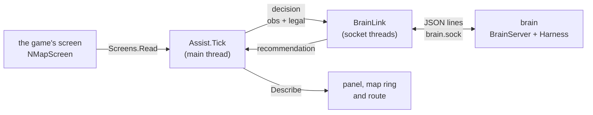

import { Aside, Badge, FileTree } from '@astrojs/starlight/components';

Everything else in this book runs headless: the simulator plays the game's own `sts2.dll` without a window, and the brains answer it. The **mod** is the one part that runs inside the real game, started from Steam, with a player at the keyboard. It is the AI's host there, as the simulator is in self-play ([Protocol: the wire §8](/en/arch/protocol/wire/#sec-8)): it reads the decision on screen, asks the brain over a local socket, and shows the answer over the game. This chapter is for whoever wants to use the mod in the game or change it. Read [Protocol](/en/arch/protocol/) and [GameBridge](/en/arch/gamebridge/) first if the terms observation, surface and legal action are new.

<Aside title="Status">

Built: assist mode on every surface, in both environments. `src/Sts2Ai.Mod` loads in the real game (v0.111.0), connects to the brain, asks about each decision once the screen on top has been idle for 3 frames (combat, card prompts, map, rewards, card reward, bundle, event, shop, rest site, treasure, crystal sphere), and shows the answer in a panel with the game's names, with marks on the map and on the cards and targets in combat ([Output](/en/arch/output/)). A switch on the panel picks SL or NoSL. In SL the mod sends the node's checkpoint and every step taken in the node, so the brain plans each combat on the node's clone ([The SL record](/en/arch/mod/sl-record/)); in the real game, 89 of 90 SL decisions replayed on their clones asked the same decision, and the other one's cause is fixed ([The SL record §8](/en/arch/mod/sl-record/#sec-8)). The mod has not been watched through a whole real run yet. Planned: playing by itself (the executor adapters and the auto-run driver) and a decision log of its own ([Auto-play and safety](/en/arch/mod/auto/)).

</Aside>

## 1. What the mod does, and what it does not

The mod does four things, all on the game's main thread:

1. **Reads the decision on screen**: which screen is on top, whether it is idle, and the observation and legal actions it offers, asked with the same GameBridge calls the simulator uses ([The main loop §4](/en/arch/mod/loop/#sec-4)).
2. **Asks the brain**: one `decision` message at a time over a Unix socket, with `cancel` when the screen moves on first ([The main loop §3](/en/arch/mod/loop/#sec-3), [§8](/en/arch/mod/loop/#sec-8)).
3. **Shows the answer**: the panel, the route on the map and the plan's marks in combat ([Output](/en/arch/output/)).
4. **Keeps the SL record**: the node's checkpoint and every decision the player takes in it, read where the game commits it, which SL sends before each decision ([The SL record](/en/arch/mod/sl-record/)).

What it does not do:

- **think**: no search, no learning, no strategy runs in the game process. The brain is a separate process, `brain`, which the player starts ([§4](#sec-4));
- **act**: in assist mode the player plays every step. The manifest says so: "Assist only: it never acts on the game". Playing by itself is planned ([Auto-play and safety §1](/en/arch/mod/auto/#sec-1));
- **multiplayer**: the game still loads the mod in a multiplayer lobby, as a mod that does not affect gameplay, but a run with more than one player gets no help: the panel says "Off in multiplayer", and the SL record ignores its nodes;
- **write the game's files**: nothing under the game's profile, no save, no console command, no reload. It writes only its settings file, beside the brain's socket ([§5](#sec-5)), and its lines in the game's log ([Auto-play and safety §3](/en/arch/mod/auto/#sec-3)).

## 2. One decision, from the screen to the panel

Take a decision of the book's example run as the game would show it: the map on floor 43 (act 3, the player at 24 of 66 HP), with two points to go to.




1. Each frame, `Screens.Read` asks the game which screen is on top (`ActiveScreenContext.GetCurrentScreen()`). The map screen with travel enabled is the `map` surface, and once the action queue is empty its observation and legal actions are read with GameBridge's `MapActions`, as the simulator reads them: here `map:4,10` and `map:6,10`, plus the potion belt's actions if there are potions.
2. `Assist.Tick` hashes the observation. When the observation and its legal actions have held for 3 frames, and no other decision is open, it sends `decision` with the hash, the surface, the observation and the legal actions.
3. The brain's Harness routes the decision to the macro brain, which values each option's afterstate with V and answers `map:4,10`, with the rest of the act's route as its plan ([Macro brain: search §1](/en/arch/macro-brain/search/#sec-1)).
4. The answer is for that hash and those legal actions only. While they still hold, the panel names the room ("go to" and the map legend's name for it) and the rooms of the route to the boss, and the map gets a pulsing ring on the point and a line along the route ([Output §3](/en/arch/output/#sec-3)).
5. The player clicks a point. The mod reads the travel where the game queues it and records it in the SL record ([The SL record §3](/en/arch/mod/sl-record/#sec-3)); the screen changes, and the next decision starts over.

## 3. Installing and loading

How the game finds and starts a mod. Everything in this section was read in the game source and holds for the mod in the game on this machine <Badge text="verified" variant="success" />.

The game scans its `mods/` folder recursively for manifests, and loads the DLL named `<id>.dll` that sits next to each one (`Modding/ModManager.cs`). The game folder on this machine is `~/.local/share/Steam/steamapps/common/Slay the Spire 2`. Inside it:

<FileTree>

- mods/
  - Sts2Ai/
    - Sts2Ai.json the manifest
    - Sts2Ai.dll the mod itself (`<id>.dll`), with GameBridge and Protocol inside

</FileTree>

**Install**: `dotnet build src/Sts2Ai.Mod/Sts2Ai.Mod.csproj -t:Install` builds the mod and copies `Sts2Ai.dll` and `Sts2Ai.json` into `mods/Sts2Ai/` (`Sts2Ai.Mod.csproj:23-26`; the game folder is the `Sts2GameDir` property). The game picks up a new mod at its next start, enabled.

**The manifest** (`Sts2Ai.json`):

| field | value | why |
|---|---|---|
| `id` | `Sts2Ai` | names the DLL the loader looks for |
| `name`, `author`, `description` | `STS2 AI`, …, "Shows the AI's recommended action. Assist only: it never acts on the game." | shown in the game's mod list |
| `version` | `0.1.0` | |
| `has_dll`, `has_pck` | `true`, `false` | a DLL, and no Godot resource pack |
| `affects_gameplay` | `false` | only matters for the multiplayer handshake, and the mod stays off in multiplayer |
| `dependencies` | `[]` | |
| `min_game_version` | `0.111.0` | |

**What the game does with it:**

- **Consent.** The player agrees to mod loading once, with a click in the game. The answer, `PlayerAgreedToModLoading`, is stored in `settings.save` as `mods_enabled`. Mods are loaded at startup only.
- **Profile.** Modded runs use a separate profile folder, `modded/`, copied from the vanilla (unmodded) profile on first use.
- **Entry point.** The loader calls a static method marked `[ModInitializer(nameof(Init))]`: `ModEntry.Init`, which calls `Host.Start`. It runs before `ModelDb.Init`, the game's database of cards, relics and monsters, so `Start` only sets things up, and the work starts on the first frame.
- **One DLL.** The loader lists the mod's types (`Assembly.GetTypes`) before it calls the entry point, and the game's assembly load context (the .NET mechanism that decides where an assembly's dependencies are found) does not look in the mod's folder. A type that needs a DLL shipped next to `Sts2Ai.dll` fails that listing, and the mod is not loaded; a resolver installed by `Init` would come too late. So the mod project compiles the sources of GameBridge and Protocol into `Sts2Ai.dll` (`Sts2Ai.Mod.csproj:19`), and references nothing else of the project.

**What `Host.Start` does** (`Host.cs:23-42`):

1. **The version guard.** If `NGame.GetGameVersion()` is not `v0.111.0`, the version GameBridge is written against, the mod stays off: it patches nothing, and its panel shows "off: game V, the mod is for v0.111.0".
2. **The patches, first.** Before anything else compiles game code that could inline the patched methods: the card prompts' context ([GameBridge: reading the game §6](/en/arch/gamebridge/observe/#sec-6)), the SL record's hooks ([The SL record §3](/en/arch/mod/sl-record/#sec-3)) and the settings tab ([Output §2](/en/arch/output/#sec-2)). Why first: [Auto-play and safety §5](/en/arch/mod/auto/#sec-5).
3. **The brain link**, which starts connecting on its own thread ([The main loop §8](/en/arch/mod/loop/#sec-8)).
4. **The frame callback**: `Tick`, attached to the scene tree's `ProcessFrame` ([The main loop §1](/en/arch/mod/loop/#sec-1)).

## 4. Running it with a brain

The mod needs a brain listening at its socket, `~/.local/state/sts2ai/brain.sock` (under `$XDG_STATE_HOME` when that is set). The brain is SimWorker's `brain` command ([Simulator: whole runs §7](/en/arch/simulator/runs/#sec-7)), started before or after the game; the mod tries again every 2 s until it connects.

```bash
dotnet run -c Release --project src/Sts2Ai.SimWorker -- brain --champion eval/champions/nosl.json
```

- `--champion` names the champion it plays: NoSL hosts get the file's combat brain (PIMC with the combat net) and macro brain (L0 with V); SL hosts get `--sl-policy`'s combat brain, the SL planner by default, with the same macro brain ([Harness: routing, budgets and seeds §1](/en/arch/harness/routing/#sec-1)). So one brain serves both environments, and the panel's switch needs no restart.
- That holds for the NoSL champion's file, whose macro brain values each option on the afterstate predicted from the screen. The SL champion's file (`sl.json`) has L0 play its options on the node's clone (`afterstates: clone`), which SL alone allows: a `brain` started with it refuses NoSL hosts with an `error` ("l0 plays on the node's clone in SL only", `Brains/ChampionOptions.cs:39`), and in SL it needs the node's clone for the decisions outside combat too ([The SL record §6](/en/arch/mod/sl-record/#sec-6)).
- `--log FILE` writes Harness's decision log; `--wire FILE` writes every message the hosts send, which `clones` replays ([The SL record §8](/en/arch/mod/sl-record/#sec-8)).
- A brain started through the launcher of a fixed build (`tmp/builds/REV/sim.sh`) has `HOME` pointed at `tmp/home`, so it needs `--socket ~/.local/state/sts2ai/brain.sock` to listen where the game looks ([Simulator: reference §1](/en/arch/simulator/reference/#sec-1)).
- The brain prints a line per run: the run id, the host's role (`mod`), how the run ended, its floor, its decisions, and any replans and game errors in its workers.

Then start the game from Steam, agree to mods once, and start or continue a single-player run. The panel shows the brain's champion once the brain has read the run's `hello`.

## 5. Controls and settings

| control | where | effect |
|---|---|---|
| F8 | anywhere | hides or shows the panel and every mark |
| SL / NoSL | the panel's head | the environment ([Environments](/en/arch/environments/)); switching ends the run as the brain sees it, and the next decision starts a new one from there |
| AI tab | the game's settings screen, after General, Graphics, Sound and Input | the mod's settings |

The settings (`Settings.cs`, the AI tab's rows in `SettingsTab.cs`) are kept in `~/.local/state/sts2ai/settings.json`, beside the brain's socket and outside the game's profile. They are read once at start and written at every change; a file that cannot be read gives the defaults.

| row | values | default | what |
|---|---|---|---|
| AI assist | off, on | on | off: the mod asks nothing and draws nothing, and the run ends as the brain sees it |
| Environment | SL, NoSL | SL | the same choice as the panel's switch |
| Panel | off, on | on | the panel card; the marks keep their own rows |
| Considered options | off, values, values + bars | values + bars | the actions the brain scored, in the panel |
| Order numbers on cards | off, on | on | the plan's step numbers on the cards it plays this turn |
| Target and end-turn marks | off, on | on | rings on the plan's targets and on the end turn button |
| Map route | off, next point, whole route | whole route | the ring on the next point, and the line along the route |
| Panel opacity | 60% to 100%, by 2% | 92% | the card's background |

A last button, "Reset AI settings", puts the defaults back. The keys planned for playing by itself (pause, step, semi-auto) are in [Auto-play and safety §4](/en/arch/mod/auto/#sec-4).

## 6. What the panel says

The panel's head shows the brain's champion (once the brain has named it), a status word and the switch. Its body shows the answer, or a message saying why there is none, with a quieter second line (`Assist.cs:61-162`, `Host.cs:44-63`):

| status | message | second line | when |
|---|---|---|---|
| `starting` | Connecting to the brain | the socket's path | before the first connection |
| `offline` | No brain running | the reason · trying again every 2 s | the connection failed or dropped |
| `ready` | Start or continue a run | single-player only | no run |
| `off` | Off in multiplayer | | a run with more than one player; the switch shows neither environment |
| `run sent` | Waiting for the brain | it loads the champion for this run | `hello` sent, `ready` not back yet |
| `off for this run` | Brain error | the brain's message · back on at the next run | the brain answered `error`, until the next `hello` ([The main loop §8](/en/arch/mod/loop/#sec-8)) |
| `ready` | Waiting for a decision | what to do first, such as "open the chest" | nothing on screen to decide, or something still moves |
| `ready` | No SL clone of this room | why · the next room has one | SL, a combat, and the node's record is missing or broken ([The SL record §6](/en/arch/mod/sl-record/#sec-6)) |
| `ready` | Thinking… | the seconds so far, while the decision on screen is the one asked | the decision is asked and not answered yet, or an older one is cancelled and its answer not back ([The main loop §3](/en/arch/mod/loop/#sec-3)) |
| `ready` | the answer | the brain and its time | ([Output §2](/en/arch/output/#sec-2)) |
| `off` | off: game V, the mod is for v0.111.0 | | the version guard ([§3](#sec-3)); no switch, and no AI tab |
| `error` | Mod error | the exception's message | the frame threw; logged once per distinct error |

With assist off, the panel and the marks are hidden.

## 7. The code

`src/Sts2Ai.Mod`, 12 source files. It builds against the game's DLLs and GodotSharp, the C# API of the Godot engine, from the same snapshot as the simulator (`src/GameReferences.props`), and compiles in GameBridge and Protocol ([§3](#sec-3)). It does not reference Brain or Harness.

| file | lines | what |
|---|---|---|
| `ModEntry.cs` | 13 | the entry point the loader calls |
| `Host.cs` | 64 | the version guard, the patches, the frame callback, and errors |
| `BrainLink.cs` | 101 | the socket: connect, reconnect, a reader and a writer thread, the inbox ([The main loop §8](/en/arch/mod/loop/#sec-8)) |
| `Assist.cs` | 226 | assist mode, once per frame: the run as the brain sees it, idle, one decision in flight, what the panel shows ([The main loop](/en/arch/mod/loop/)) |
| `Screens.cs` | 168 | the decision the screen on top asks for ([The main loop §4](/en/arch/mod/loop/#sec-4)) |
| `NodeRecord.cs` | 299 | the SL record and its hooks ([The SL record](/en/arch/mod/sl-record/)) |
| `UI/Panel.cs` | 356 | the panel card, and the marks it owns ([Output §2](/en/arch/output/#sec-2)) |
| `UI/Describe.cs` | 189 | an answer in the game's names ([The main loop §6](/en/arch/mod/loop/#sec-6)) |
| `UI/MapMark.cs` | 93 | the ring and the route on the map ([Output §3](/en/arch/output/#sec-3)) |
| `UI/CombatMark.cs` | 137 | the plan's marks in combat ([Output §3](/en/arch/output/#sec-3)) |
| `UI/Settings.cs` | 66 | the settings and their file ([§5](#sec-5)) |
| `UI/SettingsTab.cs` | 217 | the AI tab in the game's settings screen ([Output §2](/en/arch/output/#sec-2)) |

The project file is `Sts2Ai.Mod.csproj` (27 lines) and the manifest `Sts2Ai.json` (12). The mod has no unit tests of its own: what it shares with the simulator, GameBridge and Protocol, is tested there, and the rest is checked in the game ([Auto-play and safety §7](/en/arch/mod/auto/#sec-7)).

## 8. This chapter

- [The main loop](/en/arch/mod/loop/): one thread for the game, each frame step by step, one decision in flight, idle per screen, card prompts, answers, and the brain link.
- [The SL record](/en/arch/mod/sl-record/): the node's checkpoint, every step read where the game commits it, a broken record, what is sent, and how it was checked in the game.
- [Auto-play and safety](/en/arch/mod/auto/): the planned executor and auto-run driver, logs, controls and safety, patches and the JIT, prior art, tests and open questions.
