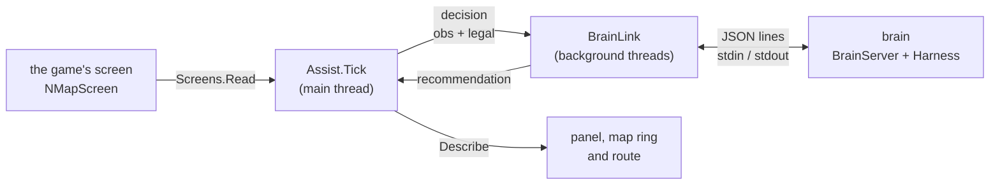

import { Aside, Badge, FileTree } from '@astrojs/starlight/components';

Everything else in this book runs headless: the simulator plays the game's own `sts2.dll` without a window, and the brains answer it. The **mod** is the one part that runs inside the real game, started from Steam, with a player at the keyboard. It is the AI's host there, as the simulator is in self-play ([Protocol: the wire §8](/en/arch/protocol/wire/#sec-8)): it reads the decision on screen, asks the brain it started, over the brain's stdin and stdout, and shows the answer over the game. This chapter is for whoever wants to use the mod in the game or change it. Read [Protocol](/en/arch/protocol/) and [GameBridge](/en/arch/gamebridge/) first if the terms observation, surface and legal action are new.

<Aside title="Status">

Built: assist mode on every surface, in both environments. `src/Sts2Ai.Mod` loads in the real game (v0.111.0), starts the brain it ships, asks about each decision once the screen on top has been idle for 3 frames (combat, card prompts, map, rewards, card reward, bundle, event, shop, rest site, treasure, crystal sphere), and shows the answer in a panel with the game's names and each option's chance to win, with marks on the map and on the cards and targets in combat ([Output](/en/arch/output/)). From the panel's toolbar the AI also plays the answers itself, when the player asks: one action, the rest of the turn or the room, or on its own until paused ([Auto-play and safety](/en/arch/mod/auto/)). A switch on the panel picks SL or NoSL, and the one brain the mod ships plays both ([§4](#sec-4)). In SL the mod sends the node's checkpoint and every step taken in the node, so the brain plans each combat and values each option outside combat on the node's clone ([The SL record](/en/arch/mod/sl-record/)). Planned: playing whole runs with no one at the keyboard (the auto-run driver) and a decision log of its own ([Auto-play and safety §2](/en/arch/mod/auto/#sec-2), [§3](/en/arch/mod/auto/#sec-3)).

</Aside>

## 1. What the mod does, and what it does not

The mod does five things, all on the game's main thread:

1. **Reads the decision on screen**: which screen is on top, whether it is idle, and the observation and legal actions it offers, asked with the same GameBridge calls the simulator uses ([The main loop §4](/en/arch/mod/loop/#sec-4)).
2. **Asks the brain**: one `decision` message at a time over the brain's stdin and stdout, with `cancel` when the screen moves on first ([The main loop §3](/en/arch/mod/loop/#sec-3), [§8](/en/arch/mod/loop/#sec-8)).
3. **Shows the answer**: the panel, the route on the map and the plan's marks in combat ([Output](/en/arch/output/)).
4. **Plays the answer, when the player asks**: the toolbar's goals, from one action to auto-play, each action carried out as the player's click would be ([Auto-play and safety](/en/arch/mod/auto/)).
5. **Keeps the SL record**: the node's checkpoint and every decision taken in it, the player's or the AI's, read where the game commits it, which SL sends before each decision ([The SL record](/en/arch/mod/sl-record/)).

What it does not do:

- **think**: no search, no learning, no strategy runs in the game process. The brain is a separate process, `brain`, which the mod starts from its own folder ([§4](#sec-4));
- **act unasked**: the AI plays only when the player asks, from the toolbar or its keys, and only the brain's answer to the decision on screen ([Auto-play and safety §4](/en/arch/mod/auto/#sec-4)). Nothing starts a run by itself: the auto-run driver is planned ([Auto-play and safety §2](/en/arch/mod/auto/#sec-2));
- **multiplayer**: the game still loads the mod in a multiplayer lobby, as a mod that does not affect gameplay, but a run with more than one player gets no help: the panel says "Off in multiplayer", and the SL record ignores its nodes;
- **write the game's files**: nothing under the game's profile, no save, no console command, no reload. It writes only its settings, the brain's log and, when the player asks for them, the brain's captures, in its state folder outside the game's profile ([§4](#sec-4), [§5](#sec-5)), and its lines in the game's log ([Auto-play and safety §3](/en/arch/mod/auto/#sec-3)).

## 2. One decision, from the screen to the panel

Take a decision of the book's example run as the game would show it: the map on floor 19 (act 2, the player at 70 of 70 HP), with two points to go to.

1. Each frame, `Screens.Read` asks the game which screen is on top (`ActiveScreenContext.GetCurrentScreen()`). The map screen with travel enabled is the `map` surface, and once the action queue is empty its observation and legal actions are read with GameBridge's `MapActions`, as the simulator reads them: here `map:3,2` and `map:5,2`, plus the potion belt's actions if there are potions.
2. `Assist.Tick` hashes the observation. When the observation and its legal actions have held for 3 frames, and no other decision is open, it sends `decision` with the hash, the surface, the observation and the legal actions.
3. The brain's Harness routes the decision to the macro brain, which values each option's afterstate with V and answers `map:5,2`, with the rest of the act's route as its plan ([Macro brain: search §1](/en/arch/macro-brain/search/#sec-1)).
4. The answer is for that hash and those legal actions only. While they still hold, the panel names the room ("go to" and the map legend's name for it) and the rooms of the route to the boss, and the map gets a pulsing ring on the point and a line along the route ([Output §3](/en/arch/output/#sec-3)).
5. The player clicks a point, or presses F10 and the AI travels there as the click would ([Auto-play and safety §1](/en/arch/mod/auto/#sec-1)). The mod reads the travel where the game queues it and records it in the SL record ([The SL record §3](/en/arch/mod/sl-record/#sec-3)); the screen changes, and the next decision starts over.

## 3. Installing and loading

How the mod is built and installed, and how the game finds and starts it. What the game does with a mod was read in the game source and holds for this mod in the game on Linux <Badge text="verified" variant="success" />.

The game scans its `mods/` folder recursively for manifests (and `mods_STEAMTEST/`, which it reads as Workshop items), and loads the DLL named `<id>.dll` that sits next to each one (`Modding/ModManager.cs`). The game folder is, on Linux by default, `~/.local/share/Steam/steamapps/common/Slay the Spire 2`. Inside it, the installed mod:

<FileTree>

- mods/
  - Sts2Ai/
    - Sts2Ai.json the manifest
    - Sts2Ai.dll the mod itself (`<id>.dll`), with GameBridge and Protocol inside
    - brain/ the brain the mod starts
      - champion.json the champion file it plays
      - nets/ the champion's nets, as `NAME.net`
      - linux-x64/ a self-contained brain for each platform, `Sts2Ai.SimWorker` its launcher
      - osx-arm64/
      - win-x64/

</FileTree>

**Building and installing.** `distro/build.sh [REV]` builds this folder, the Workshop item, from one commit (HEAD by default, taken with `git archive`) into `out/Sts2Ai/` (not in git), and names the commit in `out/commit`. Installing is copying `out/Sts2Ai/` into the game's `mods/` folder; the game picks up a new mod at its next start, enabled. The script:

- builds the mod once for every platform, since it runs on the game's own .NET, against the game's DLLs as the simulator does ([Simulator: reference §1](/en/arch/simulator/reference/#sec-1));
- publishes the brain (`Sts2Ai.SimWorker`) for `linux-x64`, `osx-arm64` and `win-x64` with the profile `Properties/PublishProfiles/brain.pubxml`: self-contained, since a player has no .NET; a folder and not one file, since Harmony patches through the JIT's own library, which a single-file build folds into the executable; not trimmed, since the brain loads the player's own `sts2.dll` at run time and that needs the whole framework. No game file ships: the game's assemblies are only compiled against;
- signs the `osx-arm64` launcher ad hoc, with `codesign` on a Mac: Apple silicon runs only signed code;
- copies the NoSL champion's file, `eval/champions/nosl.json`, as `brain/champion.json` (the brain plays it in both environments, [§4](#sec-4)), and its nets into `brain/nets/` without their `.json`: the game reads every `.json` under a mod's folder as a possible manifest, and a net's `name` field would make it log an error. The brain's own `deps.json` and `runtimeconfig.json` have none of a manifest's fields, and the game skips them.

**The manifest** (`Sts2Ai.json`):

| field | value | why |
|---|---|---|
| `id` | `Sts2Ai` | names the DLL the loader looks for |
| `name`, `author`, `description` | `STS2 AI`, …, "An AI for single-player runs: shows its recommended action with each option's chance to win, and plays it when asked. Starts its own brain, a background program, while the game runs." | shown in the game's mod list |
| `version` | `0.2.0` | |
| `has_dll`, `has_pck` | `true`, `false` | a DLL, and no Godot resource pack |
| `affects_gameplay` | `false` | only matters for the multiplayer handshake, and the mod stays off in multiplayer |
| `dependencies` | `[]` | |
| `min_game_version` | `0.111.0` | |

**What the game does with it:**

- **Consent.** The player agrees to mod loading once, with a click in the game. The answer, `PlayerAgreedToModLoading`, is stored in `settings.save` as `mods_enabled`. Mods are loaded at startup only.
- **Profile.** Modded runs use a separate profile folder, `modded/`, copied from the vanilla (unmodded) profile on first use.
- **Entry point.** The loader calls a static method marked `[ModInitializer(nameof(Init))]`: `ModEntry.Init`, which calls `Host.Start`. It runs before `ModelDb.Init`, the game's database of cards, relics and monsters, so `Start` only sets things up, and the work starts on the first frame.
- **One DLL.** The loader lists the mod's types (`Assembly.GetTypes`) before it calls the entry point, and the game's assembly load context (the .NET mechanism that decides where an assembly's dependencies are found) does not look in the mod's folder. A type that needs a DLL shipped next to `Sts2Ai.dll` fails that listing, and the mod is not loaded; a resolver installed by `Init` would come too late. So the mod project compiles the sources of GameBridge and Protocol into `Sts2Ai.dll` (`Sts2Ai.Mod.csproj:19`), and references nothing else of the project. The DLLs under `brain/` belong to the brain, a separate program; the game loads none of them.

**What `Host.Start` does** (`Host.cs:23-46`):

1. **The version guard.** If `NGame.GetGameVersion()` is not `v0.111.0`, the version GameBridge is written against, the mod stays off: it patches nothing, starts no brain, and its panel shows "off: game V, the mod is for v0.111.0".
2. **The patches, first.** Before anything else compiles game code that could inline the patched methods: the card prompts' context ([GameBridge: reading the game §6](/en/arch/gamebridge/observe/#sec-6)), the SL record's hooks ([The SL record §3](/en/arch/mod/sl-record/#sec-3)) and the settings tab ([Output §2](/en/arch/output/#sec-2)). Why first: [Auto-play and safety §5](/en/arch/mod/auto/#sec-5).
3. **The brain**: `BundledBrain.Find` looks for the brain shipped beside the mod for this platform, and the brain link starts it on its own thread ([§4](#sec-4), [The main loop §8](/en/arch/mod/loop/#sec-8)).
4. **The frame callback**: `Tick`, attached to the scene tree's `ProcessFrame` ([The main loop §1](/en/arch/mod/loop/#sec-1)).

## 4. The brain it ships

The mod starts its brain itself, from its own folder, as a child process of the game (`BundledBrain.cs`), so a player installs nothing else and starts nothing else.

- **What it runs.** `brain/RID/Sts2Ai.SimWorker` (`.exe` on Windows) for the game's platform and processor (`BundledBrain.Find`); when none ships for them, the mod runs without a brain and says so ([§6](#sec-6)). The command is SimWorker's `brain` ([Simulator: whole runs §7](/en/arch/simulator/runs/#sec-7)): `brain --champion champion.json --workers N`, with N half the logical processors, from 1 to 8, so the game keeps its share, and no more than the planner's 8 worlds. Outside Windows the mod sets the launcher's executable bit when it is missing, since a download is not relied on to keep it.
- **Its environment.** The working folder is `brain/`, so the champion's nets (`nets/NAME.net`) are found there. `STS2_BIN_DIR` is the folder the game loaded `sts2.dll` from, so the brain plays with the running game's own assemblies. `DOTNET_ReadyToRun=0`, as every launcher of the simulator sets it ([Simulator: reference §1](/en/arch/simulator/reference/#sec-1)). `SENTRY_GODOT_LIB_PATH` is removed: the game's Sentry extension sets it in the game's process, and inherited, it makes `sts2.dll`'s module initializer in each search worker load that extension outside Godot, and the worker crashes at boot.
- **The wire.** JSON lines over the brain's stdin and stdout ([The main loop §8](/en/arch/mod/loop/#sec-8)). The brain serves the one host that started it until its stdin closes.
- **Its log.** The brain's stderr goes to `brain.log` in the mod's state folder, `$XDG_STATE_HOME/sts2ai` (by default `~/.local/state/sts2ai`), beside the settings ([§5](#sec-5)). A game session's first brain starts the file; a brain started again adds to it. The brain writes a line at start naming its champions, then a line per run: the run id, the host's role (`mod`), how the run ended, its floor, its decisions, and any replans and game errors in its workers.
- **When it ends.** When the brain's stdout ends or the pipe fails, the mod kills the brain with its search workers, waits 2 s and starts it again ([The main loop §8](/en/arch/mod/loop/#sec-8)); meanwhile the panel says why the brain ended ([§6](#sec-6)).
- **The champion.** `champion.json` is the NoSL champion's file, and one brain serves both environments: `brain` sets L0's afterstates by the host's environment, predicted from the screen for a NoSL host and played on the node's clone for an SL host (`BrainCommand.Champions`). A NoSL run gets the file's champion, PIMC with the champion's combat net and L0 with its V; an SL run gets the SL planner with the same two nets and L0 on the clone, the SL champion ([Harness: routing, budgets and seeds §1](/en/arch/harness/routing/#sec-1), [Evaluation: champions and baselines](/en/arch/evaluation/champions/)). So the panel's switch needs no second brain. Both environments play the same nets, which learned from SL's games: NoSL is not trained for now.
- **The effort.** The mod's effort setting ([§5](#sec-5)) asks the brain, in `hello`, for one of the SL planner's presets for the run: `low`, `medium`, `high` or `max` ([The SL planner: budget §1](/en/arch/sl-planner/budget/#sec-1)). The brain then plays that run's SL planner with the preset's budget, and names it in the champion it sends back; with none asked, it plays its own. Another combat brain (PIMC) plays as it is ([Harness §5](/en/arch/harness/#sec-5)).
- **Recording.** `--log FILE` writes Harness's decision log, and `--wire FILE` every message the host sends, which `clones` replays ([The SL record §8](/en/arch/mod/sl-record/#sec-8)). The mod passes them only when the settings file's `Record` is on (off by default, set by hand, [§5](#sec-5)): each brain it starts then writes a pair of files named by its start time in UTC, `captures/STAMP-wire.jsonl` and `captures/STAMP-decisions.jsonl` (`STAMP` as `yyyy-MM-dd-HHmmss`) in the state folder (`BundledBrain.Captures`).

Then start the game from Steam, agree to mods once ([§3](#sec-3)), and start or continue a single-player run. The panel shows the brain's champion once the brain has read the run's `hello`.

## 5. Controls and settings

| control | where | effect |
|---|---|---|
| F8 | anywhere | hides or shows the panel and every mark |
| F5, F10, F11 | the toolbar under the panel's head | the AI plays: on its own until paused, one action, or to the end of the turn or the room ([Auto-play and safety §2](/en/arch/mod/auto/#sec-2)) |
| SL / NoSL | the panel's head | the environment ([Environments](/en/arch/environments/)); switching ends the run as the brain sees it, and the next decision starts a new one from there |
| effort | a row of toggles under the toolbar | the SL planner's effort; a change ends the run as the brain sees it, as the switch does, and the next decision starts a new one with that effort (in SL, with the node's checkpoint sent again); the champion's name in the head shows the budget |
| speed, stops | under the toolbar while auto-play runs | auto-play's wait and where it stops |
| AI tab | the game's settings screen, after General, Graphics, Sound and Input | the mod's settings |

The settings (`Settings.cs`, the AI tab's rows in `SettingsTab.cs`) are kept in `~/.local/state/sts2ai/settings.json` (under `$XDG_STATE_HOME/sts2ai` when that is set), beside the brain's log and outside the game's profile. They are read once at start and written at every change; a file that cannot be read gives the defaults.

| row | values | default | what |
|---|---|---|---|
| AI assist | off, on | on | off: the mod asks nothing and draws nothing, and the run ends as the brain sees it |
| Environment | SL, NoSL | SL | the same choice as the panel's switch |
| Panel | off, on | on | the panel card; the marks keep their own rows |
| Considered options | off, values, values + bars | values + bars | the options the brain scored, with their chances to win, in the panel |
| Order numbers on cards | off, on | on | the plan's step numbers on the cards it plays this turn |
| Target and end-turn marks | off, on | on | rings on the plan's targets and on the end turn button |
| Map route | off, next point, whole route | whole route | the ring on the next point, and the line along the route |
| Panel opacity | 60% to 100%, by 2% | 92% | the card's background |
| Search effort | the brain's, low, medium, high, max | the brain's | the SL planner's effort the mod asks the brain for; the same choice as the toolbar's row |
| Speed of auto-play | slow, medium, fast | medium | the wait before each of the AI's actions: 1.5 s, 0.8 s, 0.2 s |
| Stop before elites and bosses | off, on | on | auto-play stops before it travels to an elite or the boss |
| Stop when the win chance falls 3 points | off, on | on | auto-play stops when V's chance to win falls more than 3 points below its best since auto-play started |

The last three rows sit under their own header, "Auto-play". A last button, "Reset AI settings", puts the defaults back. One field of the file has no row: `Record` (default `false`), which makes each brain the mod starts record its session ([§4](#sec-4)). Every label is in the game's language ([Output §2](/en/arch/output/#sec-2)). The keys and how far each one plays are in [Auto-play and safety §4](/en/arch/mod/auto/#sec-4).

## 6. What the panel says

The panel's head shows the brain's champion (once the brain has named it, with its budget), a status line and the switch. Once the brain has taken the run, the status line is the run's own: the character, the ascension, the floor and the HP, as at the latest decision ("The Silent · A0 · floor 9 · HP 53/70"); before that it is a word. Its body shows the answer, or a message saying why there is none, with a quieter second line (`Assist.cs:163-280`, `Host.cs:48-69`):

| status | message | second line | when |
|---|---|---|---|
| `starting` | Connecting to the brain | the brain's launcher, or "no brain ships with this copy of the mod for this platform" | until the brain has first started, or failed to |
| `offline` | No brain running | the reason · trying again every 2 s | the brain ended (the reason gives its exit code, its last line on stderr and the log's path), could not start, or none ships for this platform |
| `ready` | Start or continue a run | single-player only | no run |
| `off` | Off in multiplayer | | a run with more than one player; the switch shows neither environment |
| `run sent` | Waiting for the brain | it loads the champion for this run | `hello` sent, `ready` not back yet |
| `off for this run` | Brain error | the brain's message · back on at the next run | the brain answered `error`, until the next `hello` ([The main loop §8](/en/arch/mod/loop/#sec-8)) |
| the run's line | Waiting for a decision | what to do first, such as "open the chest" | nothing on screen to decide, or something still moves |
| the run's line | No SL clone of this room | why · the next room has one | SL, and the node's record is missing or broken: no SL decision is asked in that node ([The SL record §6](/en/arch/mod/sl-record/#sec-6)) |
| the run's line | Thinking… | the seconds so far, while the decision on screen is the one asked | the decision is asked and not answered yet, or an older one is cancelled and its answer not back ([The main loop §3](/en/arch/mod/loop/#sec-3)) |
| the run's line | the answer | how the fight or the run is expected to go after it; the foot names the brain and its time | ([Output §2](/en/arch/output/#sec-2)) |
| `off` | off: game V, the mod is for v0.111.0 | | the version guard ([§3](#sec-3)); no switch, and no AI tab |
| `error` | Mod error | the exception's message | the frame threw; logged once per distinct error |

From the brain's `ready` on, the toolbar, the effort row and the strip with the chance to win and the AI's state show above the message or the answer ([Output §2](/en/arch/output/#sec-2)). With assist off, the panel and the marks are hidden. Every word in the table is shown in the game's language; the reasons in the second lines (why the brain ended, the brain's message, an exception) come as they are, in English.

## 7. The code

`src/Sts2Ai.Mod`, 17 source files. It builds against the game's DLLs and GodotSharp, the C# API of the Godot engine, from the same snapshot as the simulator (`src/GameReferences.props`), and compiles in GameBridge and Protocol ([§3](#sec-3)). It does not reference Brain or Harness.

| file | lines | what |
|---|---|---|
| `ModEntry.cs` | 13 | the entry point the loader calls |
| `Host.cs` | 70 | the version guard, the patches, the brain, the frame callback, and errors |
| `BrainLink.cs` | 110 | the link to the brain: starts it on its own thread, and again 2 s after it ends; a reader and a writer thread, the inbox ([The main loop §8](/en/arch/mod/loop/#sec-8)) |
| `BundledBrain.cs` | 104 | the brain shipped beside the mod: found for the platform, started with its options and environment, its stderr written to `brain.log`, its captures when asked ([§4](#sec-4)) |
| `Assist.cs` | 488 | assist mode and the AI's play, once per frame: the run as the brain sees it, idle, one decision in flight, the goals with their waits and stops, what the panel shows ([The main loop](/en/arch/mod/loop/), [Auto-play and safety §2](/en/arch/mod/auto/#sec-2)) |
| `Executor.cs` | 221 | an answer carried out as the player's click would be, and the nudges ([Auto-play and safety §1](/en/arch/mod/auto/#sec-1)) |
| `Screens.cs` | 170 | the decision the screen on top asks for ([The main loop §4](/en/arch/mod/loop/#sec-4)) |
| `NodeRecord.cs` | 299 | the SL record and its hooks ([The SL record](/en/arch/mod/sl-record/)) |
| `UI/Panel.cs` | 702 | the panel card with its toolbar and its keys, and the marks it owns ([Output §2](/en/arch/output/#sec-2)) |
| `UI/Icons.cs` | 64 | the toolbar's icons, drawn in code ([Output §2](/en/arch/output/#sec-2)) |
| `UI/Fonts.cs` | 33 | the game's own font for the mod's text, by the game's language ([Output §2](/en/arch/output/#sec-2)) |
| `UI/L10n.cs` | 175 | the mod's own words in the game's language ([Output §2](/en/arch/output/#sec-2)) |
| `UI/Describe.cs` | 226 | an answer in the game's names, and what its options' values are ([The main loop §6](/en/arch/mod/loop/#sec-6)) |
| `UI/MapMark.cs` | 93 | the ring and the route on the map ([Output §3](/en/arch/output/#sec-3)) |
| `UI/CombatMark.cs` | 139 | the plan's marks in combat ([Output §3](/en/arch/output/#sec-3)) |
| `UI/Settings.cs` | 96 | the settings, their file, and the mod's state folder (`Settings.Dir`) ([§5](#sec-5)) |
| `UI/SettingsTab.cs` | 224 | the AI tab in the game's settings screen ([Output §2](/en/arch/output/#sec-2)) |

The project file is `Sts2Ai.Mod.csproj` (28 lines) and the manifest `Sts2Ai.json` (12). The mod has no unit tests of its own: what it shares with the simulator, GameBridge and Protocol, is tested there, and the rest is checked in the game ([Auto-play and safety §7](/en/arch/mod/auto/#sec-7)).

## 8. This chapter

- [The main loop](/en/arch/mod/loop/): one thread for the game, each frame step by step, one decision in flight, idle per screen, card prompts, answers, and the brain link.
- [The SL record](/en/arch/mod/sl-record/): the node's checkpoint, every step read where the game commits it, a broken record, what is sent, and the round trip that checks it.
- [Auto-play and safety](/en/arch/mod/auto/): the executor, playing by goal, the planned auto-run driver, logs, controls and safety, patches and the JIT, prior art, tests and open questions.
