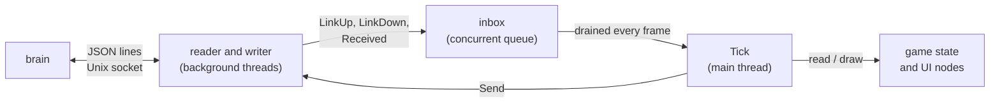

import { Badge } from '@astrojs/starlight/components';
import TickDemo from '../../../../../components/book/TickDemo.svelte';

The game does not call the mod when a decision comes up. There is no such event: a decision is simply a moment when the game waits for the player, and nothing is still moving. So the mod looks, every frame, and asks the brain only once a state has held still. This page follows that loop: where it runs, what it does each frame, how it keeps one decision in flight, how it decides that a screen is idle, and how it talks to the brain. [The overview](/en/arch/mod/) says what the mod is; [Output](/en/arch/output/) says how the answer is drawn.

## 1. One thread for the game

Godot, like most game engines, expects game state and UI nodes to be touched only from its main thread. So every game read and write happens inside one per-frame callback, `Host.Tick`, attached with `((SceneTree)Engine.GetMainLoop()).ProcessFrame += Tick` (`Host.cs:41`). `ProcessFrame` is a plain C# event the scene tree raises once per frame, so the mod needs no Godot source generators or node scripts of its own.

Waiting on a socket would stall the frame, so the socket's IO runs on background threads that never touch the game: a reader puts what arrives into a concurrent queue, the **inbox**, and a writer sends what the main thread queues. `Tick` drains the inbox at the start of every frame. This is the pattern of STS2MCP ([Auto-play and safety §6](/en/arch/mod/auto/#sec-6)).

`Tick` builds the panel on its first frame, reads the F8 key, and hands the frame to `Assist.Tick`; if the mod is off (the version guard), it only shows why. An exception in the frame is logged and shown as "Mod error", once per distinct error rather than once per frame (`Host.cs:44-63`).

## 2. Each frame, step by step

`Assist.Tick` (`Assist.cs:61-162`) does the same steps every frame, in this order. Most frames stop early.

1. **Drain the inbox**: connection changes, `ready`, the answer, or `error` ([§8](#sec-8)).
2. **The environment.** If the setting changed, the run ends as the brain sees it (`run_end`, `aborted`), and the next decision starts a new run in the other environment.
3. **The run.** The game's run state, the local player, and the run id hashed from the seed (`RunHeader.IdOf`). A different id than the run the brain was told about ends that run: `won` or `lost` if the game was over, else `aborted`. So does assist being turned off.
4. **Read the screen**, single-player runs only: `Screens.Read` returns the decision on screen, or none ([§4](#sec-4)). This happens with assist off and without a brain too, since the SL record needs to know the screen the player answers ([The SL record §3](/en/arch/mod/sl-record/#sec-3)). A step the player took on this surface that still plays out (an event option, a rest option, a reward, a purchase, a divination) hides the decision until its task ends.
5. **Assist off**: hide everything and stop.
6. **Who is there.** No connection, no run, a multiplayer run, a brain error for this run, or no `ready` yet: show why ([The overview §6](/en/arch/mod/#sec-6)) and stop. The first frame of a run with a connection sends `hello`.
7. **Nothing to decide**: show "Waiting for a decision", reset the idle count, and stop. In SL, a combat without the node's clone stops here too ([The SL record §6](/en/arch/mod/sl-record/#sec-6)).
8. **Idle.** The decision's key is its observation hash and its legal actions. A new key starts the count again; fewer than 3 frames in a row and the frame stops, the panel left as it was.
9. **Show or ask.** An answer for this key is shown. Otherwise the panel says "Thinking…", and the mod asks, unless a decision is already open ([§3](#sec-3)): in SL first the node's checkpoint and steps ([The SL record §7](/en/arch/mod/sl-record/#sec-7)), then `decision`.

The figure runs these rules frame by frame on a made-up SL combat:

<TickDemo client:visible lang="en" />

## 3. One decision in flight

The brain answers the decisions of a connection in order, one at a time ([Harness §5](/en/arch/harness/#sec-5)). So the mod keeps at most one decision open:

- **A key.** A decision is for one key: the observation's hash (`DecisionRequest.HashOf`, FNV-1a 64 over its JSON, [Protocol §4](/en/arch/protocol/#sec-4)) and its legal actions. The same observation can allow different actions: a rest site may be left once an option is used, though nothing else visible changed (`Assist.cs:133-134`).
- **Asking.** A key that has held for 3 frames, with nothing open and no answer for it, is sent as `decision` with the next id, counting from 0 in each run on this connection.
- **The state moves on first.** When a new key has held for 3 frames while the decision is still open, the mod sends `cancel` with its id, once, and waits. It asks about the new key only after the old decision's answer has come back. That answer is dropped.
- **The answer.** An answer is matched to the open decision by its id; the mod does not read its `obs_hash`. It is kept for the key it was asked for, and shown on every frame that key lasts. A state that comes back to that key shows it again, without asking.
- **A key that comes back after its cancel.** If the state moves from A to B and back to A before A's cancelled answer arrives, A is not asked again: when that answer comes it is dropped, and A was already asked, so the panel says "Thinking…" until the key changes (`Assist.cs:143-149`, `194-200`).

A slow brain then never falls behind a player who acts faster than it thinks: the mod never queues a second question behind the first. The brain does not stop a search on `cancel` ([Protocol: the wire §5](/en/arch/protocol/wire/#sec-5)); the cancelled answer simply costs the time it takes.

Why 3 frames: the game can look idle for one frame between two steps of the same action, when the queue is briefly empty. A decision sent then would describe a state about to change. Three frames in a row with the same key, each with the screen's idle test passing, is how long a state must hold (`Assist.cs:21`).

## 4. Idle, screen by screen

"Idle" means the game is really waiting for the player: the game logic waits, no queued actions remain, nothing still plays out, and no other screen covers the one being decided. Headless, GameBridge's `CombatActions.WaitingForInput` is enough; in the real game it is not ([GameBridge: actions per surface §1](/en/arch/gamebridge/actions/#sec-1)). So `Screens.Read` (`Screens.cs:50-113`) starts from the screen the player looks at, the game's own `ActiveScreenContext.Instance.GetCurrentScreen()`: the open modal, the map if open, the top of the overlay stack, else the current room <Badge text="verified" variant="success" />. Its type picks the surface:

| screen on top | surface | asked when |
|---|---|---|
| `NCombatRoom`, the hand in a select mode (`NPlayerHand.IsInCardSelection`) | `card_choice` | at once: the game waits on the prompt inside an action |
| `NCombatRoom` (an event's combat too) | `combat` | `CombatActions.WaitingForInput`, the action queue empty, and the hand in play mode, not in a card play |
| `NCombatPileCardSelectScreen`, `NCardGridSelectionScreen`, `NChooseACardSelectionScreen` | `card_choice` | at once |
| `NCardRewardSelectionScreen` | `card_reward` | at once |
| `NChooseABundleSelectionScreen` | `bundle` | at once |
| `NRewardsScreen` with a rewards set | `rewards` | the action queue empty |
| `NCrystalSphereScreen`, the game not finished | `crystal_sphere` | the action queue empty |
| `NMapScreen`, travel enabled and not travelling | `map` | the action queue empty |
| `NEventRoom`, `NFakeMerchant` or `NMerchantInventory`, in an event room | `event` | the action queue empty |
| `NMerchantRoom` or `NMerchantInventory`, in a merchant room | `shop` | the action queue empty |
| `NRestSiteRoom` | `rest` | the action queue empty |
| `NTreasureRoom`, its relics shown | `treasure` | the action queue empty; a chest still closed says "open the chest" |

Prompts are asked at once because the game waits on them *inside* an action or a reward, with the queue busy; every other screen waits with the queue empty.

**As the simulator asks.** A surface is asked with the same GameBridge calls the simulator's `RunSession` uses, so the brain sees the same observations and legal actions in both hosts ([Simulator: whole runs §4](/en/arch/simulator/runs/#sec-4)). What a screen offers is read from the screen node's private fields, which hold exactly what it shows: the rewards set, the card reward's cards and its remaining alternatives (a used reroll comes back as a new list without it), the bundles, the prompt's cards and its `CardSelectorPrefs`. The hand's select mode and a combat pile prompt filter a pile instead, so the mod applies their filter to the pile.

**The potion belt** is offered on the same screens as in the simulator: everywhere but the card reward, the bundle and card prompts; in combat its actions are among the combat's own.

**A screen with nothing legal** (an animation, a proceed button the screen waits on) is no decision: `Ask` returns none when the screen's legal actions are empty.

## 5. Card prompts

A card prompt is a screen that asks the player to pick cards: choose one of three, discard two, upgrade one ([Protocol: observations and actions §6](/en/arch/protocol/observation/#sec-6)). Three things make it work in the game (`Screens.cs:131-157`):

- **Its context.** The brain needs to know why the prompt was asked: which card, relic or event asked, and what the picks will do. GameBridge's prefixes on `CardSelectCmd.From*` record each prompt's context as the game asks it ([GameBridge: reading the game §6](/en/arch/gamebridge/observe/#sec-6)). The screen opens after its entry's first await, when the current context is already gone, so the mod takes the latest recorded one, `ChoiceContexts.Last`. Each prompt (a new screen node, or a new hand selection) takes it once. When it was already used by an earlier prompt, this prompt came without one: the mod logs "a card prompt without its context, left to the player", and asks nothing.
- **Its bounds.** How many cards may be picked comes from the screen's `CardSelectorPrefs`, corrected for the context (`ChoiceContexts.Bounds`). The choose-a-card screen is asked for 0 to 1 cards, whether or not it can be skipped, as `CardSelectCmd` asks the selector.
- **Canonical order.** The options are put in canonical order (`CardChoices.Canonical`), with its ties broken by `new Random(0)`, so the observation and its hash hold still from frame to frame and the brain's answer does not depend on the screen's order. The answer picks canonical indexes; the SL record keeps the game's own indexes ([The SL record §3](/en/arch/mod/sl-record/#sec-3)).

A prompt in combat carries the combat too. In SL without the node's clone, prompts are still asked, as are the decisions outside combat; only combat waits ([The SL record §6](/en/arch/mod/sl-record/#sec-6)). A prompt that came without its context is not asked, and in SL its answer breaks the node's record, since the record cannot read it against a prompt it never saw.

## 6. Answers in the game's names

The brain answers with action texts: `play:1:1`, `map:4,10`, `reward:0`. The panel names them as the screen does, in the game's language, from the observation the answer was for (`UI/Describe.cs`). An id the game has no text for is shown as is.

| surface | an action reads as |
|---|---|
| combat | the card's name (with `+` if upgraded) and its target, "→ Terror Eel"; "#2" after a name when several enemies are alive; "drink" a potion; "end turn" |
| card prompt | "pick" the cards, or "pick none" |
| map | "go to" the map legend's name for the room |
| rewards | "take 25 gold", "take" a potion or relic, "open the card reward" with its cards, "remove a card"; `rewards_done` is "proceed", or "skip the rest, proceed" |
| card reward | "take" the card, or the alternative's own name (skip, reroll) |
| bundle | "bundle 2:" and its cards |
| event | the option's title, from the event's table or the ancients' |
| shop | "buy" the item "(75 gold)", "remove a card (75 gold)", "leave the shop" |
| rest | the option's name |
| treasure | the relic's name, or "skip the relic" |
| crystal sphere | "big divination at 3,4", "small divination at 3,4" |
| potion belt | "drink" or "discard" the potion |

**The plan.** In combat the panel names the plan up to the turn's end: the first action, then the plan's steps through the next `end_turn`. The SL planner plans the whole combat, but its later turns play cards not drawn yet, which the screen cannot name, so they are only counted: "2 more turns planned" (`Describe.Turn`). On the map the plan is the route: the rooms it goes through, up to the boss. Elsewhere the plan's actions are listed as they are.

**The considered actions** are the brain's first three candidates, best first, each with its value and confidence interval, when it scored more than one. Only the combat brains give candidates today; the macro brain answers with its pick and plan ([Harness: the decision log §5](/en/arch/harness/decision-log/#sec-5)).

**The marks.** The same answer draws on the game: the ring and route on the map, the numbers and rings on cards, targets and the end turn button in combat ([Output §3](/en/arch/output/#sec-3)).

## 7. When the mod waits

Besides a brain that is still thinking, the panel waits for the game:

- **Something moves**: the action queue is not empty, the hand is in a card play, the map is travelling. The screen asks nothing until it settles.
- **A step plays out.** An event option, a rest option, a reward, a purchase and a divination run as the game's own tasks, and the screen shows a step's result only once its task ends: until then the screen still shows the decision it answered. The mod notes each such task where the player starts it, and asks nothing on that surface until it ends, as the simulator waits for its running tasks (`NodeRecord.Running`, [The SL record §4](/en/arch/mod/sl-record/#sec-4)).
- **A screen the mod does not read**: a modal, the deck view, a chest still closed. It shows "Waiting for a decision"; the closed chest adds "open the chest".

Planned for auto-play: if no adapter matches, or the idle test holds but there are no legal actions, pause, say "manual needed" and log a coverage bug, never a random action ([Auto-play and safety §1](/en/arch/mod/auto/#sec-1)).

## 8. The brain link

`BrainLink` (`BrainLink.cs`) is the mod's end of the wire ([Protocol: the wire](/en/arch/protocol/wire/)).

- **The socket**: the Unix domain socket `~/.local/state/sts2ai/brain.sock` (`$XDG_STATE_HOME/sts2ai/brain.sock` when that is set; `BrainSocket.DefaultPath`), carrying JSON lines. The mod is the client, the brain the server ([The overview §4](/en/arch/mod/#sec-4)).
- **Why there.** Steam starts the game inside its Linux runtime container (pressure-vessel), which shares the home directory with the host but has its own `$XDG_RUNTIME_DIR`. A socket there could not be reached from the game, so the socket lives under the home directory. The brain creates its folder readable by the user only.
- **Connecting.** A background thread connects, starts a writer thread, and reads until the connection ends; then it waits 2 s and connects again, forever. Each connection's start is `LinkUp` in the inbox, each end `LinkDown` with the reason.
- **Sending** queues a message for the writer. With no connection the message is dropped: a new connection starts again from `hello`, so nothing from the old one is needed.

**The run, as the brain sees it** (`Assist.cs:102-107`, `176-223`):

| when | the mod sends | or does |
|---|---|---|
| the first frame of a single-player run, connected | `hello`: the game version, the environment, role `mod`, and the run: its id, character and ascension | resets the decision ids and the SL counters |
| `ready` arrives | | shows the champion it names |
| a decision is asked, answered or cancelled | `decision`, `cancel` ([§3](#sec-3)); in SL `node_checkpoint` and `node_action` first | |
| the run id changes, or there is no run any more | `run_end`: `won` or `lost` if the game was over, else `aborted` | |
| the environment is switched, or assist turned off | `run_end` `aborted` | the next decision sends a new `hello` |
| `error` arrives | `run_end` `failed` | off until the next `hello`: "Brain error", "back on at the next run". The next `hello` comes with a new run, and also after a switch of the environment, assist turned off and on, or a reconnect, which start the brain's run again in the same game run |
| the connection drops | nothing: it is gone | forgets the run and the open decision; the next connection starts again from `hello` |

A continued run gets the same run id as before, since the id is the seed's hash; so does the run the brain gets after a reconnect or a switch, with decision ids from 0 again and the node sent again. A message the mod does not expect from the brain is logged and ignored, and a `ready` sets the champion's name whenever it comes. While disconnected, the head keeps the last champion's name.

**One brain for both environments.** `hello` carries the environment, and it holds for the run as the brain sees it. `brain` gives a NoSL run its champion's combat brain and an SL run `--sl-policy`'s, with the same macro brain ([Harness: routing, budgets and seeds §1](/en/arch/harness/routing/#sec-1)), so the panel's switch needs no second brain, as long as the macro brain may play in both ([The overview §4](/en/arch/mod/#sec-4)).

**What the brain prints.** `brain: NoSL C; SL C; listening on PATH` at start, then a line per `run_end`: `RUN_ID (mod) REASON floor F, N decisions`, with the replans and the workers' game errors when there are any (`Commands/BrainCommand.cs:48-53`).
