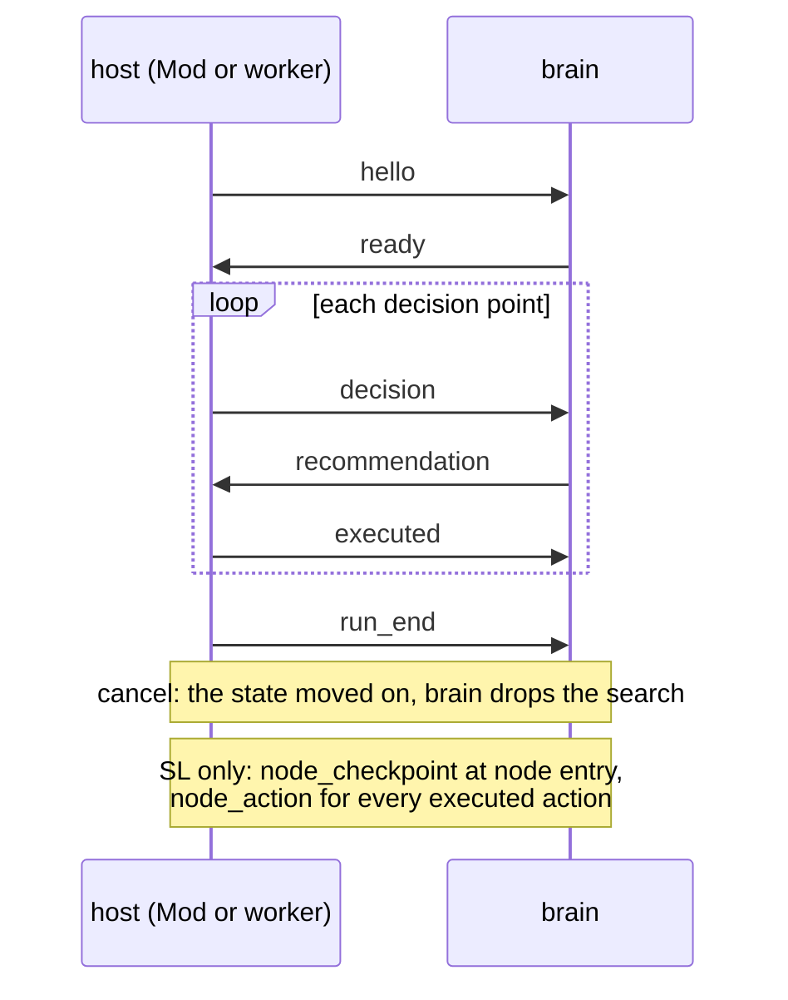

import { Aside } from '@astrojs/starlight/components';

Protocol is the shared language of the project's processes. The game host (the Mod inside the real game, or a SimWorker that runs a whole run headless) sends observations and legal actions; the decision process (Harness and the brains) answers with recommendations; search reaches simulated games through the world API defined here. The assembly `Sts2Ai.Protocol` references only the .NET framework, so Brain can use it without any game reference.

This assembly is also the observation **whitelist**: a field exists here only if the game's UI shows it (or it can be inferred from what the UI shows) and a test checks that. A value that is not in Protocol cannot reach the brain.

<Aside title="Status">

The combat part, the run-level observation with a screen for every surface ([§3](#sec-3)) and `ChoiceContext` ([§4](#sec-4)) exist (`src/Sts2Ai.Protocol`). The combat world API exists too ([§7](#sec-7)), and so do the worker messages that carry PIMC's world searches ([§7.1](#sec-7.1)). The host–brain messages exist (`Wire.cs`, [§2](#sec-2)), the SL ones included, and the simulator plays whole runs over them. The event stream and facts are planned.

</Aside>

## 1. Existing types

These types exist today. They cover combat, card prompts and the run-level observation.

- `CombatObservation`: everything the player can see of one combat. It holds the encounter id and its room type (Monster, Elite or Boss, as the map shows it), act, ascension, round, a `PlayerView`, the hand (with uids), the draw pile sorted by card key, the discard and exhaust piles, potions per slot, relics (each with its counter, status, whether it is melted or used up, and the cards it keeps, by id, as its tip lists them: Pael's Tooth's), allies, and the enemies with their intents as `IntentView{type, damage per hit, hits}`. The draw pile is sorted because its real order is hidden.
- `CardView{id, uid?, up, cost|x_cost, stars, enchant, affliction, tinker?, keywords sorted, vars sorted, upgraded?}`: one card as the player sees it. `ProtocolJson.CardKey` is the card serialized without its uid. That is the card's player-visible identity: two cards with the same key look the same to the player. `vars` leaves out calculated numbers (Perfected Strike's damage): the card shows them as a base number plus an extra number times a count from the state, and both parts are listed. `tinker` is set on a Mad Science: the card type and the rider the Tinker Time event chose for it, which its frame and text show and which its id alone does not fix (a world built without them gave it the wrong type, and a legal play in the real combat was illegal there). `upgraded` is the card after one more upgrade, as the game's upgrade preview shows it (the deck view's tickbox and the upgrade prompt): its numbers, cost and keywords then. Only cards of the deck that can be upgraded have it, in the run's deck and in a deck prompt's options, which are those same views; it is made on a clone of the card, which runs no hook and changes nothing in the run.
- `PowerView{id, amount, stacks?, card?}`: a power as its icon and tooltip show it. `amount` is the number on the icon. `stacks` is the power's own amount, which the tooltip states; it is there only when the icon shows another number (Sloth's icon counts the cards played this turn, and its stacks are the limit). `card` is a card the power keeps, which the tooltip names: the card Nightmare adds copies of next turn.
- `CombatAction`: one combat action, in text form `play:C[:T]` (play card C, optionally at target T), `potion:S[:T]` (use the potion in slot S) or `end_turn`. Actions name things by **uid**, a stable id taken from the game rather than a position in a list: a hand card's uid is its `NetCombatCardDb` id, a creature's uid is its `CombatId`. So an action stays valid while the hand changes, and means the same thing in the simulator and in the real game.
- `CardChoice{options canonical-sorted by card key, ties by hidden-state-free seed; min; max; context}`, with `Accepts(picks)`: a card prompt, such as "discard 1" or "choose 1 of 3". The options come in *canonical order*: sorted by card key, with ties broken by a seed that carries no hidden state, never in the game's own order. An answer picks between min and max options; `Accepts(picks)` checks it. `context` says why the game asks ([§4](#sec-4)).
- `Observation{run, screen}`: what the player sees at any decision ([§3](#sec-3)); the `Surfaces` constants (`Surfaces.cs`) name the screens.
- `ProtocolJson`: the JSON settings: snake_case names, null fields omitted. `ProtocolJson.Hash(obs)` computes `obs_hash` ([§2](#sec-2)).

## 2. Wire

All messages are **JSON lines**: one UTF-8 JSON object per line.

- **Mod ↔ brain:** a Unix domain socket. There is no TCP, so nothing is reachable from outside the machine.
- **Brain ↔ worker:** the stdin/stdout pipes of child processes. Switch to a binary codec only if profiling shows that JSON dominates.
- Every message has the form `{"type": ..., "v": PROTOCOL_VERSION, ...}`. The version is bumped on any breaking change, and logs record it.

In the messages below, the **host** is the process that runs the game: the Mod in the real game, or a worker that hosts a run (the `role` field says which). The **brain** is the decision process.

```
host → brain   hello{v, game_version, env: "NoSL"|"SL", role: "mod"|"worker", run: {run_id, character, ascension}}
brain → host   ready{champion}                // the run is accepted
host → brain   decision{decision_id, obs_hash, surface, obs, legal[], events[]}
brain → host   recommendation{decision_id, obs_hash, action, brain, plan?, candidates?, facts[], degraded?}
brain → host   error{message}                 // instead of ready or a recommendation; the host ends the run
host → brain   executed{decision_id, action, ok, error?}
host → brain   cancel{decision_id}            // state moved on; brain drops the search
host → brain   run_end{won, floor, reason}
// SL only (env-gated, docs: mod §6; a NoSL log containing these is invalid)
host → brain   node_checkpoint{node_index, save_json}      // RunManager.ToSave(null) at node entry
host → brain   node_action{node_index, seq, action}  // every decision in the node, as "surface action"
```

| message | direction | when / what |
|---|---|---|
| `hello` | host → brain | at the start of each run: protocol version, game version, environment (`NoSL` or `SL`), role (`mod` or `worker`), run header (run id, character, ascension) |
| `ready` | brain → host | the answer to `hello`: the brain takes the run, and names the champion that plays it |
| `decision` | host → brain | a decision point: decision id, observation hash, surface, observation, legal actions (empty for a card prompt, whose answer is `pick:i,j,…`, [§3](#sec-3)), the events since the previous decision |
| `recommendation` | brain → host | the answer: action, the brain that chose it, plan, candidates, facts, an optional degraded flag ([§6](#sec-6)) |
| `error` | brain → host | instead of `ready` or a `recommendation`: the brain cannot take the run or answer the decision (an uncovered surface, an illegal pick, an observation that does not match its hash); the host ends the run |
| `executed` | host → brain | which action was executed for a decision, whether it succeeded, the error if any |
| `cancel` | host → brain | the state moved on; the brain drops that search |
| `run_end` | host → brain | the run is over: won or not, floor, reason (`won`, `lost`, `truncated` at the decision cap, `failed` or `aborted`) |
| `node_checkpoint` | host → brain | SL only: the save `RunManager.ToSave(null)` taken at node entry |
| `node_action` | host → brain | SL only: every decision taken inside the node, numbered by `seq` from 0 and sent before the next decision, as `surface action` text (a card prompt's picks are the game's own indexes) |

The two SL messages are gated by the environment ([Mod §6](/en/arch/mod/#sec-6)). A NoSL log that contains either of them is invalid, and the brain answers them in NoSL with an `error` at the next decision. Nodes are numbered from 0 in the run; the checkpoint and the decisions after it make the node's clone ([Simulator §7](/en/arch/simulator/#sec-7)).

The normal exchange in one run:



Two fields protect against stale answers:

- `obs_hash` is FNV-1a 64 (a fast 64-bit hash) over the canonical JSON of `obs` (`ProtocolJson.Hash`). The host drops a recommendation whose hash differs from the current one, that is, one computed for a state that is no longer on screen.
- `decision_id` strictly increases within a run, and the brain answers only the latest one.

More rules of the exchange:

- One connection carries runs one after another, each from `hello` to `run_end`. Each run gets its own Harness on the brain side, made at `hello`.
- `run_id` is a hash of the run's seed (FNV-1a 64, in hex), so the seed never leaves the host ([Mod §9](/en/arch/mod/#sec-9)). Harness draws the brains' seeds from it ([Harness §5](/en/arch/harness/#sec-5)).
- The brain answers decisions in order, each before it reads the next message, so `cancel` has no search to drop yet.
- The host reports an action `executed` once the game reaches the next decision, or the end of the run. In the simulator, `ok` is false only when the run failed.
- The brain also checks `obs_hash` against the observation it received: a mismatch means the JSON did not survive the trip, and gets an `error`.

## 3. Observation

One `Observation` per decision (`Observation.cs`, `Screens.cs`). It is a *union*: the run part is always present, and the screen part is exactly one of several variants, the one for the surface that is asking. A **surface** is a kind of decision screen (combat, map, shop, …). In JSON the screen carries a `"surface"` field with the surface name, which says which variant it is. GameBridge builds observations ([GameBridge §3](/en/arch/gamebridge/#sec-3)).

```
Observation{run: RunView, screen: ScreenView}       // screen JSON carries "surface": <Surfaces constant>
RunView{character, ascension, act (from 0), act_id, floor (run total), hp, max_hp, gold,
        deck (sorted by card key), relics, potions (per slot, null = empty), map}
MapView{points (sorted by row, col: start row 0 .. boss / second boss), visited (this act, last = current),
        boss, second_boss?, ancient?}
MapPointView{col, row, type (map icon; "?" stays Unknown after the visit), next (sorted), quest?}
```

- `act_id` says which variant of the act this run rolled. `floor` is counted over the whole run, as the top bar shows it.
- `map` is the current act's map: every point with its icon and the points its paths lead to, the points visited in this act (the last one is where the player stands), and the boss, second boss and Ancient drawn on the map. `quest` marks a point a quest rewards reaching.

Each screen variant is named by its surface. The surface name is also the key Harness uses to route a decision to a brain ([Harness §4](/en/arch/harness/#sec-4)).

| surface | screen payload | legal action forms |
|---|---|---|
| `combat` | `combat: CombatObservation` | `play:C[:T]`, `potion:S[:T]`, `end_turn` |
| `card_choice` | `choice: CardChoice` (with its `context`, [§4](#sec-4)); `combat` too while a combat is going on | `pick:i,j,…` (canonical indexes; an empty pick is allowed only if min = 0) |
| `map` | `travelable` coords, in legal-action order (the map itself is in `run.map`) | `map:col,row` |
| `rewards` | the rewards not taken yet: `{index, kind, id?, amount?, card?, cards?}` with kind `gold`, `potion`, `relic`, `card`, `special_card` or `remove_card`; `cards` is a card reward's cards (rolled before the screen shows; a player can open the reward, look and skip at no cost) | `reward:i`, `rewards_done` |
| `card_reward` | `cards`, and `alternatives`: the other buttons by id (Skip, reroll, ones added by relics) | `card:i`, `card_alt:<id>` |
| `bundle` | `bundles`: lists of cards | `bundle:i` |
| `event` | `id`, `page` (loc key), `options{index, key, locked?, relic?, tips?, kills?}` (empty once finished), `finished` | `event:i`, `proceed` |
| `shop` | `entries{slot, kind, card? or id?, cost, on_sale?}` for the goods still for sale, kind `card`, `relic` or `potion`; `removal_cost` (absent once used) | `buy:<slot>`, `remove`, `leave` |
| `rest` | `options{id, enabled, heal?}`, `heal` being the HP the HEAL option restores, as its text shows (relics change it) | `rest:<id>`, `leave` (only after one option succeeded, or when none is left) |
| `treasure` | `relics`: the relics in the chest, by id | `relic:i`, `relic_skip` |
| `crystal_sphere` | `rows`, an 11x11 grid where `rows[y][x]` is `#` hidden, `.` uncovered and empty, or what the uncovered cell shows part of (`R` relic, `P` potion, `C` card reward, `G` gold, `X` curse); `divinations_left` | `big:X,Y` (3x3), `small:X,Y` (only if a hidden cell is uncovered) |

The end of a run is the wire message `run_end` ([§2](#sec-2)), not a surface.

Every macro surface (every surface except `combat` and `card_choice`) also lists the potion belt: `potion:S` (a potion that can be used at any time) and `discard_potion:S`. When the belt is full, potion rewards and potion purchases are left out of the legal actions until a slot frees up; there is no separate `potion_full` surface. The event action `proceed` means leaving to the map: from a finished event, or through an Ancient's PROCEED button.

The macro surfaces reach a policy as `MacroDecision{surface, legal, observation}` (in Brain); `card_choice` goes through `IChoicePolicy` as `ChoiceDecision{choice, observation}`. Both build the observation only when the policy reads it; a combat started on its own has no run, so its prompts come without one.

- Indexes into lists the game provides are fine when the UI order is public (rewards, events, shop slots). Card lists whose order may reflect hidden state (piles) always go through the canonical sort (`CardChoice`).
- The deck is sorted by card key, so the same deck reached in a different order gives the same observation.
- The map never holds what a future `?` turns out to be; the boss and the Ancient are drawn on the map, so they are included.
- Text is sent as loc keys (localization keys, `table.key`; event options by their text key), never as resolved strings. The numbers the game fills into event texts are not included yet: some events keep values the page does not show among them, so they need a per-event whitelist first. Hover tips (cards or relics shown in a tip) are visible, so an option's `tips` lists their model ids (`+` marks an upgraded card).
- Observations are built lazily: only when someone reads one (`MacroDecision.Observation`, `CombatDecision.Observation`, or the run session's `observed` callback).

## 4. ChoiceContext

`CardChoice` says what the options are, but not why the game is asking: the same options mean different things for an upgrade, a removal or a discard. In the real game a policy may get a prompt on its own, with nothing else telling it what the prompt is for. `ChoiceContext` carries that reason. GameBridge fills it ([GameBridge §5](/en/arch/gamebridge/#sec-5)).

```csharp
public sealed record ChoiceContext
{
    public required string Purpose { get; init; }       // from the CardSelectCmd entry, or "<pile>_pile"
    public string? Source { get; init; }                // card/relic/power/event id that asked
    public required bool Cancelable { get; init; }      // a cancel or skip button closes the prompt
    public required bool InCombat { get; init; }        // asked during a combat
    public string? PromptKey { get; init; }             // the prompt's loc key, "table.key"
    public ModifierView? Enchantment { get; init; }     // for deck_for_enchantment
}
```

| field | meaning |
|---|---|
| `Purpose` | the kind of prompt: the name of the `CardSelectCmd` entry the game used, without "From", in snake_case: `deck_for_upgrade`, `deck_for_transformation`, `deck_for_enchantment`, `deck_for_removal`, `deck_generic`, `hand`, `hand_for_discard`, `hand_for_upgrade`, `choose_a_card_screen`, `simple_grid`, `simple_grid_for_rewards`. A prompt over a combat pile is `draw_pile`, `discard_pile`, `exhaust_pile`, … |
| `Source` | id of the card, relic, power or event that asked, when the game names one: the entry's `source` argument, else the last model its `PlayerChoiceContext` involved (optional) |
| `Cancelable` | `CardSelectorPrefs.Cancelable`, or the `canSkip` of a choose-a-card screen |
| `InCombat` | `CombatManager.IsInProgress` when the prompt opens: a card or power resolving, rather than a rest site, event or shop. Harness routes the prompt by it ([Harness §4](/en/arch/harness/#sec-4)) |
| `PromptKey` | the prompt text's loc key (optional) |
| `Enchantment` | for `deck_for_enchantment`: the enchantment the picked cards get, and its amount |

- Cancelling or skipping is the empty answer, so `min` is 0 whenever `Cancelable` is set.
- A choose-a-card screen without a skip button asks its selector for 0 or 1 card and then enforces the pick itself, so its `min` is 1 (`ChoiceContexts.Bounds`).
- When one entry calls another (a removal goes through the generic deck prompt), the outermost entry names the purpose.

## 5. Events

Each `decision` message carries the **events** since the previous decision. Together they form the public history stream: what the player could have watched happen. The set is minimal: only what *belief* needs. Belief is the decision process's estimate of the hidden state, built from the public history ([Harness §3](/en/arch/harness/#sec-3)).

```
draw{card}  play{card_uid, target?}  move{card, from, to, pos: top|bottom|random|null}
generate{card, to}  shuffle{}  intents{creature, intents[]}  move_done{creature, effects…}
reward_seen{…}  shop_seen{…}  event_page{…}
```

`move` is a card moving from one pile to another; `move_done` reports a creature's finished move and its effects. The last line records what a rewards screen, a shop or an event page showed.

- In events a card is identified by its `CardView`, plus its uid while it is in hand.
- On the game side, GameBridge subscribes to game hooks and events to produce the stream ([GameBridge §8](/en/arch/gamebridge/#sec-8)).
- The set grows only when a belief feature needs it.

## 6. Recommendation

The brain's answer to a `decision`. `Wire.cs` has it without `Facts` and `Degraded`, which are planned:

```csharp
public sealed record Recommendation(long DecisionId, string ObsHash, string Action, string Brain,
    IReadOnlyList<string>? Plan = null,          // rest of the turn/screen, or of the act's route on the map
    IReadOnlyList<Candidate>? Candidates = null) : WireMessage;
// Planned:
//   IReadOnlyList<Fact> Facts                   // the only source for explanations
//   bool Degraded                               // worker loss etc.; docs: harness §7
public sealed record Candidate(string Action, double Value, double Ci, int Samples);
public sealed record Fact(string Kind, IReadOnlyDictionary<string, double> Values, bool Exact); // planned; Exact only in SL
```

- `Action` is one of the decision's legal actions; for a card prompt, `pick:i,j,…`.
- `Brain` names the brain that chose it, from the champion's routing table ([Harness §4](/en/arch/harness/#sec-4)). The host counts decisions per brain for the run record, where placeholder decisions must be zero ([Evaluation §3](/en/arch/evaluation/#sec-3)).
- `Candidates` come only from a searching brain, and `Plan` from a brain that plans (the combat search, and the macro brain on the map), as in the decision log ([Harness §6](/en/arch/harness/#sec-6)).
- `Plan` is the rest of the turn or screen, or on the map the rest of the act's route, used for the highlight and the narration.
- `Candidates` lists the actions that were scored, each with its `Value`, `Ci` (confidence interval) and number of `Samples`.
- `Facts` are the only source for explanations.
- A fact's `Exact` flag is set only in SL, where facts may be exact outcomes ([Environments §8](/en/arch/environments/#sec-8)).
- `Degraded` marks an answer given under trouble, such as the loss of a worker ([Harness §7](/en/arch/harness/#sec-7)).

## 7. World API

Search never touches a game directly. It gets **worlds** from this API: simulated combats it can observe, act in, snapshot and restore. The types live in Protocol (`World.cs`), so Brain can use them without game references; SimWorker implements them ([Simulator §6](/en/arch/simulator/#sec-6)). How NoSL and SL worlds differ is described in [Environments §5](/en/arch/environments/#sec-5).

```csharp
public enum PlayEnvironment { NoSL, SL }
public enum CombatStatus { InProgress, Won, Lost }

// Hands out the worlds for one decision.
public interface IWorldSource
{
    PlayEnvironment Environment { get; }
    // NoSL: k samples drawn from searchSeed. SL: the one exact copy.
    IReadOnlyList<ICombatWorld> Worlds(int k, ulong searchSeed);
}

public interface ICombatWorld
{
    CombatObservation Observe();
    IReadOnlyList<CombatAction> Legal();   // empty once the combat is over
    CombatStatus Status { get; }
    void Execute(CombatAction action);     // card prompts are answered inside the world
    WorldSnapshot Snapshot();
    void Restore(WorldSnapshot snapshot);  // a snapshot taken from this same world
}

public sealed record WorldSnapshot(IReadOnlyList<string> Steps);
public sealed record Candidate(string Action, double Value, double Ci, int Samples);
```

- A NoSL world is one sample of the hidden state that agrees with the observation; the SL world is an exact copy of the real combat.
- Worlds are combat worlds only: the combat brain is their only consumer. Run-level worlds come with macro search.
- `WorldSnapshot` is the list of steps the world has taken since it began (actions, prompt answers, determinize steps), in their text form. Search treats it as opaque; only the world that made it reads it, and restores it by replay. Because it is plain text, any worker can restore it.
- Card prompts raised inside a world are answered there. In v0 they go to `p0`, the fixed rule the run itself answers by, so a world picks as the run will; making each option a search branch is planned ([Combat brain §2](/en/arch/combat-brain/#sec-2), rule 7).
- `Candidate` is one scored action: its mean value over the worlds, the 95% confidence half-width, and the number of worlds.

Planned: the SL seal, under which `Execute` throws once the last action left the node (`AtHorizon`, [Simulator §7](/en/arch/simulator/#sec-7)).

### 7.1 Worker messages

The worker pool ([Simulator §8](/en/arch/simulator/#sec-8)) does not move worlds over the wire one step at a time: an IPC round trip (tens of µs) costs about as much as a sim step (about 0.1 ms), and search takes thousands of steps per decision. A request asks for a whole unit of work instead, here the search of one world (`Worker.cs`):

```csharp
// The worker's first line, once it has booted.
public sealed record WorkerHello(string Game);

// A request, typed by "type" on the wire; its reply carries the same id.
public abstract record WorkerRequest(long Id);

// "pimc_world": build the combat from Observation with BuildSeed, take world World of Worlds drawn
// from SearchSeed, and search this turn after each of First, in that order, each with NodesPerFirst nodes.
// History is the combat's record of enemy moves so far, for the leaves.
public sealed record PimcWorldRequest(long Id, CombatObservation Observation, IReadOnlyList<CombatAction> First,
    string BuildSeed, ulong SearchSeed, int World, int Worlds, int NodesPerFirst,
    IReadOnlyList<EnemyTurns>? History = null) : WorkerRequest(Id);

// "sl_world": load Node, the SL clone, and search this turn after each of First, each with NodesPerFirst nodes.
public sealed record SlWorldRequest(long Id, NodeClone Node, IReadOnlyList<CombatAction> First,
    int NodesPerFirst, IReadOnlyList<EnemyTurns>? History = null) : WorkerRequest(Id);

// Lines[i] is the best line after First[i]. Error is set instead when the request failed.
public sealed record WorkerReply(long Id, IReadOnlyList<PlannedLine>? Lines, string? Error, IReadOnlyList<string> GameErrors);

// Nodes: the actions simulated below the line's first action. Hashes: the hash of the observation each action
// is played at, which a followed plan checks before each step.
public sealed record PlannedLine(double Value, IReadOnlyList<CombatAction> Actions, int Nodes = 0,
    IReadOnlyList<ulong>? Hashes = null);
```

- A request carries everything the worker needs, so any worker can serve it and a crashed worker's request can be sent again.
- A NoSL request holds the observation, never the true state: a worker cannot see more than the player. An SL request holds the node's clone, which SL may know.
- `GameErrors` holds the game's `Log.Error` lines while the request was served, so the host can count them.

## 8. Invariants and tests

- **Round trip:** every type serializes and deserializes to the same JSON. Combat: selftest; run level: every observation of a `run --check` batch.
- **Whitelist:** a per-field test that the field is visible in the UI. For any new field, reviewers add a row to the fair-play table.
- No field carries seeds, RNG counters, move ids, the hidden order of a pile, or save paths.
- Canonical ordering wherever the game's order could reflect hidden state.

## 9. Open questions

1. Granularity of the event stream: start minimal, grow on demand.
2. Whether the worker pipes need a binary codec (measure).
3. What still has to reach the observation: the numbers in event texts (per-event whitelist), the rarity hint of card rewards, the preview a transform shows before it is confirmed.
