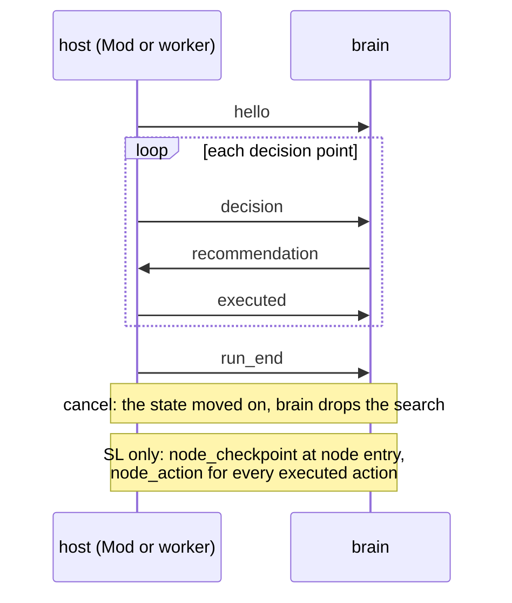

import { Aside } from '@astrojs/starlight/components';

Protocol is the shared language of the project's processes. The game host (the Mod inside the real game, or a SimWorker that runs a whole run headless) sends observations and legal actions; the decision process (Harness and the brains) answers with recommendations; search reaches simulated games through the world API defined here. The assembly `Sts2Ai.Protocol` references only the .NET framework, so Brain can use it without any game reference.

This assembly is also the observation **whitelist**: a field exists here only if the game's UI shows it (or it can be inferred from what the UI shows) and a test checks that. A value that is not in Protocol cannot reach the brain.

<Aside title="Status">

The combat part exists (`src/Sts2Ai.Protocol`). Run-level screens, the message envelopes, the event stream and the world API are planned. Listing and applying legal actions already works for every surface that has actions; the screen payloads do not exist yet ([§3](#sec-3)).

</Aside>

## 1. Existing types

These types exist today. They cover combat and card prompts.

- `CombatObservation`: everything the player can see of one combat. It holds the encounter id, act, ascension, round, a `PlayerView`, the hand (with uids), the draw pile sorted by card key, the discard and exhaust piles, potions per slot, relics, allies, and the enemies with their intents as `IntentView{type, damage per hit, hits}`. The draw pile is sorted because its real order is hidden.
- `CardView{id, uid?, up, cost|x_cost, stars, enchant, affliction, keywords sorted, vars sorted}`: one card as the player sees it. `ProtocolJson.CardKey` is the card serialized without its uid. That is the card's player-visible identity: two cards with the same key look the same to the player.
- `CombatAction`: one combat action, in text form `play:C[:T]` (play card C, optionally at target T), `potion:S[:T]` (use the potion in slot S) or `end_turn`. Actions name things by **uid**, a stable id taken from the game rather than a position in a list: a hand card's uid is its `NetCombatCardDb` id, a creature's uid is its `CombatId`. So an action stays valid while the hand changes, and means the same thing in the simulator and in the real game.
- `CardChoice{options canonical-sorted by card key, ties by hidden-state-free seed; min; max}`, with `Accepts(picks)`: a card prompt, such as "discard 1" or "choose 1 of 3". The options come in *canonical order*: sorted by card key, with ties broken by a seed that carries no hidden state, never in the game's own order. An answer picks between min and max options; `Accepts(picks)` checks it.
- `ProtocolJson`: the JSON settings: snake_case names, null fields omitted.

## 2. Wire

All messages are **JSON lines**: one UTF-8 JSON object per line.

- **Mod ↔ brain:** a Unix domain socket. There is no TCP, so nothing is reachable from outside the machine.
- **Brain ↔ worker:** the stdin/stdout pipes of child processes. Switch to a binary codec only if profiling shows that JSON dominates.
- Every message has the form `{"type": ..., "v": PROTOCOL_VERSION, ...}`. The version is bumped on any breaking change, and logs record it.

In the messages below, the **host** is the process that runs the game: the Mod in the real game, or a worker that hosts a run (the `role` field says which). The **brain** is the decision process.

```
host → brain   hello{v, game_version, env: "NoSL"|"SL", role: "mod"|"worker", run_header}
host → brain   decision{decision_id, obs_hash, surface, obs, legal[], prompt?, events[]}
brain → host   recommendation{decision_id, obs_hash, action, plan[], candidates[], facts[], degraded?}
host → brain   executed{decision_id, action, ok, error?}
host → brain   cancel{decision_id}            // state moved on; brain drops the search
host → brain   run_end{won, floor, reason}
// SL only (env-gated, docs: mod §6; a NoSL log containing these is invalid)
host → brain   node_checkpoint{node_index, save_json}      // RunManager.ToSave(null) at node entry
host → brain   node_action{node_index, seq, action}  // every executed action + prompt answer
```

| message | direction | when / what |
|---|---|---|
| `hello` | host → brain | once, at the start: protocol version, game version, environment (`NoSL` or `SL`), role (`mod` or `worker`), run header |
| `decision` | host → brain | a decision point: decision id, observation hash, surface, observation, legal actions, an optional `prompt`, the events since the previous decision |
| `recommendation` | brain → host | the answer: action, plan, candidates, facts, an optional degraded flag ([§6](#sec-6)) |
| `executed` | host → brain | which action was executed for a decision, whether it succeeded, the error if any |
| `cancel` | host → brain | the state moved on; the brain drops that search |
| `run_end` | host → brain | the run is over: won or not, floor, reason |
| `node_checkpoint` | host → brain | SL only: the save `RunManager.ToSave(null)` taken at node entry |
| `node_action` | host → brain | SL only: every executed action and prompt answer inside the node, numbered by `seq` |

The two SL messages are gated by the environment ([Mod §6](/en/arch/mod/#sec-6)). A NoSL log that contains either of them is invalid.

The normal exchange in one run:



Two fields protect against stale answers:

- `obs_hash` is FNV-1a 64 (a fast 64-bit hash) over the canonical JSON of `obs`. The host drops a recommendation whose hash differs from the current one, that is, one computed for a state that is no longer on screen.
- `decision_id` strictly increases within a run, and the brain answers only the latest one.

## 3. Observation

This is planned: one `Observation` per decision. It is a *union*: the run part is always present, and the screen part is exactly one of several variants, the one for the surface that is asking. A **surface** is a kind of decision screen (combat, map, shop, …).

```csharp
// Planned. One per decision; the screen part says which surface is asking.
public sealed record Observation
{
    public required RunView Run { get; init; }       // always present
    public required ScreenView Screen { get; init; } // exactly one variant
}

public sealed record RunView
{
    public required string Character { get; init; }
    public required int Ascension { get; init; }
    public required int Act { get; init; }            // index from 0
    public required int Floor { get; init; }          // total floor, as the top bar shows
    public required int Hp { get; init; }
    public required int MaxHp { get; init; }
    public required int Gold { get; init; }
    public required IReadOnlyList<CardView> Deck { get; init; }   // deck view order (public)
    public required IReadOnlyList<RelicView> Relics { get; init; }
    public required IReadOnlyList<string?> Potions { get; init; }
    public required MapView Map { get; init; }
}
```

Each screen variant is named by its surface. The surface name is also the key Harness uses to route a decision to a brain ([Harness §4](/en/arch/harness/#sec-4)).

| surface | payload | legal action forms |
|---|---|---|
| `combat` | `CombatObservation` | `play:C[:T]`, `potion:S[:T]`, `end_turn` |
| `card_choice` | `CardChoice` + `ChoiceContext` ([§4](#sec-4)) | `pick:i,j,…` (canonical indexes; an empty pick is allowed only if min = 0) |
| `map` | travelable coords (the current map is in `RunView.Map`) | `map:col,row` |
| `rewards` | rewards in UI order, `{kind, id/amount}` | `reward:i`, `rewards_done` |
| `card_reward` | cards + alternatives (skip, reroll, added by a hook; at most 2) | `card:i`, `card_alt:<id>` |
| `bundle` | bundles of cards | `bundle:i` |
| `event` | event id, page key, options `{index, key, locked, tips}` | `event:i`, `proceed` |
| `shop` | entries `{slot, kind, id, cost, stocked, affordable}`, card removal `{cost, used}` | `buy:<slot>`, `remove`, `leave` |
| `rest` | options `{id, enabled}` | `rest:<id>`, `leave` (only after one option succeeded, or when none is left) |
| `treasure` | relic choices | `relic:i`, `relic_skip` |
| `crystal_sphere` | 11x11 grid: for each cell, hidden or what it shows; divinations left | `big:X,Y` (3x3), `small:X,Y` (only if a hidden cell is uncovered) |
| `game_over` | won, floor | — |

Every macro surface (every surface except `combat` and `card_choice`) also lists the potion belt: `potion:S` (a potion that can be used at any time) and `discard_potion:S`. When the belt is full, potion rewards and potion purchases are left out of the legal actions until a slot frees up; there is no separate `potion_full` surface. The event action `proceed` means leaving to the map: from a finished event, or through an Ancient's PROCEED button.

**Built today:** legal actions and applying them, for every surface that has actions. The macro surfaces are passed as `MacroDecision(surface, legal)`, with the surface constants in `Surfaces` in `MacroDecision.cs`; `card_choice` still goes through `IChoicePolicy`. The payloads in the table are not built yet.

- Indexes into lists the game provides are fine when the UI order is public (rewards, events, shop slots). Card lists whose order may reflect hidden state (piles) always go through the canonical sort (`CardChoice`).
- `MapView` holds the points `{col,row,type}` (a `?` stays `unknown`), the edges, the visited coords, the current coord, and the boss id if it is shown. It never holds what a future `?` turns out to be.
- Text: event and option ids are sent as loc keys (localization keys), never as resolved strings that contain hidden values. Hover tips (cards or relics shown in a tip) are visible, so they are included.

## 4. ChoiceContext

This type fixes a known gap: `CardChoice` says what the options are, but not why the game is asking. In the real game a policy may get a prompt on its own, with nothing else telling it what the prompt is for. `ChoiceContext` carries that reason. It is planned; GameBridge will fill it ([GameBridge §5](/en/arch/gamebridge/#sec-5)).

```csharp
// Planned. Why the game is asking, so a policy can answer a lone prompt in the real game.
public sealed record ChoiceContext
{
    public required string Purpose { get; init; }   // discard, exhaust, upgrade, transform, enchant, remove,
                                                    // choose, put_on_draw_top, retain, … (from the CardSelectCmd entry)
    public string? Source { get; init; }            // card/relic/power/event id that asked
    public required bool Cancelable { get; init; }  // CardSelectorPrefs.Cancelable (needs a prefix to expose, docs: simulator §5)
    public string? PromptKey { get; init; }         // the prompt's loc key
}
```

| field | meaning |
|---|---|
| `Purpose` | what the pick does: discard, exhaust, upgrade, transform, enchant, remove, choose, put_on_draw_top, retain, …; taken from the `CardSelectCmd` entry the game used |
| `Source` | id of the card, relic, power or event that asked (optional) |
| `Cancelable` | `CardSelectorPrefs.Cancelable`; exposing it needs a prefix patch ([Simulator §5](/en/arch/simulator/#sec-5)) |
| `PromptKey` | the prompt's loc key (optional) |

## 5. Events

Each `decision` message carries the **events** since the previous decision. Together they form the public history stream: what the player could have watched happen. The set is minimal: only what *belief* needs. Belief is the decision process's estimate of the hidden state, built from the public history ([Harness §3](/en/arch/harness/#sec-3)).

```
draw{card}  play{card_uid, target?}  move{card, from, to, pos: top|bottom|random|null}
generate{card, to}  shuffle{}  intents{creature, intents[]}  move_done{creature, effects…}
reward_seen{…}  shop_seen{…}  event_page{…}
```

`move` is a card moving from one pile to another; `move_done` reports a creature's finished move and its effects. The last line records what a rewards screen, a shop or an event page showed.

- In events a card is identified by its `CardView`, plus its uid while it is in hand.
- On the game side, GameBridge subscribes to game hooks and events to produce the stream ([GameBridge §8](/en/arch/gamebridge/#sec-8)).
- The set grows only when a belief feature needs it.

## 6. Recommendation

The brain's answer to a `decision`. It is planned.

```csharp
// Planned.
public sealed record Recommendation
{
    public required long DecisionId { get; init; }
    public required string ObsHash { get; init; }
    public required string Action { get; init; }                 // one of legal[]
    public required IReadOnlyList<string> Plan { get; init; }    // rest of the turn/screen, for highlight + narration
    public required IReadOnlyList<Candidate> Candidates { get; init; }
    public required IReadOnlyList<Fact> Facts { get; init; }     // the only source for explanations
    public bool Degraded { get; init; }                          // worker loss etc.; docs: harness §7
}
public sealed record Candidate(string Action, double Value, double Ci, int Samples);
public sealed record Fact(string Kind, IReadOnlyDictionary<string, double> Values, bool Exact); // Exact only in SL
```

- `Action` is one of the decision's legal actions.
- `Plan` is the rest of the turn or screen, used for the highlight and the narration.
- `Candidates` lists the actions that were scored, each with its `Value`, `Ci` (confidence interval) and number of `Samples`.
- `Facts` are the only source for explanations.
- A fact's `Exact` flag is set only in SL, where facts may be exact outcomes ([Environments §8](/en/arch/environments/#sec-8)).
- `Degraded` marks an answer given under trouble, such as the loss of a worker ([Harness §7](/en/arch/harness/#sec-7)).

## 7. World API

Search never touches a game directly. It gets **worlds** from this API: simulated games it can observe, act in, snapshot and restore. The types live in Protocol, so Brain can use them without game references. SimWorker implements them, either in the same process or over pipes. How NoSL and SL worlds differ is described in [Environments §5](/en/arch/environments/#sec-5).

```csharp
public enum PlayEnvironment { NoSL, SL }

// The only way search touches a game. Given by Harness per decision.
public interface IWorldSource
{
    PlayEnvironment Environment { get; }
    // NoSL: k worlds sampled from the public record, seeded from searchSeed.
    // SL: one clone of the current node; k and searchSeed are ignored.
    IReadOnlyList<ISimWorld> Worlds(int k, ulong searchSeed);
}

public interface ISimWorld : IDisposable
{
    Observation Observe();
    IReadOnlyList<string> Legal();
    void Execute(string action);       // throws if illegal, or if AtHorizon
    bool AtHorizon { get; }            // SL: the last action left the node. NoSL: always false.
    WorldSnapshot Snapshot();          // opaque, serializable recipe (worker-side replay)
    void Restore(WorldSnapshot snapshot);
    // Batched to amortize IPC: run each branch from the snapshot, return the leaf observations.
    IReadOnlyList<BranchResult> RunBranches(WorldSnapshot from, IReadOnlyList<Branch> branches);
}
public sealed record Branch(IReadOnlyList<string> Actions, string? RolloutPolicy, int MaxActions);
public sealed record BranchResult(Observation Leaf, bool AtHorizon, bool Ended, int ActionsRun);
```

- `IWorldSource` is handed out by Harness for each decision, and is the only way search touches a game. In NoSL it returns k worlds sampled from the public record, seeded from `searchSeed`. In SL it returns one clone of the current node and ignores `k` and `searchSeed`.
- `ISimWorld.Execute` throws on an illegal action, or once the world is `AtHorizon`. In SL, `AtHorizon` means the last action left the node; in NoSL it is always false.
- `WorldSnapshot` is an opaque, serializable recipe that the worker restores by replay. So it survives worker crashes: any worker can restore it by replay.
- `RunBranches` exists because one IPC round trip per step (about tens of µs) costs about as much as one sim step (about 0.1 ms). So rollouts run inside the worker, with Brain's rollout policies; SimWorker already references Brain. A *rollout* plays a line forward with a fast policy to estimate how good it is. Each `Branch` gives a list of actions, an optional rollout policy and a cap on the number of actions. Each `BranchResult` gives the leaf observation, whether the world is at the horizon, whether it ended, and how many actions ran.

## 8. Invariants and tests

- **Round trip:** every type serializes and deserializes to an equal record (exists for combat).
- **Whitelist:** a per-field test that the field is visible in the UI. For any new field, reviewers add a row to the fair-play table.
- No field carries seeds, RNG counters, move ids, the hidden order of a pile, or save paths.
- Canonical ordering wherever the game's order could reflect hidden state.

## 9. Open questions

1. Granularity of the event stream: start minimal, grow on demand.
2. `RunView.Deck` order: does the deck view sort? Use the public UI order; verify in game.
3. Whether the worker pipes need a binary codec (measure).
