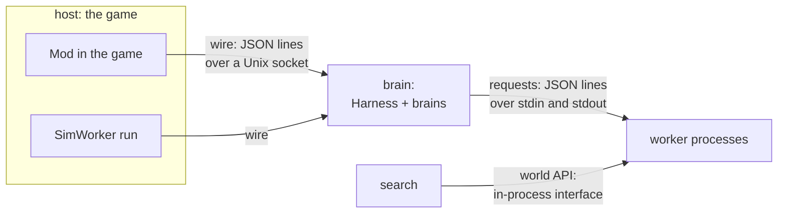

import { Aside } from '@astrojs/starlight/components';

The project's programs never share objects: the game, the brain and the search workers run in different processes, and the brain must not see the game at all ([Introduction §2](/en/#sec-2)). What they share is a language, the types of the assembly `Sts2Ai.Protocol` (`src/Sts2Ai.Protocol`). Everything one part tells another is one of these types, usually as a line of JSON. This chapter is that language: what each message and field means, and what may and may not be in it.

<Aside title="Status">

Exist: the observation of every decision screen, combat and card prompts included; the actions in text form; the host–brain wire with its SL node messages, over which the simulator plays whole runs and the mod in the game advises; the combat world API; the four worker requests. Planned: the event stream of the public history, facts for explanations, and the `degraded` flag of a recommendation ([§6](#sec-6)).

</Aside>

## 1. Three conversations

The types serve three conversations:

| conversation | between | carries | page |
|---|---|---|---|
| the wire | a **host**, the process that runs the game (the mod in the real game, or the simulator hosting a run), and the **brain**, the decision process | hello, each decision with its observation and legal actions, the recommendation, the end of the run; in SL the node's checkpoint and decisions | [The wire](/en/arch/protocol/wire/) |
| worker requests | the brain's searches and the simulator's worker processes | one unit of search work per request: a world of a combat decision, a turn of the SL planner, a set of probes on the clone | [Worlds and worker messages](/en/arch/protocol/worlds/) |
| the world API | a search and the worlds it plays in | observe, list the legal actions, execute, snapshot, restore | [Worlds and worker messages](/en/arch/protocol/worlds/) |

The observation and the actions, which all three carry, have a page of their own: [Observations and actions](/en/arch/protocol/observation/).

## 2. An assembly that knows no game

`Sts2Ai.Protocol` references nothing but the .NET framework: no game assembly, no other project. That is the whole point of it. The brain (`Sts2Ai.Brain`) references Protocol and nothing of the game, and Harness references Brain, so the only things a brain can ever read are what a Protocol type carries. GameBridge, which reads the game, translates it into Protocol types ([GameBridge](/en/arch/gamebridge/)).

| project | references |
|---|---|
| `Sts2Ai.Protocol` | nothing |
| `Sts2Ai.Brain` | Protocol (and ONNX Runtime for the nets) |
| `Sts2Ai.Harness` | Brain, so Protocol |
| `Sts2Ai.GameBridge` | Protocol and the game's assemblies |
| `Sts2Ai.SimWorker` | all of the above |
| `Sts2Ai.Mod` | compiles GameBridge's and Protocol's source files into itself, and runs inside the game |

The boundary is checked twice: `BoundaryTests` (xUnit, without the game) and the first two `selftest` checks walk the compiled references of Brain, Protocol and Harness and fail if any reaches a game assembly, with GameBridge as the control that does ([Simulator: reference §5](/en/arch/simulator/reference/#sec-5)).

## 3. What may be in it

A Protocol type is what the brain is allowed to know, so what goes into one is a fairness decision, not a convenience. The rules:

- **Only what the player can see.** A field exists because the game's screen shows it, or because it follows from what the screen showed. The doc comment of each type says where the game shows it (`CombatObservation.cs:3-12`).
- **Never the hidden state**: no seeds, random-stream counters, queued monster moves (only their intents), the order of a pile the player cannot see, or save paths. The draw pile is a sorted list; a monster shows its intents, never its move ([Observations and actions §3](/en/arch/protocol/observation/#sec-3)).
- **No order that could leak the hidden state.** Where the game's own order of a list might depend on hidden things, the list goes out in a canonical order instead ([Observations and actions §4](/en/arch/protocol/observation/#sec-4)).
- **SL's exceptions are explicit.** In SL the brain may know the current node exactly, so two kinds of message carry what NoSL never may: the node checkpoint, whose save holds the run's seed and random streams, and the node's clone in worker requests. Both are gated by the environment: a NoSL run refuses them ([The wire §6](/en/arch/protocol/wire/#sec-6)), and the search never reads them except through a world.

There is no test per field that it is visible in the game: these rules are kept by review, by the doc comments, and by the observation round trips below. A new field gets its row in the fair-play table of the output chapter when it reaches a player ([Output §6](/en/arch/output/#sec-6)).

## 4. JSON conventions

Every Protocol message is JSON written by `ProtocolJson` (`ProtocolJson.cs`):

- property names in `snake_case` (`max_hp`, `decision_id`); fields that are null are left out;
- **enums as numbers**, since no string converter is set: a `TurnEnd`'s `status` is `0`, `1` or `2`;
- **dictionary keys as they are**: a card's `vars` keep the game's names (`"Damage"`, `"Block"`);
- **`ulong` as JSON numbers**: hashes, hidden keys and search seeds. A JavaScript reader loses precision on them; .NET and Python read them exactly;
- a list keeps its nulls: an empty potion slot is `null` in `potions`;
- **combat actions as text**, `play:7:1`, through their own converter, so a log line reads as the action it is.

Two functions give identities:

- `ProtocolJson.Hash(value)` is FNV-1a 64, a fast non-cryptographic hash, over the UTF-8 bytes of the value's JSON. It names an observation (`obs_hash`, as 16 hex digits), a run (`run_id`, from the seed's JSON string), and a combat's hidden state (a world's hidden key). Since it hashes the JSON, it depends on the serialization: two builds whose types differ by one field hash the same observation differently, which the brain uses to catch a host built from another commit ([The wire §5](/en/arch/protocol/wire/#sec-5)).
- `ProtocolJson.CardKey(card)` is the card's JSON without its uid: everything the player sees of the card. Two cards with the same key are the same card to the player, and every list whose order must not depend on hidden state is sorted by it.

## 5. Tests

| what | where |
|---|---|
| the boundary: Brain, Protocol and Harness reach no game assembly | `BoundaryTests`; `selftest` |
| every combat observation and every combat action survive a JSON round trip, as text and as JSON | `selftest`, per combat ([Simulator: reference §5](/en/arch/simulator/reference/#sec-5)) |
| every observation of a run survives a JSON round trip, and the same run gives the same observation hashes | `run --check` ([Simulator: whole runs §6](/en/arch/simulator/runs/#sec-6)) |
| a run plays the same in process and over the wire: trace, observations, run record, decision log | `run --check` |
| the brain refuses node messages in NoSL; a node's clone keeps the gauntlet's rule | `DispatcherTests` |
| the wire version: a message of another `v` is refused when read | `WireStream.Receive` |
| the SL decisions a host sent replay on their clones with the same observations | `clones` over a `brain --wire` log ([Mod: the SL record §8](/en/arch/mod/sl-record/#sec-8)) |

## 6. Planned

- **The event stream.** Each `decision` would carry the public events since the previous one (cards drawn and moved, intents shown, screens seen), so that a belief over the hidden state can be built from them ([Observations and actions §8](/en/arch/protocol/observation/#sec-8)).
- **Facts** in the recommendation: the only source for explanations, exact only in SL ([The wire §7](/en/arch/protocol/wire/#sec-7)).
- **`degraded`**: a recommendation given under trouble, such as a lost worker. Today a lost worker fails the decision instead ([Simulator: the worker pool §6](/en/arch/simulator/pool/#sec-6)).

## 7. This chapter

| page | what it explains |
|---|---|
| [The wire](/en/arch/protocol/wire/) | the host–brain conversation: its socket, every message and field, one run step by step, the rules, the SL node messages, the recommendation, how the two hosts differ |
| [Observations and actions](/en/arch/protocol/observation/) | the observation of every decision: the run, a combat, card identity and canonical order, every screen with its actions, card prompts and their context, what is left out |
| [Worlds and worker messages](/en/arch/protocol/worlds/) | the world API search plays in, the node clone and the record of enemy moves, and the four worker requests with their answers |

Open questions:

1. How fine the event stream should be: start with what a belief needs, and grow it on demand.
2. Whether the worker pipes need a binary codec; only if profiles show JSON dominates.
3. What still has to reach the observation: the numbers in event texts (which need a per-event whitelist, since some events keep values their page does not show), the rarity hint of card rewards, the preview a transform shows before it is confirmed.
