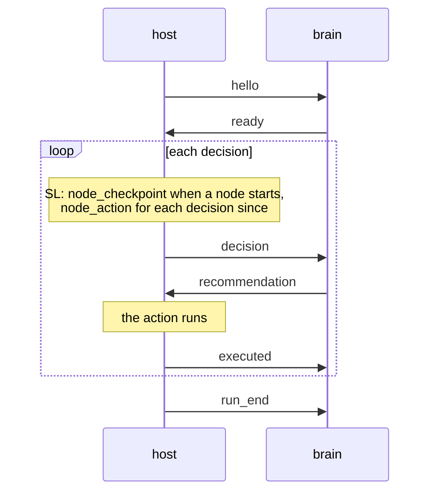

import WireExchange from '../../../../../components/book/WireExchange.svelte';

The brain never runs inside the game. The game's side, the **host**, asks it one question per decision and gets one answer back. The host is the mod in the real game, or the simulator hosting a run (`run --brain`); the **brain** is Harness with the champion's brains, served by the `brain` command ([Simulator: whole runs §7](/en/arch/simulator/runs/#sec-7)). Both ends use the same types (`Sts2Ai.Protocol/Wire.cs`), so a run plays the same whichever host asks.

## 1. The connection

- **A Unix domain socket**, never TCP, so nothing outside the machine can reach the brain. By default `$XDG_STATE_HOME/sts2ai/brain.sock`, or `~/.local/state/sts2ai/brain.sock` when that variable is unset (`BrainSocket.DefaultPath`): Steam runs the game in a container that shares the home directory with the host system, but not `$XDG_RUNTIME_DIR`.
- **The brain listens** (`BrainServer.Listen`, `Sts2Ai.Harness/BrainServer.cs`). It creates the socket's directory readable by the user only, replaces a socket file left by a brain that is gone, and refuses to start if a brain still listens there. A path starting with a NUL byte names an abstract socket, which has no file: `run --check` uses one for its in-process brain.
- **One host at a time.** The brain serves one connection until the host closes it, then takes the next. A connection whose bytes are not valid messages is dropped with a warning, and the brain goes on listening.
- **Runs one after another.** A connection carries runs in sequence, each from `hello` to `run_end`.

## 2. The format

Every message is one line of UTF-8 JSON (`WireStream`). The first property is `type`, the message's kind; the second is `v`, the protocol version, now 1; then the message's fields in their declared order, in `snake_case`, with null fields left out ([Overview §4](/en/arch/protocol/#sec-4)):

```json
{"type":"executed","v":1,"decision_id":0,"action":"event:0","ok":true}
```

The version is bumped on any breaking change. A reader refuses a message whose `v` is not its own. Within a version, a field one side does not know is dropped on reading; the observation hash then differs, so a host built from another commit than the brain fails at its first decision with a message saying so ([§5](#sec-5)).

## 3. The messages

| type | direction | fields | meaning |
|---|---|---|---|
| `hello` | host → brain | `game_version`, `env` (`"NoSL"` or `"SL"`), `role` (`"mod"` or `"worker"`), `run`: `{run_id, character, ascension}`, `effort`? (`"low"`, `"medium"`, `"high"` or `"max"`) | a run starts; the environment is fixed for the run, and so is the SL planner's effort the host asks for, if any ([Harness §5](/en/arch/harness/#sec-5)) |
| `ready` | brain → host | `champion` | the brain takes the run, and names the champion that plays it |
| `decision` | host → brain | `decision_id`, `obs_hash`, `surface`, `obs`, `legal` | a decision point: the kind of screen, the observation ([Observations and actions](/en/arch/protocol/observation/)), the legal actions; `legal` is empty for a card prompt, whose answer is `pick:i,j,…` |
| `recommendation` | brain → host | `decision_id`, `obs_hash`, `action`, `brain`, `plan`?, `candidates`? | the answer ([§7](#sec-7)) |
| `executed` | host → brain | `decision_id`, `action`, `ok`, `error`? | the host played the answer to a decision |
| `cancel` | host → brain | `decision_id` | the game moved on before the answer came |
| `run_end` | host → brain | `won`, `floor`, `reason` | the run is over; `reason` is `won`, `lost`, `truncated` (the decision cap), `failed` or `aborted` |
| `error` | brain → host | `message` | instead of `ready` or a `recommendation`: the brain cannot take the run or answer the decision; the host ends the run |
| `node_checkpoint` | host → brain | `node_index`, `checkpoint` | SL only: a node starts ([§6](#sec-6)) |
| `node_action` | host → brain | `node_index`, `seq`, `action` | SL only: a decision taken in the node ([§6](#sec-6)) |

`run_id` is `ProtocolJson.Hash` of the seed's JSON string, as 16 hex digits (`RunHeader.IdOf`): the brain can tell runs apart and seed its own random streams from the id, without learning the seed from it ([Harness: routing, budgets and seeds §5](/en/arch/harness/routing/#sec-5)). `decision_id` counts from 0 in each run. `obs_hash` is the observation's hash as 16 hex digits.

## 4. One run, step by step



The opening of the book's example run, as the simulator hosting it in SL would send it:

<WireExchange client:visible lang="en" />

## 5. The rules of the exchange

**Answers stay in step with the game.**

- The brain answers decisions in order, each before it reads the next message. A `decision_id` not greater than the last one gets an `error` (`BrainServer.cs:101-105`).
- The brain checks that `obs_hash` is the hash of the `obs` it received. A mismatch means the observation did not survive the trip, most often because the two ends were built from different commits, and gets an `error` saying so.
- The recommendation repeats the decision's id and hash. The simulator's host fails the run if either differs; the mod keeps answers by decision id and shows one only while the game still shows the same observation and legal list ([§8](#sec-8)).
- The action must be one of the decision's legal actions (for a card prompt, picks the prompt accepts); Harness refuses anything else, so an illegal answer reaches the host as an `error`.

**What `error` means.** The brain sends `error` instead of `ready` when it refuses the run (an environment its champion cannot play, such as the SL planner in a NoSL run, or an effort it does not know), and instead of a recommendation when it cannot answer: a decision outside a run, an uncovered surface, an illegal pick, a hash that does not match, a decision after a refused node message. The host then ends the run: the simulator's run fails; the mod sends `run_end` with `failed` and turns the assistant off for that run.

**`executed` and `cancel`.** The simulator's host sends `executed` for a decision once the game has reached the next decision or the end of the run; `ok` is false only when the run failed. The brain reads both messages and ignores them: it answers each decision before reading on, so there is never a search to drop. The mod sends `executed`, with `ok` true, for each answer the AI played at the player's request ([Mod: auto-play and safety §2](/en/arch/mod/auto/#sec-2)), and none for the player's own actions; it sends `cancel` when the game moves on before the answer arrives, and waits for that answer before asking again.

**Runs.** A `hello` in the middle of a run starts a new one: the brain drops the old run's Harness. At `run_end` the `brain` command writes the run's decision log and prints a line for it. The reasons by host: the simulator ends a run `won`, `lost`, `truncated` or `failed`; the mod `won`, `lost`, `failed`, or `aborted` when the player switches the environment or the effort, or turns the assistant off, mid-run.

## 6. SL: the node messages

In SL the brain may know the current node exactly, a node being a map point from arrival to the travel that leaves it ([Environments: information §3](/en/arch/environments/information/#sec-3)). The host sends what the brain needs to rebuild it, the node's clone ([Simulator: worlds and the SL clone §3](/en/arch/simulator/worlds/#sec-3)), in two messages:

- **`node_checkpoint`** when a node starts: `node_index` (from 0, the first node the host saw; a mod can join a run late), and `checkpoint`, a JSON string of its own holding the game's save on arrival and each relic's plain fields.
- **`node_action`** for each decision taken in the node: `seq` from 0 within the node, and the decision in its trace form, the surface, a space, then the action (`map 0,1`, `combat play:7:1`). A card prompt's step is `card_choice` with the picks as the game's own indexes, not the canonical indexes of `pick:` ([Observations and actions §4](/en/arch/protocol/observation/#sec-4)), since the clone replays it through the game's card selector.

**Timing.** Both are sent lazily, just before the next decision: the checkpoint if a new node has started since, then each decision of the node not yet sent (`Brains/RunBrains.cs:88-99`). A node's travel, its last decision, is therefore never sent: the next decision is in the next node, which starts with its own checkpoint.

**Rules** (`Sts2Ai.Harness/Dispatcher.cs:170-186`): node messages in a NoSL run are refused; node indexes must increase; `seq` must equal the number of actions the node has so far; an SL combat decision before any checkpoint is an error. The brain does not answer node messages: one it refuses fails the run's next decision with the reason.

**What SL lets through.** The checkpoint carries the game's save, which holds the run's seed and random streams, so in SL the seed reaches the brain after all. SL may know it: the node's outcomes are the game's own ([Environments: information §2](/en/arch/environments/information/#sec-2)). The brain reads the checkpoint only by loading it in a worker, as a clone sealed at the node's exit.

## 7. The recommendation

```csharp
public sealed record Recommendation(long DecisionId, string ObsHash, string Action, string Brain,
    IReadOnlyList<string>? Plan = null, IReadOnlyList<Candidate>? Candidates = null) : WireMessage;

public sealed record Candidate(string Action, double Value, double Ci, int Samples,
    IReadOnlyList<double>? Values = null, double? Win = null, double? Hp = null,
    IReadOnlyList<string>? Plan = null);
```

| field | meaning |
|---|---|
| `action` | one of the decision's legal actions; for a card prompt, `pick:i,j,…` |
| `brain` | the brain that chose it, as the champion's routing table names it ([Harness: routing, budgets and seeds §1](/en/arch/harness/routing/#sec-1)); the host counts decisions per brain for the run record, where placeholder decisions must be none ([Evaluation: metrics, seeds and reports §2](/en/arch/evaluation/metrics/#sec-2)) |
| `plan` | what the brain planned after this action: the rest of the turn from PIMC, the rest of the combat from the SL planner, the rest of the act's route from the macro brain on the map |
| `candidates` | the options the brain scored, the chosen first, then best first: a searching combat brain's first actions; L0's options at a decision or card prompt outside combat, valued by V (none when its answer was drawn by exploration). A card prompt's options are answers (`pick:i,j`); a card prompt in combat has none |

A `Candidate` (`World.cs:70`) is one scored option:

| field | meaning |
|---|---|
| `value` | a search's mean over its worlds; outside combat, V's chance to win the run after the option |
| `ci`, `samples` | the half-width of the 95% confidence interval and the worlds; 0 and 1 for the SL planner and for V |
| `values`? | when the search kept them, the value in each world, to 4 decimals |
| `win`?, `hp`? | the SL planner's: the chance to win the combat on the action's best line, 1 or 0 where the line reaches the combat's end, else the combat net's 1 − P(death); and the HP held at the end of a win on that line, exact at the end, else expected from the net's buckets ([Combat brain: the leaf §5](/en/arch/combat-brain/leaf/#sec-5)) |
| `plan`? | on the map, the route to the boss the macro brain would take after the option; only for the hosts that show answers ([Harness §5](/en/arch/harness/#sec-5)) |

The plan and a combat's candidates are what the decision log keeps too ([Harness: the decision log §5](/en/arch/harness/decision-log/#sec-5)); the options outside combat go to the host only. All of them are what the output shows the player ([Output §2](/en/arch/output/#sec-2)).

**Planned:**

- `facts`: the only source for explanations. Each fact would be a kind and its numbers, marked exact only in SL, where facts may be exact outcomes ([Environments: worlds §7](/en/arch/environments/worlds/#sec-7)).
- `degraded`: an answer given under trouble, such as the loss of a worker ([Harness: routing, budgets and seeds §6](/en/arch/harness/routing/#sec-6)).

## 8. The two hosts

| | the simulator (`run --brain`, `run --check`) | the mod in the game |
|---|---|---|
| `role` | `worker` | `mod` |
| when it asks | at each decision the run reaches | once the screen has been still for 3 frames (the same observation hash and legal list), one decision at a time |
| acts on the answer | plays it | shows it; the AI plays it when the player asks ([Mod: auto-play and safety §2](/en/arch/mod/auto/#sec-2)) |
| `executed` | after each action | after each action the AI played |
| `cancel` | never | when the screen changes first |
| node messages | in SL, before each decision | in SL, before each decision |
| `error` from the brain | the run fails | `run_end` `failed`; the assistant is off for the rest of the run |
| `run_end` reasons | `won`, `lost`, `truncated`, `failed` | `won`, `lost`, `failed`, `aborted` |
| `effort` in `hello` | never | the player's choice, if any |

The mod's side is described in [Mod: the main loop §8](/en/arch/mod/loop/#sec-8) and [Mod: the SL record §7](/en/arch/mod/sl-record/#sec-7): it runs in single-player runs only, on the game version it was built for.
