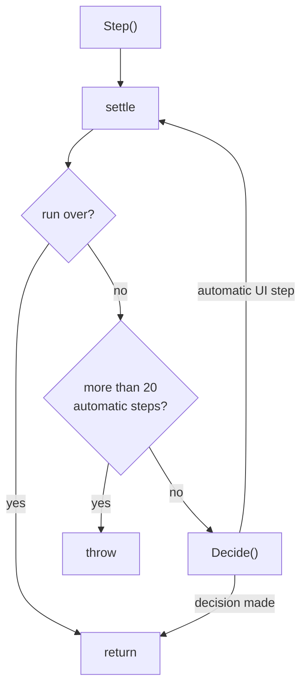

import { Aside, Badge, Steps } from '@astrojs/starlight/components';

The simulator is `Sts2Ai.SimWorker`: a plain .NET process that loads the game's own `sts2.dll` and runs its rules **headless**, with no Godot engine, window, rendering or sound. The rules are the game's code, not a rewrite ([overview §1](/en/#sec-1), constraint 4). The decision process never loads the game; it talks to simulator processes instead ([overview §3](/en/#sec-3)).

<Aside title="Status">

Exists: the headless host, single-combat sessions, Determinize, CombatBuilder, the whole-run session, combat worlds ([§6](#sec-6)), the SL node clone ([§7](#sec-7)), and the worker pool for PIMC's worlds, NoSL and SL, and for the SL planner's turns ([§8](#sec-8)). Planned: run worlds.

</Aside>

A worker process has three roles:

- **(a)** the host of the "real" run in R1–R3 (the rungs of the [sim-to-real ladder](/en/arch/evaluation/#sec-1) where the simulator, not the real game, plays the run);
- **(b)** search worlds: NoSL samples and SL clones ([Environments §5](/en/arch/environments/#sec-5));
- **(c)** benchmarks and the selftest.

Each process holds **one live run or combat** at a time. The game keeps the run and the combat in process-wide singletons (`RunManager`, `CombatManager`), so a second run cannot exist next to the first. Branching is therefore done by replay ([§2](#sec-2)), and parallel search needs several processes ([§8](#sec-8)).

File references such as `Runs/RunManager.cs:295-312` point into the decompiled game assembly. Godot node files (`NGame.cs`, `NRestSiteRoom.cs`) are unique by name, so they are given by file name only.

## 1. Headless host

The game is a Godot app. Its rules live in managed C# (the "model layer"), its screens in Godot nodes. Headless, only the model layer runs. Three things make that work: a stub for the native engine, a set of Harmony patches (runtime rewrites of game methods), and the game's own `TestMode`, a flag for its automated tests under which most model code skips presentation.

`HeadlessGame.Boot` runs once per process:

<Steps>

1. `GodotNativeStub.Install`. GodotSharp reaches the engine through a table of native function pointers. With no engine, the stub fills every slot with one tiny function that returns zeroed memory, so managed code that touches Godot runs through without side effects.
2. `HeadlessPatches.Apply`: install the patch groups listed below.
3. `TestMode.TurnOnInternal`.
4. `ModManager.State=Skipped`: mods are never loaded headless.
5. `AssemblyInfo.Init`, `ModelDb.Init`, `ModelIdSerializationCache.Init`, `ModelDb.InitIds`: load the game's model database.
6. `LocalContext.NetId=1`.
7. Settings and prefs for test, with `FastMode=Instant`.

</Steps>

Game `Log.Error` lines and unobserved task faults are collected. The selftest asserts there are none.

Patch groups (`Runtime/Patches/`, one file per group of the partial class `HeadlessPatches`; `HeadlessPatches.Apply` installs them all, GameBridge's `ChoiceContexts` first):

| group | what it does |
|---|---|
| engine shells | managed shells instead of the engine for OS, Time, singletons, resources, localization and the player name |
| asset preloads | off |
| presentation | model code that reaches presentation without the TestMode guard: Kaiser Crab arms, SoulNexus, the `EventPresentation` transpiler ([§5.2](#sec-5.2)) |
| persistence | off: `SaveRun`, progress, replay. Any disk IO throws. |
| rule fidelity | puts back shipped rules that TestMode changes: RollingBoulder hits enemies one by one; the `ShippedBranch` transpiler swaps the TestMode branch for the shipped one in MerchantPotionEntry, Cauldron and CallingBell |
| speed | `FastCreatures`, `FastPlayerCreatures`, `FastPlayers`; `FastHookListeners`, checked against the game's own listeners through reverse patches |
| choices | `ChooseABundle`, `CrystalSphereScreen`, `CardRemovalUsed`; plus GameBridge's `ChoiceContexts`, patched first ([GameBridge §5](/en/arch/gamebridge/#sec-5)) |
| game quirks | errors the shipped game logs too, fixed so that every game error stays a real one: a card play the player dies in (an enemy's Thorns killing the player while Sly plays a card) returns early and leaves the card on its choice context (`PlayerChoiceContext`), and the hook that started the play then logs an error; `PopCardAfterEarlyReturn` pops the card |

A transpiler is a Harmony patch that rewrites a method's IL instead of wrapping it.

**JIT.** The csproj sets `TieredCompilation=false`. With tiered compilation the runtime re-JITs hot methods in the background, and one such rejit silently dropped a Harmony patch after some thousands of combats. Launch with `DOTNET_ReadyToRun=0` as well (about 20% faster).

**Pump.** `Pump` is a single-threaded `SynchronizationContext`. The game's async code (actions, hooks, commands) posts its continuations to it, and they all run on the driver's thread when the driver pumps. Nothing runs on another thread, so the order of events is fixed: this is where determinism comes from. `RunUntil(cond)` pumps until a condition holds; `Drain()` runs everything queued. *Settle* means pumping until the game waits for the player again.

**Running it.** Set `HOME` to a scratch directory and `DOTNET_ROOT=~/.dotnet`. The binary is `src/Sts2Ai.SimWorker/bin/Release/net9.0/Sts2Ai.SimWorker`.

**CLI.** `--help` lists the commands and `COMMAND --help` a command's options (System.CommandLine). Each command is a class with its options; the option groups that several commands share (loadout, encounter pool, budget, leaf, champion) are in `Commands/Args.cs`. stdout carries only a command's results, which scripts read (for `serve`, the wire). Logs (Microsoft.Extensions.Logging) go to stderr, one line each, Information and up; `--verbose` adds Debug: the game's own log. A failed combat or run logs its stack at Error, with a worker's whole exception when a world failed in a worker; a rare failure may not come again. Exit codes: 0 done; 1 done with failures (failed combats or runs, a gate that did not pass); 2 a mistake in the command line or in a file it names, in one line; 70 a bug, with its stack.

The code is in folders by role, its namespace unchanged: `Runtime/` runs the game without the engine (the headless host, `Pump`, the patches), `Simulation/` holds the game side of combats and runs (`CombatSession`, `CombatBuilder`, `RunSession`, the worlds), `Brains/` what a run's brains need (the brain link, the champion's options, logged runs), `Commands/` the commands, and `Checks/` the diagnostics, which check and measure but make no training or evaluation data (`selftest`, `fidelity`, `forkbench`). `Simulation/` and `Runtime/` use nothing of `Commands/`.

| command | what it does |
|---|---|
| `list` | characters, acts and encounters of this game build |
| `combat --encounter ID` | one combat, printing every step |
| `combat --from OBS.json` | the same, from a combat built to show that observation ([§3](#sec-3)) |
| `run` | whole runs ([§5](#sec-5)); `--policy pimc` plays their combats with the combat brain in workers ([§8](#sec-8)), `--macro l0` the rest with the macro brain; `--auto-win` makes it a boss gauntlet ([§5](#sec-5)) |
| `brain` | the brain alone: Harness serving the hosts that connect, one at a time ([§5](#sec-5), [Protocol §2](/en/arch/protocol/#sec-2)) |
| `report` | an evaluation report from run records ([Evaluation §6](/en/arch/evaluation/#sec-6)) |
| `gate` | a challenger's run records against the champion's report, and its promotion ([Evaluation §5](/en/arch/evaluation/#sec-5)) |
| `leaderboard` | the leaderboards from the reports ([Evaluation §2](/en/arch/evaluation/#sec-2)) |
| `seeds` | a seed set's seeds ([Evaluation §4](/en/arch/evaluation/#sec-4)) |
| `weights` | V's initial weights as a weights file, or with `--leaf` PIMC's default leaf weights, for tuning to start from ([Learning §2](/en/arch/learning/#sec-2)) |
| `ranks` | V's card sense: per act, each card's mean change of V when one more copy joins the logs' decks ([Learning §1](/en/arch/learning/#sec-1)) |
| `afterstates` | every macro decision of logged runs, replayed, with each option's afterstate and value ([Learning §2](/en/arch/learning/#sec-2)) |
| `fork` | counterfactual pairs: logged decisions replayed, then played on with L0's best and with another action ([Learning §2](/en/arch/learning/#sec-2)) |
| `bench` | many combats over an encounter pool: throughput and failures ([§4](#sec-4)) |
| `selftest` | determinism, restore, determinize and more ([§9](#sec-9)) |
| `forkbench` | cost of a restore and of one search branch ([§4](#sec-4)) |
| `panel` | the fixed combat panel: a placeholder or the combat brain, same seeds for every player ([Combat brain §5](/en/arch/combat-brain/#sec-5)); `--prompt-prefer IDS`, an experiment, has a card prompt that offers some of these cards take the first one listed instead of `p0`'s pick, in the real combat and in the planner's worlds |
| `fusion` | the fusion panel: NoSL combat decisions from decision logs, PIMC's values against merged ones ([NoSL PIMC: search §4](/en/arch/pimc/search/#sec-4)) |
| `fidelity` | how far a combat built from an observation plays like the real one, apart from what is sampled ([§6](#sec-6)) |
| `clones` | replays each SL decision of a host's messages on its node's clone and compares the observations ([Mod §12](/en/arch/mod/#sec-12)) |
| `serve` | a worker: JSON-lines requests on stdin, replies on stdout ([§8](#sec-8)); `--leaf FILE` sets its search's leaf weights, `--combat-net FILE` its learned leaf |

Every command that runs combats also takes the loadout options (character, deck, relics, potions, HP). A card in `--deck` may carry its upgrades and its enchantment with its amount (`LEADING_STRIKE+@SHARP:2`, commit `2534961`). A loadout's relics give their potion slots as their pickup does (Potion Belt +2, Phial Holster +1, Alchemical Coffer +4, from the relic's `PotionSlots`), and a run started from a loadout does not run its relics' pickup again, which doubled the slots and the max HP they give (commit `a4582df`).

## 2. Combat session

A combat session runs one combat in the real engine. It is set up by `CombatSetup(Character, Encounter, ActIndex, Seed, Ascension, Loadout?, From?)` and started like this:

1. `Player.CreateForNewRun(ch, UnlockState.all)`, then the loadout;
2. `RunState.CreateForTest` with a `MockSinglePointActMap`;
3. `RunManager.SetUpTest`;
4. `EnterRoomDebug(Monster, encounter)`.

This is **not** the real travel path: it skips the `?` roll and its odds, and `GenerateRooms` <Badge text="verified" variant="success" />. That is fine for isolated combats and wrong for runs, which have their own start ([§5](#sec-5)).

**Snapshot and restore.** A snapshot is a recipe, not a copy of the game's objects: `(Setup, Trace)`. Each trace item is one of `Action`, `Choice(game indexes)` or `Determinize(seed)`. Restore starts a new combat from the setup and replays the trace. The same setup and trace always give the same state, because all randomness comes from seeded streams. `Rng.Chaotic` (seeded from the clock) feeds only cosmetics <Badge text="verified" variant="success" />: skins, screen shake, dialogue, the Trial entrant number, the YummyCookie icon, card-add animation timing.

**Determinize.** `Determinize(seed)` replaces everything the player cannot know with a sample drawn from `seed`, and leaves the visible state unchanged. A search that branches only from determinized states cannot use the real future, and different seeds give different plausible futures. The seed comes only from the caller, never from the run. It calls `Resample(new Rng(seed))`, which:

- reseeds every `RunRngType` stream, every `PlayerRngType` stream, and each monster's `Rng`;
- reorders the draw pile: first sorted by card key (an order that depends only on what the player sees), then a Fisher–Yates shuffle;
- renumbers the cards outside the hand (`CombatBuilder.NumberCards`). The game numbers cards in draw order, so the old ids would leak the true draw order;
- resamples each enemy's `NextMove` uniformly among the moves that show identical intents, and rewrites the last state-log entry (`StateLog[^1]`) to match.

**Execute.** `Execute` starts an action through `CombatActions.Start` (the UI entry points), then settles: it pumps until `WaitingForInput` or until the combat is over.

**uids.** Actions name cards and creatures by uid: a hand card by its `NetCombatCardDb` id, a creature by its `CombatId`. For example, `play:7:2` plays card #7 at creature #2. Replay stays deterministic because the numbering is.

## 3. CombatBuilder

`CombatBuilder` builds a combat that shows a given observation. `CombatBuilder.Setup(obs, seed)`:

1. starts the encounter with the observation's deck, relics and HP. A start-of-combat effect can kill a player at low HP (Royal Poison deals 4 at the start of the first turn, which every build starts with), and a dead player's relics, powers and cards no longer act; such a combat starts again at full HP, and `Apply` sets the observed HP as always. A relic that keeps a flag by the HP at the start (Red Skull's strength) can then be off, which only that rare start risks;
2. `Apply` overwrites the visible state: round; enemies (added, removed, reordered); HP and block; energy; gold; potions; orb slots and orbs, with the numbers they show; relic counters, shown or hidden, and used-up relics; the cards a relic keeps (Pael's Tooth's, whose counter is their number), as canonical copies, since the tip shows no upgrades and they come back only after the combat; powers, with their stacks where the icon shows another number and the card a power keeps; the 4 piles with per-card modifications; intents;
3. `Resample(StableHash(seed))` draws the hidden state;
4. `BuildDifferences` diffs, by JSON path, the input observation against the observation of the rebuilt combat. Empty means exact.

Details:

- **Knob solver.** Shown numbers derive from internal numbers in a different way for each power or relic. The builder tries numbers (amount, dynamic vars, fields, and the int and decimal fields of a power's internal data, such as `HARDENED_SHELL_POWER`'s damage taken this turn) until the display matches. A relic seen as used up (a spent `LIZARD_TAIL`, `WINGED_BOOTS` with no flights left) gets its int and bool fields tried the same way, after its counter, until the rebuilt one is used up too with the counter still as observed: `SILVER_CRUCIBLE` is used up only once its counter has run out and a treasure room has been entered.
- **Intents.** The builder chooses among the moves that show the observed intents. A stunned enemy gets a synthesized stun move, made like `Creature.StunInternal` does (`FollowUpStateId = StateLog.Last().Id`). Hidden enum switches in powers (e.g. `SurroundedPower._facing`) and then the monsters' own int fields (e.g. the Waterfall Giant's pressure gun damage, which grows each time it fires) are searched to maximize the number of matching enemies.
- **uids** match the observation; other cards are numbered above them.
- **Allies** besides the player are built like enemies: a relic's pet, which joins at the start, is matched by monster id, and a missing one joins as the player's pet, as a summon makes it. Any character can summon Osty with a card from another character's pool (`KALEIDOSCOPE` offers those), which failed one g1 run in 165 before allies were built.
- **Costs.** A card's own cost is set so that the global modifiers (powers, relics) on top of it give the cost shown, and it may be below 0: a `PINPOINT` that an Attack Potion made free this turn costs 1 less again for each Skill played this turn, and Entangled (`TANGLED_POWER` adds 1) it still shows 0. Clamping the card's own cost at 0 failed one g1 run in 452.
- **Move logs.** A monster picks its next move by the moves it made (not the same one three times in a row, a fixed cycle), and a fresh combat's log holds none. `Setup(obs, seed, history)` takes the record of what each enemy showed at the start of each round ([Harness §6](/en/arch/harness/#sec-6)) and gives each monster its log: each earlier round's move, then the current one. An earlier round matches the move that shows the same intents, else the same intent types and hits, else the same types, since the numbers grow with the monster's strength. A monster with a round that no move matches keeps a fresh log. A stun is not logged, as in the game: a round shown stunned is left out, and a monster stunned now goes on, after the stun, with the move it showed at this round's start. Without the record, every monster has a fresh log.
- **Approximations (gap):** this turn's history and the counters inside powers and monsters; cost-modifier durations; player debuff decay; stun-move follow-ups without the record; the deck is all cards seen, generated ones included. `fidelity` measures what they cost in the simulator ([§6](#sec-6)); never validated on real-game observations.

Selftest matrix (2026-10-27), all checks pass:

| set | combats |
|---|---|
| SILENT | 60/60 |
| IRONCLAD | 58/58 |
| SILENT, elite + boss, acts 0 / 1 / 2 | 57 / 57 / 58 |

## 4. Performance

Measured on 2026-10-26, Release build, `DOTNET_ReadyToRun=0`.

**Combats** (`bench`, act 0 weak + regular encounters, `play` policy):

| character | combats | combats/s | actions/s | time per combat |
|---|---|---|---|---|
| SILENT | 5000 | 319 | 10.3k | 3.1 ms |
| IRONCLAD | 2000 | 379 | | |

Short runs (n=200) take about 6.7 ms per combat: boot and JIT warmup dominate.

**Branching** (`forkbench`). A search branch is a restore, a determinize and a rollout to the end of the combat with the placeholder policy.

| measure | value |
|---|---|
| restore | 0.28 ms + 0.073 ms per replayed action |
| branch | median 2.78 ms, p90 3.97 ms |
| mean root depth / mean rollout | 15.8 / 16.6 actions |
| throughput | 329 branches/s per core |

**Where a search worker's time goes.** Sampled for 40 s in a worker of a whole-run gate (2026-10-27: NoSL worlds built from observations, combat net c2, 4 runs of 8 workers on 16 threads), the worker searched 87% of the time and waited for requests the rest. Restoring worlds took 48%: starting the combat from its setup 38% (entering the room 9%, applying the observation 8%, resampling 4%, comparing the build with the observation 10%), replaying the line 7%, determinizing 4%. Playing the searched actions took 16%, observations 16% (11% besides that comparison), the combat net 5%. A restore no longer compares the build, which the request's first build has checked (commit `5032064`): the champion's runs are the same, 7% faster under that load.

**Multi-process** (`bench` with n=3000 per process; wall time includes about 1.2 s of boot):

| processes | combats/s |
|---|---|
| 1 | 275 |
| 4 | 1060 |
| 8 | 1860 |
| 12 | 1879 |
| 16 | 2019 |

The machine has 8 physical cores; SMT adds about 8%. The default pool is 8 processes. Memory is about 160 MB per worker.

**Whole runs** (`run`: SILENT A0, 9999 HP, random macro policy + `play` combat policy; long random-play combats dominate): about 1,800 decisions/s per process, about 0.4 s per run; 8 processes times 50 runs take 22 s wall time.

**Levers**, in order:

1. Avoid replay depth: reuse prefixes in depth-first search; node checkpoints ([§5.4](#sec-5.4)).
2. Per-hook listener filtering (needs `perf`, not installed).
3. Deep copy of the object graph: removes the replay cost; needed for AlphaZero-style search.

## 5. Run session

`RunSession` (`RunSession.cs`) plays whole runs: the real world setup ([§5.1](#sec-5.1)), and every decision through GameBridge entry points, the same calls the mod will make. The game runs each room by itself. The driver plays the part of the UI: which screen is showing and what its buttons do.

What a screen would remember is kept per room in `RoomProgress`: left the room, rewards offered, rest succeeded, chest opened, relic picked. It is reset when `CurrentRoom` changes, which also happens when an event combat resumes its event.

**Step.** `Step()` settles, then calls `Decide()`. `Decide()` makes one decision, or does one automatic UI step (offer the combat rewards, open the chest, leave the treasure room). More than 20 automatic steps in a row throws.

**Settle.** In combat, pump until `WaitingForInput` (after EndTurn: on a later turn). Elsewhere, pump until the pump queue is empty and the action executor is idle. Then collect the game tasks the driver started (`_running`: a purchase, a rest option, a reward, a divination…). A faulted task throws.

**Decide order:**

1. the newest open rewards screen;
2. a driver task still running with no screen to answer: throw;
3. the map (in a `MapRoom`, or once the room is left);
4. by room: combat, event (the crystal sphere minigame first), shop, rest, treasure. Any other room throws.

**Policies:**

- combat: `ICombatPolicy`;
- card prompts: `IChoicePolicy` via `PolicySelector`, as `ChoiceDecision(choice, observation)` (plus card-reward and bundle handlers);
- every other screen: `IMacroPolicy` (`MacroDecision(surface, legal, observation)`): the macro brain ([Macro brain](/en/arch/macro-brain/)) or the placeholder `RandomMacro`.

A card prompt's bounds come from its context (`ChoiceContexts.Bounds`): a cancelable prompt has min 0.

**Output:**

- the trace: every decision as "surface action", including card prompts answered inside other actions;
- a hash of each act's map;
- `Summary()`: act, floor, room, HP, gold, deck, relics, potions;
- optionally, an `observed` callback that receives each decision's `Observation` before its action applies.

`IsOver = RunState.IsGameOver`. A run is won when it is over in the victory room.

**CLI:** `run [--n] [--start] [--seed | --seeds FILE] [--asc] [--champion FILE] [--env NoSL|SL] [--policy play|random|pimc|plan] [--macro random|l0] [--value FILE] [--afterstates screen|clone] [--leaf FILE] [--combat-net FILE] [--leaf-prices leaf|v] [--worlds] [--nodes] [--elite-x] [--boss-x] [--halving] [--follow] [--effort] [--beam] [--easy-beam] [--replan] [--loss-plans] [--macro-explore T] [--combat-explore T] [--explore ε] [--workers] [--max-decisions] [--check] [--trace] [--obs] [--auto-win] [--gauntlet] [--log FILE] [--records FILE] [--brain SOCKET]` plus the loadout options. Every decision goes through Harness's `Dispatcher` ([Harness §4](/en/arch/harness/#sec-4)), which the session is given as its combat, prompt and macro policy. With `pimc`, each combat decision is searched in a worker pool, one worker per world unless `--workers` says otherwise; the run itself stays live in this process, and `--leaf` sets the search's leaf weights and `--combat-net` its learned leaf ([Combat brain: the leaf §3](/en/arch/combat-brain/leaf/#sec-3)); `--elite-x` and `--boss-x` multiply the nodes per world in elite and boss combats, `--halving` shares them over the first actions by sequential halving instead of evenly, and `--follow` plays the rest of a turn that every world planned the same without searching again ([NoSL PIMC: budget §3](/en/arch/pimc/budget/#sec-3)). With `plan`, in SL only, the SL planner plans each combat in the worker pool ([The SL planner §3](/en/arch/sl-planner/#sec-3)): `--effort` sets its budget (`medium` by default), and `--beam`, `--easy-beam`, `--replan`, `--loss-plans` and `--nodes` override its parts; `--elite-x` and `--boss-x` multiply its beam and easy beam ([The SL planner: budget §1](/en/arch/sl-planner/budget/#sec-1)); `--leaf-prices v` prices its leaves' ends by V ([Combat brain: the leaf §5](/en/arch/combat-brain/leaf/#sec-5)). `--env` picks the environment (NoSL by default): in SL the search runs on the node's clone instead of NoSL worlds ([§7](#sec-7)). `--macro` picks the brain of every decision outside combat: `random` (the placeholders) or `l0` (the macro brain), whose V is what `--value` reads, a net file (V v2 or pure V, [Learning §1](/en/arch/learning/#sec-1)) or V v0's weights, which are no longer fitted (V v0's initial weights by default); card prompts inside combat go to `p0` ([Combat brain: prompts, moves and workers §1](/en/arch/combat-brain/shared/#sec-1), rule 7). `--afterstates clone`, in SL only, has L0 play each option on the node's clone and read the real afterstate, instead of predicting it from the screen as `screen`, the default, does ([Macro brain: search §2](/en/arch/macro-brain/search/#sec-2)). `--macro-explore T` and `--combat-explore T` are for self-play: l0 and pimc draw their answers by their values instead of taking the best ([Learning §5](/en/arch/learning/#sec-5)). `--explore ε`, for self-play too, has L0 draw the answer of a share ε of its decisions evenly among their options, whatever V says ([Learning §5](/en/arch/learning/#sec-5)). `--champion FILE` plays the champion that a champion file names ([Evaluation §5](/en/arch/evaluation/#sec-5)); options given override the file's. `--seeds` plays the seeds of a seed file, from `--start`, and `--records` writes one run record per run for `report` ([Evaluation §4](/en/arch/evaluation/#sec-4), [§6](/en/arch/evaluation/#sec-6)). `--check` also observes every decision: each observation's JSON round trip must be exact, the hashes are compared on replay, and the run's line ends with a digest of them (`obs`). `--obs` prints each observation. `--log` writes the decision log ([Harness §6](/en/arch/harness/#sec-6)). `--check` plays each seed a second time over the wire ([Protocol §2](/en/arch/protocol/#sec-2)), to a `BrainServer` on a thread of the same process with the same champion, and compares the two plays: trace, observations, run records and decision logs. In SL the second play also carries the node messages.

**Boss gauntlet pilot.** `run --auto-win` wins every combat, bosses included, at its first decision, as the game's `win` console command (`WinConsoleCmd`) wins it: each enemy loses its powers and is killed, then the game checks for the win; an enemy that comes back or calls others when killed is killed again, at most 5 times. The combat's rewards follow as after any win, and no combat decision is asked. A run so reaches every boss's door in about a second, with only its macro decisions played (5 runs of n2-b0.03's L0 with the since removed `--card-explore 0.5`: 3.1 s in all, the bosses of all three acts passed, no game error); `bosslab.py states` then fights at the doors ([Learning §2](/en/arch/learning/#sec-2)). The records say `auto_win`, and `gate`, `report` and pure V's trainer refuse them, since their floors and HP say nothing of how a run fares ([Evaluation §6](/en/arch/evaluation/#sec-6)). `--check` is refused with it: a node's checkpoint does not keep the rule.

**Elite gauntlet.** `run --gauntlet` (commit `7a9f845`) is the simplified run that V is trained and judged in ([Learning §2](/en/arch/learning/#sec-2)). A combat whose encounter is a plain monster one (`RoomType.Monster`, an event's included) is won at its first decision, as with `--auto-win`, with its rewards. Elites and bosses, an event's included, are fought by the combat brain, with the HP and potions the run has; a death ends the run. Everything else is the game's own. The rule goes with the run's SL clones: a node's checkpoint carries it to the brain (`NodeCheckpoint.Gauntlet`, commit `e970b60`), so L0's probes on the clone win the same combats; without it, every probe at a won monster combat's rewards replayed the combat as a fought one and the run failed. The records say `gauntlet`, and each combat's `end` also gives its enemies' HP and max HP at a death (a won combat's enemies are gone, 0 of 0). `report`, `gate` and a whole run's V refuse them ([Evaluation §6](/en/arch/evaluation/#sec-6)); the gauntlet's V reads nothing else ([Learning §1](/en/arch/learning/#sec-1)).

`--brain SOCKET` hosts the runs against a brain listening at SOCKET instead, as the mod will: each run sends `hello` with a run id hashed from the seed, and every decision goes out with its observation. The brain picks the champion, so `--policy`, `--macro`, the budget options and `--log` belong to it. `brain [--socket PATH] [--champion FILE] [--policy …] [--macro …] [--worlds] [--nodes] [--workers] [--log FILE]` is that brain: Harness alone, serving the hosts that connect, one at a time, on `~/.local/state/sts2ai/brain.sock` by default ([Mod §5](/en/arch/mod/#sec-5)). It needs no game of its own; pimc's search workers boot theirs. It prints a line per run, with the game errors of its workers, which the host's run records do not count.

### 5.1 Start

The run starts the way the game starts a new singleplayer run. The game's own code for that is `NGame.StartRun`, which lives in a Godot node <Badge text="verified" variant="success" />, so `RunSession` copies it. From `RunSetup(Character, Seed, Ascension, Loadout?)`:

1. `Player.CreateForNewRun(ch, UnlockState.all, NetId)`, then the loadout;
2. roll the acts with `ActModel.GetRandomList(Rng(hash(seed),"act_selection"), UnlockState.all, false)`, as `StartRunLobby.BeginRunLocally` does;
3. `RunState.CreateForNewRun`;
4. `SetUpNewSingleplayer(run, shouldSave:false)`;
5. `FinalizeStartingRelics`, `Launch`, `EnterAct(0, false)`;
6. settle. The first decision is Neow.

Sources: `Nodes/NGame.cs:1138-1145,1176-1187`; `Runs/RunManager.cs:295-312,711-738`.

- It does not use `SetUpTest`, which skips `GenerateRooms` (`RunManager.cs:743-771`): no ancients, no double boss.
- `UnlockState.all` means everything is discovered and `NumberOfRuns` is huge, so there are no newbie tweaks and the run starts with Neow.
- Not done: mirroring the user's real profile (verify against R4); clamping the ascension to the character's maximum (`StartRunLobby.cs:485-491`). Callers pass valid values.

### 5.2 Surfaces

A surface is the kind of decision screen. The table lists each one as implemented; the action grammar is in [Protocol §3](/en/arch/protocol/#sec-3). "Legal" is what GameBridge lists, "apply" is the game call that carries the action out.

| surface | legal (GameBridge) | apply | notes |
|---|---|---|---|
| map | `MapActions.Travelable`: the rules of `NMapScreen.RecalculateTravelability`, sorted by (row, col) | `RequestEnqueue(VoteForMapCoordAction(…))` | |
| combat | `CombatActions.Legal` | `CombatActions.Start` | When won: `room.OfferRoomEndRewards()`, or `ProceedFromTerminalRewardsScreen` if `!Encounter.ShouldGiveRewards`. Automatic, as in `NCombatUi.OnCombatWon`. |
| rewards | untaken rewards (a potion only with a free slot); `rewards_done` unless `DisallowSkipping` | `SelectLocalReward` | Sets arrive in `RewardsSet.testSelector` (`ThrowInTestIfRewardsNotTaken=false`). A non-terminal set closes once `IsRewardsSetCompleted`. On done: a non-terminal set → `SkipLocalRewardsSet`; boss or victory (not between double bosses) → `ActChangeSynchronizer.SetLocalPlayerReady`; otherwise `ProceedFromTerminalRewardsScreen` (as `NRewardsScreen` does). |
| card_reward | the cards plus alternatives; reroll once per screen (the button stays listed after use) | `PolicySelector.GetSelectedCardReward` handler | |
| card_choice | `IChoicePolicy` via `PolicySelector`; bounds by `ChoiceContexts.Bounds` | the answer is the picks; empty means cancel or skip | The context is read inside the `CardSelectCmd.From*` entry. Choose-a-card without skip has min 1 (the game enforces it after the selector). |
| bundle | `bundle:i` | prefix on `CardSelectCmd.FromChooseABundleScreen`: reserve the choice id, ask, `SyncLocalChoice` | TestMode forced `bundles[0]`. The only caller is ScrollBoxes. |
| event | the options minus locked ones | `EventSynchronizer.ChooseLocalOption(i)` | `IsProceed` options are UI buttons: the ancient's "PROCEED" is `proceed`; Trial's DOUBLE_DOWN (an abandon popup) is never legal. Once the event is finished, the only action is `proceed`, which opens the map (`NEventRoom.Proceed` throws a null reference headless). |
| crystal_sphere | `big:X,Y` (the 3x3 block) or `small:X,Y` (one cell), only if it uncovers a hidden cell | `SetTool` + `CellClicked` | The CRYSTAL_SPHERE minigame. A prefix on `NCrystalSphereScreen.ShowScreen` hands it to the driver (`HeadlessPatches.CrystalSphereShown`). After the last divination its rewards arrive as a rewards set. The small tool is offered so the player can avoid completing the curse. |
| shop | `buy:i` for stocked, affordable items (a potion needs a free slot and a character allowed to take potions: Sozu forbids it, and the purchase would fail with nothing changed); `remove`; `leave` | `OnTryPurchaseWrapper(inv)` | `CardRemovalUsed` marks a removal used, which is the removal node's job; this also covers Lord's Parasol's free removal. `MerchantRoom.Exit` returns early in TestMode, so no history is written (cosmetic). |
| rest | the enabled options; `leave` after a success or when none is enabled | `RestSiteSynchronizer.ChooseLocalOption` → `Task<bool>` | `NRestSiteRoom.cs:333,571-596` |
| treasure | `relic:i`, `relic_skip` | The chest opens automatically (`DoNormalRewards` + `DoExtraRewardsIfNeeded`). Pick or skip once, then `ProceedFromTerminalRewardsScreen`. | In single player, skipping leaves `CurrentRelics` non-null, hence the `RelicPicked` flag. |
| potion belt | `potion:S` (any-time potions), `discard_potion:S`; appended to every macro surface | `EnqueueManualUse` / `DiscardPotionGameAction` | With a full belt, potion rewards and potion purchases are hidden until a slot frees. |
| game over / victory | none | none | `RunState.IsGameOver`. The victory room means won; the game then kills the players. |

**Patches the run needed** ([§1](#sec-1)):

- asset preloads;
- presentation in model code that skips the TestMode guard: Kaiser Crab arms (`BeforeDeath`) and SoulNexus (`AfterDeath`);
- the `EventPresentation` transpiler. In every `EventModel` subclass, including its lambdas and async state machines, a call into a Godot object or one returning a Godot object is dropped and gives the default result, and `Task.Delay` becomes a finished task. It hits Amalgamator, DenseVegetation, DollRoom, JungleMazeAdventure, PunchOff and Trial;
- `CrystalSphereScreen`;
- `ChooseABundle`;
- `CardRemovalUsed`.

**Legitimate game behavior** seen with a 9999-HP loadout (not bugs):

- kill mechanics: THE_INSATIABLE's Sandpit `Kill`, and THE_LOST_AND_FORGOTTEN stealing strength and dexterity (about 156 turns);
- PunchOff's "event not finished" warning: its combat has `shouldResumeAfterCombat:false`, and the real game warns the same way.

### 5.3 Determinism

Measured on 2026-10-26 with 200 seeds (SILENT A0, 9999 HP, random macro policy + `play` combat policy):

- `--check` replays each run in the same process: 200/200 identical (trace, summary, map hashes).
- The same 200 seeds in another process partition (8 processes times 25 runs against 4 times 50) are identical line for line: outcome, summary, decision count, map hashes. So the risk that `MapPoint.Children` comes out in a different order was not observed; `MapActions` sorts anyway.
- IRONCLAD, DEFECT, REGENT and NECROBINDER (25 runs each, `--check`): all identical on replay, 0 failures, 0 game errors.
- With observations (same setup): every observation round-trips exactly; 200/200 identical on replay, including the per-decision observation hashes; 8 times 25 against 4 times 50 identical per-run lines, including the observation digest; the other 4 characters (25 runs each) identical; 0 failures, 0 game errors, 0 idle waits. Every surface was reached; the rarest was bundle, in 9 of 200 runs.

TestMode changes some rules. The branches that matter for runs (from the local note `tmp/notes/testmode-audit.md`):

| TestMode branch | handled by |
|---|---|
| RewardsSet auto-claim | `testSelector` |
| ChooseABundle | the prefix ([§5.2](#sec-5.2)) |
| ActModel act-1 and newbie tweaks | nothing to do with `UnlockState.all` |
| `MerchantRoom.Exit` | cosmetic |

**Real-time waits.** Model code must not use `Task.Delay`: a real-time wait breaks quiescence, so settle can no longer tell when the game is idle. Amalgamator is patched. Others are not reached headless: `ActionExecutor.WaitForUnpause` (a 50 ms poll while paused), `CombatState.GodotTimerTask` (the timeout of a net-id creature lookup), rest-site hover messages (UI). The guard is the pump's idle-wait count, the number of times it had to block for work from another thread: `pump idle waits` = 0 over the 200-run batch.

**Inline execution.** In `NonInteractiveMode` the game runs actions inline instead of yielding once per frame, so the order of fire-and-forget work may differ from the real game. This is on the R2/R3 diff list.

### 5.4 Run snapshot

Replaying a whole run from its start would cost 0.073 ms times some thousands of actions. Instead:

- at every node entry, store `RunManager.ToSave(null)`, the game's own serializer;
- a run snapshot is `(checkpoint, node trace)`;
- restore loads the checkpoint (the path in [§7](#sec-7)) and replays the node trace.

This is the SL clone's mechanism ([§7](#sec-7)), so there is one code path, and its cost is measured there.

## 6. NoSL worlds

A NoSL world is a determinized sample: a full game state that agrees with everything the player has seen ([Environments §1](/en/arch/environments/#sec-1)). Combat worlds exist; run worlds are planned.

- **Input:** the public record (protocol types) and a search seed. **Output:** a sampled state consistent with it.
- **Combat worlds:** `SimWorlds` implements the world API ([Protocol §7](/en/arch/protocol/#sec-7)) inside one process. The root is `CombatBuilder.Setup(combat obs, build seed)`, built from the observation and never from the real combat. World k is the root plus `Determinize(seed_k)`, with `seed_k` mixed from the search seed and k. The monsters' move logs come from the record of their intents ([§3](#sec-3)); this turn's history and a posterior over hidden counters are still gaps.
- **One live combat for all worlds.** Each world keeps its own trace, and its snapshot is that trace. When a world is used while another one is live, it rebuilds itself from the root by replay; a search that stays inside one world replays only when it backtracks. Card prompts inside a world go to `p0`, as in the run ([Combat brain: prompts, moves and workers §1](/en/arch/combat-brain/shared/#sec-1), rule 7), so search expects the picks the run will make. A world's trace is the live combat's, so it also holds the prompts asked while the combat starts (a relic that asks at the start of each turn); replay hands out recorded picks in order, and without those a later prompt's pick would go to them.
- **The same process as the real combat.** In-process search (`panel` without `--workers`, [Combat brain §5](/en/arch/combat-brain/#sec-5)) keeps the real combat as a snapshot before each decision, lets the worlds use the process, and puts the real combat back by replay. With the worker pool ([§8](#sec-8)) the worlds live in the workers and the real combat or run stays live, so there is no hand-over.
- `SimWorlds.SL` is the same class with the real combat's snapshot as the root and one world: an exact copy of the combat, with no seal. It needs the real combat in the same process, so only the panel uses it; in a run the SL world is the node's clone ([§7](#sec-7)). Both SL worlds tell states apart by the full hidden state (`HiddenState.Full`): besides what a NoSL world's key holds, each monster's moves so far and what the combat's history holds of this turn, as a multiset ([The SL planner: turn search §2](/en/arch/sl-planner/turn-search/#sec-2)).
- **Run worlds** (macro search beyond a node): build a `SerializableRun` from `RunView` (deck, relics, potions, HP, gold, act, floor, map, visited points) with the hidden parts sampled: every RNG stream; `RoomSet` contents and counters (from the rules: the act pools minus what was seen); grab bags; odds (inferred from the reward history where that is possible, otherwise a prior). Load it like a save ([§7](#sec-7)). Exactness is tested by an observation round trip.
- **Fidelity.** `fidelity` measures how far a world plays like the real combat, apart from what `Determinize` samples. At every k-th decision of a panel's combats, the real combat plays on with a placeholder policy to the end of the turn, the enemies' turn included. A combat built from the decision's observation and record is given the real one's sampled state (the draw order, the RNG streams, each monster's RNG and next move: `CombatSession.Mirror`) and plays the same actions. The first observation that differs, uids aside, is counted by its JSON path. Silent's starter deck, policy `play`, every second decision (2026-10-27):

  | combats | decisions | the same through the enemies' turn, without the record → with it |
  |---|---|---|
  | act 0 weak + regular, 30 | 459 | 82.4% → 96.3%; 97.4% with stuns' follow-ups |
  | act 1 weak + regular, 30 | 478 | 88.7% → 98.1%; 99.0% with stuns' follow-ups |
  | act 0 boss, 9 | 201 | 96.5% → 96.5% |
  | act 0 elite, 15 | 289 | 99.0% → 99.0% |

  No combat was built wrong, and no action was illegal in a built one. Within the turn at most 1% differ. The rest differ after the turn ends: in act 0 the intents of `TWO_TAILED_RAT`, whose summon depends on counters inside the monster (turns until it may summon, summons so far); in act 1 `PARAFRIGHT`'s; in the boss fights the Waterfall Giant's damage. A stunned `CORPSE_SLUG` (another slug died) went on with the wrong move until stuns took their follow-up from the record.
- R1 uses the same Build path as R4, with no shortcut that determinizes the true state for decisions, so behavior is identical across rungs. `Determinize` on the true state stays for tests and benchmarks.

## 7. SL node clone

An SL clone is one exact copy of the current node, sealed at its exit ([Environments §6](/en/arch/environments/#sec-6)). `run --env SL` searches it in the worker pool ([§8](#sec-8)).

- **Node and checkpoint.** A node is a map point, from arrival until travel. On arrival the game saves the run (`RunManager.ToSave(null)`; the headless host keeps the save instead of writing it). The node's checkpoint is that save plus each relic's plain fields (numbers, flags and enums, its status among them), which the save drops unless the relic marks them as saved (`Checkpoint` in GameBridge, which the mod shares). `RunSession` keeps it, with every decision since as "surface action" text; a card prompt's picks are the game's own indexes, and card prompts are numbered from the node's entry.
- **Clone:** `NodeClone(save, trace)`, a protocol type that only the simulator reads. `RunSession.Clone()` makes one at any point of the node, and `RunSession.Load(clone)` loads it: the save as the game's Continue loads one, the relic fields put back, then the trace replayed.

Loading follows the game's Continue path (`NMainMenu`'s Continue and `NGame.LoadRun`, without the nodes) <Badge text="verified" variant="success" />:

<Steps>

1. `SaveManager.FromJson<SerializableRun>(save)`, then `RunState.FromSerializable(save)`.
2. `await RunManager.Instance.SetUpSavedSingleplayer(state, save)`. It needs `State==null`, so the previous session's `CleanUp()` comes first. It increments `NumReloads`, which only metrics read. It also turns saving on; the clone turns it off again, as for any run the simulator starts, or the run's end would write progress.
3. `Launch()`; `await GenerateMap()` (the saved map).
4. `await LoadIntoLatestMapCoord(AbstractRoom.FromSerializable(save.PreFinishedRoom, state))`. It enters the point as the arrival did: the same `?` roll, encounter, monster HP, opening shuffle and moves.
5. Replay the trace: combat and macro decisions from a queue, card picks through the card selector. A step recorded on another surface than the one asked, or one never asked for, is a divergence and throws.

</Steps>

- **Ids.** The multiplayer test loader (`Nodes.Debug.Multiplayer/NMultiplayerTest.cs:552-556`) also fast-forwards the action, hook, choice and reward ids that the save leaves out. The clone does not: no observation shows them, and the clone's observations equal the run's without them.
- **Seal.** The travel is the node's last decision. A clone records it and stops there without travelling, and sets `AtHorizon`; any later `Step` throws. A run that ends inside the node ends the clone with it.
- **Relic state the save drops.** What the save leaves out comes back as loading sets it. For relics that showed in their status and counter: `KUSARIGAMA`, `WHETSTONE`, and `LAVA_ROCK`, which disables itself after the act 1 boss's rewards and saves only that it triggered. Every clone after that showed the relic as normal, the SL planner's steps met observations they did not expect, and each combat decision after it was planned again (148 and 120 replans in 2 of 40 SL runs, [The SL planner §4](/en/arch/sl-planner/#sec-4)). So the checkpoint carries each relic's plain fields, and loading puts them back once the save is loaded (2026-10-28). Fields that hold a reference (a card, a list) are not carried; `run --check` would show one that mattered.
- **Checked** on every node of a run by `run --check`, which allows no difference. On five characters, 86 runs each at 9999 HP (macro random) and 90 each at normal HP (macro L0), with `play` in combat: 9,747 nodes, all replayed exactly, and the game logs no errors (2026-10-28). Before the checkpoint carried the relic fields, 35 of 7,335 nodes differed in relic state.
- **Cost** of a load plus its replay: 8–11 ms per node on average at normal HP (at most 241 ms). At 9999 HP bosses last long, and it is 25–38 ms (at most 8.8 s, a long boss node).
- **In a run.** In SL the host sends the checkpoint on arrival and each decision of the node after it is taken (`node_checkpoint`, `node_action`, [Protocol §2](/en/arch/protocol/#sec-2)). Harness keeps the latest checkpoint and the decisions since; at a combat decision they are the clone ([Harness §3](/en/arch/harness/#sec-3)). The simulator's run host sends them, and so does the mod from the game ([Mod §6](/en/arch/mod/#sec-6)); `clones` replays a host's SL decisions on their clones and compares observations ([Mod §12](/en/arch/mod/#sec-12)).
- **SL world.** `NodeWorld` is the clone as a combat world ([§6](#sec-6)): loaded and replayed, it is the real combat at the decision. An action is one more step of the clone; a restore loads the clone again with the steps it keeps, since a process holds one run. Card prompts inside the world go to `p0`, as in a NoSL world. A decision outside the combat throws: search stays inside the combat. A restore costs about 0.5 ms for the load plus about 0.1 ms per step replayed since the node's entry (2026-10-28; the 8–11 ms above include building an observation at every step, which `run --check` compares and search does not), so late in a long fight it is 10–20 ms.
- **Horizon counterfactual helpers** (planned): perturb the RoomSet tails, UnknownMapPoint, TreasureRoomRelics, the grab-bag tail and the future map seeds ([Environments §7](/en/arch/environments/#sec-7)); test that the node never reads each of them.

## 8. Worker pool and IPC

A worker is the same binary started as `serve`. `WorkerPool` (in `Sts2Ai.Harness`, which sees the game only through protocol types) starts N of them and keeps each one for the pool's lifetime.

- **Wire.** One JSON line per message over stdin/stdout ([Protocol §7](/en/arch/protocol/#sec-7)). After booting (about 1.2 s) the worker writes `WorkerHello{game}`, then answers each request line with one `WorkerReply` line, in order, until stdin closes. Before the game boots, `serve` moves `Console.Out` to stderr, so nothing the game prints can get into the stream. The pool keeps the last 20 stderr lines of each worker for error messages.
- **Four requests so far.** `PimcWorldRequest` is PIMC's search of one NoSL world of one combat decision. The worker builds the combat from the observation with the build seed (`SimWorlds.NoSL`, [§6](#sec-6)), takes world k of the worlds drawn from the search seed, runs the depth-first search of this turn ([NoSL PIMC: search §1](/en/arch/pimc/search/#sec-1)), and replies with the best line after each first action. `PooledPimc` sends one request per world and merges the replies the way in-process PIMC does ([NoSL PIMC: budget §5](/en/arch/pimc/budget/#sec-5)); with sequential halving it sends one such set per round, with the first actions still in ([NoSL PIMC: budget §3](/en/arch/pimc/budget/#sec-3)).
- `SlWorldRequest` is PIMC's search of the SL world after one first action: the worker loads the node's clone (`NodeWorld`, [§7](#sec-7)) and searches this turn. SL has one world, so `PooledPimc` splits it by first action instead: one request per first action, each with the share of the budget that action gets in one search. Each request keeps its own memo of transpositions, where a search in one process shares it across first actions, so the answer can differ from in-process search.
- `SlTurnRequest` is the SL planner's search of one turn from one state of its beam ([The SL planner: budget §4](/en/arch/sl-planner/budget/#sec-4)): the worker loads the node's clone, plays the state's path from the decision and searches the turn, and replies with the best ends of the turn (`TurnSearch`). `PooledPlanner` sends one request per kept state for each turn of the beam, with the best whole line so far as the floor of the pruning. A turn's search lives in one request, so the plan is the same as in one process, which `selftest --workers N` checks.
- `SlMacroRequest` is L0's probe on the node's clone at a decision outside combat ([Macro brain: search §6](/en/arch/macro-brain/search/#sec-6)): for each path of answers, the worker loads the clone, plays the answers from the decision, and replies with the next decision the game asks, as its `RunView`, surface, screen and legal actions (`NodeProbe`); a combat, the map or the run's end stops a probe like any other decision. `PooledClone` splits a search's paths into one request per worker, in order. A path's afterstate depends only on the clone and the path, so the split changes no result.
- **Self-contained requests.** A request carries everything the worker needs, and nothing carries over from one request to the next. So any free worker can take any request. In NoSL only the observation leaves the host: the true state never reaches a worker. In SL the node's clone does, which SL may know. The requests also carry the combat's record of enemy moves so far: a NoSL worker builds the monsters' move logs from it ([§3](#sec-3)), and both hand it to the leaves ([Combat brain: prompts, moves and workers §2](/en/arch/combat-brain/shared/#sec-2)).
- **Determinism.** Replies are merged in request order, never in completion order. With the same seeds the result equals in-process search exactly, values included: `selftest --workers N` checks four decisions, and a 6-combat panel trace with 8 workers diffs empty against the in-process one.
- **Crash.** A worker that closes its stdout or breaks the pipe is restarted, and the request is sent once more. So is a worker that does not boot or answer within the pool's timeout (5 minutes; a request is seconds at most, so such a worker is stuck), after it is killed. A second failure is an error. The count is reported as `worker restarts`. A reply with an error (an exception in the worker) fails the decision; the pool keeps the replies' game errors for the caller to report. It names where the innermost exception was thrown, and the worker exits after sending it, since a request that threw can leave the game set up (a combat still live) and fail every later request; the next request restarts it. Game `Log.Error` lines in a worker come back in the reply and are counted with the host's.
- **Speed.** On 6 act-1 combats with the default budget (8 worlds × 300 nodes), 8 workers take 68.7 ms per action against 307.5 ms in process (9.4 s against 42.1 s). A whole run with the `pimc` combat policy takes about 19.9 s, with two runs at a time on 8 workers each ([NoSL PIMC: budget §5](/en/arch/pimc/budget/#sec-5)). SL searches one world instead of eight: on the first three seeds a run takes 6–9 s on 8 workers, with combat decisions at a median of 47 ms; there a restore costs a load and a replay of the node.

Planned requests, for run worlds and for searches that outgrow one request: open a world by kind (build, clone, run host) and get a world id; then snapshot, restore, execute, legal, observe and branch on it; then close. Such a world keeps live state in its worker, so its branches should go to that worker first (affinity), since a restore elsewhere costs a replay; snapshots stay portable, so any worker can take over. A crash then reopens the worker's worlds from their snapshots.

## 9. Tests

**Exists, in `selftest`:**

- determinism;
- restore, with the hidden state byte-equal;
- determinize keeps the observation, replays, and plays on;
- build shows the observation, restores, and plays on; it also shows numbers that only a model's own state holds (a worn Glass orb, a spent Silver Crucible, a Pael's Tooth keeping two cards, a Hardened Shell after damage this turn);
- a player built at 3 HP with Royal Poison survives the start, with relics and powers acting;
- fast hook listeners give the same result as the game's;
- Brain, Protocol and Harness reach no game assembly (with GameBridge as the negative control);
- with `--workers N`: pooled PIMC picks what in-process PIMC picks, with the same values, with no worker restarts or worker game errors;
- protocol round trip;
- the Rolling Boulder path is hit;
- a card play the player dies in (an enemy's Thorns while Sly plays a card) logs no game error ([§1](#sec-1), game quirks);
- a search world restores exactly after a card prompt, also with a relic that asks at the start of each turn (Toasty Mittens);
- the SL world of a run's combat shows that combat, plays as the run does, and restores;
- the SL seal: a node's clone, its travel recorded, loads at its horizon and refuses another step; the SL world, played to its combat's end, refuses another action;
- the SL clone keeps the relic state the save drops (a relic disabled as `LAVA_ROCK` disables itself, [§7](#sec-7));
- the boss gauntlet pilot: a run with `--auto-win`, a random macro brain and a combat brain that must never be asked wins every combat, the first act's boss included, at no HP lost ([§5](#sec-5));
- the elite gauntlet: a run with `--gauntlet` and random macro and combat brains, into the second act or to its end, asks the combat brain in elite and boss fights only (at least one), wins every plain monster combat at no HP lost, and a lost run died in its last combat, a fought one, whose end has the enemies' HP ([§5](#sec-5));
- a loadout's potion slots: its relics give them in a combat and at the start of a run, where ascension 4 (Tight Belt) takes one away, and the relics' pickups do not run again;
- the SL plan holds: the planner plans the rest of a run's combat (a hallway fight at full HP, which it must win) on the node's clone; the run, played again to that decision, follows the plan step for step, each observation as the plan expects, and the combat ends with the HP and potions the plan's value says; with `--workers N` the pooled planner plans the same, nodes included;
- no game errors.

**Exists, in `run`:**

- `--check` replays each run in the same process, over the wire to an in-process brain, and compares trace, summary, map hashes, observation hashes, the run record and the decision log (all but its timings); each observation must also survive a JSON round trip;
- the report lists surfaces never reached, driver failures (there is no fallback: an unknown screen throws), game `Log.Error` lines, and pump idle waits (real-time waits). Any of these makes the exit code 1;
- cross-process: run the same seeds in another process partition and diff the per-run lines.
- `--check` also loads every node of the first run from its checkpoint and replays the node's decisions ([§7](#sec-7)). In SL both plays send the checkpoints and decisions to the brain, which searches the clone; the wire play must play the same as the one in process. The clone must show the run's observations one for one, stop at its horizon once it has travelled, and refuse to step past it. Any difference, or a game error, fails.

Results from 2026-10-26 are in [§5.3](#sec-5.3).

**Exists, in `src/Sts2Ai.Tests`** (xUnit, `dotnet test src/Sts2Ai.Tests`), one folder per project tested (`Brain/`, `Harness/`, `SimWorker/`) and one file per test class, for what runs without the game: the move record, the leaf value, budgets, reports and the gate, Harness's routing (an illegal pick or an uncovered surface throws, the combat brain gets the moves so far, a macro decision ends them), exploration (the softmax's draws, l0's and pimc's, and the log's marks), L0's search on the clone (on a toy clone: a shop is worth its best basket, an event option what its next page gives, map moves are not played, a prompt of two picks finds the best pair, a state reached twice is searched once), and the command line (defaults, mistakes, the champion file's options under the ones given, a champion's options playing it again). `BoundaryTests` checks without the game what `selftest` checks with it: Brain, Protocol and Harness reach no game assembly, and the check does see GameBridge's reference to `sts2`.

**Planned:** the horizon counterfactual fields; an R3-vs-R4 same-seed diff once the mod logs runs.

## 10. Open questions

1. Deep copy or replay: decide once search exists and profiles show that restore dominates.
2. Building a run world from `RunView`: how much of `RoomSet` and the odds can be inferred, and how much must come from a prior.
