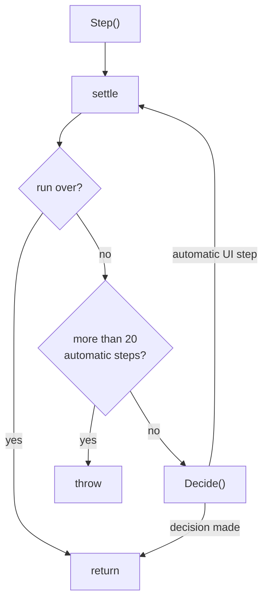

import { Aside, Badge, Steps } from '@astrojs/starlight/components';

The simulator is `Sts2Ai.SimWorker`: a plain .NET process that loads the game's own `sts2.dll` and runs its rules **headless**, with no Godot engine, window, rendering or sound. The rules are the game's code, not a rewrite ([overview §1](/en/#sec-1), constraint 4). The decision process never loads the game; it talks to simulator processes instead ([overview §3](/en/#sec-3)).

<Aside title="Status">

Exists: the headless host, single-combat sessions, Determinize, CombatBuilder, the whole-run session, combat worlds ([§6](#sec-6)), and the worker pool for PIMC's NoSL worlds ([§8](#sec-8)). Planned: the SL clone, and worker requests beyond one PIMC world.

</Aside>

A worker process has three roles:

- **(a)** the host of the "real" run in R1–R3 (the rungs of the [sim-to-real ladder](/en/arch/evaluation/#sec-1) where the simulator, not the real game, plays the run);
- **(b)** search worlds: NoSL samples and SL clones ([Environments §5](/en/arch/environments/#sec-5));
- **(c)** benchmarks and the selftest.

Each process holds **one live run or combat** at a time. The game keeps the run and the combat in process-wide singletons (`RunManager`, `CombatManager`), so a second run cannot exist next to the first. Branching is therefore done by replay ([§2](#sec-2)), and parallel search needs several processes ([§8](#sec-8)).

File references such as `Runs/RunManager.cs:295-312` point into the decompiled game assembly. Godot node files (`NGame.cs`, `NRestSiteRoom.cs`) are unique by name, so they are given by file name only.

## 1. Headless host

The game is a Godot app. Its rules live in managed C# (the "model layer"), its screens in Godot nodes. Headless, only the model layer runs. Three things make that work: a stub for the native engine, a set of Harmony patches (runtime rewrites of game methods), and the game's own `TestMode`, a flag for its automated tests under which most model code skips presentation.

`HeadlessGame.Boot` runs once per process:

<Steps>

1. `GodotNativeStub.Install`. GodotSharp reaches the engine through a table of native function pointers. With no engine, the stub fills every slot with one tiny function that returns zeroed memory, so managed code that touches Godot runs through without side effects.
2. `HeadlessPatches.Apply`: install the patch groups listed below.
3. `TestMode.TurnOnInternal`.
4. `ModManager.State=Skipped`: mods are never loaded headless.
5. `AssemblyInfo.Init`, `ModelDb.Init`, `ModelIdSerializationCache.Init`, `ModelDb.InitIds`: load the game's model database.
6. `LocalContext.NetId=1`.
7. Settings and prefs for test, with `FastMode=Instant`.

</Steps>

Game `Log.Error` lines and unobserved task faults are collected. The selftest asserts there are none.

Patch groups (`HeadlessPatches.cs`):

| group | what it does |
|---|---|
| engine shells | managed shells instead of the engine for OS, Time, singletons, resources, localization and the player name |
| asset preloads | off |
| presentation | model code that reaches presentation without the TestMode guard: Kaiser Crab arms, SoulNexus, the `EventPresentation` transpiler ([§5.2](#sec-5.2)) |
| persistence | off: `SaveRun`, progress, replay. Any disk IO throws. |
| rule fidelity | puts back shipped rules that TestMode changes: RollingBoulder hits enemies one by one; the `ShippedBranch` transpiler swaps the TestMode branch for the shipped one in MerchantPotionEntry, Cauldron and CallingBell |
| speed | `FastCreatures`, `FastPlayerCreatures`, `FastPlayers`; `FastHookListeners`, checked against the game's own listeners through reverse patches |
| choices | `ChooseABundle`, `CrystalSphereScreen`, `CardRemovalUsed`; plus GameBridge's `ChoiceContexts`, patched first ([GameBridge §5](/en/arch/gamebridge/#sec-5)) |

A transpiler is a Harmony patch that rewrites a method's IL instead of wrapping it.

**JIT.** The csproj sets `TieredCompilation=false`. With tiered compilation the runtime re-JITs hot methods in the background, and one such rejit silently dropped a Harmony patch after some thousands of combats. Launch with `DOTNET_ReadyToRun=0` as well (about 20% faster).

**Pump.** `Pump` is a single-threaded `SynchronizationContext`. The game's async code (actions, hooks, commands) posts its continuations to it, and they all run on the driver's thread when the driver pumps. Nothing runs on another thread, so the order of events is fixed: this is where determinism comes from. `RunUntil(cond)` pumps until a condition holds; `Drain()` runs everything queued. *Settle* means pumping until the game waits for the player again.

**Running it.** Set `HOME` to a scratch directory and `DOTNET_ROOT=~/.dotnet`. The binary is `src/Sts2Ai.SimWorker/bin/Release/net9.0/Sts2Ai.SimWorker`.

**CLI** (full options in the `Cli.cs` header):

| command | what it does |
|---|---|
| `list` | characters, acts and encounters of this game build |
| `combat --encounter ID` | one combat, printing every step |
| `combat --from OBS.json` | the same, from a combat built to show that observation ([§3](#sec-3)) |
| `run` | whole runs ([§5](#sec-5)); `--policy pimc` plays their combats with the combat brain in workers ([§8](#sec-8)) |
| `bench` | many combats over an encounter pool: throughput and failures ([§4](#sec-4)) |
| `selftest` | determinism, restore, determinize and more ([§9](#sec-9)) |
| `forkbench` | cost of a restore and of one search branch ([§4](#sec-4)) |
| `panel` | the fixed combat panel: a placeholder or the combat brain, same seeds for every player ([Combat brain §7](/en/arch/combat-brain/#sec-7)) |
| `serve` | a worker: JSON-lines requests on stdin, replies on stdout ([§8](#sec-8)) |

Every command that runs combats also takes the loadout options (character, deck, relics, potions, HP).

## 2. Combat session

A combat session runs one combat in the real engine. It is set up by `CombatSetup(Character, Encounter, ActIndex, Seed, Ascension, Loadout?, From?)` and started like this:

1. `Player.CreateForNewRun(ch, UnlockState.all)`, then the loadout;
2. `RunState.CreateForTest` with a `MockSinglePointActMap`;
3. `RunManager.SetUpTest`;
4. `EnterRoomDebug(Monster, encounter)`.

This is **not** the real travel path: it skips the `?` roll and its odds, and `GenerateRooms` <Badge text="verified" variant="success" />. That is fine for isolated combats and wrong for runs, which have their own start ([§5](#sec-5)).

**Snapshot and restore.** A snapshot is a recipe, not a copy of the game's objects: `(Setup, Trace)`. Each trace item is one of `Action`, `Choice(game indexes)` or `Determinize(seed)`. Restore starts a new combat from the setup and replays the trace. The same setup and trace always give the same state, because all randomness comes from seeded streams. `Rng.Chaotic` (seeded from the clock) feeds only cosmetics <Badge text="verified" variant="success" />: skins, screen shake, dialogue, the Trial entrant number, the YummyCookie icon, card-add animation timing.

**Determinize.** `Determinize(seed)` replaces everything the player cannot know with a sample drawn from `seed`, and leaves the visible state unchanged. A search that branches only from determinized states cannot use the real future, and different seeds give different plausible futures. The seed comes only from the caller, never from the run. It calls `Resample(new Rng(seed))`, which:

- reseeds every `RunRngType` stream, every `PlayerRngType` stream, and each monster's `Rng`;
- reorders the draw pile: first sorted by card key (an order that depends only on what the player sees), then a Fisher–Yates shuffle;
- renumbers the cards outside the hand (`CombatBuilder.NumberCards`). The game numbers cards in draw order, so the old ids would leak the true draw order;
- resamples each enemy's `NextMove` uniformly among the moves that show identical intents, and rewrites the last state-log entry (`StateLog[^1]`) to match.

**Execute.** `Execute` starts an action through `CombatActions.Start` (the UI entry points), then settles: it pumps until `WaitingForInput` or until the combat is over.

**uids.** Actions name cards and creatures by uid: a hand card by its `NetCombatCardDb` id, a creature by its `CombatId`. For example, `play:7:2` plays card #7 at creature #2. Replay stays deterministic because the numbering is.

## 3. CombatBuilder

`CombatBuilder` builds a combat that shows a given observation. `CombatBuilder.Setup(obs, seed)`:

1. starts the encounter with the observation's deck and relics;
2. `Apply` overwrites the visible state: round; enemies (added, removed, reordered); HP and block; energy; gold; potions; relic counters; powers; the 4 piles with per-card modifications; intents;
3. `Resample(StableHash(seed))` draws the hidden state;
4. `BuildDifferences` diffs, by JSON path, the input observation against the observation of the rebuilt combat. Empty means exact.

Details:

- **Knob solver.** Shown numbers derive from internal integers in a different way for each power or relic. The builder tries integers (amount, dynamic vars, fields) until the display matches.
- **Intents.** The builder chooses among the moves that show the observed intents. A stunned enemy gets a synthesized stun move, made like `Creature.StunInternal` does (`FollowUpStateId = StateLog.Last().Id`). Hidden enum switches in powers (e.g. `SurroundedPower._facing`) are searched to maximize the number of matching enemies.
- **uids** match the observation; other cards are numbered above them.
- **Approximations (gap):** per-turn history and internal counters; cost-modifier durations; player debuff decay; real stun-move follow-ups; the deck is all cards seen, generated ones included; orbs and non-player allies are not built. Never validated on real-game observations.

Selftest matrix (2026-10-26), all checks pass:

| set | combats |
|---|---|
| SILENT | 60/60 |
| IRONCLAD | 58/58 |
| SILENT, elite + boss, acts 0 / 1 / 2 | 57 / 58 / 57 |

## 4. Performance

Measured on 2026-10-26, Release build, `DOTNET_ReadyToRun=0`.

**Combats** (`bench`, act 0 weak + regular encounters, `play` policy):

| character | combats | combats/s | actions/s | time per combat |
|---|---|---|---|---|
| SILENT | 5000 | 319 | 10.3k | 3.1 ms |
| IRONCLAD | 2000 | 379 | | |

Short runs (n=200) take about 6.7 ms per combat: boot and JIT warmup dominate.

**Branching** (`forkbench`). A search branch is a restore, a determinize and a rollout to the end of the combat with the placeholder policy.

| measure | value |
|---|---|
| restore | 0.28 ms + 0.073 ms per replayed action |
| branch | median 2.78 ms, p90 3.97 ms |
| mean root depth / mean rollout | 15.8 / 16.6 actions |
| throughput | 329 branches/s per core |

**Multi-process** (`bench` with n=3000 per process; wall time includes about 1.2 s of boot):

| processes | combats/s |
|---|---|
| 1 | 275 |
| 4 | 1060 |
| 8 | 1860 |
| 12 | 1879 |
| 16 | 2019 |

The machine has 8 physical cores; SMT adds about 8%. The default pool is 8 processes. Memory is about 160 MB per worker.

**Whole runs** (`run`: SILENT A0, 9999 HP, random macro policy + `play` combat policy; long random-play combats dominate): about 1,800 decisions/s per process, about 0.4 s per run; 8 processes times 50 runs take 22 s wall time.

**Levers**, in order:

1. Avoid replay depth: reuse prefixes in depth-first search; node checkpoints ([§5.4](#sec-5.4)).
2. Per-hook listener filtering (needs `perf`, not installed).
3. Deep copy of the object graph: removes the replay cost; needed for AlphaZero-style search.

## 5. Run session

`RunSession` (`RunSession.cs`) plays whole runs: the real world setup ([§5.1](#sec-5.1)), and every decision through GameBridge entry points, the same calls the mod will make. The game runs each room by itself. The driver plays the part of the UI: which screen is showing and what its buttons do.

What a screen would remember is kept per room in `RoomProgress`: left the room, rewards offered, rest succeeded, chest opened, relic picked. It is reset when `CurrentRoom` changes, which also happens when an event combat resumes its event.

**Step.** `Step()` settles, then calls `Decide()`. `Decide()` makes one decision, or does one automatic UI step (offer the combat rewards, open the chest, leave the treasure room). More than 20 automatic steps in a row throws.

**Settle.** In combat, pump until `WaitingForInput` (after EndTurn: on a later turn). Elsewhere, pump until the pump queue is empty and the action executor is idle. Then collect the game tasks the driver started (`_running`: a purchase, a rest option, a reward, a divination…). A faulted task throws.

**Decide order:**

1. the newest open rewards screen;
2. a driver task still running with no screen to answer: throw;
3. the map (in a `MapRoom`, or once the room is left);
4. by room: combat, event (the crystal sphere minigame first), shop, rest, treasure. Any other room throws.

**Policies:**

- combat: `ICombatPolicy`;
- card prompts: `IChoicePolicy` via `PolicySelector` (plus card-reward and bundle handlers);
- every other screen: `IMacroPolicy` (`MacroDecision(surface, legal, observation)`), with the placeholder `RandomMacro`.

A card prompt's bounds come from its context (`ChoiceContexts.Bounds`): a cancelable prompt has min 0.

**Output:**

- the trace: every decision as "surface action", including card prompts answered inside other actions;
- a hash of each act's map;
- `Summary()`: act, floor, room, HP, gold, deck, relics, potions;
- optionally, an `observed` callback that receives each decision's `Observation` before its action applies.

`IsOver = RunState.IsGameOver`. A run is won when it is over in the victory room.

**CLI:** `run [--n] [--start] [--seed] [--asc] [--policy play|random|pimc] [--worlds] [--nodes] [--workers] [--max-decisions] [--check] [--trace] [--obs]` plus the loadout options. With `pimc`, each combat decision is searched (NoSL) in a worker pool, one worker per world unless `--workers` says otherwise; the run itself stays live in this process. Out-of-combat decisions are random for every policy. `--check` also observes every decision: each observation's JSON round trip must be exact, the hashes are compared on replay, and the run's line ends with a digest of them (`obs`). `--obs` prints each observation.

### 5.1 Start

The run starts the way the game starts a new singleplayer run. The game's own code for that is `NGame.StartRun`, which lives in a Godot node <Badge text="verified" variant="success" />, so `RunSession` copies it. From `RunSetup(Character, Seed, Ascension, Loadout?)`:

1. `Player.CreateForNewRun(ch, UnlockState.all, NetId)`, then the loadout;
2. roll the acts with `ActModel.GetRandomList(Rng(hash(seed),"act_selection"), UnlockState.all, false)`, as `StartRunLobby.BeginRunLocally` does;
3. `RunState.CreateForNewRun`;
4. `SetUpNewSingleplayer(run, shouldSave:false)`;
5. `FinalizeStartingRelics`, `Launch`, `EnterAct(0, false)`;
6. settle. The first decision is Neow.

Sources: `Nodes/NGame.cs:1138-1145,1176-1187`; `Runs/RunManager.cs:295-312,711-738`.

- It does not use `SetUpTest`, which skips `GenerateRooms` (`RunManager.cs:743-771`): no ancients, no double boss.
- `UnlockState.all` means everything is discovered and `NumberOfRuns` is huge, so there are no newbie tweaks and the run starts with Neow.
- Not done: mirroring the user's real profile (verify against R4); clamping the ascension to the character's maximum (`StartRunLobby.cs:485-491`). Callers pass valid values.

### 5.2 Surfaces

A surface is the kind of decision screen. The table lists each one as implemented; the action grammar is in [Protocol §3](/en/arch/protocol/#sec-3). "Legal" is what GameBridge lists, "apply" is the game call that carries the action out.

| surface | legal (GameBridge) | apply | notes |
|---|---|---|---|
| map | `MapActions.Travelable`: the rules of `NMapScreen.RecalculateTravelability`, sorted by (row, col) | `RequestEnqueue(VoteForMapCoordAction(…))` | |
| combat | `CombatActions.Legal` | `CombatActions.Start` | When won: `room.OfferRoomEndRewards()`, or `ProceedFromTerminalRewardsScreen` if `!Encounter.ShouldGiveRewards`. Automatic, as in `NCombatUi.OnCombatWon`. |
| rewards | untaken rewards (a potion only with a free slot); `rewards_done` unless `DisallowSkipping` | `SelectLocalReward` | Sets arrive in `RewardsSet.testSelector` (`ThrowInTestIfRewardsNotTaken=false`). A non-terminal set closes once `IsRewardsSetCompleted`. On done: a non-terminal set → `SkipLocalRewardsSet`; boss or victory (not between double bosses) → `ActChangeSynchronizer.SetLocalPlayerReady`; otherwise `ProceedFromTerminalRewardsScreen` (as `NRewardsScreen` does). |
| card_reward | the cards plus alternatives; reroll once per screen (the button stays listed after use) | `PolicySelector.GetSelectedCardReward` handler | |
| card_choice | `IChoicePolicy` via `PolicySelector`; bounds by `ChoiceContexts.Bounds` | the answer is the picks; empty means cancel or skip | The context is read inside the `CardSelectCmd.From*` entry. Choose-a-card without skip has min 1 (the game enforces it after the selector). |
| bundle | `bundle:i` | prefix on `CardSelectCmd.FromChooseABundleScreen`: reserve the choice id, ask, `SyncLocalChoice` | TestMode forced `bundles[0]`. The only caller is ScrollBoxes. |
| event | the options minus locked ones | `EventSynchronizer.ChooseLocalOption(i)` | `IsProceed` options are UI buttons: the ancient's "PROCEED" is `proceed`; Trial's DOUBLE_DOWN (an abandon popup) is never legal. Once the event is finished, the only action is `proceed`, which opens the map (`NEventRoom.Proceed` throws a null reference headless). |
| crystal_sphere | `big:X,Y` (the 3x3 block) or `small:X,Y` (one cell), only if it uncovers a hidden cell | `SetTool` + `CellClicked` | The CRYSTAL_SPHERE minigame. A prefix on `NCrystalSphereScreen.ShowScreen` hands it to the driver (`HeadlessPatches.CrystalSphereShown`). After the last divination its rewards arrive as a rewards set. The small tool is offered so the player can avoid completing the curse. |
| shop | `buy:i` for stocked, affordable items (a potion needs a free slot); `remove`; `leave` | `OnTryPurchaseWrapper(inv)` | `CardRemovalUsed` marks a removal used, which is the removal node's job; this also covers Lord's Parasol's free removal. `MerchantRoom.Exit` returns early in TestMode, so no history is written (cosmetic). |
| rest | the enabled options; `leave` after a success or when none is enabled | `RestSiteSynchronizer.ChooseLocalOption` → `Task<bool>` | `NRestSiteRoom.cs:333,571-596` |
| treasure | `relic:i`, `relic_skip` | The chest opens automatically (`DoNormalRewards` + `DoExtraRewardsIfNeeded`). Pick or skip once, then `ProceedFromTerminalRewardsScreen`. | In single player, skipping leaves `CurrentRelics` non-null, hence the `RelicPicked` flag. |
| potion belt | `potion:S` (any-time potions), `discard_potion:S`; appended to every macro surface | `EnqueueManualUse` / `DiscardPotionGameAction` | With a full belt, potion rewards and potion purchases are hidden until a slot frees. |
| game over / victory | none | none | `RunState.IsGameOver`. The victory room means won; the game then kills the players. |

**Patches the run needed** ([§1](#sec-1)):

- asset preloads;
- presentation in model code that skips the TestMode guard: Kaiser Crab arms (`BeforeDeath`) and SoulNexus (`AfterDeath`);
- the `EventPresentation` transpiler. In every `EventModel` subclass, including its lambdas and async state machines, a call into a Godot object or one returning a Godot object is dropped and gives the default result, and `Task.Delay` becomes a finished task. It hits Amalgamator, DenseVegetation, DollRoom, JungleMazeAdventure, PunchOff and Trial;
- `CrystalSphereScreen`;
- `ChooseABundle`;
- `CardRemovalUsed`.

**Legitimate game behavior** seen with a 9999-HP loadout (not bugs):

- kill mechanics: THE_INSATIABLE's Sandpit `Kill`, and THE_LOST_AND_FORGOTTEN stealing strength and dexterity (about 156 turns);
- PunchOff's "event not finished" warning: its combat has `shouldResumeAfterCombat:false`, and the real game warns the same way.

### 5.3 Determinism

Measured on 2026-10-26 with 200 seeds (SILENT A0, 9999 HP, random macro policy + `play` combat policy):

- `--check` replays each run in the same process: 200/200 identical (trace, summary, map hashes).
- The same 200 seeds in another process partition (8 processes times 25 runs against 4 times 50) are identical line for line: outcome, summary, decision count, map hashes. So the risk that `MapPoint.Children` comes out in a different order was not observed; `MapActions` sorts anyway.
- IRONCLAD, DEFECT, REGENT and NECROBINDER (25 runs each, `--check`): all identical on replay, 0 failures, 0 game errors.
- With observations (same setup): every observation round-trips exactly; 200/200 identical on replay, including the per-decision observation hashes; 8 times 25 against 4 times 50 identical per-run lines, including the observation digest; the other 4 characters (25 runs each) identical; 0 failures, 0 game errors, 0 idle waits. Every surface was reached; the rarest was bundle, in 9 of 200 runs.

TestMode changes some rules. The branches that matter for runs (from the local note `tmp/notes/testmode-audit.md`):

| TestMode branch | handled by |
|---|---|
| RewardsSet auto-claim | `testSelector` |
| ChooseABundle | the prefix ([§5.2](#sec-5.2)) |
| ActModel act-1 and newbie tweaks | nothing to do with `UnlockState.all` |
| `MerchantRoom.Exit` | cosmetic |

**Real-time waits.** Model code must not use `Task.Delay`: a real-time wait breaks quiescence, so settle can no longer tell when the game is idle. Amalgamator is patched. Others are not reached headless: `ActionExecutor.WaitForUnpause` (a 50 ms poll while paused), `CombatState.GodotTimerTask` (the timeout of a net-id creature lookup), rest-site hover messages (UI). The guard is the pump's idle-wait count, the number of times it had to block for work from another thread: `pump idle waits` = 0 over the 200-run batch.

**Inline execution.** In `NonInteractiveMode` the game runs actions inline instead of yielding once per frame, so the order of fire-and-forget work may differ from the real game. This is on the R2/R3 diff list.

### 5.4 Run snapshot

Replaying a whole run from its start would cost 0.073 ms times some thousands of actions. Instead:

- at every node entry, store `RunManager.ToSave(null)`, the game's own serializer;
- a run snapshot is `(checkpoint, node trace)`;
- restore loads the checkpoint (the path in [§7](#sec-7)) and replays the node trace.

This is the same mechanism as the SL clone, so there is one code path, tested by both. The load cost is still to be measured (open question 1, [§10](#sec-10)).

## 6. NoSL worlds

A NoSL world is a determinized sample: a full game state that agrees with everything the player has seen ([Environments §1](/en/arch/environments/#sec-1)). Combat worlds exist; run worlds are planned.

- **Input:** the public record (protocol types) and a search seed. **Output:** a sampled state consistent with it.
- **Combat worlds:** `SimWorlds` implements the world API ([Protocol §7](/en/arch/protocol/#sec-7)) inside one process. The root is `CombatBuilder.Setup(combat obs, build seed)`, built from the observation and never from the real combat. World k is the root plus `Determinize(seed_k)`, with `seed_k` mixed from the search seed and k. Knobs derived from the record (turn history, move posterior) are still gaps ([§3](#sec-3)).
- **One live combat for all worlds.** Each world keeps its own trace, and its snapshot is that trace. When a world is used while another one is live, it rebuilds itself from the root by replay; a search that stays inside one world replays only when it backtracks. Card prompts inside a world are answered at random, from a generator seeded by the world's seed and its trace length.
- **The same process as the real combat.** In-process search (`panel` without `--workers`, [Combat brain §7](/en/arch/combat-brain/#sec-7)) keeps the real combat as a snapshot before each decision, lets the worlds use the process, and puts the real combat back by replay. With the worker pool ([§8](#sec-8)) the worlds live in the workers and the real combat or run stays live, so there is no hand-over.
- `SimWorlds.SL` is the same class with the real combat's snapshot as the root and one world: an exact copy of the combat, with no seal ([§7](#sec-7)).
- **Run worlds** (macro search beyond a node): build a `SerializableRun` from `RunView` (deck, relics, potions, HP, gold, act, floor, map, visited points) with the hidden parts sampled: every RNG stream; `RoomSet` contents and counters (from the rules: the act pools minus what was seen); grab bags; odds (inferred from the reward history where that is possible, otherwise a prior). Load it like a save ([§7](#sec-7)). Exactness is tested by an observation round trip.
- R1 uses the same Build path as R4, with no shortcut that determinizes the true state for decisions, so behavior is identical across rungs. `Determinize` on the true state stays for tests and benchmarks.

## 7. SL node clone

Planned. An SL clone is one exact copy of the current node, sealed at its exit ([Environments §6](/en/arch/environments/#sec-6)). It is built by loading the node-entry checkpoint the same way the game's Continue path loads a save <Badge text="verified" variant="success" />:

<Steps>

1. `SaveManager.FromJson<SerializableRun>(json)` (`Saves/SaveManager.cs:786`), or the migration manager (`RunSaveManager.cs:115`). Optionally `RunManager.CanonicalizeSave(save,1)`.
2. `state = RunState.FromSerializable(save)`.
3. `await RunManager.Instance.SetUpSavedSingleplayer(state, save)`. It needs `State==null`, so call `CleanUp()` between sessions. It increments `NumReloads`, but only in the process: headless never writes, and the field is used only for metrics <Badge text="verified" variant="success" />.
4. `Launch()`; `await GenerateMap()` (the saved map).
5. `await LoadIntoLatestMapCoord(AbstractRoom.FromSerializable(save.PreFinishedRoom, state))`, which calls `EnterMapPointInternal(saveGame:false)`. This gives the same `?` roll, encounter, monster HP (Niche), opening shuffle and moves.
6. After a combat won in the harness, call `room.OfferRoomEndRewards()`; in the live game the UI does this.

</Steps>

- **Template:** `Nodes.Debug.Multiplayer/NMultiplayerTest.cs:535-600`. It also fast-forwards the action, hook, choice and reward ids that are not in the save (:552-556). That is needed so uids line up with the live game.
- Then replay the node action log ([Mod §6](/en/arch/mod/#sec-6)).
- **Seal:** a world wrapper intercepts the travel action (and the run end) and sets `AtHorizon=true`; any later `Execute` throws.
- **Horizon counterfactual helpers:** perturb the RoomSet tails, UnknownMapPoint, TreasureRoomRelics, the grab-bag tail and the future map seeds ([Environments §7](/en/arch/environments/#sec-7)); test that the node never reads each of them.

## 8. Worker pool and IPC

A worker is the same binary started as `serve`. `WorkerPool` (in `Sts2Ai.Harness`, which sees the game only through protocol types) starts N of them and keeps each one for the pool's lifetime.

- **Wire.** One JSON line per message over stdin/stdout ([Protocol §7](/en/arch/protocol/#sec-7)). After booting (about 1.2 s) the worker writes `WorkerHello{game}`, then answers each request line with one `WorkerReply` line, in order, until stdin closes. Before the game boots, `serve` moves `Console.Out` to stderr, so nothing the game prints can get into the stream. The pool keeps the last 20 stderr lines of each worker for error messages.
- **The one request so far** is `PimcWorldRequest`: PIMC's search of one NoSL world of one combat decision. The worker builds the combat from the observation with the build seed (`SimWorlds.NoSL`, [§6](#sec-6)), takes world k of the worlds drawn from the search seed, runs the depth-first search of this turn ([Combat brain §3](/en/arch/combat-brain/#sec-3)), and replies with the best line after each first action. `PooledPimc` sends one request per world and merges the replies the way in-process PIMC does ([Combat brain §2](/en/arch/combat-brain/#sec-2)).
- **Self-contained requests.** A request carries everything the worker needs, and nothing carries over from one request to the next. So any free worker can take any request, and only the NoSL observation leaves the host: the true state never reaches a worker.
- **Determinism.** Replies are merged in request order, never in completion order. With the same seeds the result equals in-process search exactly, values included: `selftest --workers N` checks four decisions, and a 6-combat panel trace with 8 workers diffs empty against the in-process one.
- **Crash.** A worker that closes its stdout or breaks the pipe is restarted, and the request is sent once more. A second failure is an error. The count is reported as `worker restarts`. A reply with an error (an exception in the worker) fails the decision; game `Log.Error` lines in a worker come back in the reply and are counted with the host's.
- **Speed.** On 6 act-1 combats with the default budget (8 worlds × 300 nodes), 8 workers take 68.7 ms per action against 307.5 ms in process (9.4 s against 42.1 s). A whole run with the `pimc` combat policy takes about 17.5 s, with two runs at a time on 8 workers each ([Combat brain §7.2](/en/arch/combat-brain/#sec-7.2)).

Planned requests, for the SL clone and run worlds: open a world by kind (build, clone, run host) and get a world id; then snapshot, restore, execute, legal, observe and branch on it; then close. Such a world keeps live state in its worker, so its branches should go to that worker first (affinity), since a restore elsewhere costs a replay; snapshots stay portable, so any worker can take over. A crash then reopens the worker's worlds from their snapshots.

## 9. Tests

**Exists, in `selftest`:**

- determinism;
- restore, with the hidden state byte-equal;
- determinize keeps the observation, replays, and plays on;
- build shows the observation, restores, and plays on;
- fast hook listeners give the same result as the game's;
- Brain, Protocol and Harness reach no game assembly (with GameBridge as the negative control);
- with `--workers N`: pooled PIMC picks what in-process PIMC picks, with the same values, with no worker restarts or worker game errors;
- protocol round trip;
- the Rolling Boulder path is hit;
- no game errors.

**Exists, in `run`:**

- `--check` replays each run in the same process and compares trace, summary, map hashes and observation hashes; each observation must also survive a JSON round trip;
- the report lists surfaces never reached, driver failures (there is no fallback: an unknown screen throws), game `Log.Error` lines, and pump idle waits (real-time waits). Any of these makes the exit code 1;
- cross-process: run the same seeds in another process partition and diff the per-run lines.

Results from 2026-10-26 are in [§5.3](#sec-5.3).

**Planned:** the SL seal; the horizon counterfactual fields; an R3-vs-R4 same-seed diff once the mod logs runs.

## 10. Open questions

1. The load cost of a checkpoint, which dominates run-level branching.
2. Deep copy or replay: decide once search exists and profiles show that restore dominates.
3. Building a run world from `RunView`: how much of `RoomSet` and the odds can be inferred, and how much must come from a prior.
