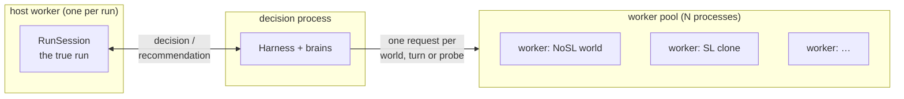

import { Aside } from '@astrojs/starlight/components';

Search and self-play need a Slay the Spire 2 that a program can run: start a combat, try a line of play, go back, try another; play ten thousand runs overnight. The **simulator** is that game. It is not a rewrite of the rules. It is the game's own `sts2.dll`, loaded into a plain .NET process and run **headless**: with no Godot engine, no window, no rendering and no sound, as fast as the CPU allows. The project is `Sts2Ai.SimWorker`, and a running copy of it is a *worker*.

This chapter explains how the game is made to run that way, what it can do once it does (single combats, whole runs, the worlds that search explores), and how many copies of it work together.

<Aside title="Status">

Exists: the headless host ([Headless host](/en/arch/simulator/headless/)); single-combat sessions with snapshots, determinization and CombatBuilder ([Combats](/en/arch/simulator/combat/)); whole runs through every decision screen, both gauntlets, and runs hosted against a brain over the wire ([Whole runs](/en/arch/simulator/runs/)); NoSL combat worlds and the SL node clone ([Worlds and the SL clone](/en/arch/simulator/worlds/)); the worker pool with its four requests ([The worker pool](/en/arch/simulator/pool/)). Planned: run worlds, which would let a NoSL search look past the current map point ([Worlds and the SL clone §8](/en/arch/simulator/worlds/#sec-8)).

</Aside>

## 1. Why the real game

Every rule of Slay the Spire 2 lives in the game's C# code: hundreds of cards, relics, powers, monsters and events, each with its own hooks into the turn, the draw, the damage. A rewrite of those rules would be a second game that has to agree with the first in every detail, and would drift whenever the game is patched. A search that plans in a slightly wrong game plays slightly wrong moves in the real one.

So the project's fourth constraint is that the simulator *is* the real `sts2.dll` ([Introduction §2](/en/#sec-2)). The game version is pinned at v0.111.0. What the project adds is a harness around it: a stub that stands in for the engine, patches that switch off presentation and keep the rules intact, and a driver that plays the part of the screens.

Two facts about the game shaped everything else:

- **Its rules and its screens are separate.** The game is a Godot app. The rules live in plain C# objects (cards, creatures, rooms, the run), which the project calls the *model layer*; the screens are Godot nodes (classes named `N…`, such as `NCombatRoom`) that draw the model and turn clicks into calls. Headless, only the model layer runs, and the driver calls the model where a screen would ([Headless host §1](/en/arch/simulator/headless/#sec-1)).
- **It keeps one run per process.** The game holds the current run and the current combat in process-wide singletons (`RunManager.Instance`, `CombatManager.Instance`). A second run cannot exist next to the first in the same process. So branching is done by **replay** (go back by starting over and repeating the steps, [Combats §2](/en/arch/simulator/combat/#sec-2)), and searching in parallel takes several **processes** ([The worker pool](/en/arch/simulator/pool/)).

## 2. What a worker does

A worker process has three roles:

1. **Hosting the run.** In self-play and in evaluation the simulator, not the real game, plays the run: rungs R1–R3 of the [sim-to-real ladder](/en/arch/evaluation/#sec-2). The host worker holds the one true run and asks the brain for every decision, exactly as the mod does in the real game.
2. **Search worlds.** The combat brain and the macro brain try lines of play in worlds: NoSL samples built from an observation, and SL clones of the current node ([Environments: worlds §1](/en/arch/environments/worlds/#sec-1)). Each search request goes to a worker of the pool, which builds or loads the world, searches it and replies.
3. **Benchmarks and checks.** `bench`, `selftest`, `forkbench`, `fidelity` and the combat panel run here too ([Reference](/en/arch/simulator/reference/)).

The decision process, where Harness and the brains run, never loads the game; it talks to workers through messages ([Introduction §3](/en/#sec-3)). In the real game the mod is the host and workers do only the searching; in self-play a worker is the host as well. Harness cannot tell the two apart: "swap the world, not the brain".

## 3. The picture

In `run`, the command that plays whole runs, the host and the decision process are one process: the run stays live in it, and the brains search in a pool of worker processes it starts. With `run --brain SOCKET` the brain is a separate process instead, the same one the mod talks to ([Whole runs §8](/en/arch/simulator/runs/#sec-8)).

## 4. The code

`src/Sts2Ai.SimWorker` references the game, GameBridge, Protocol, Brain and Harness. Its code is in folders by role; the namespace is `Sts2Ai.SimWorker` throughout.

| folder | what it holds |
|---|---|
| (root) | `Program.cs`: finding the game's binaries, starting workers as copies of this process |
| `Runtime/` | running the game without its engine: `HeadlessGame` (boot), `GodotNativeStub`, `Pump`, the patches (`Runtime/Patches/`), `FastHookListeners`, logging |
| `Simulation/` | the game side of combats and runs: `CombatSession`, `CombatBuilder`, `RunSession`, `SimWorlds`, `NodeWorld`, `PolicySelector`, `Loadout`, `GameSeeds` |
| `Brains/` | what a run's brains need: the champion's options (`ChampionOptions`, `LeafChoice`), the brain link and node export (`RunBrains`), logged runs |
| `Commands/` | the command line: one class per command, shared option groups in `Args.cs` |
| `Checks/` | diagnostics (`selftest`, `fidelity`, `forkbench`) and `NodeProbe`, which answers L0's probes on the clone |

`Simulation/` and `Runtime/` use nothing of `Commands/`. The xUnit tests that need no game are in `src/Sts2Ai.Tests` ([Reference §7](/en/arch/simulator/reference/#sec-7)).

## 5. This chapter

| page | what it explains |
|---|---|
| [Headless host](/en/arch/simulator/headless/) | how the game boots without its engine: the native stub, the patches, TestMode, the JIT, and the single-threaded `Pump` that makes it deterministic |
| [Combats](/en/arch/simulator/combat/) | a combat session, snapshots as recipes, determinization, building a combat from an observation (CombatBuilder), fidelity and speed |
| [Whole runs](/en/arch/simulator/runs/) | `RunSession`: starting a run, the step-settle-decide loop, every decision screen, determinism, the two gauntlets, hosting runs against a brain |
| [Worlds and the SL clone](/en/arch/simulator/worlds/) | NoSL combat worlds, the node checkpoint, loading and sealing the SL clone, the SL world, run worlds |
| [The worker pool](/en/arch/simulator/pool/) | the pool, its four requests, determinism across processes, crashes and speed |
| [Reference](/en/arch/simulator/reference/) | building and running, every command and option, the exit codes, every test |

File references such as `Runs/RunManager.cs:295-312` point into the decompiled game assembly, `MegaCrit.Sts2.Core` (the folder `Runs/` is its namespace `MegaCrit.Sts2.Core.Runs`); project paths such as `Simulation/RunSession.cs` are under `src/Sts2Ai.SimWorker/` unless they name another project. Godot node files (`NGame.cs`, `NRestSiteRoom.cs`) are unique by name and given by file name only.
