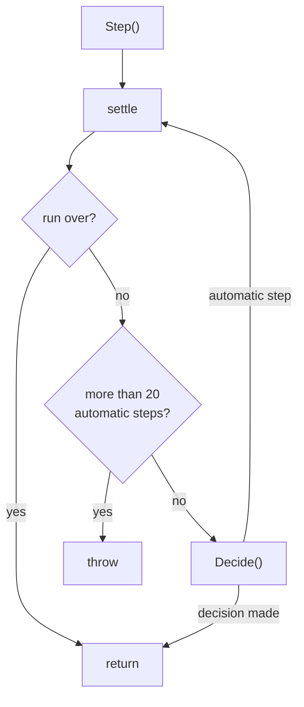

import { Badge } from '@astrojs/starlight/components';
import SurfaceCounts from '../../../../../components/book/SurfaceCounts.svelte';

A run of Slay the Spire 2 is three acts of map points, and a few hundred to about a thousand decisions: the book's example run, a win, took 848, three quarters of them in combat. `RunSession` (`Simulation/RunSession.cs`) plays such a run in the real engine, with every decision going through GameBridge, the same calls the mod makes in the game ([GameBridge](/en/arch/gamebridge/)). This page follows a run from its start to its end.

## 1. A run as a loop

Headless, the game still runs each room by itself: it rolls the encounter, plays the monsters' turns, offers the rewards. What it does not do is show screens, and in the real game the screens' code decides some things: which screen opens after a combat, what the Proceed button does, when the map opens. `RunSession` plays that part of the UI. It knows which screen would be showing, asks for the decision on it, and does what its buttons would do ([Headless host §1](/en/arch/simulator/headless/#sec-1)).

So a run is a loop: let the game work until it waits for the player, ask one question, apply the answer, again. There are three kinds of question, each answered by its own interface:

| question | interface | asked by |
|---|---|---|
| a combat action: play a card, use a potion, end the turn | `ICombatPolicy` | the driver, on the player's turn |
| a card prompt: discard a card, pick one of three, choose cards to exhaust | `IChoicePolicy` | the game, from inside an action, through the card selector `PolicySelector` |
| everything else: the map, the rewards, a card reward, an event, the shop, the rest site, a chest, a bundle, the crystal sphere | `IMacroPolicy` | the driver |

A run records every decision in its **trace**, one line of text each: the surface (the kind of decision screen, [§4](#sec-4)) and the action, such as `map 0,1`, `combat play:7:2` or `card_choice 3`. The trace is what makes a run replayable: given the same setup and the same answers, the game makes the same run ([§6](#sec-6)).

Like a combat session, only one run is live in a process at a time: the game's managers (`RunManager.Instance`, `CombatManager.Instance`) are singletons ([Combats §1](/en/arch/simulator/combat/#sec-1)).

## 2. Starting a run

A run starts the way the game starts a new single-player run. The game's own code for that is `NGame.StartRun`, which lives in a Godot node <Badge text="verified" variant="success" />, so `RunSession.Start` copies it (`Simulation/RunSession.cs:155-189`). Its input is a `RunSetup(Character, Seed, Ascension, Loadout?, AutoWin, Gauntlet)`, the last two being the gauntlets' rules ([§7](#sec-7)).

1. `Player.CreateForNewRun(character, UnlockState.all, netId)`, then the loadout, if one is given ([Reference §3](/en/arch/simulator/reference/#sec-3)).
2. Roll the acts from the seed: `ActModel.GetRandomList(new Rng(hash(seed), "act_selection"), UnlockState.all, isMultiplayer: false)`, as `StartRunLobby.BeginRunLocally` does (`Multiplayer.Game.Lobby/StartRunLobby.cs:469-472`).
3. `RunState.CreateForNewRun([player], acts, [], GameMode.Standard, ascension, seed)`.
4. `RunManager.SetUpNewSingleplayer(run, shouldSave: false)` (`Runs/RunManager.cs:295-312`), which ends with the room generation `GenerateRooms`.
5. `FinalizeStartingRelics`, but only when the loadout names no relics: a loadout's relics are its final state, with their pickups already done, potion slots included. Then `Launch` and `EnterAct(0, doTransition: false)` (`Runs/RunManager.cs:711-738`).
6. Settle ([§3](#sec-3)). The first decision is the Ancient of the first act, Neow.

The game's sources are `NGame.StartNewSingleplayerRun` (`Nodes/NGame.cs:1137-1144`) and `NGame.StartRun` (`Nodes/NGame.cs:1179-1190`).

Three things are deliberately not done the way a test setup would do them:

- The run does not use the game's `SetUpTest` (`Runs/RunManager.cs:446-462`), which skips `GenerateRooms` (`Runs/RunManager.cs:743-767`): without it there would be no Ancients and no double boss.
- `UnlockState.all` means every epoch and encounter is unlocked and the number of runs played is huge (`Unlocks/UnlockState.cs:34`), so the act-1 and first-run tweaks for new players never apply and the run starts with Neow ([Headless host §5](/en/arch/simulator/headless/#sec-5)).
- Not done: mirroring a real player's profile (what they have unlocked), and clamping the ascension to the character's maximum, which the game's lobby does (`StartRunLobby.cs:485-491`). Callers pass valid values.

**Seeds.** A run's seed is a game seed: 12 characters of the game's alphabet, the digits and the capital letters without I and O, such as `0SSL7NS01MU6`. `run --seeds FILE` reads them from a seed file ([Evaluation: metrics, seeds and reports §5](/en/arch/evaluation/metrics/#sec-5)); without one, `run --seed B` makes run *i*'s seed from the base B and the index, `GameSeeds.MakeSeed(B, i)` (`Simulation/GameSeeds.cs:7-12`).

## 3. Step, settle, decide

`Step()` makes one decision (`Simulation/RunSession.cs:233-248`). It settles, and if the run is not over, calls `Decide()`, which either asks a question and starts its answer, or does one automatic step a screen would do without asking anything. After an automatic step it settles again. More than 20 automatic steps in a row with no decision is a driver bug, and throws.



**Settle** (`Simulation/RunSession.cs:251-264`) pumps the game until the player can act ([Headless host §7](/en/arch/simulator/headless/#sec-7)):

- in combat, until `CombatActions.WaitingForInput` holds (the player's turn, in the play phase, the action executor idle); after the player ended a turn, on a later turn, so the enemies' turn plays out first;
- elsewhere, until the pump's queue is empty and the action executor is idle.

Then it notes what the run record needs: a combat that just ended gets its end (HP, max HP, potions, the enemies' HP left), a death inside the player's own action included, and a new act's map gets its hash. A combat the run died in before its first decision gets an entry at 0 HP. Last, it collects the game tasks the driver started (a purchase, a rest option, a reward, a divination) that are done; a task that faulted throws.

**Decide** (`Simulation/RunSession.cs:304-331`) looks in this order:

1. The open rewards screens: a set that is not the room's last and has everything taken closes by itself; otherwise the newest open set is the decision.
2. A driver task still running with nothing to answer is a bug, and throws: rewards are the only screen a started task can wait on.
3. The map, in a `MapRoom` or once the current room is left.
4. The room: combat, event (the crystal sphere minigame first, when one is open), shop, rest site, treasure. Any other kind of room throws.

**What a screen would remember** is kept per room in `RoomProgress` (`Simulation/RunSession.cs:620-630`): whether the room was left, the combat entered, how many times it was auto-won, the rewards offered, a rest option succeeded, the chest opened, the relic picked. It starts over when the current room changes, which also happens when an event's combat ends and the event resumes.

**Automatic steps**, the things a screen does without a decision:

- a won combat offers its rewards (`OfferRoomEndRewards`), or proceeds if its encounter gives none (`ProceedFromTerminalRewardsScreen`), as `NCombatUi.OnCombatWon` does (`Nodes.Combat/NCombatUi.cs:363-373`);
- a treasure room's chest opens (`DoNormalRewards`, then `DoExtraRewardsIfNeeded`), and after the relic is picked or skipped, the room is left;
- under a gauntlet's rule, a combat is won at its start ([§7](#sec-7)).

## 4. Every decision screen

A **surface** is the kind of decision screen; the protocol names eleven (`Sts2Ai.Protocol/Surfaces.cs:9-19`). Each is listed here as the driver handles it. "Legal" is the list GameBridge makes, "apply" the game call that carries an answer out; the text of each action is defined in [Protocol: observations and actions §5](/en/arch/protocol/observation/#sec-5).

| surface | legal | apply | the driver's part |
|---|---|---|---|
| `combat` | `CombatActions.Legal`: playable cards with their targets, usable potions, end turn | `CombatActions.Start` | asked on the player's turn; the combat's end is an automatic step |
| `card_choice` | the prompt's options in canonical order, with bounds from its context (`ChoiceContexts.Bounds`); a cancelable prompt has a minimum of 0 | the picks, as indexes into the game's own list | asked from inside the game's `CardSelectCmd` entries, in combat or out of it |
| `map` | `MapActions.Travelable`: the start, the boss after the last row, the second boss after the first, otherwise the game's `MapTravel.GetTravelablePointsFrom`; sorted by row, then column | `VoteForMapCoordAction`, as `NMapScreen` does | in a `MapRoom`, or once a room is left |
| `rewards` | each untaken reward (a potion only with a free slot); `rewards_done` unless the set disallows skipping and not every reward is taken | `SelectLocalReward` | sets arrive through `RewardsSet.testSelector`; on `rewards_done`: a set that is not the room's last is skipped, after a boss or in the victory room (not between two bosses) the act changes, otherwise the room's rewards end (`ProceedFromTerminalRewardsScreen`), as `NRewardsScreen` does |
| `card_reward` | `card:i` for each card, and each alternative not yet spent (a reroll is offered once per screen; its button stays listed after use) | the card selector's card-reward handler | asked again after each pick while the screen stays open |
| `bundle` | `bundle:i`; no skip | the card selector's bundle handler | headless the game would take the first bundle; a patch hands the choice to the driver ([Headless host §4](/en/arch/simulator/headless/#sec-4)); ScrollBoxes is its only source |
| `event` | the options that are not locked, as `event:i`; an option that is a UI button ("PROCEED") as `proceed`; once the event is finished, only `proceed` | `EventSynchronizer.ChooseLocalOption(i)` | `proceed` opens the map (the game's `NEventRoom.Proceed` throws headless); Trial's DOUBLE_DOWN, an abandon popup, is never legal |
| `crystal_sphere` | `big:X,Y` when any cell of its 3×3 block is hidden, `small:X,Y` when cell X,Y is hidden | `SetTool`, then `CellClicked` | the minigame of the event of the same name, handed to the driver by a patch; after the last divination its rewards arrive as a rewards set |
| `shop` | `buy:i` for stocked, affordable entries (a potion also needs a free slot and a character allowed to take potions: Sozu forbids it); `remove` when the removal is stocked and affordable; `leave` | `OnTryPurchaseWrapper(inventory)` | a patch marks a removal used, which the removal's screen node does in the game; this also covers Lord's Parasol's free removal |
| `rest` | the enabled options, by id (`rest:HEAL`); `leave` after an option succeeded, or when none is enabled | `RestSiteSynchronizer.ChooseLocalOption` | |
| `treasure` | `relic:i`, `relic_skip` | `PickRelicLocally`, `SkipRelicLocally` | the chest opens by itself; in single player, skipping leaves the relics listed, hence `RoomProgress.RelicPicked` |

**The potion belt.** A potion that can be used at any time (`potion:S`) and a discard (`discard_potion:S`) are offered on map, rewards, event, shop, rest, treasure and crystal sphere screens, after the screen's own actions (`Simulation/RunSession.cs:492-499`). Card rewards, bundles and card prompts get none. A belt action is applied at once and the screen is asked again. With a full belt, potion rewards and potion purchases are not legal until a slot frees. In combat potions are combat actions; combat has no discard.

**No fallback.** A screen the driver does not know throws, and the run fails: an unknown room, a reward or shop entry or crystal sphere item of an unknown type, a linked reward set, a task left waiting with no screen. So does an answer that is not in the legal list. A failure is never covered over by a default choice, so a run that finishes has answered every decision through its policies.

How often a run meets each screen, over the 300 SL runs of the champion's promotion report:

<SurfaceCounts client:visible lang="en" />

**Legitimate game behavior** seen in runs at 9999 HP, which are not bugs: kill mechanics such as THE_INSATIABLE's Sandpit `Kill`, THE_LOST_AND_FORGOTTEN stealing strength and dexterity until the fight is lost (about 156 turns), and PunchOff's "event not finished" warning, whose combat has `shouldResumeAfterCombat: false` (`Models.Events/PunchOff.cs:138`); the real game warns the same way.

## 5. Who answers, and what a run reports

**Combat and macro decisions** come with their legal actions and an observation built on request (`CombatDecision`, `MacroDecision`): a policy that does not look at the observation never pays for it. The answer must be legal, or the run throws.

**Card prompts** go through `PolicySelector`, the game's card selector while a run is live (`Simulation/PolicySelector.cs:21-80`):

- it shows the options in canonical order (`CardChoices.Canonical`), so the same cards make the same prompt whatever order the game's list has; ties in that order are broken by a random stream seeded with the prompt's number, which knows nothing hidden and is the same on replay;
- it records the answer as indexes into the game's own list, the form a replay gives back;
- card rewards and bundles are run-level decisions answered by the driver's handlers; without them a card reward would be skipped and the first bundle taken;
- prompts are numbered from 0 again at each node's entry, as a clone of the node numbers its own ([Worlds and the SL clone §3](/en/arch/simulator/worlds/#sec-3)).

In `run` all three interfaces are one object, Harness's `Dispatcher`, which routes each decision to the brain that answers it ([Harness: routing, budgets and seeds §1](/en/arch/harness/routing/#sec-1)): combat to the combat brain, card prompts in combat to `p0`, everything else, card prompts outside combat included, to the macro brain ([Macro brain](/en/arch/macro-brain/)).

**Outcomes.** A run ends `won` (over, in the victory room), `lost` (over anywhere else), `truncated` (still going after `--max-decisions`, 20,000 by default) or `failed` (it threw). A won run's record says HP 0: once the victory room is reached, the game kills the players. The example run's record reads won, act 2 (counted from 0), floor 48, HP 0 of 66.

**What `run` prints.** A first line names the runs, the environment, the champion and the game version. Then one line per run, of this form (the example run, with its deck, relics and potions left out):

```text
#15 0SSL7NS01MU6 won act 2 floor 48 room … hp 0/66 gold 195 deck [...] relics [...] potions [...] decisions 848 331715 ms maps <3 hashes>
```

with `replans N` before `maps` when the SL planner planned again, and `obs <digest>` after it when observations were taken ([§6](#sec-6)). A failure adds a `failure:` line, and up to three game errors follow as `game error:` lines. At the end come the totals:

| line | what it counts |
|---|---|
| `done in S s: D decisions/s` | wall time and decisions per second |
| `pump idle waits: N (T ms)` | times the pump had to block for work from another thread; must be 0 ([§6](#sec-6)) |
| `outcomes:` | runs per outcome |
| `surfaces:` | decisions per surface |
| `surfaces never reached:` | surfaces no run met; printed only if any |
| `failure xN:` | each failure message and how many runs it ended |
| `determinism:` | with `--check`: runs identical on replay over the wire, and nodes that replay exactly from their checkpoints, with the time per node |
| `game Log.Error lines:` | game errors, then `worker restarts` when a pool was used and `replans` with the SL planner |

**Exit code** 1 when a run failed, a replay differed, a node did not replay exactly, or a game error was logged; 0 otherwise. Surfaces never reached and idle waits are printed only (`Commands/RunCommand.cs:155`).

**Records and logs.** `--records FILE` writes one run record per line, the input of `report` and `gate` ([Evaluation: metrics, seeds and reports §8](/en/arch/evaluation/metrics/#sec-8)):

| field | what it holds |
|---|---|
| `config` | `game` (version), `commit` (the simulator's, `-dirty` if `src/` had changes), `champion` (its name), `env`, `rung` (always `R1` today), and `auto_win` or `gauntlet` when a rule was on |
| `seed`, `character`, `ascension`, `run_id` | the run; `run_id` is the hash the brain knows it by ([§8](#sec-8)) |
| `outcome`, `act`, `floor`, `hp`, `max_hp`, `gold` | where it ended |
| `combats` | each combat: act, floor, encounter, room kind, HP, max HP and potions at its first decision, and its `end`: died, HP, max HP, potions, the enemies' HP and max HP left |
| `surfaces`, `brains` | decisions per surface, and per brain that answered them |
| `card_rewards`, `card_rewards_skipped` | card reward screens closed, and those closed with no card taken |
| `game_errors`, `failure`, `elapsed_ms` | the run's health and its wall time |

`--log FILE` writes Harness's decision log, one line per decision ([Harness: the decision log §1](/en/arch/harness/decision-log/#sec-1)). Both files are flushed line by line; a run's log lines are written when the run ends, so a batch stopped midway loses at most the run being played.

## 6. Determinism

Everything downstream needs a run to be a function of its setup and its answers. The SL clone replays a node's decisions from its checkpoint and must reach the same state ([Worlds and the SL clone](/en/arch/simulator/worlds/)); a gate pairs a challenger and a champion on the same seeds ([Evaluation: gates §2](/en/arch/evaluation/gates/#sec-2)); `--check` compares a run with its own replay. The game is deterministic given its seed, but only if nothing else leaks in: no clock, no thread timing, no unordered collection. The pump runs every continuation on one thread in posting order ([Headless host §7](/en/arch/simulator/headless/#sec-7)), the clock-seeded random stream is never reached by the rules ([Combats §2](/en/arch/simulator/combat/#sec-2)), and GameBridge sorts what the game keeps unordered, such as a map point's children.

**`run --check`** checks it on every run it plays (`Commands/RunCommand.cs:103-139`):

- it observes every decision: each observation must survive a JSON round trip exactly, and its hash is kept;
- it plays each seed a second time over the wire ([Protocol: the wire §1](/en/arch/protocol/wire/#sec-1)), to a brain in a thread of the same process with the same champion (or to the `--brain` given), and compares the two plays: the trace, the observation hashes, the summary, the map hashes, the run record and the decision log, timings aside; in SL the second play also carries the node messages;
- it loads every node of the first play from its checkpoint, replays the node's decisions, and requires the clone to show the run's observations one for one, to be at its horizon once it has travelled, and to refuse another step ([Worlds and the SL clone §5](/en/arch/simulator/worlds/#sec-5)).

**Measured** on 2026-10-26 with 200 seeds (Silent, ascension 0, 9999 HP, random macro policy and the `play` combat policy):

- `--check`: 200 of 200 identical on replay (trace, summary, map hashes); every observation round-tripped exactly, and the per-decision observation hashes matched;
- across process partitions: the same 200 seeds as 8 processes of 25 runs and as 4 of 50 gave identical lines (outcome, summary, decision count, map hashes, observation digest), so the order of a map point's children never came out differently, though `MapActions` sorts anyway;
- the other four characters (Ironclad, Defect, Regent, Necrobinder), 25 runs each with `--check`: identical on replay;
- 0 failures, 0 game errors, 0 idle waits; every surface was reached, the rarest being `bundle`, in 9 of 200 runs.

The clone's own check, over every node of 880 runs on five characters, is in [Worlds and the SL clone §6](/en/arch/simulator/worlds/#sec-6).

**Real-time waits.** Model code must not wait on the clock. A `Task.Delay` leaves the pump's queue empty until a timer thread posts, so settling cannot tell an idle game from a waiting one ([Headless host §7](/en/arch/simulator/headless/#sec-7)). Amalgamator's event waits that way, and is patched. Others are not reached headless: `ActionExecutor.WaitForUnpause` polls every 50 ms while the game is paused (`GameActions/ActionExecutor.cs:227-242`), `CombatState.GodotTimerTask` times out a creature lookup by net id (`Combat/CombatState.cs:603-609`), and the rest site's hover messages are UI. The guard is the idle-wait count above, 0 over the 200-run batch.

**Inline execution.** Headless, the game runs in `NonInteractiveMode`, where actions run inline instead of yielding once per frame, so fire-and-forget work may run in a different order than in the real game. Whether this changes anything a player sees is open until runs in the game can be compared with runs here ([Evaluation §2](/en/arch/evaluation/#sec-2)).

## 7. The two gauntlets

Two rules shorten a run by winning some combats at their start, as the game's `win` console command does (`DevConsole.ConsoleCommands/WinConsoleCmd.cs:31-47`): each enemy loses its powers and is killed, then the game checks for the win (`Simulation/RunSession.cs:393-401`). An enemy that comes back or calls others when killed is killed again, at most 5 times. The combat's rewards follow as after any win, and no combat decision is asked.

**The boss gauntlet pilot**, `run --auto-win`, wins every combat, bosses included. A run so reaches every boss's door in about a second, with only its macro decisions played: 5 runs took 3.1 s in all, passing the bosses of all three acts with no game error. It was built so that `bosslab.py states` could collect the states at the bosses' doors and fight them there ([Learning: reference §9](/en/arch/learning/reference/#sec-9)). `--check` is refused with it, and so is `--afterstates clone`: a node's checkpoint does not keep the rule.

**The elite gauntlet**, `run --gauntlet` (commit `7a9f845`), wins only the combats whose encounter is a plain monster one (`RoomType.Monster`), an event's included. Elites and bosses, an event's included, are fought by the combat brain with the HP and potions the run has, and a death ends the run. Everything else is the game's own. The rule goes with the run's SL clones: a node's checkpoint carries it to the brain (`NodeCheckpoint.Gauntlet`, commit `e970b60`), so the macro brain's probes on the clone win the same combats. Without that, every probe at a won monster combat's rewards replayed the combat as a fought one, and the run failed. V trains and is gated on whole runs, and refuses this game's runs.

The code's help texts and comments call `--gauntlet` "the boss gauntlet"; this book keeps the name elite gauntlet for it, since every elite is fought, and the boss gauntlet pilot for `--auto-win`.

Both rules mark their records (`auto_win`, `gauntlet`). `report`, `gate` and a whole run's V refuse them, since their floors and HP say nothing of how a whole run fares ([Evaluation: metrics, seeds and reports §7](/en/arch/evaluation/metrics/#sec-7)). In these runs as in whole runs, every combat's end records the enemies' HP and max HP (since `7a9f845`), which the gauntlet's progress reads at a death; a won combat's enemies are gone, 0 of 0.

## 8. Runs against a brain

`run` normally keeps the brain in its own process: Harness and the champion's brains are objects there, and their searches go to a worker pool it starts ([The worker pool](/en/arch/simulator/pool/)). With `run --brain SOCKET`, the brain is a separate process listening at a Unix socket instead, the one the mod talks to in the game ([Mod: the main loop §8](/en/arch/mod/loop/#sec-8)). The simulator then hosts runs exactly as the game does: each run sends `hello` with its environment and a run id hashed from the seed, every decision goes out with its observation and legal actions, and the brain's recommendation is played ([Protocol: the wire §3](/en/arch/protocol/wire/#sec-3)). The run id hides the seed in NoSL; in SL the seed does reach the brain, inside the node checkpoint's save, which SL may know.

The brain decides what plays, so `run --brain` refuses every champion option, `--log` included (`Commands/RunCommand.cs:71-72`), and so, since a champion file's options are merged in as given ones, a `--champion FILE` that names any (`Commands/Args.cs:185-201`) <Badge text="inferred" variant="caution" />. In SL the host also sends the node messages: the checkpoint when a new node starts, then the decisions not yet sent, each just before the next decision (`Brains/RunBrains.cs:53-99`).

`brain` is that process (`Commands/BrainCommand.cs`): Harness alone, serving the hosts that connect, one at a time. It needs no game of its own; the searches' workers boot theirs.

```text
brain [--socket PATH] [--champion FILE] [champion options] [--sl-policy pimc|plan|play|random] [--log FILE] [--wire FILE]
```

- `--socket`: by default `$XDG_STATE_HOME/sts2ai/brain.sock`, or `~/.local/state/sts2ai/brain.sock` when that variable is unset (`Sts2Ai.Protocol/Wire.cs:99-103`): Steam runs the game in a container that shares the home directory but not `$XDG_RUNTIME_DIR`.
- A host names its environment in `hello`: NoSL hosts get `--policy`'s combat brain, SL hosts `--sl-policy`'s (the SL planner by default), with the same macro brain.
- `--log` writes the decision log; `--wire` writes every message the hosts send, which `clones` replays to check a host's SL decisions on their clones ([Mod: the SL record §8](/en/arch/mod/sl-record/#sec-8)).
- It prints a line per run: the run id, the end, the floor, the decisions, the replans, and its workers' game errors, which the host's run records do not count.

`run --check` uses the same server in-process for its second play, on an abstract Unix socket named after the process (`\0sts2ai-brain-PID`, `Brains/RunBrains.cs:200-220`), so the wire path is checked on every run that `--check` plays.
