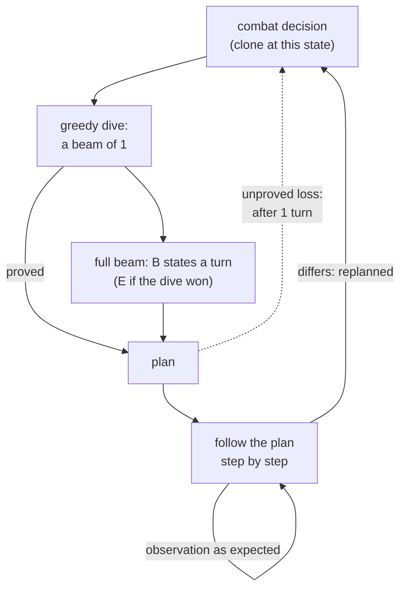
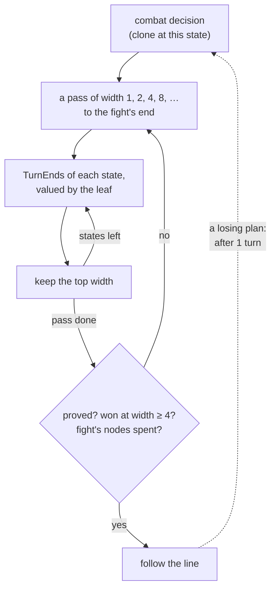

import { Aside, Badge } from '@astrojs/starlight/components';
import PlanTimeline from '../../../../../components/combat/PlanTimeline.svelte';

In SL the combat brain gets one exact copy of the fight: the clone of the current node, with every random stream in it. The same actions always give the same outcome there, so a fight is a deterministic planning problem, with nothing to guess and nothing to average. What is left is its size: SL's combat brain is **pruning + net**, a search that keeps the lines the combat net ranks best and drops the rest. The **SL planner** (`SlPlanner`) searches for the best line to the end of the fight, once, and the fight then plays that line step by step.

<Aside title="Built and planned">

[§1](#sec-1)–[§4](#sec-4) and the sections they link describe the planner that plays the SL champion: a greedy dive, then a beam, at an effort level. [§5](#sec-5) sums up the planned search, which replaces the dive and the beam with passes of growing width. It is not implemented.

</Aside>

Here is what that looks like in a real run. On floor 17 of a run (seed `E91KLB4BRWB4`), the act 1 boss is Vantom: 173 HP and 8 stacks of Slippery, so each hit deals 1 damage and takes a stack off. At the fight's first decision, with 65 of 70 HP, the planner searched for 5.2 seconds and returned a line of 22 actions over 6 rounds. The fight followed it without another search.

<PlanTimeline client:visible lang="en" />

The line is a poison plan. Neutralize and Strike spend two stacks of Slippery for 1 damage each. Calculated Gamble discards the hand and draws as many cards, and the planner already knows they will be Adrenaline, Noxious Fumes, Dash and Bouncing Flask: SL may see the draw order, and the planner tried the Gamble on the clone. Noxious Fumes and Snakebite start the poison in round 1. Round 3 takes Vantom's 26-damage hit (60 → 34 HP) to play Dagger Spray, a second Gamble and another Snakebite rather than block. In round 6 the plan ends the turn without playing a card: Vantom has 35 HP and 42 poison, and dies at the start of its own turn. The plan's value, 0.4914, is the leaf's value of a win at 34 of 70 HP, and the fight ended with 34 HP.

## 1. What SL may see

SL is NoSL plus the true outcome of any sequence of actions inside the **current node**: the current map point, from arrival until the next point is chosen ([Environments: information §3](/en/arch/environments/information/#sec-3)). Inside a fight that means the draw order and every reshuffle, the monsters' moves, generated cards, random targets, and how the order of actions changes all of these: manipulating the random streams inside the node is allowed. Nothing about later nodes is: what a `?` turns out to be, the next encounters, rewards or shops.

The fight's copy is the **node clone** ([Simulator: worlds and the SL clone §7](/en/arch/simulator/worlds/#sec-7)). On arrival at a point the game saves the run; the node's checkpoint is that save plus each relic's plain fields, which the save drops. Every decision since arrival is recorded as a trace. Loading the checkpoint the way the game's Continue does and replaying the trace gives the real fight at the current decision, random streams included. A **seal** keeps the search inside the room: the clone stops at the node's exit and refuses any later step, and the SL world refuses to play past the end of its fight, so no line can peek at what follows.

## 2. Why the best line is the right answer

With one world, taking the best line is correct. The trap of searching sampled worlds, strategy fusion, needs several worlds to fuse ([NoSL PIMC: search §4](/en/arch/pimc/search/#sec-4)): in a single exact world, knowing the future is not an error but the rules of SL.

Write the fight as a deterministic system: a state $s_t$, an action $a_t$ among the legal ones, and the game's transition $s_{t+1} = f(s_t, a_t)$. A line $a_1, \dots, a_T$ ends where the fight does, and its worth is the leaf's value of the end state, $L(s_T)$ ([The leaf](/en/arch/combat-brain/leaf/)). The planner looks for

$$
\max_{a_1, \dots, a_T} \; L\big(s_T\big), \qquad s_{t+1} = f(s_t, a_t).
$$

A fight has finitely many lines, so a best line exists, and a search that tried them all would find it. It is best with respect to $L$ at the end of the fight: once a line reaches the end, nothing in the fight is estimated any more, and the only error left is in what V says the run a won fight leaves is worth ([The leaf §2](/en/arch/combat-brain/leaf/#sec-2)).

Trying them all is out of reach. Choosing a turn's cards under an energy limit is already a knapsack problem, and with hand, energy and turns unbounded the problem is NP-hard. The real fights are bounded (a hand of at most 10 cards, 3–15 turns), but large: up to about $10^4$ sequences per turn ([Combat brain §2](/en/arch/combat-brain/#sec-2)), turn after turn. So the planner aims at the best line, proves it is the best when it can ([Beam §5](/en/arch/sl-planner/beam/#sec-5)), and does without the proof when it cannot.

## 3. The planner in one picture

1. **Each turn searched in full.** From one state, a depth-first search over the turn's actions, the answers of each action's card prompt among them, finds the distinct states where the turn can end, the enemies' turn played for real ([Turn search](/en/arch/sl-planner/turn-search/)).
2. **A beam over turns.** Of all the states where the kept states' turns end, the best B by the leaf go on to the next turn ([Beam §1](/en/arch/sl-planner/beam/#sec-1)).
3. **Nothing is pruned by value.** A win is worth V of the run it leaves, which a line can still raise, so no state's value caps its lines; the beam's width is the only cut ([Beam §2](/en/arch/sl-planner/beam/#sec-2)).
4. **A greedy dive first** gives a line to the fight's end before the full beam starts, and when it already wins, the full beam narrows to the easy beam E ([Beam §3–§4](/en/arch/sl-planner/beam/#sec-3)).
5. **Pick, and prove if possible.** The best line that ends the fight; it is proved when nothing better can exist ([Beam §5](/en/arch/sl-planner/beam/#sec-5)).
6. **Losing plans** are played one turn at a time and planned again, at most three in a row ([Beam §6](/en/arch/sl-planner/beam/#sec-6)).
7. **Workers.** Each beam state's turn is one request to the worker pool ([Budget §4](/en/arch/sl-planner/budget/#sec-4)).

## 4. Plan once, follow the plan

The world is exact, so the plan is computed once and played as computed. A plan is the line's actions with the hash of the observation each one expects before it. At each later decision of the fight, Harness's route plays the plan's next step without a search if the fight shows the expected observation and the action is legal (`TurnPlan`). A step that does not hold means the clone differs from the real fight: the route plans again, marks the decision `replanned` in the decision log, and `run` prints each run's count of replans and the batch's total ([Harness: the decision log §6](/en/arch/harness/decision-log/#sec-6)).

Replans are how clone errors show up: a clone that differs from the game in anything the observation shows, such as a relic's counter or status, fails the plan's next step. So the checkpoint carries each relic's plain fields, which the game's save drops, and loading puts them back ([Simulator: worlds and the SL clone §6](/en/arch/simulator/worlds/#sec-6)). In the champion's report runs, 100 for each character, no step failed: 0 replans. A fight is planned again on purpose when its plan expects to lose ([Beam §6](/en/arch/sl-planner/beam/#sec-6)), or when the plan ends at the 40 turns a plan may look ahead ([Beam §1](/en/arch/sl-planner/beam/#sec-1)).

`selftest` checks the same thing on purpose: a run's fight is planned on the node's clone, played in the run step for step, each observation as the plan expects, and it must end with the HP, max HP and potions the plan left on the clone, where the plan is worth V of the run its combat leaves; the pooled planner must plan what one process plans.

## 5. The planned search <Badge text="planned" variant="caution" />

The planner's reasoning stays: one world, the best line, a plan followed step by step. What changes is the machinery around it, down to one loop.

- **Pruning + net.** Each pass keeps the top width by the leaf, and nothing is dropped by value, as in the beam ([Beam §2](/en/arch/sl-planner/beam/#sec-2), [Combat brain: the leaf](/en/arch/combat-brain/leaf/)).
- **One enumeration.** A turn's ends come from `TurnEnds`, shared with NoSL ([Turn search §6](/en/arch/sl-planner/turn-search/#sec-6)).
- **Passes, not a dive and a beam.** Width 1 is the dive, and each later pass is a wider beam ([Beam §7](/en/arch/sl-planner/beam/#sec-7)).
- **One budget.** A fight's nodes and a minimum width replace the dive, easy beam, loss plans and replan options ([Budget §7](/en/arch/sl-planner/budget/#sec-7)).

## 6. This chapter

| section | what it explains |
|---|---|
| [Turn search](/en/arch/sl-planner/turn-search/) | one turn searched in full: depth first, ending the turn at every step, card prompts' answers as lines, transpositions keyed by the full hidden state, the nodes shared over the first actions, cycles; the planned `TurnEnds` |
| [Beam](/en/arch/sl-planner/beam/) | the beam over turns, why nothing is pruned by value, the greedy dive, the easy beam, picking and proving a line, losing plans; the planned iterative widening |
| [Budget](/en/arch/sl-planner/budget/) | the effort levels and the low budget, where the time goes, workers, the champion's budget and speed, weaknesses and open questions; the planned fight budget |
