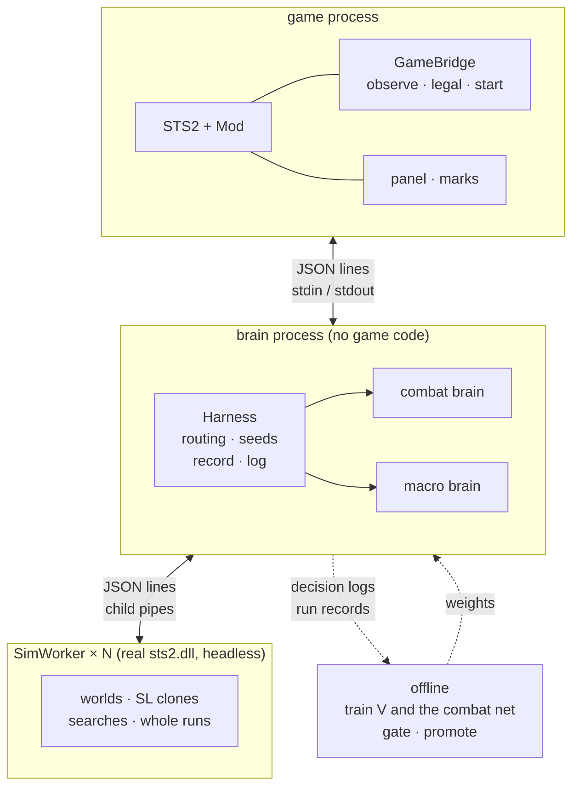

import { Badge, LinkCard } from '@astrojs/starlight/components';

This project builds an AI that plays **Slay the Spire 2** (STS2), a single-player deck-building roguelike, and runs as a mod inside the game. One brain serves two modes:

- **Assist**: the mod shows the player what the AI would do, its plan for the turn and the options it weighed, with each one's chance to win. This is built ([Mod](/en/arch/mod/), [Output](/en/arch/output/)).
- **Auto-play**: the AI plays the answers itself in the real game. When the player asks, it plays a step, the rest of a turn or a room, or goes on until paused; this is built. Playing whole runs with no one at the keyboard is planned ([Mod: auto-play and safety](/en/arch/mod/auto/)).

The strategy is learned from zero by self-play; it is not built from anyone's recorded games, and it is not written by hand. It is single-player only, and one set of nets serves all five characters at every Ascension level. The game version is pinned at **v0.111.0**; the game runs on Godot 4.5.1 and .NET 9.0.7, and mods change its code at runtime with Harmony patches.

**How well it plays.** In SL, where the AI may replay the room it is in, the champion wins **92%** of whole Silent runs at Ascension 0 (92 of 100 seeds, 95% interval 85.0–95.9%), and 82%, 71%, 68% and 47% with the Ironclad, the Regent, the Defect and the Necrobinder ([Evaluation: champions and baselines §2](/en/arch/evaluation/champions/#sec-2)). In NoSL, where it sees only what a player sees, it plays the same two nets, which learned from SL's games and are not trained or gated in NoSL; the NoSL champion has no report ([Evaluation](/en/arch/evaluation/)).

If you have never played the game, read [The game](/en/arch/game/) first.

## 1. Five ideas

1. **Search plus a learned value.** Every decision is made online by searching the options and judging where they lead with a learned value function, all on one scale. In combat, the search plays the fight forward; outside combat, the macro brain values each option's result with V ([Combat brain](/en/arch/combat-brain/), [Macro brain](/en/arch/macro-brain/)). Strategy is not written as rules: it lives in what the nets learned.
2. **Two environments.** The game is full of hidden information. In **NoSL** the AI knows only what a player knows. In **SL** it may also see the true outcomes inside the current map point, as a player who saves and reloads could; later rooms stay hidden in both. Each environment has its own champions and leaderboard ([Environments](/en/arch/environments/)).
3. **Swap the world, not the brain.** The same brains answer the simulator in self-play and the mod in the real game, through the same messages ([Protocol](/en/arch/protocol/), [Harness](/en/arch/harness/)). Only the host changes.
4. **The real game, headless.** The simulator is not a model of the game: it runs the game's own `sts2.dll` in a plain .NET process, without graphics, with its rules untouched ([Simulator](/en/arch/simulator/)).
5. **No fallback.** A decision that no brain covers stops the run with an error; it is never made at random. A decision by a random placeholder voids an evaluation.

## 2. Seven rules

Every design decision follows these rules, each for a reason:

| rule | why |
|---|---|
| **No cheating beyond the environment.** The decision process holds no reference to game code, and the compiler enforces it; what crosses to it is a whitelist of protocol types | so what the AI knows is exactly what the environment allows, and can be checked ([Environments: information §8](/en/arch/environments/information/#sec-8)) |
| **An online decision is search plus a learned value.** An LLM never decides and never breaks ties; it may only be used offline, with cheap models | so play is reproducible and every choice traces back to a search and a value |
| **Training and the real game share one code path**: the same Protocol, GameBridge, Harness and brains | so what was trained and gated is what plays |
| **The simulator is the real `sts2.dll`**, headless, with no engine rewritten | a rewrite would drift from the game; the real code is right by definition |
| **No fallback**: an uncovered decision stops; it is never made at random | a silent random move would hide a missing piece and corrupt both training data and results |
| **The mod never writes saves, and nothing reloads the real game** (`NumReloads == 0`) | SL's replays happen in the simulator, on a clone; the real game is played straight |
| **Low coupling, simple, clear**: each project has one job and dependencies point one way ([§4](#sec-4)); each decision screen or component sits behind one small interface; nothing is built before something uses it; game quirks get no checksum or fallback, and one that breaks our own correctness is fixed where it enters our code | so each part can be read, tested and replaced alone. Example: a loaded save drops relic fields that continuous play keeps, so the SL checkpoint carries them ([Simulator: worlds and the SL clone §6](/en/arch/simulator/worlds/#sec-6)) |

## 3. Processes and data

- **The game process**: the real game with the mod. The mod reads the decision on screen with GameBridge (observe, list the legal actions; the simulator also starts actions with it), asks the brain, and draws the answer ([Mod](/en/arch/mod/)).
- **The brain process**: SimWorker's `brain` command, which the mod starts as a child process and talks to on its stdin and stdout, or the same objects inside `run`. It loads no game code. Harness gives each run a dispatcher that routes each decision to a brain, draws its seed, checks its answer and logs it ([Harness](/en/arch/harness/)).
- **SimWorker processes**: each runs the real `sts2.dll` headless. They build the worlds a search plays in, load SL clones, run searches, and host whole runs in self-play and evaluation ([Simulator](/en/arch/simulator/)). The game keeps its run in singletons, so one process holds one live game: search spreads over many processes ([Simulator: the worker pool](/en/arch/simulator/pool/)).
- **Offline**: Python under `learn/` trains V and the combat net from decision logs and run records, and a gate decides whether a new net replaces the champion ([Learning](/en/arch/learning/), [Evaluation](/en/arch/evaluation/)).

In self-play a SimWorker hosts the run instead of the game; Harness and the brains do not change.

## 4. The code

All .NET projects live under `src/`, in the solution `Sts2Ai.sln`. Dependencies point one way, down to Protocol:

| project | references | content |
|---|---|---|
| `Sts2Ai.Protocol` | the framework only | the messages and the observation types: together, the whitelist of what crosses ([Protocol](/en/arch/protocol/)) |
| `Sts2Ai.GameBridge` | the game, Protocol | observe, legal, start: everything that reads or drives the game ([GameBridge](/en/arch/gamebridge/)) |
| `Sts2Ai.Brain` | Protocol | the combat brains (PIMC, the SL planner, the leaf and the combat net), the macro brain L0 with V, the placeholder policies |
| `Sts2Ai.Harness` | Brain | the dispatcher, the brain server, the worker pool and the pooled brains, run records, reports and the gate |
| `Sts2Ai.SimWorker` | the game, GameBridge, Brain, Harness | the headless host, combat and run sessions, worlds and clones, the worker (`serve`), the command line ([Simulator: reference](/en/arch/simulator/reference/)) |
| `Sts2Ai.Mod` | the game; compiles GameBridge and Protocol in | the in-game host ([Mod](/en/arch/mod/)) |
| `Sts2Ai.Tests` | SimWorker | xUnit tests ([Simulator: reference §7](/en/arch/simulator/reference/#sec-7)) |

Beside `src/`:

- `learn/`: the Python that trains V (`learn/v/`) and the combat net (`learn/combat/`), and the gate script, run with uv ([Learning](/en/arch/learning/));
- `weights/`: the trained nets, one JSON file each; the nets every character shares in `weights/all/`;
- `eval/`: seed sets, the champion files, and each character's reports and leaderboard ([Evaluation](/en/arch/evaluation/));
- `distro/`: the mod's packaging; `distro/build.sh` builds the Workshop item into `out/Sts2Ai/` (not in git): the mod, a self-contained brain for each platform, and the NoSL champion's file with its nets, which serves both environments ([Mod §3](/en/arch/mod/#sec-3));
- `docs/`: this book;
- `data/`: where self-play and evaluation write their logs and records; not in git.

## 5. This book

The book has an introduction, four parts and an appendix, in the order of the sidebar. A page's badge shows its status.

**Part I: The problem**

| chapter | what it covers | status |
|---|---|---|
| [The game](/en/arch/game/) | runs, the map, rooms, combat, characters, Ascension, randomness and what is hidden | |
| [Environments](/en/arch/environments/) | what the AI may know in NoSL and SL, the node, worlds and the two combat algorithms | <Badge text="built" variant="success" /> |

**Part II: Deciding**

| chapter | what it covers | status |
|---|---|---|
| [Combat brain](/en/arch/combat-brain/) | what a combat decision is, the two algorithms, the leaf and the combat net, card prompts, enemy moves | <Badge text="partly built" variant="tip" /> |
| [The SL planner](/en/arch/sl-planner/) | planning the whole fight on the clone: turn search, the beam, budget and results | <Badge text="built" variant="success" /> |
| [NoSL PIMC](/en/arch/pimc/) | sampled worlds, the search in each, the average, budget and results | <Badge text="built" variant="success" /> |
| [Macro brain](/en/arch/macro-brain/) | decisions outside combat: afterstates and one V, search on the SL clone, the value network, self-play, next steps | <Badge text="partly built" variant="tip" /> |

**Part III: Learning and evaluation**

| chapter | what it covers | status |
|---|---|---|
| [Learning](/en/arch/learning/) | what is learned, the value function, the combat net's training, the loop, the reference | <Badge text="partly built" variant="tip" /> |
| [Evaluation](/en/arch/evaluation/) | the sim-to-real ladder, metrics, seeds and reports, gates, champions and baselines | <Badge text="partly built" variant="tip" /> |

**Part IV: The machinery**

| chapter | what it covers | status |
|---|---|---|
| [Simulator](/en/arch/simulator/) | the game headless, combats, whole runs, worlds and the SL clone, the worker pool, the command line | <Badge text="partly built" variant="tip" /> |
| [Harness](/en/arch/harness/) | routing, budgets and seeds, the decision log | <Badge text="partly built" variant="tip" /> |
| [Protocol](/en/arch/protocol/) | the wire, observations and actions, worlds and worker messages | <Badge text="partly built" variant="tip" /> |
| [GameBridge](/en/arch/gamebridge/) | reading the game, actions per surface | <Badge text="partly built" variant="tip" /> |
| [Mod](/en/arch/mod/) | the in-game host: the main loop, the SL record, auto-play and safety | <Badge text="partly built" variant="tip" /> |
| [Output](/en/arch/output/) | the panel, the marks, the planned auto loop and narration | <Badge text="partly built" variant="tip" /> |

**Appendix**: the [Glossary](/en/glossary/).

**Reading routes:**

- *To use the AI in the game*: [The game](/en/arch/game/), [Environments](/en/arch/environments/), then [Mod](/en/arch/mod/) and [Output](/en/arch/output/).
- *To train a net*: [Macro brain](/en/arch/macro-brain/), [Learning](/en/arch/learning/), [Evaluation](/en/arch/evaluation/), then [Simulator: whole runs](/en/arch/simulator/runs/).
- *To add a decision screen, or follow a game update*: [Protocol: observations and actions](/en/arch/protocol/observation/), [GameBridge](/en/arch/gamebridge/), [Simulator: whole runs §4](/en/arch/simulator/runs/#sec-4), [Mod: the main loop §4](/en/arch/mod/loop/#sec-4).
- *To see how strong it is*: [Evaluation](/en/arch/evaluation/) and [Evaluation: champions and baselines](/en/arch/evaluation/champions/).

<LinkCard title="Start here: The game" description="What a run of Slay the Spire 2 is, and what is hidden in it. Every other page builds on it." href="/en/arch/game/" />

## 6. About this book

**Reading the pages**

- <Badge text="verified" variant="success" /> means the claim was checked in the game's source. <Badge text="inferred" variant="caution" /> means it was inferred and must be checked before anything relies on it.
- Game source locations such as `Runs/RunManager.cs:670-709` are paths in the decompiled game, with the `MegaCrit.Sts2.Core.` prefix of its folder names left out. The decompiled game is not in the repository. Godot node classes (`N*`) are found by file name, which is unique.
- Our own code is cited by its path under `src/` or `learn/`, often without the `src/Sts2Ai.` prefix where the chapter makes the project clear.
- "Harness §3" points to a numbered section of a page. Its anchor is `#sec-3` in all three languages (`/en/arch/harness/#sec-3`). A chapter of several pages names the page as well: "Macro brain: search §2" is `/en/arch/macro-brain/search/#sec-2`. Code comments cite sections the same way, `docs: harness §3`, `docs: macro-brain/search §2`, so a section keeps its number.
- The English pages are the reference version; the Simplified and Traditional Chinese pages say the same thing.
