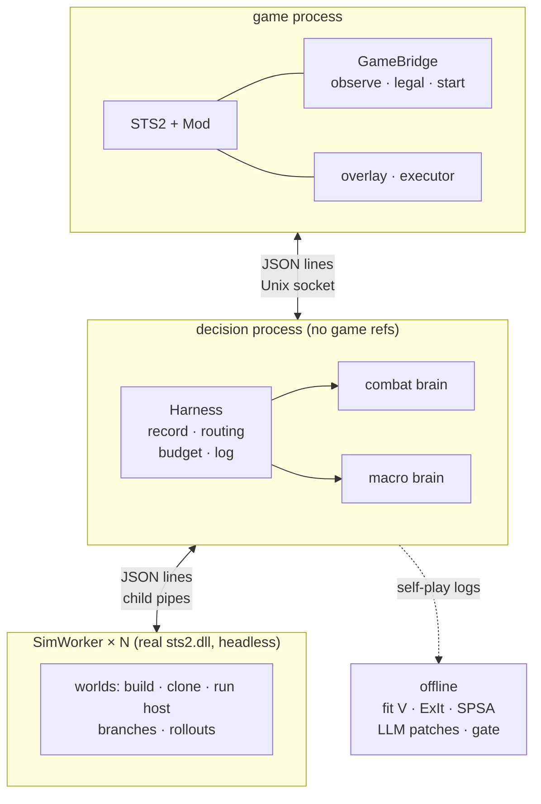

import { Badge, LinkCard } from '@astrojs/starlight/components';

This project builds an AI for **Slay the Spire 2** (STS2) that runs as a mod inside the game. One brain drives two modes:

- **Assist:** highlight the order in which to play, and explain why.
- **Auto-play:** play the whole run on its own.

The strategy improves itself starting from zero. It is not built from the user's own games. The first target is the Silent at Ascension 0 (A0). Single-player only.

The game version is pinned at **v0.111.0**. The game runs on Godot 4.5.1 and .NET 9.0.7; mods change its code at runtime with Harmony patches.

## 1. Constraints

Seven rules that every design decision follows:

1. **No cheating** beyond what the environment allows ([§2](#sec-2)). The decision process holds no reference to game code, and the compiler enforces it.
2. **An online decision is search plus a learned value,** all on one scale: the probability of winning the run, P(win run). An LLM never decides and never breaks ties. It is used only offline, to propose patches and to polish narration, with cheap models through the project's LLM gateway.
3. **Training and the real game share one code path:** the same Protocol, GameBridge, Harness and brains.
4. **The simulator is the real `sts2.dll`,** run headless (without graphics or a window). No engine rewrite.
5. **No fallback:** a decision that nothing covers pauses the game. It is never made at random.
6. **The mod never writes saves,** and nothing reloads the real game (`NumReloads == 0`).
7. **Low coupling, simple, clear:** each project has one job and dependencies point one way ([§4](#sec-4)); each decision surface or component sits behind one small interface; no mechanism is built before something uses it; game bugs get no checksum or fallback, and one that breaks our own correctness is fixed where it enters our code. Example: a loaded save drops relic fields that continuous play keeps, so the SL checkpoint carries them ([Environments §6](/en/arch/environments/#sec-6)).

## 2. Environments

The AI plays in one of two environments, defined on [Environments](/en/arch/environments/):

- **NoSL:** public history only. Search runs on K determinized samples (hidden state drawn to agree with what is public) and averages over them.
- **SL:** NoSL plus the true outcomes inside the current node, i.e. the current map point from arrival until the travel action. Search uses one sealed, exact clone. Later nodes stay hidden in both environments.
- One macro brain and one value function V serve both environments; only the combat brain differs: PIMC in NoSL, a planner over the whole combat in SL ([Environments §5](/en/arch/environments/#sec-5)). Each environment has its own champions and leaderboard. Reports give the SL − NoSL difference.

## 3. Processes

- **Game process:** the real game with our mod. The mod uses GameBridge to read what is on screen (observe), list the legal actions (legal), and carry one out through the UI's own entry points (start). It draws the overlay and, in auto-play, executes actions.
- **Decision process:** loads no game code. Harness keeps the record of the run, routes each decision to the combat or macro brain, sets the search budget and writes the decision log.
- **SimWorker processes:** each one runs the real `sts2.dll` headless. They build or clone the worlds that search explores, run search branches and rollouts, and can host a whole run themselves.
- **Offline:** a separate pipeline that turns self-play logs into a better value function and gates each change ([Learning](/en/arch/learning/)).

In self-play the run host is a SimWorker instead of the game. Harness and the brains do not change: "swap the world, not the brain".

The game keeps its run in singletons, so one process can hold only one live run. Search therefore has to spread over many processes. This fits the rule that the decision process loads no game code.

## 4. Code

All projects live under `src/`, in the solution `Sts2Ai.sln`. Dependencies point one way, from the top of the table down to Protocol.

| project | references | content |
|---|---|---|
| `Sts2Ai.Protocol` | framework only | wire types; together they are the observation whitelist |
| `Sts2Ai.GameBridge` | game + Protocol + Harmony | observe, legal, start (UI entry points) |
| `Sts2Ai.Brain` | Protocol | combat brain v0 (PIMC), placeholder policies |
| `Sts2Ai.SimWorker` | game + all of the above | headless host, combat and run sessions, CombatBuilder, combat worlds, the worker (`serve`), CLI |
| `Sts2Ai.Mod` (planned) | game + GameBridge + Protocol | in-game host |
| `Sts2Ai.Harness` | Protocol + Brain | dispatcher: routing, brain seeds, decision log, the worker pool and the pooled PIMC brain; the record is planned |

## 5. Doc map

The manual reads as a book: an overview, four parts and two appendices, in the order of the sidebar. The badge next to each page shows its status.

**Part I: The problem**

| page | scope | status |
|---|---|---|
| [Environments](/en/arch/environments/) | NoSL/SL definitions, node boundary, information table, guards | <Badge text="decided" variant="success" /> |

**Part II: Deciding**

| page | scope | status |
|---|---|---|
| [Combat brain](/en/arch/combat-brain/) | a chapter of three sections: what a combat decision is and the two algorithms, the leaf (`LeafValue` and the combat net), card prompts, enemy moves and workers | <Badge text="partly built" variant="tip" /> |
| [The SL planner](/en/arch/sl-planner/) | a chapter of four sections: planning the whole fight on the clone, turn search, the beam and its bound, budget and results | <Badge text="built" variant="success" /> |
| [NoSL PIMC](/en/arch/pimc/) | a chapter of three sections: sampled worlds, the search in each world and the average, budget and results | <Badge text="built" variant="success" /> |
| [Macro brain](/en/arch/macro-brain/) | a chapter of seven sections: what it decides, afterstates and one V, search on the SL clone, the value network, from hazards to value, self-play in the elite gauntlet, weaknesses and next steps | <Badge text="partly built" variant="tip" /> L0, pure V and its self-play exist |

**Part III: Learning and evaluation**

| page | scope | status |
|---|---|---|
| [Learning](/en/arch/learning/) | definition of V, self-play loop, credit assignment, privileged training, local optima, infrastructure | <Badge text="planned" variant="caution" /> |
| [Evaluation](/en/arch/evaluation/) | R1–R4 ladder, leaderboards, metrics, seeds, gates, baselines | <Badge text="planned" variant="caution" /> |

**Part IV: The machinery**

| page | scope | status |
|---|---|---|
| [Simulator](/en/arch/simulator/) | headless host, combat session, CombatBuilder, performance, run session, NoSL worlds, SL clone, worker pool | <Badge text="partly built" variant="tip" /> combat and run sessions, NoSL combat worlds, worker pool exist |
| [Harness](/en/arch/harness/) | record and belief, routing, budget, decision log, failures | <Badge text="partly built" variant="tip" /> routing, decision log and worker pool exist |
| [Protocol](/en/arch/protocol/) | wire format, observation union, choice context, events, recommendation, world API | <Badge text="partly built" variant="tip" /> observation and choice context exist |
| [GameBridge](/en/arch/gamebridge/) | observe sources, actions per surface, prompt context, decision points, uids | <Badge text="partly built" variant="tip" /> every surface exists |
| [Mod](/en/arch/mod/) | loading, main-thread loop, idle detection, adapters, SL export, auto-run driver, safety | <Badge text="planned" variant="caution" /> |
| [Output](/en/arch/output/) | panel, highlight anchors, auto loop, narration | <Badge text="planned" variant="caution" /> |

The appendices: progress, known gaps and the implementation order are on [Status and roadmap](/en/status/); terms are explained in the [Glossary](/en/glossary/).

Background notes, in Chinese, are kept locally under `tmp/notes/` and are not in the repository: `plan.md` (plan v1, milestones M0–M5), `fair-play-spec.md`, `output-design.md`, `testmode-audit.md`, `mod-research.md`.

<LinkCard title="Start here: Environments" description="What the AI may know in NoSL and SL. Every other page builds on it." href="/en/arch/environments/" />

## About this manual

**Reading the pages**

- <Badge text="verified" variant="success" /> means the claim was checked in the game's source. <Badge text="inferred" variant="caution" /> means it was inferred and must be checked before anything relies on it.
- Game source locations such as `Runs/RunManager.cs:670-709` are paths inside the decompiled `MegaCrit.Sts2.Core` assembly. The decompiled code stays local (`tmp/decompiled/sts2/`) and is not in the repository. Godot node classes (`N*`) are found by file name, which is unique.
- References like "Simulator §5.1" point to a numbered section of a page. Its anchor is `#sec-5.1` in all three languages (`/en/arch/simulator/#sec-5.1`). Code comments cite sections as `docs: simulator §5.1`.
- A chapter of several pages, such as the macro brain, names the page as well: "Macro brain: search §2" is `/en/arch/macro-brain/search/#sec-2`, and code comments cite it as `docs: macro-brain/search §2`.

**Maintaining it**

- The English pages are the reference version, and Claude reads them as its design manual. The Simplified and Traditional Chinese pages say the same thing. Change all three in the same commit.
- Keep section numbers stable: code comments cite them.
- Before committing, run `pnpm check` in `docs/`: it builds the site and checks every internal link and anchor.
