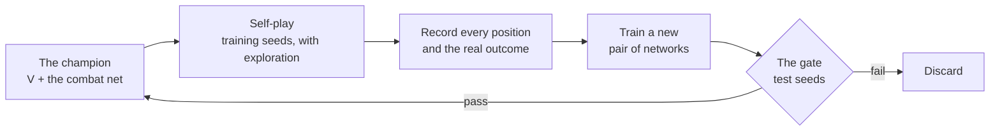

Both networks learn by self-play. The champion plays whole runs in the simulator with the current networks, deliberately replaces some of its decisions with random draws, and records every decision and the outcome of every combat. Each recorded position is labelled with what really happened afterwards. A new pair of networks learns from the newest batch of runs only and replaces the champion only after passing the gate. The whole process uses no human runs, no hand-written strategy and no language model.

## Who plays

The champion's pair of networks plays, with the same search effort it uses when it is evaluated.

The reason is that V means "the chance of winning if play goes on the way the champion plays". If the labels came from a weaker player, or from one that searches less deeply, V would learn the answer to a different question.

## Exploration: not picking the best on purpose

An AI that always picks the option V thinks best never learns what the other options lead to. When V is wrong, there is no chance to find out. So self-play needs **exploration**.

The method is simple. At every decision outside combat, with probability ε the AI draws one option evenly from all of them, whatever V thinks. The rest of the time it picks V's best.

- **Why draw evenly.** Which option is drawn depends neither on V nor on how well the run is going. Only then are the outcomes clean evidence about each option. A draw weighted by V's preferences would only retry, again and again, what V already likes.
- **Why three tiers.** A batch of runs is split evenly into three tiers, with ε at 0.3, 0.1 and 0.02. Runs with a large ε see more options, and only runs with a small ε reach the late floors.
- **The cost.** Exploration loses runs. The tier that explores most wins only about one run in ten, and the tier that explores least wins nearly four in ten.

There is no exploration in combat: the AI plays whatever search finds.

## Labels: what really happened afterwards

- **V's labels**: each decision outside combat is labelled with the floor where its run really ended, or with a win.
- **The combat net's labels**: the start of each turn is labelled with how that combat really ended.

Both use real outcomes only. A network's own estimates never come back as labels.

## Hundreds of decisions, one outcome

The example run has 186 decisions outside combat, and they share one outcome. Labels like this have no bias but a lot of noise: from one run alone, nobody can say which decision caused the win or the loss. The project does four things about this at present:

- **Labels are given by floor.** Every floor survived is information, not just the final win or loss.
- **One run, one vote.** Each sample is weighted by 1 divided by the number of samples in its run.
- **One more target for practice.** During training V also has to predict how much HP each of the next six combats costs, which gives it more places in a run where it can check its answers.
- **Combat is left to search.** Seventy percent of a run's decisions are in combat, and search settles those. Only the small part outside combat still has to be credited or blamed by the outcome.

## Only the newest batch, continuing from the champion

New networks train on the newest batch of runs only. Runs played by a weaker champion give the same position a label that is too low: the current champion, playing from there, would win more often.

Training continues from the champion's weights and does not start from zero. On the same data, a network that continues has a lower error on the runs held back for checking.

The champion's two networks learned from more than twenty thousand runs.

## Training seeds and test seeds never meet

The seeds for self-play and the seeds for evaluation come from two different sources and never overlap. Both ends are checked: the training program refuses data that contains evaluation runs, and evaluation can play only test seeds registered in advance. Only then does the gate measure how the networks do on runs they have not learned from.

## Starting from zero

Search needs both networks before it can run. When no network exists yet, two placeholder players that need no network can play the first batch of runs: one picks at random outside combat, and the other plays cards at random in combat. Every batch after that is played by the networks learned from the batch before.
