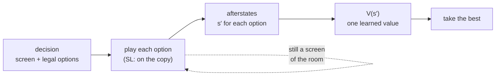

import MapRoute from '../../../components/book/MapRoute.svelte';

Every decision outside combat belongs to this chapter: which map point to go to next, which rewards to claim, which card to take, what to buy, and which option to pick at an event, a rest site or a treasure chest. The method fits in one sentence: play each option, look at the position right after it, ask a learned value function V how good that position is, and take the best.

1. **Options.** The actions the game allows on this screen.
2. **Afterstates.** Each option is applied, and the position right after it, before anything random happens, is its *afterstate*. In SL the option is played in the real game on a copy of the current room; where the game then shows another screen of the same room, for example a shop after a purchase or the next page of an event, the search goes on through it.
3. **One value.** V reads an afterstate and returns one number. The same V scores every option of every screen, so a card, a relic, an upgrade, a heal and a path on the map are compared on one scale, without exchange rates written by hand.
4. **Best.** Take the option with the highest value, the first one on a tie. Self-play sometimes draws another on purpose, to learn what it would have led to.

## What makes these decisions hard

What these decisions have in common: few options, a long reach, cheap to carry out, hard to value. A combat turn can have thousands of lines; here a decision has a handful of options, and each can be tried on the copy.

The hard part is that the effect of a choice shows up only many floors later. A card taken on floor 2 is still in the deck at the act 3 boss. A rest site skipped on floor 43 to fight one more monster may decide whether the run reaches floor 48.

The book's example run has 174 of these decisions, and they all share one result: the run was won.

## Why value the position after the play

Taking a card, buying something and choosing a path all begin with something certain: the card enters the deck, the gold is paid, the map point is chosen. Only then come the random things, such as who the next combat is against. The position where the certain part is done and the random part has not begun is the afterstate.

Valuing the afterstate and not the option itself has three benefits:

- **One function is enough.** An option means something different on every screen: a card, a map point, a shop slot. A position is always the same kind of thing: the current state of a run.
- **Different roads to the same place are learned once.** Taking a card from a reward, buying the same card in a shop and getting it from an event all end in the same position, so V has to learn what it is worth only once.
- **Every decision is training data.** Whatever screen it came from, a recorded position goes to teach the same V.

## One ruler

V's unit is the chance of winning the run. If two options differ by 0.02, V judges that choosing one of them raises the chance of winning by 2 percentage points. The screens ask very different questions, and all of them come down to this number:

- **Rest site**: heal, or upgrade a card. V compares a run with more HP against a run with a better deck.
- **Card reward**: three cards, or none. A card can be worth less than taking nothing: with one more weak card in the deck, the good cards are drawn less often.
- **Map**: a few floors before the boss, a monster combat or a rest site. The combat gives gold and a card but costs HP.

The figure below is the map on floor 19 of the example run. Two points are open: V gives the move to the enemy room 87.7% and the move to the "?" room 87.3%, so the AI goes to the enemy room. The purple line is the route it intends to follow all the way to the boss.

<MapRoute client:visible lang="en" />

It is tempting to split V into two networks, one for the deck and one for the route. But there is no line between the two. Relics come from elites and shops, yet what a relic is worth depends on the deck. A rest site trades HP for an upgrade. A shop sells cards, relics and card removal for the same purse of gold. After a split, a person would have to write the exchange rate between the two scores, and that is hand-written strategy.

## Playing the whole room through on the copy

Many rooms are not one decision but a string of them. A shop is several purchases and then leaving, a rewards screen is several claims, and an event may have several pages. Valuing only the first move means deciding whether to buy a relic without knowing whether the gold left over still pays for removing a card.

So in SL, search keeps going on the copy. After each move it keeps only the 16 positions with the highest V and goes on from those, and one decision gets at most 1,024 tries. It goes on until it leaves the room, a combat starts or the run ends. V values the place where it stops. If an option leads into a combat, the combat net first estimates how that combat will end.

What is played out on the copy is the real result: what the event really gave, which card a transform produced, what the shop still holds after a purchase.

Choosing a path is the exception. Moving to the next point leaves the room, and the copy goes only as far as the room's exit. So a choice on the map can only be predicted: the point is added to the route, and V reads the map ahead.

## When there is no copy

NoSL has no copy, so the AI can only work out the result from what the screen says: add the card, subtract the gold, add the HP healed. What the screen does not say stays hidden, such as the true cost of an event option or what a transform will produce. So the same V makes these decisions more roughly in NoSL.
