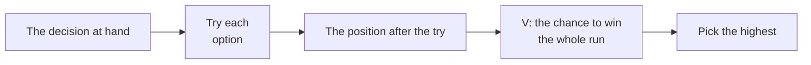

The AI makes every decision with the same method. It really tries each option in a copy of the game, looks at the position after the try, asks a learned function what chance that position has of winning the whole run, and picks the option with the highest chance. No person wrote a single rule of the kind "in this situation, play this card".

## Try: let the game give the result

The AI does not need to understand what each card does. It has the game itself: the same program, running with no screen. To learn what playing a card will do, it plays the card and looks. So not one rule of the game has to be rewritten, and none can be rewritten wrong.

In combat, one turn has more than ten thousand lines, too many to try them all. So the AI needs **search**: it tries in an organised way, remembers the positions it has reached, and goes deeper only where things look promising. Outside combat there are usually only a few options, and it can afford to try each one.

## Ask: one ruler measures everything

**V** answers how good the position after a try is. V reads the current state of a run: the deck, relics, potions, HP, gold and the map ahead. It answers with a single number: the chance that this run ends in a win.

Every decision uses this one ruler. Losing 5 more HP, taking one more card, having one potion fewer, taking the path with an elite: all of these turn into the same kind of number and can be compared directly. Nobody sets how many HP a relic is worth. V learned that exchange by itself.

In the middle of a combat a second network helps. The **combat net** reads the current state of a combat and predicts its ending: death, or a win and how much HP it costs. V then prices each ending.

## Learn: from its own runs

At the start, V and the combat net know nothing. The AI plays more than ten thousand runs by itself with the networks it has, and records the position after every decision. When a run is over, the AI labels each of its positions with what really happened next: for V, the next four floors, and past them the estimate of a V that never saw this run; for the combat net, how each combat ended. The networks learn from these labelled positions and then play better, and the new networks play the next batch. This is called **self-play**.

A new network must pass the **gate** before it replaces the old one. The new and the old play the same seeds, and the new one must win enough to count.

## Why it needs both

Search alone is not enough. A run has 48 floors, and search sees at most to the end of the current room. What comes after can only be estimated.

Learning alone is not enough either. A network's estimate always has some error, and the next few moves need no guessing once they have really been tried.

So the AI tries what is near and learns what is far.

## Three rules it does not bend

- **Strategy is not written as rules.** Whether to take a card or fight an elite is for the networks to learn from results. People write how to talk to the game and what the learning aims at. The only exceptions are a few rules about potions, which make up for V rating them too low.
- **No language model is asked.** Only the search and the two networks decide, so every move can be reproduced and traced.
- **No bluffing.** When a decision comes up that no part of the AI is responsible for, the run stops with an error. It never picks at random. One random move would quietly spoil the training data and the evaluation results.
