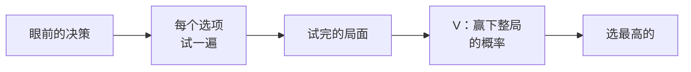

AI 做每一个决策，用的都是同一招：把每个选项在游戏的克隆里真的试一遍，看试完之后的局面，问一个学出来的函数「这个局面有多大机会赢下整局」，然后选机会最大的。没有任何一条「这种情况该出这张牌」的规则是人写的。

## 试：让游戏自己说结果

AI 不需要懂每张牌的效果。它手上有游戏本身：同一套程序，不开画面地跑。想知道打出一张牌会怎样，就真的打出去看。所以游戏的规则一条都不用重写，也就不会写错。

战斗里，一个回合有上万种打法，试不完，所以要**搜索**：有系统地试，记住走过的局面，只沿着有希望的方向往下。战斗之外，选项通常只有几个，每个都试得起。

## 问：一把尺子量所有的事

试完之后的局面好不好，由 **V** 回答。V 读一局的现状：牌组、遗物、药水、生命、金币、前面的地图。它只回答一个数字：这一局最后赢下来的概率。

所有决策都用这一把尺子。多掉 5 点血、多拿一张牌、少一瓶药水、走有精英的那条路，全都换算成同一个数字，可以直接比大小。没有人规定一件遗物值几点血。这个换算是 V 自己学到的。

战斗中途还有第二个网络帮忙。**战斗网络**读一场战斗的现状，预测它会怎么收场：死，或是赢下来、掉多少血。每一种收场再交给 V 估价。

## 学：从自己打的对局里学

V 和战斗网络一开始什么都不会。AI 用手上的网络自己打上万局，记下每个决策之后的局面。等一局打完，再给这一局的每个局面标上实际的结局：死在第几层，或是赢了。网络从这些标好的局面学习，学完打得更好，再用新的网络打下一批。这叫**自我对弈**。

新网络要先过**门槛**才能取代旧的：新旧两边打同一批种子，新的赢得够多才算数。

## 为什么两样都要

只靠搜索不够。一局有 48 层，搜索最多看到眼前这个房间结束，之后的事只能估计。

只靠学习也不够。网络的估计总有误差，而眼前这几步真的试过，就不必猜。

所以近的地方靠试，远的地方靠学。

## 三条不让步的规则

- **策略不写成规则。** 该不该拿一张牌、该不该打精英，都由网络从结果里学。人只写两样东西：怎么和游戏沟通，以及学习的目标。
- **不问语言模型。** 下决定的只有搜索和这两个网络，所以每一步都能重现、能追查。
- **不蒙混。** 遇到没有任何一部分负责的决策，这一局就报错停下，绝不随机选一个。随机的一步会悄悄弄脏训练数据和评估结果。
