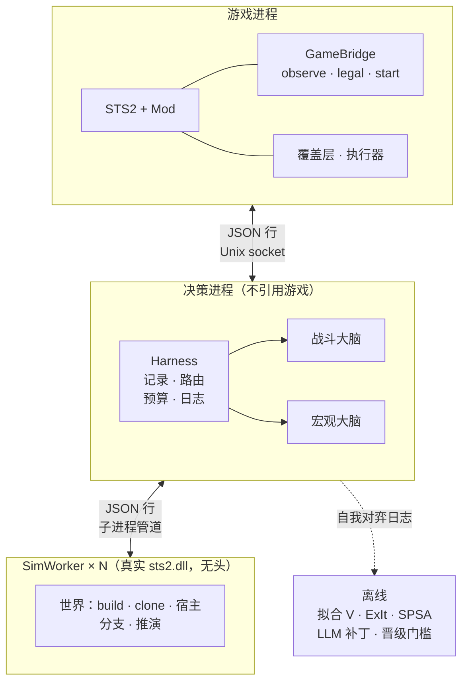

import { Badge, LinkCard } from '@astrojs/starlight/components';

这个项目为**杀戮尖塔 2**（Slay the Spire 2，简称 STS2）做一个 AI，以 Mod 的形式在游戏里运行。同一个大脑驱动两种模式：

- **辅助模式**：高亮出牌顺序，并解释原因。
- **自动游玩**：自己打完整局。

策略从零开始自我提升，不是从用户自己的对局里学来的。第一个目标是 Silent（静默猎手），进阶等级 A0。只支持单人模式。

游戏版本固定为 **v0.111.0**。游戏基于 Godot 4.5.1 和 .NET 9.0.7；Mod 通过 Harmony 补丁在运行时修改它的代码。

## 1. 约束

所有设计决策都遵循这七条规则：

1. **不作弊**，不超出所在环境允许的范围（[§2](#sec-2)）。决策进程不引用任何游戏代码，由编译器保证。
2. **在线决策 = 搜索 + 学到的价值**，全部用同一个尺度：赢下这一局的概率 P(win run)。LLM 从不做决策，也从不用来打破平局。它只在离线时使用，用来提出补丁和润色解说，并且只通过项目的 LLM 网关调用便宜的模型。
3. **训练和真实游戏走同一条代码路径**：同一套 Protocol、GameBridge、Harness 和大脑。
4. **模拟器就是真实的 `sts2.dll`**，以无头（headless，没有画面和窗口）方式运行，不重写引擎。
5. **不兜底**：没有任何模块负责的决策会让游戏暂停，绝不随机乱选。
6. **Mod 从不写存档**，也没有任何东西会让真实游戏读档（`NumReloads == 0`）。
7. **低耦合、简单、清晰**：每个项目只做一件事，依赖单向（[§4](#sec-4)）；每个决策界面或组件只藏在一个小接口后面；没有使用者的机制不做；不为游戏 bug 打补丁绕路。例如：读档后的游戏与一直连续运行的游戏不完全一样，这一点直接接受（[环境 §6](/arch/environments/#sec-6)）。

## 2. 环境

AI 在两种环境之一里游玩，定义见[环境](/arch/environments/)：

- **NoSL**：只用公开历史。搜索在 K 个确定化样本（与公开信息一致的隐藏状态）上进行，再取平均。
- **SL**：NoSL 加上当前节点内的真实结果；节点就是当前地图点，从到达到选择下一个点为止。搜索使用一个封存的精确克隆。两种环境都看不到后面的节点。
- 每种环境有自己的价值函数（V_NoSL、V_SL）、自己的冠军和排行榜。报告里给出 SL − NoSL 的差值。

## 3. 进程

- **游戏进程**：真实游戏加上我们的 Mod。Mod 通过 GameBridge 读取屏幕上的内容（observe）、列出合法动作（legal），并通过 UI 自己的入口执行动作（start）。它负责画覆盖层，在自动游玩时执行动作。
- **决策进程**：不加载任何游戏代码。Harness 保存这一局的记录，把每个决策路由给战斗大脑或宏观大脑，设定搜索预算，并写决策日志。
- **SimWorker 进程**：每个都以无头方式运行真实的 `sts2.dll`。它们构建或克隆供搜索探索的世界，运行搜索分支和推演（rollout），也可以自己作为宿主跑完整一局。
- **离线**：一条独立的流水线，把自我对弈的日志变成更好的价值函数，每次改动都要通过晋级门槛（[学习](/arch/learning/)）。

自我对弈时，这一局的宿主换成一个 SimWorker，而不是真实游戏。Harness 和大脑完全不变：「换世界，不换大脑」。

游戏把当前这一局放在单例里，所以一个进程只能有一局在运行。因此搜索必须分散到多个进程上。这正好符合「决策进程不加载游戏代码」的规则。

## 4. 代码

所有项目都在 `src/` 下，属于解决方案 `Sts2Ai.sln`。依赖单向：从表格上方指向下方，最终指向 Protocol。

| 项目 | 引用 | 内容 |
|---|---|---|
| `Sts2Ai.Protocol` | 只有框架 | 通信类型；这些类型合起来就是观测白名单 |
| `Sts2Ai.GameBridge` | 游戏 + Protocol + Harmony | observe、legal、start（UI 入口） |
| `Sts2Ai.Brain` | Protocol | 战斗大脑 v0（PIMC）、占位策略 |
| `Sts2Ai.SimWorker` | 游戏 + 以上全部 | 无头宿主、战斗和整局会话、CombatBuilder、战斗世界、worker（`serve`）、命令行 |
| `Sts2Ai.Mod`（规划中） | 游戏 + GameBridge + Protocol | 游戏内宿主 |
| `Sts2Ai.Harness` | Protocol + Brain | 调度进程：路由、大脑种子、决策日志、worker 进程池和池化的 PIMC 大脑；记录在规划中 |

## 5. 文档地图

侧边栏与这张表一致，每页旁边的徽章表示它的状态。

| 页面 | 范围 | 状态 |
|---|---|---|
| [环境](/arch/environments/) | NoSL/SL 定义、节点边界、信息表、守护测试 | <Badge text="已定" variant="success" /> |
| [协议](/arch/protocol/) | 通信格式、观测联合类型、选择上下文、事件、推荐、世界 API | <Badge text="部分实现" variant="tip" /> 观测与选牌上下文已有 |
| [GameBridge](/arch/gamebridge/) | 观测来源、各界面的动作、选牌提示上下文、决策点、uid | <Badge text="部分实现" variant="tip" /> 每个决策界面都已有 |
| [模拟器](/arch/simulator/) | 无头宿主、战斗会话、CombatBuilder、性能、整局会话、NoSL 世界、SL 克隆、worker 池 | <Badge text="部分实现" variant="tip" /> 战斗与整局会话、NoSL 战斗世界、worker 进程池已有 |
| [Mod](/arch/mod/) | 加载、主线程循环、空闲检测、适配器、SL 导出、自动开局驱动、安全 | <Badge text="规划中" variant="caution" /> |
| [Harness](/arch/harness/) | 记录与信念、路由、预算、决策日志、故障处理 | <Badge text="部分实现" variant="tip" /> 路由、决策日志和 worker 进程池已有 |
| [战斗大脑](/arch/combat-brain/) | PIMC（NoSL）、确定性规划（SL）、叶子估值、剪枝 | <Badge text="部分实现" variant="tip" /> |
| [宏观大脑](/arch/macro-brain/) | 后状态 + V、推演复核、地图 | <Badge text="规划中" variant="caution" /> |
| [学习](/arch/learning/) | V 的定义、自我对弈循环、功劳分配、特权训练、局部最优、基础设施 | <Badge text="规划中" variant="caution" /> |
| [评估](/arch/evaluation/) | R1–R4 阶梯、排行榜、指标、种子、晋级门槛、基线 | <Badge text="规划中" variant="caution" /> |
| [输出层](/arch/output/) | 面板、高亮锚点、自动循环、解说 | <Badge text="规划中" variant="caution" /> |

进度、已知缺口和实施顺序见[进度与路线图](/status/)。术语解释见[术语表](/glossary/)。

背景笔记（中文）只保存在本地 `tmp/notes/` 下，不在仓库里：`plan.md`（计划 v1，里程碑 M0–M5）、`fair-play-spec.md`、`output-design.md`、`testmode-audit.md`、`mod-research.md`。

<LinkCard title="从这里开始：环境" description="NoSL 和 SL 分别允许 AI 知道什么。其他每一页都建立在它之上。" href="/arch/environments/" />

## 关于本手册

**怎么读**

- <Badge text="已核实" variant="success" /> 表示这条说法已在游戏源码里核对过。<Badge text="推断" variant="caution" /> 表示它是推断出来的，在依赖它之前必须先核实。
- 像 `Runs/RunManager.cs:670-709` 这样的源码位置，是反编译后 `MegaCrit.Sts2.Core` 程序集里的路径。反编译代码只保存在本地（`tmp/decompiled/sts2/`），不在仓库里。Godot 节点类（`N*`）按文件名查找，文件名是唯一的。
- 「模拟器 §5.1」这样的引用指向某页的编号小节。它的锚点在两种语言里都是 `#sec-5.1`（`/arch/simulator/#sec-5.1`）。代码注释写作 `docs: simulator §5.1`。

**怎么维护**

- 英文页是参考版本，Claude 把它当作设计手册来读；中文页内容与之相同。两种语言在同一次提交里一起修改。
- 小节编号保持稳定：代码注释会引用它们。
- 提交前在 `docs/` 下运行 `pnpm check`：它会构建站点，并检查每个内部链接和锚点。
