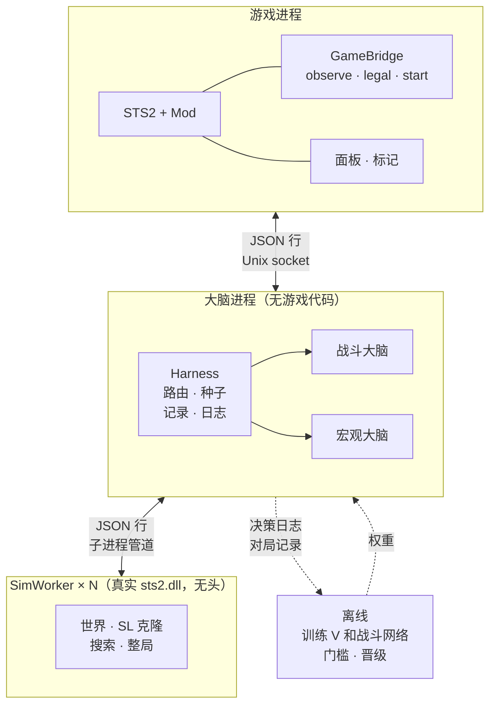

import { Badge, LinkCard } from '@astrojs/starlight/components';

这个项目做一个玩**杀戮尖塔 2**（Slay the Spire 2，简称 STS2）的 AI。杀戮尖塔 2 是一款单人卡组构筑类 Roguelike 游戏；这个 AI 以 Mod 的形式在游戏里运行。同一个大脑服务两种模式：

- **辅助**：Mod 向玩家展示 AI 会怎么做、它这个回合的计划，以及它权衡过的选项。这部分已经实现（[Mod](/arch/mod/)、[输出](/arch/output/)）。
- **自动游玩**：AI 在真实游戏里自己打完整局。这部分在规划中。

策略通过自我对弈从零学起；它不是从任何人录下的对局里学来的，也不是手写的。第一个目标是静默猎手，只支持单人模式：先是进阶 0，然后是进阶 10。游戏版本固定为 **v0.111.0**；游戏运行在 Godot 4.5.1 和 .NET 9.0.7 上，Mod 用 Harmony 补丁在运行时修改它的代码。

**今天打得多好**。在 SL 下（AI 可以重玩它所在的房间），冠军赢下 **8.5%** 的静默猎手 A10 完整对局（200 个种子里赢 17 个，95% 区间 5.4–13.2%），平均打到第 33.1 层；在 A0 上，一对更早的网络在门槛打完的 150 个种子里赢了 88 个。在 NoSL 下（它只看玩家看得到的东西），还没有哪个冠军赢过一局；最好的一份报告用的是一个较旧的价值函数，平均打到第 26.2 层（[评估](/arch/evaluation/)）。

如果你从没玩过这个游戏，请先读[游戏](/arch/game/)。

## 1. 五个想法

1. **搜索加上学到的价值**。每个决策都在线做出：搜索各个选项，用一个学到的价值函数判断它们通向哪里，全部用同一个尺度。在战斗中，搜索把这场战斗往前打；在战斗外，宏观大脑用 V 给每个选项的结果估值（[战斗大脑](/arch/combat-brain/)、[宏观大脑](/arch/macro-brain/)）。策略不写成规则：它存在于网络学到的东西里。
2. **两种环境**。游戏里满是隐藏信息。在 **NoSL** 下，AI 只知道玩家知道的东西。在 **SL** 下，它还可以看到当前地图点里的真实结果，就像一个存档再读档的玩家能做到的那样；之后的房间在两种环境里都是隐藏的。每种环境都有自己的冠军和排行榜（[环境](/arch/environments/)）。
3. **换世界，不换大脑**。同样的大脑通过同样的消息，在自我对弈时回答模拟器，在真实游戏里回答 Mod（[协议](/arch/protocol/)、[Harness](/arch/harness/)）。变的只有宿主。
4. **真实的游戏，无头运行**。模拟器不是游戏的模型：它在一个普通的 .NET 进程里运行游戏自己的 `sts2.dll`，没有画面，规则原封不动（[模拟器](/arch/simulator/)）。
5. **不兜底**。没有大脑负责的决策会让这一局报错停止；它绝不会被随机做出。一个随机决策会让一次评估作废。

## 2. 七条规则

每个设计决策都遵循这些规则，每条都有它的理由：

| 规则 | 理由 |
|---|---|
| **不超出环境作弊**。决策进程不引用任何游戏代码，由编译器保证；能传给它的只有一份协议类型的白名单 | 这样 AI 知道的正好是环境允许的，而且可以检查（[环境：信息与节点 §8](/arch/environments/information/#sec-8)） |
| **在线决策 = 搜索加学到的价值**。LLM 从不做决策，也从不打破平局；它只能离线使用，而且用便宜的模型 | 这样对局可以复现，每个选择都能追溯到一次搜索和一个价值 |
| **训练和真实游戏走同一条代码路径**：同样的 Protocol、GameBridge、Harness 和大脑 | 这样训练过、过了门槛的，就是实际上场的 |
| **模拟器就是真实的 `sts2.dll`**，无头运行，不重写任何引擎 | 重写会和游戏渐行渐远；真实的代码按定义就是对的 |
| **不兜底**：没有大脑负责的决策会停下来；它绝不会被随机做出 | 一个悄悄的随机动作会掩盖缺失的部分，并同时污染训练数据和结果 |
| **Mod 从不写存档，也没有任何东西让真实游戏读档**（`NumReloads == 0`） | SL 的重播发生在模拟器里，在克隆上；真实游戏是一路直接打下去的 |
| **低耦合、简单、清晰**：每个项目只做一件事，依赖单向（[§4](#sec-4)）；每个决策画面或组件都藏在一个小接口后面；在有东西用到它之前，什么都不先做；游戏的怪癖不加校验和或兜底，破坏我们自身正确性的，在它进入我们代码的地方修掉 | 这样每个部分都能单独阅读、测试和替换。例如：读档会丢掉连续游玩时还保留着的遗物字段，所以 SL 检查点把它们带上（[模拟器：世界与 SL 克隆 §6](/arch/simulator/worlds/#sec-6)） |

## 3. 进程与数据

- **游戏进程**：真实游戏加上 Mod。Mod 用 GameBridge 读取屏幕上的决策（observe，列出合法动作；模拟器还用它来发起动作），询问大脑，再把答案画出来（[Mod](/arch/mod/)）。
- **大脑进程**：SimWorker 的 `brain` 命令，或者 `run` 里的同一批对象。它不加载任何游戏代码。Harness 给每一局一个调度器，调度器把每个决策路由给一个大脑，抽取它的种子，检查它的答案并记入日志（[Harness](/arch/harness/)）。
- **SimWorker 进程**：每个都以无头方式运行真实的 `sts2.dll`。它们构建供搜索在其中进行的世界，加载 SL 克隆，运行搜索，并在自我对弈和评估中作为宿主跑完整局（[模拟器](/arch/simulator/)）。游戏把它的这一局放在单例里，所以一个进程只能持有一局活着的游戏：搜索要分散到许多进程上（[模拟器：工作进程池](/arch/simulator/pool/)）。
- **离线**：`learn/` 下的 Python 从决策日志和对局记录训练 V 和战斗网络，再由一道晋级门槛决定新网络是否取代冠军（[学习](/arch/learning/)、[评估](/arch/evaluation/)）。

自我对弈时，这一局的宿主是一个 SimWorker 而不是游戏；Harness 和大脑都不变。

## 4. 代码

所有 .NET 项目都在 `src/` 下，属于解决方案 `Sts2Ai.sln`。依赖单向，一路向下指到 Protocol：

| 项目 | 引用 | 内容 |
|---|---|---|
| `Sts2Ai.Protocol` | 只有框架 | 消息和观测类型：合起来就是能跨过去的东西的白名单（[协议](/arch/protocol/)） |
| `Sts2Ai.GameBridge` | 游戏、Protocol | observe、legal、start：一切读取或驱动游戏的代码（[GameBridge](/arch/gamebridge/)） |
| `Sts2Ai.Brain` | Protocol | 战斗大脑（PIMC、SL 规划器、叶子和战斗网络）、带 V 的宏观大脑 L0、占位策略 |
| `Sts2Ai.Harness` | Brain | 调度器、大脑服务器、工作进程池和池化的大脑、对局记录、报告和晋级门槛 |
| `Sts2Ai.SimWorker` | 游戏、GameBridge、Brain、Harness | 无头宿主、战斗和整局会话、世界和克隆、worker（`serve`）、命令行（[模拟器：参考](/arch/simulator/reference/)） |
| `Sts2Ai.Mod` | 游戏；把 GameBridge 和 Protocol 编译进来 | 游戏内宿主（[Mod](/arch/mod/)） |
| `Sts2Ai.Tests` | SimWorker | xUnit 测试（[模拟器：参考 §7](/arch/simulator/reference/#sec-7)） |

`src/` 之外还有：

- `learn/`：训练 V（`learn/v/`）和战斗网络（`learn/combat/`）的 Python，以及晋级门槛和连战的脚本，用 uv 运行（[学习](/arch/learning/)）；
- `weights/`：训练好的网络，每个一个 JSON 文件；每个角色共用的网络在 `weights/all/` 里；
- `eval/`：种子集、报告、排行榜、冠军文件和账本，按角色分开（[评估](/arch/evaluation/)）；
- `docs/`：本书；
- 数据目录（`data/`）存放自我对弈和评估的日志，保存在项目的存储主机上，不在 git 里。

## 5. 本书

本书由一篇前言、四个部分和两个附录组成，顺序与侧边栏一致。页面的徽章表示它的状态。

**第一部　问题**

| 章 | 内容 | 状态 |
|---|---|---|
| [游戏](/arch/game/) | 一局、地图、房间、战斗、角色、进阶、随机性以及隐藏了什么 | |
| [环境](/arch/environments/) | NoSL 和 SL 下 AI 可以知道什么、节点、世界和两种战斗算法 | <Badge text="已定" variant="success" /> |

**第二部　决策**

| 章 | 内容 | 状态 |
|---|---|---|
| [战斗大脑](/arch/combat-brain/) | 战斗决策是什么、两种算法、叶子和战斗网络、选牌提示、敌人招式 | <Badge text="部分实现" variant="tip" /> |
| [SL 规划器](/arch/sl-planner/) | 在克隆上规划整场战斗：回合搜索、束搜索、预算与结果 | <Badge text="已实现" variant="success" /> |
| [NoSL PIMC](/arch/pimc/) | 抽样的世界、每个世界里的搜索、平均、预算与结果 | <Badge text="已实现" variant="success" /> |
| [宏观大脑](/arch/macro-brain/) | 战斗外的决策：后状态与单一 V、在 SL 克隆上搜索、价值网络、自我对弈、下一步 | <Badge text="部分实现" variant="tip" /> |

**第三部　学习与评估**

| 章 | 内容 | 状态 |
|---|---|---|
| [学习](/arch/learning/) | 学什么、价值函数、战斗网络的训练、循环、参考 | <Badge text="部分实现" variant="tip" /> |
| [评估](/arch/evaluation/) | 仿真到实机阶梯、指标、种子和报告、晋级门槛、冠军和基线 | <Badge text="部分实现" variant="tip" /> |

**第四部　机器**

| 章 | 内容 | 状态 |
|---|---|---|
| [模拟器](/arch/simulator/) | 无头运行的游戏、战斗、整局、世界与 SL 克隆、工作进程池、命令行 | <Badge text="部分实现" variant="tip" /> |
| [Harness](/arch/harness/) | 路由、预算与种子，决策日志 | <Badge text="部分实现" variant="tip" /> |
| [协议](/arch/protocol/) | 线路、观测与动作、世界与工作进程消息 | <Badge text="部分实现" variant="tip" /> |
| [GameBridge](/arch/gamebridge/) | 读取游戏、各决策界面的动作 | <Badge text="部分实现" variant="tip" /> |
| [Mod](/arch/mod/) | 游戏内宿主：主循环、SL 记录、自动游玩与安全 | <Badge text="部分实现" variant="tip" /> |
| [输出](/arch/output/) | 面板、标记、规划中的自动循环和解说 | <Badge text="部分实现" variant="tip" /> |

**附录**：[状态与路线图](/status/)和[词汇表](/glossary/)。

**阅读路线**：

- *要在游戏里使用 AI*：[游戏](/arch/game/)、[环境](/arch/environments/)，然后是 [Mod](/arch/mod/) 和[输出](/arch/output/)。
- *要训练一个网络*：[宏观大脑](/arch/macro-brain/)、[学习](/arch/learning/)、[评估](/arch/evaluation/)，然后是[模拟器：整局](/arch/simulator/runs/)。
- *要添加一个决策画面，或跟进一次游戏更新*：[协议：观测与动作](/arch/protocol/observation/)、[GameBridge](/arch/gamebridge/)、[模拟器：整局 §4](/arch/simulator/runs/#sec-4)、[Mod：主循环 §4](/arch/mod/loop/#sec-4)。
- *要看它有多强*：[评估](/arch/evaluation/)和[状态与路线图](/status/)。

<LinkCard title="从这里开始：游戏" description="杀戮尖塔 2 的一局是什么，其中隐藏了什么。其他每一页都建立在它之上。" href="/arch/game/" />

## 6. 关于本书

**阅读这些页面**

- <Badge text="已核实" variant="success" /> 表示这条说法已在游戏源码里核对过。<Badge text="推断" variant="caution" /> 表示它是推断出来的，在任何东西依赖它之前必须先核实。
- 像 `Runs/RunManager.cs:670-709` 这样的游戏源码位置，是反编译后游戏里的路径，省去了文件夹名里的 `MegaCrit.Sts2.Core.` 前缀。反编译代码只保存在本地（`tmp/decompiled/sts2/`），不在仓库里。Godot 节点类（`N*`）按文件名查找，文件名是唯一的。
- 我们自己的代码按它在 `src/` 或 `learn/` 下的路径引用；章节已经表明是哪个项目时，常常省去 `src/Sts2Ai.` 前缀。
- 「Harness §3」这样的引用指向某页的一个编号小节。它的锚点在三种语言里都是 `#sec-3`（`/arch/harness/#sec-3`）。由几页组成的一章还要写出页名：「宏观大脑：搜索 §2」就是 `/arch/macro-brain/search/#sec-2`。代码注释也用同样的方式引用小节：`docs: harness §3`、`docs: macro-brain/search §2`。
- 背景笔记（中文）保存在本地 `tmp/notes/` 下，不在仓库里。

**维护本书**

- 英文页是参考版本，Claude 把它们当作设计手册来读。简体和繁体中文页说的是同一件事。三种语言在同一次提交里一起修改。
- 保持小节编号稳定：代码注释会引用它们。
- 提交前在 `docs/` 下运行 `pnpm check`：它会构建站点，并检查每个内部链接和锚点。
