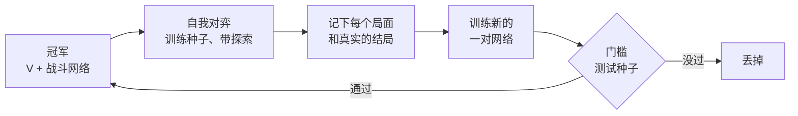

两个网络都靠自我对弈学习。冠军用现在的网络在模拟器里打整局，故意把一部分决策改成随机抽，并记下每个决策和每场战斗的结局。每个记下的局面，标上之后真正发生的事。新的一对网络只用最新这一批对局来学，过了门槛才取代冠军。整个过程没有人类的对局，没有手写的策略，也没有语言模型。

## 谁来打

打的是冠军那一对网络，用的是它上场评估时同样的搜索力度。

这是因为 V 的意思是「照冠军这样打下去，赢的概率」。标签要是来自一个比较弱、或搜索比较浅的玩家，V 学到的就是另一个问题的答案。

## 探索：故意不选最好的

永远选 V 认为最好的选项，就永远不知道其他选项会带来什么。V 看错了，也没有机会发现。所以自我对弈要**探索**。

做法很简单：战斗之外的每个决策，有 ε 的概率从所有选项里平均抽一个，不管 V 怎么想；其余时候选 V 的最佳。

- **为什么平均抽。** 抽哪一个既不看 V，也不看这一局打得顺不顺。这样得到的结局，才是每个选项干净的证据。照 V 的喜好加权去抽，只会一再重试 V 本来就喜欢的。
- **为什么分三档。** 一批对局平分成三档，ε 分别是 0.3、0.1 和 0.02。ε 大的看得到更多选项，ε 小的才打得到后面几层。
- **代价。** 探索会输。探索最多的那一档只赢一成左右，最少的那一档赢将近四成。

战斗里不探索，搜索找到什么就打什么。

## 标签：之后真正发生的事

- **V 的标签**：每个战斗之外的决策，标上这一局实际结束在哪一层，或是赢了。
- **战斗网络的标签**：每个回合的开始，标上这场战斗实际怎么收场。

两者都只用真实的结局。网络自己的估计不会回头变成标签。

## 几百个决策，一个结局

示例对局里有 174 个战斗之外的决策，它们共用同一个结局。这样的标签没有偏差，但噪声很大：单看一局，说不出是哪个决策造成了输赢。目前做了四件事来应付：

- **按层给标签。** 活过的每一层都是信息，不只最后的输赢。
- **一局只算一票。** 每个样本的权重是「1 除以这一局的样本数」。
- **多一个练习用的目标。** 训练时 V 还要预测接下来六场战斗各掉多少血，让它在一局里有更多能对答案的地方。
- **战斗交给搜索。** 一局七成的决策在战斗里，那些靠搜索解决。要靠结局来分功过的，只剩战斗之外的那一小部分。

## 只用最新的一批，从冠军接着学

新网络只用最新一批对局训练。比较弱的冠军打出来的对局，给同一个局面的标签偏低：换现在的冠军来打，会赢得更多。

训练从冠军的权重接着往下，不从零开始。在同一批数据上，接着学的网络在留下来检查的对局上误差更低。

冠军的两个网络，是从两万多局学来的。

## 训练种子和测试种子不相见

自我对弈用的种子和评估用的种子来自两个不同的来源，不会重叠。两头都有检查：训练程序遇到含有评估对局的数据就拒绝，评估只能打事先登记好的测试种子。这样门槛量到的，才是网络在没学过的对局上的表现。

## 从零开始

搜索需要两个网络才能动。还没有任何网络的时候，可以用两个不需要网络的占位玩家打出第一批对局：一个在战斗之外随机选，一个在战斗里随机出牌。之后的每一批，都是上一批学出来的网络打的。
