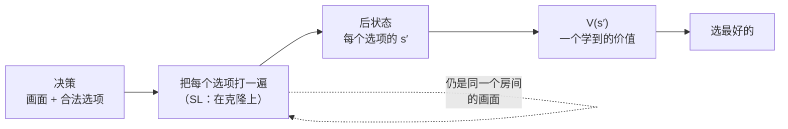

import MapRoute from '../../components/book/MapRoute.svelte';

战斗之外的每个决策都归这一章：下一步去地图上哪个点、领哪些奖励、拿哪张牌、买什么，以及在事件、休息处和宝箱前选哪个选项。方法一句话就能说完：把每个选项都打一遍，看看打完之后当下的局面，问一个学到的价值函数 V 这个局面有多好，然后选最好的。

1. **选项**：这个画面上游戏允许的动作。
2. **后状态**：每个选项都执行一遍，执行完、还没有任何随机的事发生时的局面，就是它的*后状态*。SL 下，选项在当前房间的克隆上、在真实游戏里打出；如果游戏接着显示同一个房间的另一个画面，例如购买之后的商店、事件的下一页，搜索就继续穿过它。
3. **一个价值**：V 读一个后状态，返回一个数字。同一个 V 给每个画面的每个选项评分，所以一张牌、一件遗物、一次升级、一次回血和地图上的一条路，都在同一个尺度上比较，不需要手写的换算率。
4. **最好**：选价值最高的选项，打平时选第一个。自我对弈有时故意抽另一个，为了学到它会带来什么。

## 这些决策难在哪

这些决策的共同点是：选项少、影响远、执行便宜、难以估值。一个战斗回合可能有上千种打法；这里一个决策只有寥寥几个选项，每个都能在克隆里试一遍。

难的是，一个选择的效果要过很多层才显现出来。第 2 层拿的一张牌，到第 3 幕 Boss 时还在牌组里。第 43 层为了多打一场怪物战而跳过的休息处，可能决定这一局能不能到达第 48 层。

本书的示例对局里，这种决策有 174 个，它们全都共用同一个结果：这一局赢了。

## 为什么估打完之后的局面

拿牌、买东西、选路，都是先发生一件确定的事：牌进了牌组、金币付了、地图点选定了。之后才轮到随机的事，例如下一场战斗遇到谁。确定的部分做完、随机的部分还没开始，这个局面就是后状态。

估后状态而不估选项本身，有三个好处：

- **一个函数就够。** 选项在每个画面上意思都不同：一张牌、一个地图点、一个货位。局面却总是同一种东西：一局的现状。
- **殊途同归只学一次。** 从奖励拿一张牌、在商店买同一张、从事件得到它，打完都是同一个局面，V 只要学一次它值多少。
- **每个决策都是训练数据。** 不管来自哪个画面，记下来的局面都拿去教同一个 V。

## 一把尺子

V 的单位是赢下这一局的概率。两个选项相差 0.02，意思是 V 认为选其中一个，获胜概率高 2 个百分点。各个画面问的事差很多，最后都归到这个数字：

- **休息处**：回血，还是升级一张牌。V 比的是生命多的一局和牌组好的一局。
- **卡牌奖励**：三张牌，或者都不拿。一张牌的价值可能比不拿还低：牌组多了一张弱牌，抽到好牌的次数就少了。
- **地图**：Boss 前几层，走怪物战还是走休息处。战斗给金币和一张牌，却要花生命。

下图是示例对局第 19 层的地图。眼前有两个点可以走：V 给通往敌人房的那一步 87.7%，通往问号房的 87.3%，所以走敌人房。紫线是它打算一路走到 Boss 的路线。

<MapRoute client:visible lang="zh-CN" />

有人会想把它拆成两个网络，一个管牌组，一个管路线。但两者之间没有界线：遗物来自精英和商店，它值多少却要看牌组；休息处拿生命换升级；商店用同一袋金币卖牌、遗物和删牌。拆开之后，两个分数之间的换算率只能由人来写，而那就是手写的策略。

## 在克隆上把整个房间走完

很多房间不是一个决策，而是一串。商店是几次购买再离开，奖励画面是几次领取，事件可能有好几页。只估第一步，等于在不知道剩下的金币还够不够删一张牌的情况下，决定要不要买一件遗物。

所以在 SL 里，搜索在克隆上一路往下走。每走一步，只留下 V 最高的 16 个局面继续走；一个决策最多试 1,024 次。走到离开房间、开始战斗或这一局结束为止。停下的地方由 V 估值；要是选项引出一场战斗，就先让战斗网络估这场战斗会怎么收场。

克隆上打出来的是真的结果：事件实际给了什么，变化变出哪张牌，买完之后商店还剩什么。

选路是例外。走到下一个点就离开了这个房间，而克隆只到房间的出口。所以地图上的选择只能预测：把那个点加进路线，让 V 读前面的地图。

## 没有克隆的时候

在 NoSL 里没有克隆，只能照画面上写的推算：加上这张牌，扣掉金币，加上回复的生命。画面没写的就看不到，例如事件选项真正的代价，或变化会变出什么。所以同一个 V，在 NoSL 里做这些决策比较粗。
