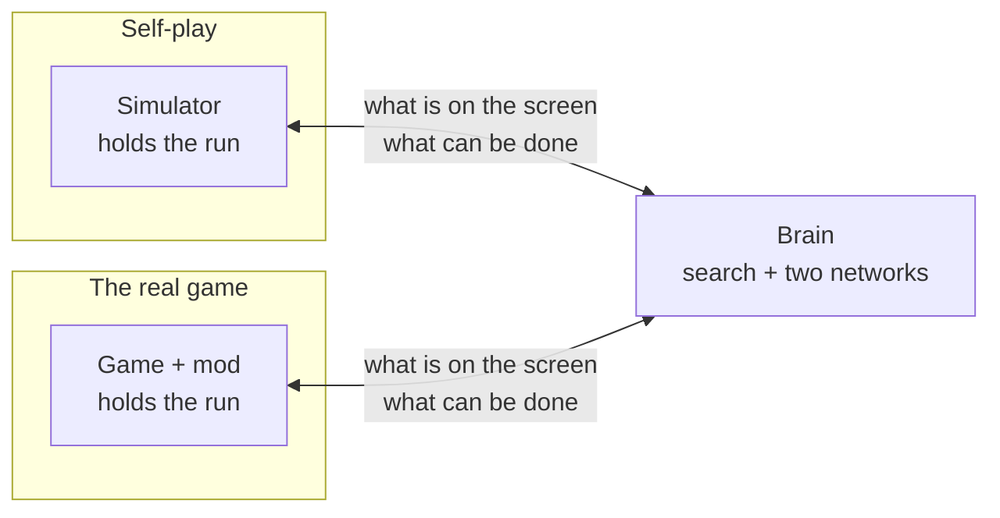

import PanelMock from '../../components/book/PanelMock.svelte';

The brain never touches the game. It only answers questions. In self-play the simulator holds the run, and in your game the mod holds it. Both read the screen with the same code, ask the same questions and ask the same brain. So the brain that was trained and passed the gate is the very one that plays in your game.

## The simulator is the game itself

The simulator is not a game rewritten from the rules. It loads the game's own rules code and runs it with no screen, and a piece of code stands where the screen used to be and presses the buttons.

It is not rewritten because the game has hundreds of cards, relics, monsters and events, and each one reaches into some part of the turn. A rewrite would amount to building a second game that must agree in every detail, and it would drift every time the game is updated. Planning in a game that is slightly wrong leads to plays that are slightly wrong.

This has two costs. The simulator runs as slowly as the game. And the game's state cannot be duplicated directly.

## Same seed, same choices, same run

The simulator uses a single thread, runs in a fixed order and does not look at the clock. Only then is a run really decided by the seed and each answer alone.

This is not an assumption but something that is checked. A checking mode plays every run twice and then reloads every room from its save, and a single difference counts as a failure.

Because the state cannot be duplicated, search on the game itself returns to an earlier position by starting again from the beginning and replaying the actions taken. A position is really a recipe: how to start, plus every move since. SL's copy is made the same way.

The game keeps the run in progress in a place shared by the whole program, so one program can hold only one run at a time. The real run has to stay, so search on the copy is sent off to run in several other programs.

## Combat is searched in a translated engine

Planning a combat means visiting more than ten thousand positions for one decision. Replaying each of them from the start of the room is too slow. So combat is searched in a separate engine, in self-play and in your game alike.

This engine is not rewritten from the rules either. A translator turns the game's combat code into another language, statement by statement and mechanically; only the layer that makes it run, and a few joints, are written by hand. A translated position is plain data, and a copy of it takes one step. Each time the game is updated, the new version's code is translated again.

For each plan, the side that holds the run copies the current combat into the engine whole: cards, powers, enemies, and where the random numbers stand. Search runs in the engine and hands back the plan; the real run plays it, checking each move against the position the plan recorded. If the translation is wrong somewhere, a move fails to match and the AI plans again from the current position, so what is played is always the real game.

That the engine agrees with the game is checked too: the same combat is played on both, the whole position is compared after every move, and play branches off from every decision to the end. The same seeds played through whole runs both ways on one machine give the same decision every time. Searching in the engine makes a self-play run more than ten times faster than replaying on the copy.

## One decision, from screen to answer

In the real game, a decision goes like this:

1. **Watch the screen.** On every frame the mod asks the game which screen is on top.
2. **Wait for it to settle.** Only when the screen has not changed for 3 frames in a row does it count as a decision that can be asked. Between the two steps of one action the screen is empty for a frame, and waiting 3 frames keeps the mod from asking too early.
3. **Read it into an observation.** With the same code as the simulator, the mod reads the screen into two things: what is on the screen, and what can be done now.
4. **Ask the brain.** The brain is a separate program that the mod starts itself. All the thinking happens on that side, so the game does not freeze because of it.
5. **Show the answer.** The brain answers with the next move, the plan after it and the chance of winning for each option. The mod writes them on a panel using the game's own names, and draws marks on the map and on the cards.
6. **The player decides.** The player clicks, or asks the AI to play for them.

An answer belongs only to the screen it was asked about. If the screen changes first, the mod cancels the question and throws away the answer that arrives late.

## The real game never loads a save

SL needs a copy of the current room, but the mod does not make the real game load a save, and it writes no save either. What it does is record. On arriving at a room, the game saves by itself, and at that moment the mod keeps the contents of the save in memory. After that, every move the player or the AI makes is recorded at the point where the game confirms it. Before each SL decision is asked, the mod hands this record to the brain, and the brain's side loads it and replays it to get the copy.

For a combat, the mod also writes the live combat out, the same way the simulator copies it, and the plan is searched in the engine. The engine comes inside the mod, built for Linux, macOS and Windows. It is translated from one version of the game, so the mod runs only on that version.

If the record breaks, for example on a move the simulator cannot replay, the mod gives no more advice in this room. It prefers no answer to a value from a wrong copy.

## What the player sees

The panel shows the run's chance of winning, the next move the AI would make, the plan after it, and the chance of winning for each of up to five options. The figure below shows what the panel looks like, with content from the example run.

<PanelMock client:visible lang="en" />

The AI can play for the player, who sets how far it goes: one move, to the end of this turn, to the end of this room, or on until it is paused. It carries out every move the way a player's click would, and the game's screen follows along as usual.

When it plays for the player, the AI keeps a few rules:

- It acts only when the player asks.
- It plays only the answer for the screen now showing, and at most once per screen.
- It stops first when it meets an elite or a boss.
- If the player asks, it also stops at each act's Ancient, once, so the player picks the gift.
- It stops when an action has no effect at all.

In multiplayer games the mod offers no help.
