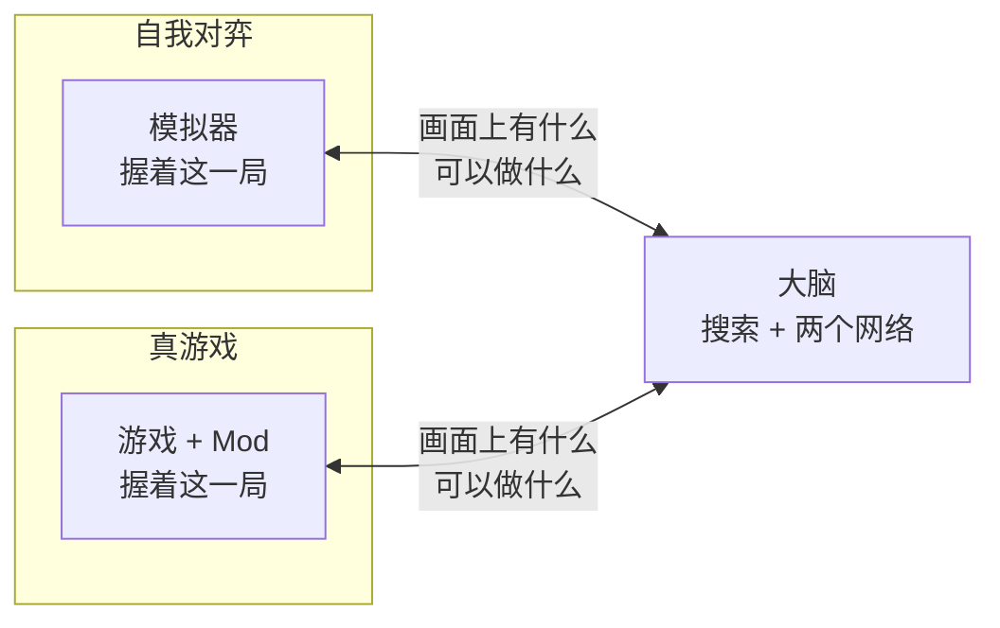

import PanelMock from '../../../components/book/PanelMock.svelte';

大脑从不碰游戏，它只回答问题。自我对弈时，握着对局的是模拟器；在你的游戏里，握着对局的是 Mod。两边用同一套程序读画面，问同样的问题，问的是同一个大脑。所以训练过、过了门槛的，就是实际在你游戏里打的那一个。

## 模拟器就是游戏本身

模拟器不是照着规则重写的一个游戏。它加载游戏自己的规则程序，不开画面地跑，由一段程序站在原本画面的位置上按按钮。

不重写，是因为游戏里有几百张牌、遗物、怪物和事件，每一个都插手回合的某个环节。重写等于做第二个游戏，每个细节都得一致，游戏每更新一次就会走样一次。在一个稍微不对的游戏里规划，就会打出稍微不对的牌。

代价有两个。它跑得和游戏一样慢。游戏的状态也没办法直接复制一份。

## 同样的种子，同样的选择，同样的一局

模拟器只用一个线程，按固定的顺序跑，不看时钟。这样一局才真的只由种子和每个答案决定。

这一点不是假设，而是检查出来的：检查模式会把每一局打两遍，再把每个房间从存档重新载入一遍，有一处不同就算失败。

因为状态不能复制，在游戏本身上搜索，要回到先前的局面时，就从头重开、把走过的动作重放一遍。一个局面其实是一份菜谱：怎么开始，加上之后的每一步。SL 的克隆也是这样来的。

游戏把正在打的一局放在整个程序共用的地方，所以一个程序一次只能有一局。真正的那一局必须留着，在克隆上的搜索就分到另外几个程序里去跑。

## 战斗在翻译出来的引擎里搜索

规划一场战斗，一个决策就要走过上万个局面。每个局面都从房间开头重放，太慢。所以不管是自我对弈还是在你的游戏里，战斗都另外放进一个引擎里搜索。

这个引擎也不是照着规则重写的。一个翻译程序把游戏里和战斗有关的代码一句一句、机械地翻成另一种语言，手写的只有让它跑起来的底层，和少数几个衔接的地方。翻出来的局面是单纯的数据，复制一份只要一步。游戏每更新一次，就从新版的代码重新翻一次。

每次要规划，握着这一局的那一方把眼前的战斗整个抄进引擎：牌、能力、敌人，连随机数走到哪里都一样。搜索在引擎里跑，交回计划；真的那一局照着打，每一步都和计划记的局面比对。翻译要是有一处不对，就会有一步对不上，AI 从眼前重新规划，打的始终是真游戏。

引擎和游戏一致，也是检查出来的：同一场战斗在两边各打一遍，每一步之后比对整个局面，再从每个决策点岔出去打到底。同一批种子在同一台机器上用两种方式打完整局，每一个决策都相同。在引擎里搜索，一局自我对弈比在克隆上重放快十几倍。

## 一个决策，从画面到答案

在真游戏里，一个决策这样走：

1. **看画面。** Mod 每一帧都问游戏现在最上层是哪个画面。
2. **等它静下来。** 画面连续 3 帧没有变化，才算一个可以问的决策。一个动作的两个步骤之间，画面会空一帧，等 3 帧才不会问早了。
3. **读成观测。** 用和模拟器同一套程序，把画面读成两样东西：画面上有什么，以及现在可以做什么。
4. **问大脑。** 大脑是 Mod 自己启动的另一个程序。思考全在那一边，游戏不会因此卡住。
5. **显示答案。** 大脑回答下一步、之后的计划，以及每个选项的胜率。Mod 用游戏里的名字把它们写在面板上，并在地图和牌上画记号。
6. **玩家决定。** 玩家自己点，或者请 AI 代打。

答案只属于它被问的那个画面。画面先变了，Mod 就取消这次询问，晚到的答案直接丢掉。

## 真游戏从不读档

SL 需要当前房间的克隆，但 Mod 不让真游戏读档，也不写任何存档。它做的是记录：抵达一个房间时，游戏自己会存档，Mod 在那一刻把存档的内容留在内存里；之后玩家或 AI 走的每一步，都在游戏确认的地方记下来。每次要问 SL 的决策之前，Mod 把这份记录交给大脑，大脑那一边载入、重放，得到克隆。

到了战斗，Mod 还会像模拟器那样把活的战斗写出来，计划在引擎里搜索。引擎就装在 Mod 里，有 Linux、macOS 和 Windows 的版本。它是从某一版游戏翻译来的，所以 Mod 只在那一版游戏上运行。

记录要是断了，例如出现一步模拟器没办法重放的操作，这个房间就不再给建议。宁可不答，也不在一个错的克隆上估值。

## 玩家看到什么

面板上有这一局的胜率、AI 会走的下一步、之后的计划，以及最多五个选项各自的胜率。下图是面板的样子，内容来自示例对局。

<PanelMock client:visible lang="zh-CN" />

AI 可以代打，范围由玩家指定：一步、打完这个回合、打完这个房间，或一直打到被暂停。每一步都照玩家点击的方式执行，游戏的画面照常跟着走。

代打守几条规矩：

- 只在玩家要求时才动手。
- 只打眼前这个画面的答案，同一个画面最多打一次。
- 遇到精英和 Boss 先停下。
- 玩家要的话，每一幕的先古之民那里也停一次，礼物由玩家自己挑。
- 一个动作没有产生任何效果，就停下。

多人游戏里 Mod 不提供协助。
