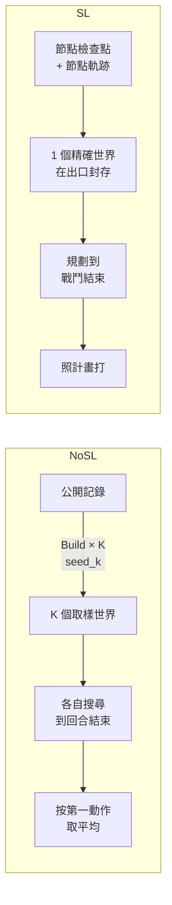

import { Aside } from '@astrojs/starlight/components';

**戰鬥大腦**負責打戰鬥。輪到玩家時，它選擇下一個動作：一張牌和它的目標、一瓶藥水，或結束回合。它和[宏觀大腦](/zh-tw/arch/macro-brain/)一起執行在決策行程裡，後者負責戰鬥之外的每個決策；[Harness](/zh-tw/arch/harness/) 把每個戰鬥決策交給它，連同它可以搜尋的世界和一份預算。

一場戰鬥是一個搜尋問題。遊戲自己的程式碼可以從任何狀態打出任何一串動作，所以大腦不需要把規則當作資料來掌握：它在戰鬥的模擬副本裡嘗試各條路線，保留最好的那條。兩種環境（[環境](/zh-tw/arch/environments/)）的差別在於副本有幾份、每份知道多少。SL（存檔讀檔）可以看到當前房間裡任何事情的真實結果，所以它拿到一份精確的副本，在上面規劃整場戰鬥。NoSL 只看得到玩家看得到的東西，所以它拿到幾份與可見資訊一致的取樣副本，對它們取平均。每個問題在同一個介面後面有自己的演算法。

本書的這一部分有三章：

- 本章，兩個演算法共同的基礎：問題（[§2](#sec-2)）、介面（[§4](#sec-4)）、葉節點估值和戰鬥網路（[葉節點](/zh-tw/arch/combat-brain/leaf/)），以及選牌提示、敵人出招記錄和 worker 行程池（[提示、招式與 worker](/zh-tw/arch/combat-brain/shared/)）；
- [SL 規劃器](/zh-tw/arch/sl-planner/)：在 SL 唯一的精確世界上，確定性地規劃整場戰鬥；
- [NoSL PIMC](/zh-tw/arch/pimc/)：在取樣世界上搜尋，逐個動作取平均。

<Aside title="狀態">

兩個演算法都已實作，並分別由各自環境的冠軍使用。SL：`SlPlanner` 在節點複本上規劃整場戰鬥，戰鬥照著它的計畫打（`run --env SL --policy plan`，預設 medium 力度）。NoSL：`PimcBrain` 在 8 個取樣世界裡各用 300 個節點搜尋本回合，再按第一動作取平均（`run --policy pimc`）。兩者都在一個 worker 行程池裡搜尋，也都用同一個葉節點給停下的地方評分：戰鬥網路 c2，按 `LeafValue` 的價格定價（[葉節點](/zh-tw/arch/combat-brain/leaf/)）。戰鬥中的選牌提示交給一條固定規則 `p0`（[提示、招式與 worker §1](/zh-tw/arch/combat-brain/shared/#sec-1)）。尚未實作：把選牌提示當作搜尋分支、PIMC 越過本回合的搜尋、基於信賴區間的世界分配，以及介面的 `Facts` 和 `Choose` 兩部分（[§4](#sec-4)）。兩個佔位策略保留下來，供基準測試使用，也作為測試集的基線：`PlayPolicy`（隨機打出一張能打的牌）和 `RandomPolicy`（在合法動作中均勻隨機）。

</Aside>

## 1. 它決定什麼

戰鬥大腦回答兩類問題：

1. **玩家的回合**。下一個動作是什麼：從手牌打出一張牌（需要目標時指定目標）、使用藥水，或結束回合。合法動作來自遊戲，由 Harness 列出（[協定：觀測與動作 §3](/zh-tw/arch/protocol/observation/#sec-3)）。
2. **出牌過程中的選牌提示**。有些牌打出時會提一個問題：棄哪張牌、消耗哪張、把哪張放到抽牌堆頂、從三張生成的牌裡拿哪張。目前這些都交給一條固定規則 `p0`，在真實戰鬥裡和每個模擬戰鬥裡都是（[提示、招式與 worker §1](/zh-tw/arch/combat-brain/shared/#sec-1)）。

只有一個合法動作的決策不經搜尋就回答。其他每個決策都回傳三樣東西：第一動作、它之後的計畫剩餘部分，以及搜尋看過的每個第一動作和它的估值（*候選*，決策日誌會保存它們，[Harness：決策日誌 §5](/zh-tw/arch/harness/decision-log/#sec-5)）。計畫很重要：SL 規劃器的計畫是戰鬥剩下的全部，只要遊戲顯示的正是計畫預期的，戰鬥就照著它打，不再搜尋；PIMC 的計畫是本回合剩下的部分，只有用 `--follow` 時、而且只在每個世界對它都一致時，才不經搜尋地打出（[NoSL PIMC：預算 §2](/zh-tw/arch/pimc/budget/#sec-2)）。

## 2. 把一場戰鬥看成搜尋問題

**一個回合**。一個回合是一串以 `end_turn` 結尾的動作。回合之內，不確定性來自抽牌和隨機效果（隨機目標、生成的牌）。一旦敵人的招式確定，接下來的敵方回合就是確定性的。一場戰鬥持續 3–15 個回合。

**分支**。手牌有 5–10 張，指向性的牌可以打向每個活著的敵人，藥水又帶來更多選擇。一個回合的序列長 3–8 個動作，所以一個回合最多約有 $10^4$ 個序列。其中很多到達同一個狀態：先打 A 再打 B，常常讓遊戲和先 B 後 A 完全一樣。這種重複就是**置換**（transposition）。有 $n$ 張牌、而且全都能以任意順序打出時，共有

$$
\sum_{j=0}^{n} \frac{n!}{(n-j)!} \quad\text{個有序序列，但只有}\quad 2^n \quad\text{種打出的牌的集合，}
$$

$n = 5$ 時是 326 對 32，$n = 8$ 時是 109,601 對 256。在殺戮尖塔裡順序確實有影響（先上易傷再攻擊，先抽牌再打出抽到的那張），所以搜尋不能按打出的牌的集合來合併序列。它按序列到達的狀態合併：兩條路線結束在同一個狀態（包括隱藏的部分）時，從那裡只搜尋一次（[SL 規劃器：回合搜尋 §2](/zh-tw/arch/sl-planner/turn-search/#sec-2)、[NoSL PIMC：搜尋 §1](/zh-tw/arch/pimc/search/#sec-1)）。

**視野**。只搜尋一個回合是貪心的：它看不到現在的一次格擋能避免三個回合後的一次死亡。搜尋到戰鬥結束是精確的，但在 NoSL 下，每次抽牌、每次隨機擲骰都是一個*機會節點*（chance node），也就是搜尋必須對它無從得知的各種結果分別展開的地方，而它們一個回合接一個回合地相乘。所以 NoSL 搜尋到回合結束，用**葉節點估值**（leaf value）給那裡的狀態評分（[葉節點](/zh-tw/arch/combat-brain/leaf/)）；SL 沒有機會節點，一直規劃到戰鬥結束。

**開銷**。搜尋的每個節點，都是遊戲自己的程式碼在一場模擬戰鬥裡執行的一個動作（[模擬器：戰鬥 §1](/zh-tw/arch/simulator/combat/#sec-1)）。回到較早的狀態是一次*恢復*（restore）：按 setup 重新開始這場戰鬥，再重播動作到那個狀態。一次恢復耗時 0.28 ms，外加每個重播的動作 0.073 ms；一個分支（恢復、重新取樣、打到結束）約 2.8 ms，即單核每秒約 330 個（[模擬器：戰鬥 §2](/zh-tw/arch/simulator/combat/#sec-2)）。SL 下的恢復則是載入節點複本，約 0.5 ms，外加節點開始以來的每一步 0.1 ms，在一場長戰鬥的後段是 10–20 ms（[模擬器：世界與 SL 複本 §7](/zh-tw/arch/simulator/worlds/#sec-7)）。時間花在恢復上，而不是葉節點上（[提示、招式與 worker §3](/zh-tw/arch/combat-brain/shared/#sec-3)）。

## 3. 兩種環境，兩種演算法

宏觀大腦和價值函式 V 在兩種環境裡是同一個（[環境：世界 §5](/zh-tw/arch/environments/worlds/#sec-5)）。戰鬥大腦不是：兩種環境提出的是不同的問題。



| | NoSL：PIMC | SL：規劃器 |
|---|---|---|
| 隱藏的是什麼 | 抽牌順序、亂數流、怪物排好的招式 | 房間之內沒有 |
| 世界 | 從觀測取樣 K 個（[NoSL PIMC §2](/zh-tw/arch/pimc/#sec-2)） | 一個：節點複本（[SL 規劃器 §1](/zh-tw/arch/sl-planner/#sec-1)） |
| 機會節點 | 每次揭示 | 沒有 |
| 什麼是最佳 | 在各世界上平均最好的動作 | 那一個世界裡最好的路線 |
| 搜尋 | 每個世界搜到本回合結束，再按第一動作取平均（[NoSL PIMC：搜尋](/zh-tw/arch/pimc/search/)） | 跨戰鬥各回合的束，每個回合完整搜尋（[SL 規劃器：束搜尋](/zh-tw/arch/sl-planner/beam/)） |
| 多久搜尋一次 | 每個動作 | 每場戰鬥一次，除非計畫會輸（[SL 規劃器：束搜尋 §6](/zh-tw/arch/sl-planner/beam/#sec-6)） |
| 置換的鍵 | 觀測和這個世界取樣出的隱藏狀態 | 觀測和完整的隱藏狀態 |
| 葉節點 | 下一回合的開始 | 大多是戰鬥結束 |

為什麼不讓兩者用同一個演算法？在 SL 唯一的精確世界上跑 PIMC（`--policy pimc --env SL`）保留下來作為基線，它在測試集上和 NoSL 下的 PIMC 打得幾乎一模一樣：120 場戰鬥裡有 112 場結果相同，其餘 8 場相差不超過 5 點生命值（[NoSL PIMC：預算 §6](/zh-tw/arch/pimc/budget/#sec-6)）。它的搜尋在回合結束處停下，而一個回合之內揭示的東西很少，所以真實的世界能告訴它的，八個取樣世界幾乎都已經告訴它了。只有看得到回合之後的搜尋，知道未來才有用，而這正是規劃器做的事：同樣這 120 場戰鬥，它多贏 9 場（[SL 規劃器：預算 §5](/zh-tw/arch/sl-planner/budget/#sec-5)）。

## 4. 介面

```csharp
public sealed record Budget(int Worlds = 8, int NodesPerWorld = 300, double Elite = 1, double Boss = 1, bool Halving = false,
    bool Follow = false, int Beam = 0, int Replan = 1, int LossPlans = 0, int EasyBeam = 0);
    // PIMC reads Worlds, NodesPerWorld, Halving, Follow; the SL planner Beam, EasyBeam, Replan, LossPlans and
    // NodesPerWorld (per state and turn). Elite and Boss multiply PIMC's nodes or the planner's beams.
    // Budget.Effort(level) gives the planner's presets.

public interface ICombatBrain
{
    // Search the worlds and return the first action and the rest of the plan.
    // history: the combat's record of enemy moves so far (MoveRecord), for the leaves.
    CombatDecisionResult Decide(CombatObservation observation, IReadOnlyList<CombatAction> legal,
                                IWorldSource worlds, Budget budget, ulong seed,
                                IReadOnlyList<EnemyTurns>? history = null);
}

public interface ICombatLeaf
{
    // A search leaf: the state after the turn ends, or after the combat does.
    double Value(CombatStatus status, CombatObservation obs, IReadOnlyList<EnemyTurns> history);
}

public sealed record CombatDecisionResult(
    CombatAction First,                  // one of legal
    IReadOnlyList<CombatAction> Plan,    // the rest of the plan after First
    IReadOnlyList<Candidate> Candidates, // every first action, best first
    IReadOnlyList<ulong>? PlanHashes);   // the observation each step of Plan expects, when it can be followed
```

- `PimcBrain` 為 NoSL 實作 `ICombatBrain`，`SlPlanner` 為 SL 實作它，由 Harness 按環境選一個（[Harness：路由、預算與種子 §1](/zh-tw/arch/harness/routing/#sec-1)）。在對局裡，它們透過 `PooledPimc` 和 `PooledPlanner` 在 worker 行程池裡搜尋：這兩者把同樣的搜尋送到 worker 行程，再按固定順序合併回覆，所以答案和單一行程給出的相同（[提示、招式與 worker §3](/zh-tw/arch/combat-brain/shared/#sec-3)）。
- `IWorldSource` 提供世界：NoSL 下是 K 個取樣世界，SL 下是節點複本（[協定：世界與工作行程訊息 §1](/zh-tw/arch/protocol/worlds/#sec-1)）。大腦從不問自己身在哪個環境；環境由世界帶著。
- `TurnPlan` 負責照計畫打：只要戰鬥顯示的是計畫在某一步之前預期的觀測（它在 `PlanHashes` 裡的雜湊），這一步就不經搜尋打出；否則這個決策重新搜尋，並在決策日誌裡標為 `replanned`。`SlRoute` 加上規劃器對失敗計畫的規則（[SL 規劃器：束搜尋 §6](/zh-tw/arch/sl-planner/beam/#sec-6)）。
- 規劃中：`Choose(request, worlds, budget)`，用同一套搜尋為出牌過程中的選牌提示估值；以及結果上的 `Facts`（預期掉血、幾回合能殺死、抽到某張牌的機率），它將是解說的唯一來源（[輸出層 §5](/zh-tw/arch/output/#sec-5)）。NoSL 的事實是機率和期望；SL 的事實可以是確切的。
- `ICombatPolicy` 和 `IChoicePolicy` 保留下來，用於佔位策略，以及可以在搜尋裡快速把路線打完的策略。

## 5. 如何檢驗

1. **戰術題**（規劃中）：有明確答案的局面（打出斬殺、正好格擋、先上易傷再攻擊），記錄找到與否。
2. **固定測試集**：每個玩家打同樣的戰鬥（遭遇、牌組、種子），使用公共亂數，讓差異來自大腦而不是運氣；統計勝率和掉血（[SL 規劃器：預算 §5](/zh-tw/arch/sl-planner/budget/#sec-5)、[NoSL PIMC：預算 §6](/zh-tw/arch/pimc/budget/#sec-6)）。版本晉級門檻用整局（[評估 §5](/zh-tw/arch/evaluation/#sec-5)）。
3. **NoSL 反事實**（規劃中）：公開記錄相同、隱藏狀態不同時，在固定的大腦種子下必須給出相同的選擇。
4. **SL 封存**：越過節點出口的任何一步都會拋出例外。已成立（`selftest`）：節點複本載入到它的視野邊界後，拒絕再走一步；SL 世界在它那場戰鬥結束後拒絕任何動作。
5. **可重現**：固定預算下，兩次執行測試集給出相同的走法和結果；放到 worker 池裡的搜尋給出的和單一行程相同（`selftest --workers N`）。
6. **SL 計畫一致性**：在節點複本上做的計畫，在對局裡一步一步打出，每個觀測都如計畫預期，戰鬥結束時的生命值和藥水正是計畫的估值所說的。已成立（`selftest`）；在對局裡，對不上的一步算作一次重新規劃。
7. **不需要遊戲的規劃器**（`Sts2Ai.Tests`）：在一個很小的精確戰鬥上，完整搜尋找到的最好路線和窮舉所有路線找到的相同，路線重播後得到它聲稱的估值，沒有證明的失敗計畫在第一個回合後停下，已證明的失敗重播到結束。

## 6. 三個章節

| 章 | 節 | 解釋什麼 | 圖 |
|---|---|---|---|
| 戰鬥大腦 | [葉節點](/zh-tw/arch/combat-brain/leaf/) | 搜尋在哪裡停下、那個狀態值多少：`LeafValue`、戰鬥網路 c2、它的結局輸出頭、定價 | 手工葉節點，可即時操作；c2 在真實狀態上的預測 |
| | [提示、招式與 worker](/zh-tw/arch/combat-brain/shared/) | `p0`、敵人出招記錄、worker 行程池 | – |
| [SL 規劃器](/zh-tw/arch/sl-planner/) | 概覽 | 節點複本、為什麼最好的路線是對的、規劃一次並照著打 | 一場真實的頭目戰，在它的第一個決策處規劃 |
| | [回合搜尋](/zh-tw/arch/sl-planner/turn-search/) | 完整搜尋一個回合、置換、分享節點 | 一個回合的搜尋樹 |
| | [束搜尋](/zh-tw/arch/sl-planner/beam/) | 跨回合的束、上界、下潛、簡易束、已證明的和失敗的計畫 | 束，一個回合接一個回合 |
| | [預算](/zh-tw/arch/sl-planner/budget/) | 力度等級、低預算、時間花在哪裡、結果、弱點 | – |
| [NoSL PIMC](/zh-tw/arch/pimc/) | 概覽 | 隱藏了什麼、取樣世界、它們有多忠實、公平規則 | 取樣出的抽牌順序 |
| | [搜尋](/zh-tw/arch/pimc/search/) | 一個世界裡的搜尋、取平均、雜訊和公共亂數、策略融合 | 一個真實決策在 8 個世界裡 |
| | [預算](/zh-tw/arch/pimc/budget/) | 沿用計畫、逐次減半、按房間分預算、結果、弱點 | – |
