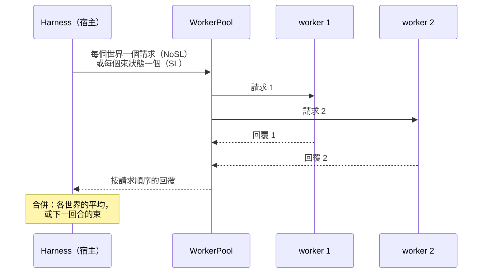

兩個演算法底下有三個元件。戰鬥中的選牌提示由一條固定規則回答，在真實戰鬥和每個模擬戰鬥裡都是，所以搜尋預期的回答正是這一局會給的（[§1](#sec-1)）。敵人每個回合顯示了什麼，這份記錄隨每個決策傳遞，所以無論在哪裡計算，葉節點讀到的歷史都相同（[§2](#sec-2)）。而搜尋在一個 worker 行程池裡執行，有一套協定讓池裡得到的答案等於單一行程的答案（[§3](#sec-3)）。

## 1. 選牌提示：p0

有些牌打出時會提一個問題：生存者要求棄一張牌，精算一搏自己就把手牌棄掉，消耗或「把一張牌放到抽牌堆頂」會問是哪一張，生成三個選項的牌會問拿哪一張。設計的目標是把每個回答當作搜尋的一個分支，讓搜尋像評估其他動作一樣評估它們（[§4](#sec-4)）。在那之前，戰鬥中的每個選牌提示都交給 `PromptBrain`，叫作 `p0`，一條按選中的牌會怎樣而定的固定規則：

- **這回合離開手牌的選擇**（棄牌、消耗、放到抽牌堆頂）選最沒用的牌，棄牌時先選 Sly 牌，因為棄掉 Sly 牌就會打出它。超過提示的最少張數時，只多選本來就該扔的牌：不能打出的牌，棄牌時還有 Sly 牌。
- **讓一張牌免費的提示**選最貴的那張。
- **其他任何提示**都是加牌或改進牌（拿一張牌進手牌、複製、升級），所以選最有用的，能選多少選多少。

一張牌的用處是它的數值之和加一個固定部分：

$$
\text{用處} = 5 + \text{傷害} + 1.5\,\text{中毒} + \text{格擋} + 4\,\text{抽牌數} + 4\,\text{能量} + 2\,(\text{虛弱} + \text{易傷}) + 2\,\text{升級}
$$

而不能打出的牌（狀態牌、詛咒牌）用處為零。`p0` 只讀提示本身，從不隨機抽取：打平時選規範順序裡的第一個選項。正因如此，模擬世界也可以問它：搜尋的世界對每個提示的回答都和這一局一樣，所以經過提示的路線，用的就是真正會給出的回答來估值。在 NoSL 下這在每個取樣世界裡都成立；在 SL 下規劃器的計畫精確重播（[SL 規劃器 §4](/zh-tw/arch/sl-planner/#sec-4)）。

在 `p0` 之前（提交 `c239f12`），提示是隨機回答的，在真實戰鬥和世界裡都一樣，所以搜尋無法預期這一局會給的回答。有了它，PIMC 的整局在同樣的種子上從第 18.50 層提高到第 19.34 層（[NoSL PIMC：預算 §6](/zh-tw/arch/pimc/budget/#sec-6)）。這條規則是手寫的策略，正是專案在其他地方都交給學到的價值的那一類。它之所以保留，是因為把提示當作分支來搜尋，需要世界 API 的提示分支和 `ChoiceContext`（[協定 §4](/zh-tw/arch/protocol/#sec-4)），這些還沒實作。

## 2. 敵人出招記錄

怪物的下一招取決於它至今的出招：固定循環、一次從不讓同一招連出三次的擲骰、一招之後總是接另一招（[NoSL PIMC §1](/zh-tw/arch/pimc/#sec-1)）。玩家會記得每個敵人做過什麼。大腦也是：`MoveRecord` 按 uid 為這場戰鬥的每個敵人保存它在每個回合第一個決策處顯示的意圖。這是公開記錄裡目前已經實作的部分（[Harness §3](/zh-tw/arch/harness/#sec-3)）。

- Harness 從展示給它的戰鬥觀測裡收集它，每個宏觀決策之後重新開始，並隨每個決策交給戰鬥大腦（`history`）。決策日誌在每個戰鬥決策旁保存它（[Harness §6](/zh-tw/arch/harness/#sec-6)）。
- 搜尋在每個請求裡把它送給 worker。NoSL 的 worker 據此建構每個怪物的出招日誌，讓取樣世界裡的怪物像真實的怪物那樣繼續出招（[NoSL PIMC §2](/zh-tw/arch/pimc/#sec-2)）。兩種 worker 都把它交給葉節點。
- 戰鬥網路讀它：每個敵人最近 3 個回合的意圖，以及它已經顯示過幾個回合（[葉節點 §3](/zh-tw/arch/combat-brain/leaf/#sec-3)）。一個決策的搜尋裡，每個葉節點都沿用同一份記錄：葉節點是下一回合的開始，而記錄存的是直到決策所在回合為止的各回合。SL 規劃器後面的回合會加上它自己的路線到達的回合（每個回合結束時的 `MoveRecord.Witness`）。

## 3. worker 行程池

一個搜尋由許多互相獨立的部分組成：NoSL 下是 K 個世界，SL 下是束裡的各個狀態。它們在一個 worker 行程池裡執行。worker 就是以 `serve` 啟動的同一個執行檔；`WorkerPool`（在 Harness 裡，而 Harness 只透過協定型別看到遊戲）啟動 N 個 worker，預設每個世界一個，並在自己的生命週期內一直保留它們（[模擬器：工作行程池 §2](/zh-tw/arch/simulator/pool/#sec-2)）。

**請求**。每個方向一行 JSON，經由 worker 的 stdin 和 stdout（[協定 §7.1](/zh-tw/arch/protocol/#sec-7.1)）：

| 請求 | 誰發送 | worker 做什麼 |
|---|---|---|
| `PimcWorldRequest` | NoSL 下的 PIMC（`PooledPimc`） | 用建構種子從觀測建構戰鬥，取由搜尋種子抽出的世界中的第 k 個，搜尋本回合，回覆每個第一動作之後的最好路線 |
| `SlTurnRequest` | SL 規劃器（`PooledPlanner`） | 載入節點複本，從決策處走完束狀態的路徑，完整搜尋那個回合，回覆該回合最好的幾個結束狀態（[SL 規劃器：回合搜尋 §4](/zh-tw/arch/sl-planner/turn-search/#sec-4)） |
| `SlWorldRequest` | SL 世界上的 PIMC，即基線 | 載入節點複本，在一個第一動作之後搜尋本回合 |
| `SlMacroRequest` | 複本上的宏觀大腦 | 在複本上打一條宏觀回答的路徑，回覆下一個決策（[宏觀大腦：搜尋 §6](/zh-tw/arch/macro-brain/search/#sec-6)） |

**自足**。一個請求帶著它的 worker 需要的一切，請求之間不留下任何東西，所以任何空閒的 worker 都能接任何請求。在 NoSL 下，離開宿主的只有觀測和記錄：真實狀態永遠不會到達 worker（[NoSL PIMC §4](/zh-tw/arch/pimc/#sec-4)）。在 SL 下節點複本會送出去，這是 SL 可以知道的。

**確定性**。回覆按請求順序合併，從不按完成的順序。種子相同時，答案和單一行程裡的搜尋完全相同，連估值也一樣：`selftest --workers N` 檢查這一點，而一次 8 個 worker 的 6 場戰鬥測試集軌跡，和行程內的軌跡 diff 起來沒有任何差異。

**失敗**。關閉輸出或弄斷管道的 worker 會被重啟，並再收到一次請求；5 分鐘內沒有回答的 worker（一個請求只需幾秒）先被終止，然後也一樣處理。第二次失敗就是錯誤。拋出例外的 worker 在送出錯誤後結束，因為拋出例外的請求可能讓遊戲停在已搭好的狀態，使之後的每個請求都失敗（[模擬器：工作行程池 §6](/zh-tw/arch/simulator/pool/#sec-6)）。

**時間花在哪裡**。不在葉節點上。在一次整局晉級門檻期間對一個 NoSL worker 取樣 40 s：它 87% 的時間在搜尋；恢復世界佔 48%（從 setup 開始戰鬥 38%、重播路線 7%、重新取樣 4%），打出搜尋的動作 16%，建構觀測 16%，戰鬥網路 5%（[模擬器：戰鬥 §7](/zh-tw/arch/simulator/combat/#sec-7)）。SL 規劃器的 worker 約 88% 的忙碌時間花在恢復上：載入節點複本，再重播一條路徑到它要搜尋的狀態。這就是為什麼規劃器的槓桿是束和規劃次數，而不是節點數（[SL 規劃器：預算 §3](/zh-tw/arch/sl-planner/budget/#sec-3)）。每個 worker 約佔 160 MB。

**速度**。在 6 場第 1 幕戰鬥上，以 8 個世界 × 300 個節點，8 個 worker 每個動作 68.7 ms，單一行程是 307.5 ms。

## 4. 規劃中

- **把提示當作搜尋分支**。在搜尋裡，模擬器的選擇器（回答選牌提示的程式碼）將由搜尋驅動，讓每個回答都是一個分支；真實戰鬥裡單獨出現的提示，將用同一套搜尋為每個選項估值來回答（`Choose`，[概覽 §4](/zh-tw/arch/combat-brain/#sec-4)）。
- **活在 worker 裡的世界**。用於整局世界，以及超出一個請求的搜尋：按種類開啟一個世界（建構、複本、整局宿主），按 id 在上面分支，再關閉它；它的分支優先交給那個 worker，因為在別處恢復要付出一次重播（[模擬器：工作行程池 §8](/zh-tw/arch/simulator/pool/#sec-8)）。
