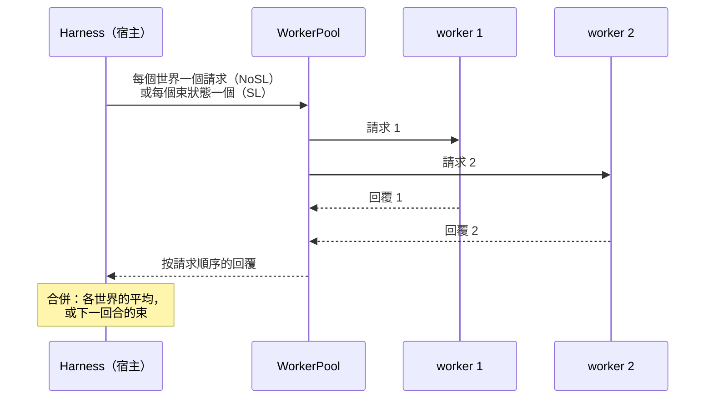

import { Badge } from '@astrojs/starlight/components';

兩個演算法底下有四個元件。戰鬥中的選牌提示是搜尋的一個分支：一個動作的第一個提示的每個回答都是一條自己的路線，像其他路線一樣由葉節點估值，而搜尋選中的回答就是這一局給出的回答（[§1](#sec-1)）。敵人每個回合顯示了什麼，這份記錄隨每個決策傳遞，所以無論在哪裡計算，葉節點讀到的歷史都相同（[§2](#sec-2)）。而搜尋在一個 worker 行程池裡執行，有一套協定讓池裡得到的答案等於單一行程的答案（[§3](#sec-3)）。最後，搜尋把一張牌的幾張複製品算作一個動作，把同樣的牌以另一種順序打出算作一個狀態（[§5](#sec-5)）。

## 1. 選牌提示：回答當作分支

有些牌打出時會提一個問題：生存者要求棄一張牌，消耗或「把一張牌放到抽牌堆頂」會問是哪一張，生成三個選項的牌會問拿哪一張。有些藥水也會，瘋狂之觸就會問讓手上哪張牌免費；一些在回合結束或下一回合開始時發生的效果也會。這樣的問題就是**選牌提示**（card prompt）：按規範順序排列的選項（按牌是什麼排序，從不按遊戲的順序，因為遊戲的順序可能反映隱藏的抽牌順序），以及最少和最多要選幾個（[協定：觀測與動作 §6](/zh-tw/arch/protocol/observation/#sec-6)）。

**每個回答都是一條路線**。在搜尋世界裡，一個動作的第一個提示是搜尋的一個分支（`PromptAnswers.Others`，`src/Sts2Ai.Brain/Combat/Prompts.cs`）。動作打出後，世界告訴搜尋它遇到了哪個提示、這個提示是怎麼回答的（`ICombatWorld.LastPrompt`，一個 `PromptSeen`）。這個提示能接受的每個其他回答，都變成一個自己的動作，也就是帶著那個回答的同一個動作，緊接在它之後從同一個狀態嘗試；每條路線都像其他路線一樣由葉節點估值，最好的勝出。回答按玩家能分辨的每一種選牌方式各列一次（`PromptSeen.Others`，`src/Sts2Ai.Protocol/World.cs`）：一張牌的兩張複製品就是同一張牌兩次，所以選其中一張就是選第一張。它們按選的張數由少到多排列，再按選項的順序：從手牌 A、A、B 裡棄一或兩張牌，第一次的回答是一張 A，於是接著試 B，再試兩張 A，再試 A 和 B。試多少個，取決於這個動作分到的搜尋節點份額，每個回答至少一個節點：這是搜尋自己的預算，而不是對牌的評判（[SL 規劃器：回合搜尋 §3](/zh-tw/arch/sl-planner/turn-search/#sec-3)、[NoSL PIMC：搜尋 §1](/zh-tw/arch/pimc/search/#sec-1)）。

**回答是動作的一部分**。帶著回答的動作把它寫在 `@` 之後：選中的選項在提示裡的位置，按順序、以逗號分隔，`play:12:3@1,3`、`potion:0@2`、`end_turn@0`，而不選任何東西的回答寫成 `play:12@`（`CombatAction.Pick`，`src/Sts2Ai.Protocol/CombatAction.cs`）。它回答這個動作引發的第一個提示，也就是那張牌或那瓶藥水自己的提示；對 `end_turn` 來說，則是回合結束或下一回合開始時帶來的第一個提示。遊戲從來看不到它：宿主收到的是不帶回答的動作，Harness 把回答交給接下來戰鬥中的第一個選牌提示（`Dispatcher`，`src/Sts2Ai.Harness/Dispatcher.cs`）。計畫也這樣重播，在真實戰鬥裡和在複本上都一樣。

**沒有搜尋的地方**。沒有搜尋權衡的提示，也就是一個動作的第二個提示，或搜尋已經沒有節點可用的提示，由 `FirstPicks` 回答：按規範順序取最前面的選項，取提示允許的最少數量（`src/Sts2Ai.Brain/Combat/Prompts.cs`）。它對一張牌值多少沒有任何看法；它只是固定一個回答，在真實戰鬥裡和每個模擬戰鬥裡都相同，讓搜尋預期到這一局會怎麼做。在冠軍的名字裡，戰鬥提示的路由是 `first`（[Harness：路由、預算與種子 §1](/zh-tw/arch/harness/routing/#sec-1)）。

## 2. 敵人出招記錄

怪物的下一招取決於它至今的出招：固定循環、一次從不讓同一招連出三次的擲骰、一招之後總是接另一招（[NoSL PIMC §1](/zh-tw/arch/pimc/#sec-1)）。玩家會記得每個敵人做過什麼。大腦也是：`MoveRecord` 按 uid 為這場戰鬥的每個敵人保存它在每個回合第一個決策處顯示的意圖。這是公開記錄裡唯一已經實作的部分（[Harness §4](/zh-tw/arch/harness/#sec-4)）。

- Harness 從展示給它的戰鬥觀測裡收集它，每個宏觀決策之後重新開始，並隨每個決策交給戰鬥大腦（`history`）。決策日誌在每個戰鬥決策旁保存它（[Harness：決策日誌 §7](/zh-tw/arch/harness/decision-log/#sec-7)）。
- 搜尋在每個請求裡把它送給 worker。NoSL 的 worker 據此建構每個怪物的出招日誌，讓取樣世界裡的怪物像真實的怪物那樣繼續出招（[NoSL PIMC §2](/zh-tw/arch/pimc/#sec-2)）。兩種 worker 都把它交給葉節點。
- 戰鬥網路讀它：每個敵人最近 3 個回合的意圖，以及它已經顯示過幾個回合（[葉節點 §3](/zh-tw/arch/combat-brain/leaf/#sec-3)）。一個決策的搜尋裡，每個葉節點都沿用同一份記錄：葉節點是下一回合的開始，而記錄存的是直到決策所在回合為止的各回合。SL 規劃器後面的回合會加上它自己的路線到達的回合（每個回合結束時的 `MoveRecord.Witness`）。

- <Badge text="規劃中" variant="caution" /> 即使網路不再讀這份記錄，它仍留給 NoSL 建構世界用：建構出的世界裡，怪物的出招記錄取自它（[NoSL PIMC §3](/zh-tw/arch/pimc/#sec-3)）。

## 3. worker 行程池

一個搜尋由許多互相獨立的部分組成：NoSL 下是 K 個世界，SL 下是束裡的各個狀態。它們在一個 worker 行程池裡執行。worker 就是以 `serve` 啟動的同一個執行檔；`WorkerPool`（在 Harness 裡，而 Harness 只透過協定型別看到遊戲）啟動 N 個 worker，預設每個世界一個，並在自己的生命週期內一直保留它們（[模擬器：工作行程池 §2](/zh-tw/arch/simulator/pool/#sec-2)）。

**請求**。每個方向一行 JSON，經由 worker 的 stdin 和 stdout（[協定：世界與工作行程訊息 §4](/zh-tw/arch/protocol/worlds/#sec-4)）：

| 請求 | 誰發送 | worker 做什麼 |
|---|---|---|
| `PimcWorldRequest` | NoSL 下的 PIMC（`PooledPimc`） | 用建構種子從觀測建構戰鬥，取由搜尋種子抽出的世界中的第 k 個，搜尋本回合，回覆每個第一動作之後的最好路線 |
| `SlTurnRequest` | SL 規劃器（`PooledPlanner`） | 載入節點複本，從決策處走完束狀態的路徑，完整搜尋那個回合，回覆該回合最好的幾個結束狀態（[SL 規劃器：回合搜尋 §4](/zh-tw/arch/sl-planner/turn-search/#sec-4)） |
| `SlMacroRequest` | 複本上的宏觀大腦 | 在複本上打一條宏觀回答的路徑，回覆下一個決策（[宏觀大腦：搜尋 §6](/zh-tw/arch/macro-brain/search/#sec-6)） |

**自足**。一個請求帶著它的 worker 需要的一切，請求之間不留下任何東西，所以任何空閒的 worker 都能接任何請求。在 NoSL 下，離開宿主的只有觀測和記錄：真實狀態永遠不會到達 worker（[NoSL PIMC §4](/zh-tw/arch/pimc/#sec-4)）。在 SL 下節點複本會送出去，這是 SL 可以知道的。

**確定性**。回覆按請求順序合併，從不按完成的順序。種子相同時，答案和單一行程裡的搜尋完全相同，連估值也一樣：`selftest --workers N` 檢查這一點。

**失敗**。關閉輸出或弄斷管道的 worker 會被重啟，並再收到一次請求；5 分鐘內沒有回答的 worker（一個請求只需幾秒）先被終止，然後也一樣處理。第二次失敗就是錯誤。拋出例外的 worker 在送出錯誤後結束，因為拋出例外的請求可能讓遊戲停在已搭好的狀態，使之後的每個請求都失敗（[模擬器：工作行程池 §6](/zh-tw/arch/simulator/pool/#sec-6)）。

**時間花在哪裡**。不在葉節點上。恢復狀態佔 worker 時間的最大份額（[模擬器：戰鬥 §7](/zh-tw/arch/simulator/combat/#sec-7)）：NoSL 的 worker 從觀測建構每個世界並重播它的路線，SL 的 worker 載入節點複本並重播一條路徑到它要搜尋的狀態，而且兩者在搜尋每退回一步時都要再恢復一次（[SL 規劃器：預算 §3](/zh-tw/arch/sl-planner/budget/#sec-3)）。

## 4. 規劃中 <Badge text="規劃中" variant="caution" />

- **活在 worker 裡的世界**。用於整局世界，以及超出一個請求的搜尋：按種類開啟一個世界（建構、複本、整局宿主），按 id 在上面分支，再關閉它；它的分支優先交給那個 worker，因為在別處恢復要付出一次重播（[模擬器：工作行程池 §8](/zh-tw/arch/simulator/pool/#sec-8)）。

## 5. 搜尋把什麼算作相同

手牌常常有複製品：兩張打擊、三張防禦。對玩家來說，它們是同一張牌出現兩次；對遊戲來說，每張複製品都有自己的 id（`uid`），所以打出不同複製品的兩條路線，或以另一種順序打出同樣的牌的兩條路線，到達的觀測只差在這些 id 或某個牌堆的順序上。搜尋把這樣的動作和這樣的狀態算作一個（`src/Sts2Ai.Brain/Combat/CombatBrain.cs:157-193`）。

**同一個動作**。在每個狀態，對彼此相同的幾個動作，搜尋只嘗試其中一個（`PimcBrain.Ordered`）：同一張牌，按觀測顯示的它除了 id 以外的一切（`ProtocolJson.CardKey`），或同一瓶藥水，打向同一個目標，對它的提示帶著同一個回答。保留的是搜尋順序裡的第一個：先是結束回合，再是按手牌順序的各張牌，然後是藥水。升級過的打擊和普通打擊是不同的牌；第二張普通打擊就是第一張再來一次。所以根節點的節點份額只分給各個不同的動作（[SL 規劃器：回合搜尋 §3](/zh-tw/arch/sl-planner/turn-search/#sec-3)、[NoSL PIMC：搜尋 §1](/zh-tw/arch/pimc/search/#sec-1)）。提示的回答也這樣列出，按玩家能分辨的每一種選牌方式各列一次（[§1](#sec-1)）。

**同一個狀態**。在搜尋記住它見過的狀態的地方，一個狀態的鍵是搜尋所分辨的觀測（`PimcBrain.StateKey`），旁邊是世界的隱藏鍵：手牌、棄牌堆和消耗堆各自是不帶 id 的牌的多重集（按卡牌鍵排序），藥水也是一個多重集。抽牌堆在觀測裡本來就是多重集，它的順序在隱藏鍵裡（[協定：世界與工作行程訊息 §1](/zh-tw/arch/protocol/worlds/#sec-1)）。所以以任何順序打出的同樣的牌，或換打另一張複製品，都會相遇為同一個狀態。這個鍵用在：

- SL 規劃器的回合搜尋，用於它見過的狀態，以及每個回合結束的鍵，束按這個鍵保留不同的狀態（[SL 規劃器：回合搜尋 §2](/zh-tw/arch/sl-planner/turn-search/#sec-2)）；
- PIMC 在每個世界裡的備忘錄（[NoSL PIMC：搜尋 §1](/zh-tw/arch/pimc/search/#sec-1)）；
- LoopSearch 的兌現（[SL 規劃器：回合搜尋 §5](/zh-tw/arch/sl-planner/turn-search/#sec-5)）。

計畫比對的東西不變：計畫為每一步帶著的觀測雜湊，也就是這一局照計畫打時拿來比較的那些，是真實觀測的雜湊（`TurnPlan`）。

**敵人保持分開**。同一種的兩個敵人就是兩個敵人：每個都有自己的亂數流，以及自己在回合順序裡的位置。

**它放棄了什麼**。遊戲按牌在牌堆裡的位置挑選某些隨機的牌：木乃伊之手用戰鬥的選牌亂數流在手牌裡隨機挑一張，能量汲取從棄牌堆裡拿走隨機的牌。在 SL 下，搜尋知道各個亂數流，打出哪一張複製品，也就是手牌和棄牌堆留下的順序，可能左右這樣的挑選。搜尋不分辨這些路線：兩條只在這裡不同的路線，它保留先找到的那條。
