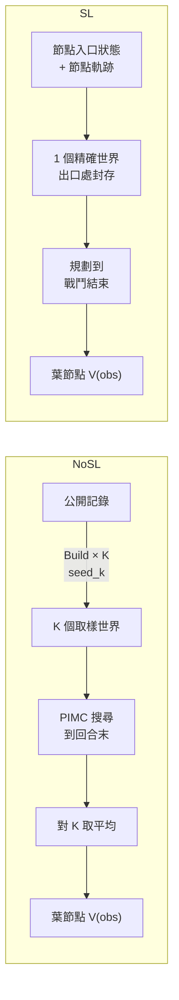

import { Aside, Badge } from '@astrojs/starlight/components';

AI 總是在兩種**環境**之一裡遊玩。兩者只差一件事：對遊戲還沒揭示的隨機結果，AI 能知道多少。NoSL 只允許公開資訊；SL 還允許知道當前地圖點內部的真實結果，就像玩家可以在這裡存檔、讀檔。協定、模擬器、兩個大腦、學習和評估都把環境當作參數，所以這一頁放在最前面。

<Aside title="狀態">

已確定。

</Aside>

## 1. 定義

兩種環境共享同一套基本規則：

- 只支援單人模式，遊戲版本固定為 v0.111.0；
- 規則知識相同，Brain、Harness、Protocol 的程式碼也相同；
- 使用同一組預先登記的種子，結果分開報告；
- 兩種環境都從不在真實遊戲裡讀檔：存檔欄位 `SerializableRun.NumReloads` 始終為 0。

### NoSL：只用公開資訊

決策只能依賴本局的公開歷史、規則知識，以及離線學到的東西。

**公開歷史**指到目前為止螢幕上顯示過的一切，加上能從中推斷出的資訊。例如：記牌；根據怪物的意圖歷史，推出它下一步動作的後驗分布；根據獎勵歷史，推算獎勵機率的計數器。搜尋只在**確定化樣本**上進行：確定化就是抽取一個具體的隱藏狀態（抽牌順序、怪物動作等），並且保證它與公開歷史一致。

### SL：在當前節點內存檔、讀檔

SL 等於 NoSL，再加上**當前節點**內任意動作序列的真實結果。專案裡把它叫作「有限作弊」。這相當於一個玩家可以在節點內無限次存檔並離開，並且什麼都記得住。

**節點**就是當前地圖點（`MapPoint`），從到達它開始，到選定下一個地圖點為止。它包括這個點的所有房間（`MapPointHistoryEntry.Rooms`，例如由事件觸發的戰鬥）、獎勵畫面、商店購物、休息處選項、寶箱，以及事件的每一頁。

SL 可以知道的例子：

- 抽牌順序和每一次洗牌、怪物動作、生成的卡牌、隨機目標、隨機費用和隨機充能球；
- 動作順序如何改變上面這些結果（在節點內操縱亂數是允許的）；
- 事件結果。比如在「濕滑木橋」（Slippery Bridge）上，SL 知道每次 HOLD_ON 之後會拿走哪張牌：`SlipperyBridge.GetNewRandomCard` 使用事件自己的 `Rng`，種子由 seed + slot + hash(事件 id) 得到（`Models/EventModel.cs:234`） <Badge text="已核實" variant="success" />；
- 本節點的獎勵，包括獎勵如何隨打法變化；
- Ancient 事件的「隨機稀有卡」選項具體會給哪張牌。

SL **不能**知道後面節點的任何資訊：`?` 會變成什麼、遭遇、獎勵、商店貨品、事件。儘管模擬器裡握有真實的亂數流，這條規則依然成立。

<Aside type="caution" title="已否決">

曾考慮過「整局視野」（知道整局的全部隨機順序），已否決，不要實作。

</Aside>

## 2. 為什麼以節點為界

為什麼不直接用遊戲自己的存檔點做邊界？遊戲會在以下時刻自動存檔 <Badge text="已核實" variant="success" />：

- 開局時；
- 到達一個地圖點時，在 `?` 擲骰和 `CreateRoom` 之前（`Runs/RunManager.cs:899-901`、915、917）；
- 戰鬥勝利時，此時房間被標記為預先完成（`Combat/CombatManager.cs:1341-1342`）；
- **Ancient** 事件結束時，而且只有 Ancient 事件會這樣（`Rooms/EventRoom.cs:129-141`）。

戰鬥中途沒有存檔。讀檔會原樣重演這個房間：相同的遭遇、相同的起手牌、相同的怪物動作。存檔裡儲存著每條亂數流的完整狀態 `{counter, s0..s3}`（`Saves/SerializableRng.cs:51-63`）。

所以遊戲原生的存讀檔比「節點」稍窄。戰鬥勝利後存檔已經越過了這場戰鬥，於是「換一種打法，獎勵會不會變？」在真實遊戲裡沒法試。我們仍然選了節點邊界：它覆蓋一個地圖點內的全部內容（房間、獎勵、事件的每一頁），而且只有一個封存世界的位置。兩者的差別記為未決問題 1（[§10](#sec-10)）。

## 3. 資訊表

每種環境能用哪些資訊：

| 資訊 | NoSL | SL |
|---|---|---|
| 螢幕歷史及其推斷、規則知識、離線學習（特權資訊只在訓練時使用） | 可以 | 可以 |
| 本節點：抽牌順序、洗牌 | 只知道有哪些牌（多重集） | 可以 |
| 本節點：怪物的下一步動作 | 意圖 + 基於歷史的後驗 | 可以 |
| 本節點：生成的卡牌、隨機目標/費用/充能球 | 只知道分布 | 可以 |
| 本節點：事件結果、寶箱、獎勵 | 顯示之後 | 可以 |
| 後續節點 | 不可以 | 不可以 |
| 直接讀取種子字串、亂數狀態、存檔檔案 | 不可以 | 不可以（只能透過封存的複本） |
| 修改狀態、主控台、除錯或多人模式後門 | 不可以 | 不可以 |
| 真實讀檔（`NumReloads > 0`）、評估時挑種子 | 不可以 | 不可以 |

灰色地帶的裁定，兩種環境相同（來自公平規範，本地筆記 `tmp/notes/fair-play-spec.md`）：

- 精確的傷害計算可以用；
- 能力（power）只在 `IsVisible` 時可見，並且只用顯示出來的數值；
- 不匯出 `move_id`；
- 抽牌堆只作為多重集提供，從不提供順序；
- 水晶球（Crystal Ball）事件裡隱藏的格子永不匯出。

## 4. 節點邊界

- **入口**：到達一個地圖點。這正是遊戲的存檔點，所以入口狀態是一個 `SerializableRun`。
- **出口**：地圖移動動作（`VoteForMapCoordAction`）。移動動作屬於當前節點，之後的一切屬於下一個節點。
- **特殊情況**：開局的 Ancient 事件（Neow）是第 1 個節點；打完頭目後，下一幕的第一個點是新節點；一局結束也算出口。
- 越過出口的搜尋（例如「這張牌在下一場戰鬥裡值多少？」）必須使用由搜尋自己播種的確定化樣本，絕不能用真實的亂數流。

## 5. 一個宏觀大腦，兩種戰鬥演算法

宏觀大腦和價值函式 V 在兩種環境裡是同一個。戰鬥大腦不是：NoSL 和 SL 面對的是不同的問題，所以在同一個介面（`ICombatBrain`）後面各有各的演算法。Harness 按環境選擇用哪一個，並交給它對應的世界：

| | NoSL | SL |
|---|---|---|
| 問題 | 有隱藏狀態和隨機：找在各種可能世界上平均最好的動作 | 確定性的：找這一個世界裡最好的路線 |
| 世界從哪來 | 公開記錄 → Build / Determinize（[模擬器 §6](/zh-tw/arch/simulator/#sec-6)） | 節點複本（[模擬器 §7](/zh-tw/arch/simulator/#sec-7)） |
| 世界數量 | K 個，取平均（不做策略融合） | 1 個；挑最好的路線就是對的，沒有可融合的東西 |
| 機會節點（chance node） | 每次揭示都有 | 沒有 |
| 戰鬥演算法 | PIMC：搜到回合末，按第一個動作取平均，每個動作之後重新規劃（[戰鬥大腦 §2](/zh-tw/arch/combat-brain/#sec-2)） | 跨整場戰鬥各個回合的束搜尋，每個回合內部完整搜尋，用結束戰鬥的最好路線剪枝；只規劃一次（[戰鬥大腦 §3](/zh-tw/arch/combat-brain/#sec-3)） |
| 換位按什麼識別 | 觀測加上這個世界取樣出的隱藏狀態 | 觀測加上完整的隱藏狀態：亂數流、怪物出招記錄、本回合的戰鬥歷史 |
| 預算花在 | 樣本數 × 深度 | 深度和廣度（一場戰鬥通常能搜到結束） |
| 越過視野邊界後 | 本來就是樣本 | 世界停止（`AtHorizon`）；只能從出口觀測重新確定化後繼續 |
| 宏觀大腦 | 後狀態 + V，對 K 個樣本取平均 | 同一個大腦，用唯一的確切結果 |
| 價值 | V(觀測) | 同一個 V |

「不做策略融合」是指：NoSL 給每個動作評分時，取它在 K 個世界裡的平均值，而不是在每個世界裡各自挑最佳路線。後一種做法會讓計畫表現得好像已經知道哪個世界才是真的。

**兩種環境共用一個 V**。理論上 SL 也會改變戰鬥之外的價值：從同一個狀態出發，SL 贏得更多，因為它在之後每個節點都打得更好，所以專為 SL 做的價值函式會更願意冒險（多打菁英、多選結果波動大的事件和卡牌）。這一點被有意忽略：兩種環境共用一個 V。它用戰鬥由 SL 戰鬥大腦來打的對局訓練，包括自我對弈和分叉推演（2026-10-28 決定）。宏觀大腦在兩種環境裡看到的資訊一樣，所以這不是用 SL 去教 NoSL 的戰鬥：NoSL 的戰鬥大腦單獨訓練，兩種環境之間宏觀價值的差異仍然忽略。

兩種環境的葉節點估值器都只讀觀測，所以真實亂數流不可能經由估值洩漏進來。環境只存在於 Harness（它選擇戰鬥大腦和世界來源）和世界的實作裡；宏觀大腦和 V 都看不到它。介面見 [協定 §7](/zh-tw/arch/protocol/#sec-7)（`IWorldSource`、`ICombatWorld`）。

## 6. SL 複本從哪來

- **R1–R3**（由模擬器來玩這一局；R1–R4 是[模擬到實機階梯](/zh-tw/arch/evaluation/#sec-1)的各級）：宿主 worker 行程持有真實狀態。進入節點時，它做一個檢查點：`RunManager.ToSave(null)`（`Runs/RunManager.cs:670-709`） <Badge text="已核實" variant="success" />，加上存檔丟掉的遺物欄位。它在遊戲到達地圖點時存檔的那一刻取這個檢查點。複本 = 這個檢查點 + 節點軌跡，像遊戲「繼續」載入存檔那樣載入，放回遺物欄位，然後重播（[模擬器 §7](/zh-tw/arch/simulator/#sec-7)）。
- **R4**（真實遊戲）：在遊戲到達時存檔的那一刻，Mod 在記憶體裡做同樣的檢查點，從不碰會被雲同步的 `current_run.save`。它還記錄節點內的每個動作（在遊戲提交動作的地方讀出），每個決策之前把兩者發給大腦（[Mod §6](/zh-tw/arch/mod/#sec-6)）。worker 透過「繼續」（Continue）的路徑載入，再重播這些動作。
- 載入存檔和一直不間斷執行的遊戲並不一樣：載入會重新執行地圖鉤子和 `OnRunLoaded`，並丟掉沒有標記為儲存的遺物欄位（`Runs/RunManager.cs:815-816`、`Runs/RunState.cs:330-332`）。遺物欄位的差別會表現出來：存檔丟掉的狀態或計數改變了複本的每個觀測，SL 規劃器每一步都要重新規劃。所以檢查點帶上每個遺物的簡單欄位，載入之後放回去，`run --check` 現在找不到任何和原對局不同的節點（[模擬器 §7](/zh-tw/arch/simulator/#sec-7)）。不做檢查碼驗證，不做後備。
- **NoSL**：這個通道是關閉的。環境在工作階段開始時確定並記入日誌；Mod 從不匯出存檔，worker 也從不提供複本。NoSL 日誌裡只要出現一次匯出，這一局就作廢。
- 決策行程從不讀存檔：Brain 不引用遊戲組件，由編譯器保證。

## 7. 守護測試

上面的每條規則都有一個測試來守住它。

**兩種環境**

1. Brain 和 Protocol 不引用任何遊戲組件（已有，在 selftest 中）。
2. 搜尋的亂數只來自呼叫方，絕不來自本局種子。
3. 後備決策的數量為 0。
4. `NumReloads == 0`。
5. 觀測的每個欄位都有白名單測試。

**NoSL**

6. 反事實：公開記錄相同、隱藏狀態不同（抽牌順序、所有亂數流、怪物動作及 AI 私有欄位、生成池）→ 在固定大腦種子下決策相同。
7. 往返：狀態 → 觀測 → Build → 觀測'，兩個觀測完全相同（戰鬥部分已有）。

**SL**

8. 封存：出口動作之後再走任何一步都會拋出例外（複本已有，在 `run --check` 和 `selftest` 中）。一場戰鬥的 SL 世界也拒絕越過戰鬥的結束，所以搜尋永遠不會離開這個房間（已有，在 `selftest` 中）。
9. 視野邊界反事實：只擾動出口之後才會讀到的狀態 → 決策不變。
   - 可以擾動的 <Badge text="已核實" variant="success" />：每一幕 `RoomSet` 中計數器之後的條目（事件、弱/普通/菁英遭遇、頭目、第二個頭目、Ancient；在開局時由 `GenerateRooms` 裡的 UpFront 一次定好，`Runs/RunManager.cs:743-767`，透過計數器消耗，`Rooms/RoomSet.cs:70-108`）；UnknownMapPoint 亂數流（只在進入 `?` 時使用，`Odds/UnknownMapPointOdds.cs:140-175`）；TreasureRoomRelics 亂數流和共享遺物抽取袋的尾部；後續各幕的地圖種子（`Rng(seed, "act_N_map")`）。
   - 不能擾動的，因為當前節點也在用：Shuffle、MonsterAi、Niche、六條 Combat* 亂數流，以及玩家的 Rewards、Shops、Transformations 亂數流。
   - 每個可擾動欄位都需要一個測試，證明當前節點從不讀它。
10. 每次決策的複本查詢都記入日誌。

## 8. 學習、評估與輸出

- 兩種環境共用一個 V（[§5](#sec-5)）。冠軍、晉級門檻和排行榜仍然按環境分開；新的 V 會同時改變兩個冠軍，所以必須分別通過兩種環境各自的門檻。
- 同一組種子對應兩個排行榜。報告裡給出 SL − NoSL 的差值，也就是節點級資訊的價值。這是計畫 v1（本地筆記 `tmp/notes/plan.md`）裡「全知 vs 重取樣」消融實驗的正式版本。
- 輸出：NoSL 給出的事實是機率和期望；SL 給出的事實可以是確切結果（「先打 A 再打 B → 會抽到 X」）。

## 9. 對各子系統的影響

| 子系統 | NoSL | SL 額外需要 |
|---|---|---|
| 協定 | 觀測、動作、選牌提示、推薦、世界 API | `AtHorizon`；確切結果類事實 |
| GameBridge | 白名單內的觀測，列舉 / 執行動作 | 無 |
| 模擬器 | 從記錄 Build、Determinize | 節點檢查點、載入存檔 + 重播、封存 |
| Mod | 觀測、執行、覆蓋層 | 節點入口匯出 + 動作日誌（按環境開關） |
| Harness | 記錄、K 個世界 | 1 個複本 |
| 戰鬥大腦 | PIMC 期望搜尋 | 自己的演算法：SL 規劃器 |
| 宏觀大腦 | 後狀態 + V | 無（同一個大腦；節點內的結果來自複本，是確切的） |
| 學習 | V | 無（同一個 V） |
| 評估 | NoSL 排行榜 | SL 排行榜 + 差值 |

## 10. 未決問題

1. 戰鬥勝利後的獎勵：用節點規則（現行）還是遊戲的存檔規則？整局跑通後，統計獎勵有多常受到戰鬥中亂數流使用方式的影響。Rewards 亂數流與商店、事件共享 <Badge text="已核實" variant="success" />，所以在戰鬥節點內這種情況大概很少見。
2. SL 的預算：與 NoSL 用相同的掛鐘時間，這比相同的分支數更公平。
3. 用真實讀檔來驗證複本：只允許在帶標記的驗證局中進行，從不計分。
