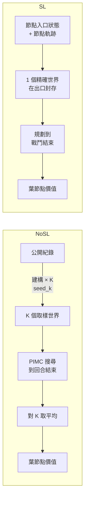

import Determinize from '../../../../../components/book/Determinize.svelte';
import StrategyFusion from '../../../../../components/book/StrategyFusion.svelte';

兩種環境的差別在於搜尋可以知道什麼（[資訊與節點](/zh-tw/arch/environments/information/)）。搜尋透過在模擬的遊戲裡嘗試各種打法來得知事情，所以這個差別體現在它可以在*哪些模擬遊戲*裡嘗試。本頁解釋這些遊戲，也就是**世界**：NoSL 如何根據它看到的東西做出世界、對世界取平均仍可能犯的錯誤，以及為什麼只有一個精確世界的 SL 需要一種完全不同的戰鬥演算法。最後講保持不變的部分：兩者共用一個宏觀大腦和一個價值函數 V。

## 1. 世界

**世界**是一個搜尋可以探索的模擬器狀態：一個正在執行的遊戲，搜尋可以觀測它、在裡面行動、儲存它（快照，snapshot）並回到它（還原，restore）。搜尋從不碰真實的遊戲。它透過世界 API 要求世界（[協定：世界與工作行程訊息 §1](/zh-tw/arch/protocol/worlds/#sec-1)），在裡面打它的候選路線，再比較這些路線的結局。

目前每個世界都是**戰鬥世界**：一場戰鬥，由戰鬥大腦搜尋（[戰鬥大腦](/zh-tw/arch/combat-brain/)）。宏觀大腦在戰鬥外的搜尋直接使用 SL 複本（[宏觀大腦：搜尋 §2](/zh-tw/arch/macro-brain/search/#sec-2)）；NoSL 的對局世界能讓它看到當前節點之後的東西，目前還在規劃中（[模擬器：世界與 SL 複本 §8](/zh-tw/arch/simulator/worlds/#sec-8)）。

世界從哪裡來，是環境唯一改變的東西：

| | NoSL 世界 | SL 世界 |
|---|---|---|
| 由什麼做成 | 觀測和公開紀錄 | 節點的檢查點和節點內的各步 |
| 怎麼做 | 建構一場顯示這個觀測的戰鬥，再用一個種子抽取隱藏狀態（*確定化*） | 像遊戲的「繼續」那樣載入檢查點，再重播各步 |
| 每個決策幾個 | K 個，各用自己的種子 | 一個 |
| 它是什麼 | 對隱藏狀態的一個合理猜測 | 確切的真實戰鬥 |
| 類別 | `SimWorlds.NoSL`（[模擬器：世界與 SL 複本 §2](/zh-tw/arch/simulator/worlds/#sec-2)） | `NodeWorld`，在節點的複本上（[模擬器：世界與 SL 複本 §7](/zh-tw/arch/simulator/worlds/#sec-7)） |

兩者都在工作行程裡，根據請求所帶的內容建構（[模擬器：工作行程池 §5](/zh-tw/arch/simulator/pool/#sec-5)）。NoSL 請求帶的是觀測，從不帶真實狀態，所以 NoSL 工作行程看不到比玩家更多的東西。

## 2. 確定化：猜測隱藏狀態

NoSL 的搜尋看不到隱藏狀態，但可以猜。**確定化**就是把玩家無法知道的一切，換成一個與玩家所見一切都一致的具體樣本。在一個樣本上，遊戲又成了完全資訊的遊戲，搜尋可以像對待其他任何模擬一樣去打它。

NoSL 世界一開始是一場被建構成恰好顯示這個觀測的戰鬥（`CombatBuilder.Setup`，[模擬器：戰鬥 §5](/zh-tw/arch/simulator/combat/#sec-5)）。接著 `Determinize(seed)` 用種子抽取隱藏的部分（`Simulation/CombatSession.cs:237-283`）：

- 這一局、玩家和每個怪物的每條帶種子的亂數流都重新播種：洗牌、生成的牌、隨機目標、怪物 AI；
- 抽牌堆先排成只取決於玩家所見內容的順序（按卡牌鍵排序），再用種子洗牌；
- 手牌以外的牌重新編號：遊戲按抽牌順序給牌編號，所以舊編號會洩漏真實順序；
- 每個怪物排定的招式，從顯示相同意圖的招式中抽取，並改寫它招式日誌的最後一條，使之相符。

種子只來自呼叫方，從不來自這一局，所以真實種子的任何部分都不會洩漏到樣本裡。一個決策的第 k 個世界使用由該決策的搜尋種子和 k 混合而成的種子，所以 K 個世界就是 K 個不同、同樣合理的未來。尚未建模的有：玩家確實知道位置的抽牌堆卡牌（例如剛放到頂端的那張），以及怪物的歷史如何讓它的某些招式比其他招式更有可能出現。

下圖取自一個較早的戰鬥網路的訓練資料中一個真實的回合開始：寂靜獵手以 39 點生命值對戰蝨蟲始祖（LOUSE_PROGENITOR），抽牌堆裡有九張牌。玩家知道是哪九張；每個世界是它們的一種順序。抽取 K 個世界，看看每個世界放在最上面的五張牌。一張牌出現在多少比例的世界中，就估計了抽到它的真實機率；K 越小，雜訊越大。

<Determinize client:visible lang="zh-TW" />

冠軍的 NoSL 戰鬥大腦預設搜尋 8 個世界，每個 300 個節點（[NoSL PIMC：預算 §1](/zh-tw/arch/pimc/budget/#sec-1)）。世界一旦建好就很便宜（一次還原大約 0.3 ms，每重播一個動作再加 0.07 ms，[模擬器：戰鬥 §2](/zh-tw/arch/simulator/combat/#sec-2)），但搜尋量會隨世界數成倍增加，所以 K 是在準確度和時間之間取捨。

## 3. 策略融合

把每個世界都當作真相來搜尋，有一個已知的缺陷。在一個世界裡，搜尋確切知道會發生什麼，所以它可能規劃出一條路線：在這個選擇所依賴的資訊揭曉*之前*就做出選擇，卻仍然選對，因為它早就知道了。對各世界取平均後，這樣的路線看起來比任何真實玩家能打出的都要好。這個錯誤就是**策略融合**：計畫把幾個策略（每個世界一個）融合在一起，彷彿玩家知道哪個世界才是真的。

這個錯誤可能從兩個地方進來。

- **在根節點**。如果每個世界只是各自挑選自己最好的第一個動作，AI 就會像知道是哪個世界一樣去打。NoSL 的 PIMC 從不這樣做：它用每個第一個動作在 K 個世界上的平均值給它評分，並打出平均值最好的那個第一個動作（[NoSL PIMC：搜尋 §2](/zh-tw/arch/pimc/search/#sec-2)）。下面比較中所說的「沒有策略融合」就是這個意思。
- **在根節點之下**。第一個動作之後，每個世界的搜尋各自繼續到回合結束，而在那裡它仍然看得到自己世界的未來。在一條玩家必須在隱藏的牌被抽出之前做選擇的路線上，每個世界都會得到適合該世界的選擇。對第一個動作取平均並不能消除這一點。PIMC 每走一個動作就重新規劃，所以它打出的永遠是第一個動作，但它的估值仍可能偏向那些後續步驟被融合的路線。

下圖是一個有兩個世界的決策：抽牌堆頂端的牌要麼是打擊，要麼是防禦。穩健的打法在兩個世界裡價值相同。另一個第一個動作會通往第二個選擇，而這個選擇必須在抽出頂端那張牌之前做出。移動滑桿來改變每個世界的可能性，比較每個世界自己的搜尋怎麼看、PIMC 的平均怎麼看，以及這條路線對一個看不到那張牌的玩家實際上值多少。

<StrategyFusion client:visible lang="zh-TW" />

這在真實戰鬥中代價多大，由融合面板來測量：取決策日誌中的 NoSL 戰鬥決策，把 PIMC 的估值，和在各世界還無法區分之處把路線合併後的估值相比較（[NoSL PIMC：搜尋 §4](/zh-tw/arch/pimc/search/#sec-4)）。如果剩下的誤差被證明確實重要，替代方案是 ISMCTS（資訊集蒙地卡羅樹搜尋），它在所有世界上搜尋同一棵樹，因此在玩家看來相同的世界之間共用同一個選擇。

## 4. SL：一個精確的世界

SL 的世界是節點的複本：真實戰鬥的一份精確複製，帶著真實的亂數流。這改變了問題。

- **不再有隨機性**。每個動作只有一個結果，整場戰鬥是一個確定性的謎題。在這個世界裡找到的路線，就是在真實戰鬥裡行得通的路線。
- **沒有可融合的東西**。只有一個世界時，採用它最好的路線就是正確的：計畫不可能假設自己不具備的知識，因為這個世界*就是*玩家會遇到的。
- **狀態按一切來區分**。搜尋會記住它見過的狀態（*換位*，transposition），讓同一組出牌的兩種順序只搜一次。除了觀測之外，NoSL 世界的鍵還包含觀測所隱藏、但會改變接下來發生之事的東西：抽牌堆的順序、每條亂數流的位置，以及每個怪物排定的招式（`HiddenState.Key`，`GameBridge/HiddenState.cs:19-29`）。SL 世界的鍵再加上每個怪物至今的招式，以及戰鬥歷史中本回合的條目，以多重集的形式記錄，讓同一組出牌的另一種順序仍能相遇（`HiddenState.Full`，`:36-44`）；在唯一的真實戰鬥中，這些東西會改變接下來發生的事。
- **預算花在深度上**。只有一個世界、不需取平均，搜尋通常能一直搜到戰鬥結束。
- **世界在視野邊界停止**。複本在節點的出口處封存，而 SL 世界拒絕戰鬥結束之後的任何動作（[資訊與節點 §8](/zh-tw/arch/environments/information/#sec-8)）。目前沒有任何搜尋會越過出口；真要這樣做的搜尋，就得像 NoSL 一樣，從出口的觀測出發，使用確定化的世界。

## 5. 一個宏觀大腦，兩種戰鬥演算法

所以兩種環境提出了兩個不同的戰鬥問題：NoSL 必須選出在它無法區分的各個世界上平均最好的動作，SL 則必須在一個已知的世界裡找出最好的路線。兩者各有自己的演算法。冠軍的選項按環境選擇演算法：一局用 `run --policy`（SL 規劃器 `plan` 在 SL 以外會被拒絕）；在 `brain` 指令裡，NoSL 宿主用 `--policy`，SL 宿主用 `--sl-policy`，預設為 SL 規劃器（[環境 §5](/zh-tw/arch/environments/#sec-5)）。接著 Harness 在每個戰鬥決策都把對應的輸入交給戰鬥路由：SL 下是節點的複本，NoSL 下只有觀測，工作行程再據此建構它們的世界（`Harness/Dispatcher.cs:132`）。在單一行程裡，例如戰鬥面板中，同樣的兩種演算法在同一個介面 `ICombatBrain` 後面執行，使用來自 `IWorldSource` 的世界（[協定：世界與工作行程訊息 §1](/zh-tw/arch/protocol/worlds/#sec-1)）：

| | NoSL | SL |
|---|---|---|
| 問題 | 隱藏狀態和隨機性：在各個可能的世界上平均最好的動作 | 確定性的：唯一世界裡最好的路線 |
| 世界從哪裡來 | 公開紀錄 → 建構並確定化（[模擬器：世界與 SL 複本 §2](/zh-tw/arch/simulator/worlds/#sec-2)） | 節點的複本（[模擬器：世界與 SL 複本 §4](/zh-tw/arch/simulator/worlds/#sec-4)） |
| 世界數量 | K 個，按第一個動作取平均（根節點沒有融合） | 1 個；它最好的路線就是正確的，沒有可融合的東西 |
| 隨機性 | 在根節點抽取 K 個確定化世界；在單一世界的搜尋內部沒有隨機性 | 完全沒有 |
| 戰鬥演算法 | PIMC：把每個世界搜到回合結束，按第一個動作取平均，每走一個動作就重新搜尋（[NoSL PIMC](/zh-tw/arch/pimc/)） | SL 規劃器：跨整場戰鬥各回合的束搜尋，每個回合內完整搜尋，用結束戰鬥的最好路線剪枝；它照著自己的計畫走，在某一步沒有照計畫發展或計畫用完時重新規劃（[SL 規劃器 §3](/zh-tw/arch/sl-planner/#sec-3)） |
| 換位的鍵 | 觀測、抽牌順序、亂數流的位置、怪物排定的招式 | 同上，再加上怪物至今的招式和本回合的戰鬥歷史 |
| 預算花在 | 樣本數 × 深度 | 深度和廣度：一場戰鬥通常能搜到結束 |
| 越過視野邊界 | –（沒有搜尋會越過節點） | 世界停止（`AtHorizon`）；沒有任何搜尋越過它 |
| 宏觀大腦 | 從畫面預測的後狀態，由 V 估值 | 同一個大腦；使用 `--afterstates clone` 時，它在複本上把每個選項打一遍（[宏觀大腦：搜尋 §2](/zh-tw/arch/macro-brain/search/#sec-2)） |
| 價值 | V(觀測) | 同一個 V |

兩種搜尋的葉節點都只根據公開資訊估值：觀測和怪物至今的意圖紀錄（[戰鬥大腦：葉節點 §1](/zh-tw/arch/combat-brain/leaf/#sec-1)）。所以真實的亂數流不可能經由估值洩漏進來。宏觀大腦和 V 也從不讀取環境；在 SL 下使用 `--afterstates clone` 時，Harness 把節點的複本交給宏觀這一側，所以 L0 的搜尋不同，大腦卻還是同一個。

在複本上跑的 PIMC（`--policy pimc` 搭配 `--env SL`）也存在：它只搜尋唯一世界的當前回合，每個第一個動作送出一個請求（[模擬器：工作行程池 §3](/zh-tw/arch/simulator/pool/#sec-3)），並保留作為 SL 規劃器的基線。

## 6. 兩種環境共用一個 V

原則上，SL 對戰鬥之外的狀態也會有不同的估值。從同一個狀態出發，SL 更常獲勝，因為它在之後的每個節點都打得更好，所以為 SL 做的價值會願意承擔更多風險：更多菁英、更多結果波動大的事件和卡牌。這一點被刻意忽略。一個 V 服務兩種環境，它用戰鬥由 SL 戰鬥大腦來打的對局訓練（[宏觀大腦：自我對弈 §2](/zh-tw/arch/macro-brain/selfplay/#sec-2)）。

宏觀大腦在兩種環境裡看到的資訊相同，而 V 只讀這一局是什麼樣子（[宏觀大腦：價值網路](/zh-tw/arch/macro-brain/network/)）。兩種環境的戰鬥大腦也共用一個網路檔案 c8-3，它從 SL 的對局學習；在 NoSL 下它能載入、能打，但從沒在那裡訓練過或過過門檻（[戰鬥大腦：葉節點 §6](/zh-tw/arch/combat-brain/leaf/#sec-6)）。共用的 V 放棄的，是兩種環境在戰鬥外的價值差異；在 NoSL 下，它會有些偏樂觀。

## 7. 排行榜、晉級門檻與解釋

- **冠軍、晉級門檻和排行榜仍然按環境分開**。每種環境都有自己的冠軍檔案，晉級門檻只把挑戰者和它自己環境的冠軍配對，並拒絕來自另一種環境的對局（`Harness/Gate.cs:44-52`）；`gate --promote` 只改寫給定的那個檔案（[評估：晉級門檻 §8](/zh-tw/arch/evaluation/gates/#sec-8)）。共用一個 V 並不改變這一點：新的 V 只有經由某個環境的檔案，才會進入那個環境的冠軍。兩個檔案都寫著同一個 V，v8-3，和同一個戰鬥網路，c8-3。在它們有 NoSL 報告之前，NoSL 檔案寫的是 SL 報告，所以 NoSL 晉級門檻會拒絕與它配對（[評估 §3](/zh-tw/arch/evaluation/#sec-3)）。
- **同一組種子餵給兩個排行榜**，每種環境一張表，從不放在一起排名。在它們下方，排行榜為每個在兩種環境下都有同名報告的冠軍列出 SL − NoSL 的差值（[環境 §3](/zh-tw/arch/environments/#sec-3)）。
- **解釋會有所不同**。推薦目前還沒有事實；有了之後，NoSL 的事實會是一個機率或期望值（「平均擋下 6 點生命值」），而 SL 的事實可能是一個確切結果（「先打 A 再打 B，你就會抽到 X」）（[輸出 §5](/zh-tw/arch/output/#sec-5)）。

## 8. 各子系統在每種環境下做什麼

| 子系統 | NoSL | SL 額外的部分 |
|---|---|---|
| 協定 | 觀測、動作、選牌提示、推薦、世界 API、NoSL 工作行程請求 | `node_checkpoint` 和 `node_action`；複本型別 `NodeClone`；SL 工作行程請求（`SlWorldRequest`、`SlTurnRequest`、`SlMacroRequest`） |
| GameBridge | 白名單內的觀測、合法動作、啟動動作 | 節點檢查點（`Checkpoint.Take`、`Open`、`RestoreRelics`）；SL 的換位鍵（`HiddenState.Full`） |
| 模擬器 | 從觀測建構戰鬥、確定化 | 節點檢查點（兩種環境下都會取）、載入存檔並重播、封存（`AtHorizon`） |
| Mod | 觀測、詢問、顯示答案（輔助；從不執行） | 節點的檢查點和各步，在兩種環境下都記錄，只在 SL 下送出 |
| Harness | 路由、種子、怪物的意圖紀錄 | 最新的檢查點和節點內的各步：一個複本，用於每個戰鬥決策，以及在使用 `--afterstates clone` 時用於每個宏觀決策 |
| 戰鬥大腦 | PIMC，一種期望值搜尋 | 自己的演算法：SL 規劃器 |
| 宏觀大腦 | 從畫面預測的後狀態，由 V 估值 | 同一個大腦；使用 `--afterstates clone` 時，後狀態在複本上打出（`CloneSearch`、`PooledClone`） |
| 學習 | V 和戰鬥網路，都來自 SL 的對局 | 沒有：兩種環境打同樣兩個網路檔案 |
| 評估 | NoSL 排行榜 | SL 排行榜，以及 SL − NoSL 差值 |
