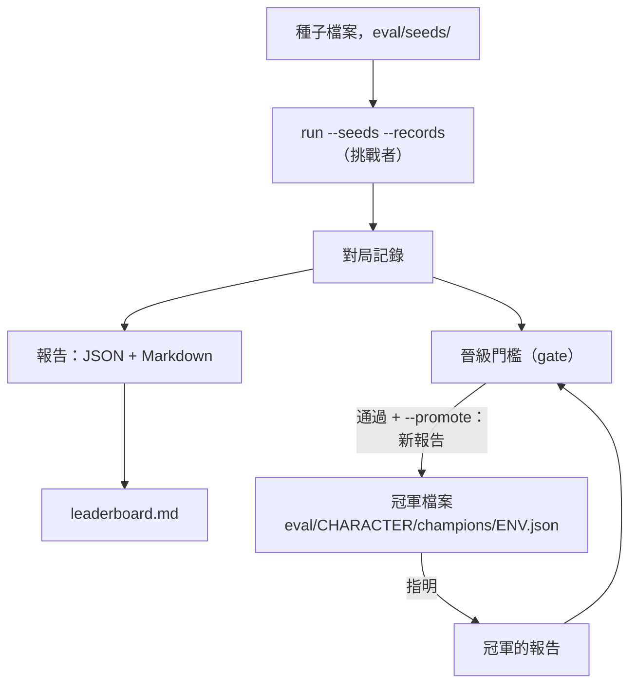

import { Aside } from '@astrojs/starlight/components';

殺戮尖塔 2 的一局是一長串的機率：地圖、遭遇、提供的卡牌、每一次抽牌。同一個 AI 可能在一個種子上死在第 9 層，換下一個種子就贏了。評估把這些雜訊變成兩個答案：**AI 有多強**（排行榜），以及**一個改動有沒有讓它變強**（晉級門檻）。兩者都在模擬器裡打整局，都按 SL 和 NoSL 兩種環境分開，也都建立在固定、事先登記的種子集上。

先讀：[環境](/zh-tw/arch/environments/)，了解 SL 和 NoSL；[模擬器：整局](/zh-tw/arch/simulator/runs/)，了解一局是什麼、記錄些什麼。本章中，`Harness/…` 指 `src/Sts2Ai.Harness` 裡的檔案，`SimWorker/…` 指 `src/Sts2Ai.SimWorker` 裡的檔案，`learn/…` 指一個 Python 腳本。

<Aside title="狀態">

已有：模擬器裡兩種環境的整局，即 R1 級（`run --seeds FILE --records FILE`）；報告（`report`）及其作廢規則；排行榜（`leaderboard`）；種子檔案及其生成器（`seeds`）；配對 SPRT 門檻（`gate`），連同冠軍檔案和 `--promote`；戰鬥測試集（`panel`）；還有 `learn/gauntlet.py` 在整局上按勝局的配對下界門檻。規劃中：R2–R4 級、幕級門檻、A/A 測試、把 `NumReloads` 和 NoSL 存檔匯出次數列入必須為零的指標、報告裡的校準和搜尋計算量數字、跑一次最終種子集。

</Aside>

## 1. 兩個問題

**它有多強**？一局說明不了什麼。強度是在事先固定的種子上打很多局得到的比率：贏下的局所佔的比例及其區間；勝局還很少的時候，則看平均到達層數（[指標、種子與報告 §1](/zh-tw/arch/evaluation/metrics/#sec-1)）。每次評估都產生一份**報告**，每份報告都進入它所屬環境的**排行榜**（[§3](#sec-3)）。現在的冠軍的報告還在等待。

**改動有沒有讓它變強**？挑戰者（新的網路、新的搜尋預算、一個程式碼修復）在相同的種子上逐對面對**冠軍**，即已接受的最好版本。它必須通過的檢定就是**晉級門檻**（[晉級門檻](/zh-tw/arch/evaluation/gates/)）。按種子配對讓雙方共有的運氣互相抵消，序列檢定則能在證據一明確時就停止。

兩個答案分開保存。排行榜列出每一份完整的報告，不論是否被接受；冠軍只透過晉級門檻或一個有紀錄的決定才會更換，寫進該環境的**冠軍檔案**（[冠軍與基線 §1](/zh-tw/arch/evaluation/champions/#sec-1)）。

## 2. 模擬到實機階梯

模擬器裡的結果，只有能遷移到真實遊戲才算數。階梯用 R1 到 R4 四級逐步走到真實遊戲，每級多加一步真實性。每個里程碑都應該跑完所有級別，分開報告：

| 級 | 世界 | 測量什麼 | 現況 |
|---|---|---|---|
| R1 | 在模擬器裡跑整局，由 Harness 驅動 | 策略 | 已有：兩種環境的整局；SL 是主要情境 |
| R2 | R1 + 觀測往返（決策只在由觀測建構的世界上做） | 觀測重建 | 不是單獨的一級：NoSL 搜尋已經從觀測建構它的世界，而 `run --check` 會檢查每個觀測的往返 |
| R3 | 用真實 DLL 跑整局，帶真實解鎖、大廳的幕選擇和實際運行的協定 | 世界搭建和介面 | 無 |
| R4 | Steam 版遊戲加 Mod | 全部 | 無：Mod 的自動跑局驅動程式還在規劃中（[Mod：自動遊玩與安全 §2](/zh-tw/arch/mod/auto/#sec-2)） |

**為什麼每級只加一個新變數**。每一級和它下面那一級只差一處。如果勝率在相鄰兩級之間下降，只有一樣東西變了，差距就能歸因於它：

- R1 → R2：觀測重建；
- R2 → R3：世界搭建和介面；
- R3 → R4：動畫、時序、UI 狀態和執行器（在遊戲裡執行動作的 Mod 程式碼）。

如果從 R1 直接跳到真實遊戲，較低的勝率可能出自上面任何一個原因，無從分辨是哪一個。

- R4 按真實時間執行，所以用於確認，不用於調參。
- 在 NoSL 裡，R1 的決策已經走 Build 路徑，即由觀測建構世界（[模擬器：世界與 SL 複本 §2](/zh-tw/arch/simulator/worlds/#sec-2)），所以就決策而言，NoSL 的 R1 約等於 R2。SL 則不然：戰鬥規劃器和 `--afterstates clone` 搜尋的是節點的複本，即遊戲的存檔加上此後的決策，而不是由觀測建構的世界（[Harness：路由、預算與種子 §2](/zh-tw/arch/harness/routing/#sec-2)）。
- 每條對局記錄都寫著 `R1`：`run` 把級別當作常數寫入（`SimWorker/Commands/RunCommand.cs:285`）。

## 3. 兩個排行榜

排行榜為一個環境在一個種子集上的報告排名。每個環境一個，兩者從不混在一起：

| | NoSL | SL |
|---|---|---|
| 種子 | 同一組事先登記的種子集 | 相同 |
| 冠軍 | NoSL 冠軍檔案指明的報告 | SL 冠軍檔案指明的報告 |
| 允許的資訊 | [環境：資訊與節點 §5](/zh-tw/arch/environments/information/#sec-5) | 同一張表 |
| 預算 | 按每個決策計，同一檔位 | 相同 |

<Aside type="caution" title="不要混用環境">

絕不把兩種環境放進同一張表，或同一次晉級決定。門檻拒絕在另一個環境裡打出的挑戰者，`leaderboard` 也為每個環境各寫一張表（[指標、種子與報告 §9](/zh-tw/arch/evaluation/metrics/#sec-9)）。

</Aside>

- **現在**。兩個冠軍共用宏觀大腦、同一個 V（`v8-2`）和同一個戰鬥網路（`c8-2`）；它們的戰鬥搜尋不同（[環境：世界 §5](/zh-tw/arch/environments/worlds/#sec-5)）。NoSL 打 V 時用從畫面預測的後狀態，因為複本是 SL 的。這個冠軍沒有 NoSL 報告，所以 NoSL 檔案指向一份 SL 報告：NoSL 的門檻拒絕和它配對（環境不同），NoSL 排行榜也不標出冠軍。
- **SL − NoSL**。同一個冠軍在相同種子上兩種環境的成績之差，就是節點內資訊的價值。作為參考，前人專案 spire-mentor 去掉它的作弊後，勝率下降了 22.8–25.5 個百分點（pp），而它的作弊涵蓋整局（`tmp/notes/refs/strong-bots.md:42`）；我們的只到節點級，所以預計差值更小。`leaderboard` 對每個在兩種環境都有報告的冠軍名稱計算這個差（`Harness/Reports.cs:205-222`），但還沒有哪個榜顯示過它：SL 冠軍名為 `combat plan …`，NoSL 冠軍名為 `combat pimc …`，所以沒有一個名稱兩邊都有。最接近的一對是一個較早的 V 在 `promotion-1` 上：SL 用規劃器 28.25，NoSL 用 PIMC 26.16，按種子配對 +2.09 層（標準誤 0.55，由兩份報告算出）；由於戰鬥大腦不同，它量到的是規劃器和資訊加在一起的效果。
- 榜如何建出來，逐欄說明：[指標、種子與報告 §9](/zh-tw/arch/evaluation/metrics/#sec-9)。

## 4. 現況

| 部分 | 狀態 | 在哪裡 |
|---|---|---|
| 兩種環境的整局（R1）、對局記錄 | 已有 | [指標、種子與報告 §8](/zh-tw/arch/evaluation/metrics/#sec-8) |
| 報告、作廢規則、Wilson 區間 | 已有 | [指標、種子與報告 §2](/zh-tw/arch/evaluation/metrics/#sec-2)、[§7](/zh-tw/arch/evaluation/metrics/#sec-7) |
| 種子集，即 `promotion-1` 及其擴充、`final-1` 和 `a10-check-1`，以及它們的生成器 | 已有；`final-1` 從未跑過 | [指標、種子與報告 §5](/zh-tw/arch/evaluation/metrics/#sec-5) |
| 排行榜 | 已有；SL − NoSL 一節從未出現過 | [指標、種子與報告 §9](/zh-tw/arch/evaluation/metrics/#sec-9) |
| 戰鬥測試集 | 已有 | [晉級門檻 §5](/zh-tw/arch/evaluation/gates/#sec-5) |
| 配對 SPRT 門檻 `gate`、冠軍檔案、晉級 | 已有 | [晉級門檻 §6](/zh-tw/arch/evaluation/gates/#sec-6) |
| 勝局門檻，即在整局上用 `learn/gauntlet.py --against` | 已有，使用中 | [晉級門檻 §10](/zh-tw/arch/evaluation/gates/#sec-10) |
| 幕級門檻、A/A 測試、McNemar 檢定 | 規劃中 | [晉級門檻 §4](/zh-tw/arch/evaluation/gates/#sec-4)、[§5](/zh-tw/arch/evaluation/gates/#sec-5) |
| R2–R4 | 規劃中 | [§2](#sec-2) |

**新網路如何過門檻**。網路在整局 SL 中訓練和接受評判，依據是它獲勝的機率（[宏觀大腦：自我對弈 §1](/zh-tw/arch/macro-brain/selfplay/#sec-1)）。它的門檻讓挑戰者用冠軍的規劃器，以 medium 力度（`--afterstates clone`、不探索）在 `promotion-1-300` 的 300 個種子上打，把它的對局和冠軍的按種子配對；當勝局（每局 1 或 0）平均差的 95% 單側下界大於 0 時，挑戰者晉級。相同的種子也用低預算打，只供參考，不決定任何事。如果一代的兩個網路都通過，贏得較多的那個晉級。所以有兩種門檻並存：C# 的 SPRT `gate`，序列式，按層數或按勝局；以及 `learn/gauntlet.py` 按勝局的固定樣本下界。

## 5. 本章

| 頁面 | 講什麼 |
|---|---|
| [指標、種子與報告](/zh-tw/arch/evaluation/metrics/) | 主要指標、必須為零的計數、次要指標、Wilson 區間；種子集及其生成器；報告、對局記錄和排行榜，逐欄說明 |
| [晉級門檻](/zh-tw/arch/evaluation/gates/) | 為什麼要配對；共同亂數、SPRT、McNemar 與 A/A；分層的門檻；`gate` 和勝局門檻的每個選項；不更差、晉級、重定基線 |
| [冠軍與基線](/zh-tw/arch/evaluation/champions/) | 冠軍檔案、歷史和報告放在哪裡、外部基線、未決問題 |
