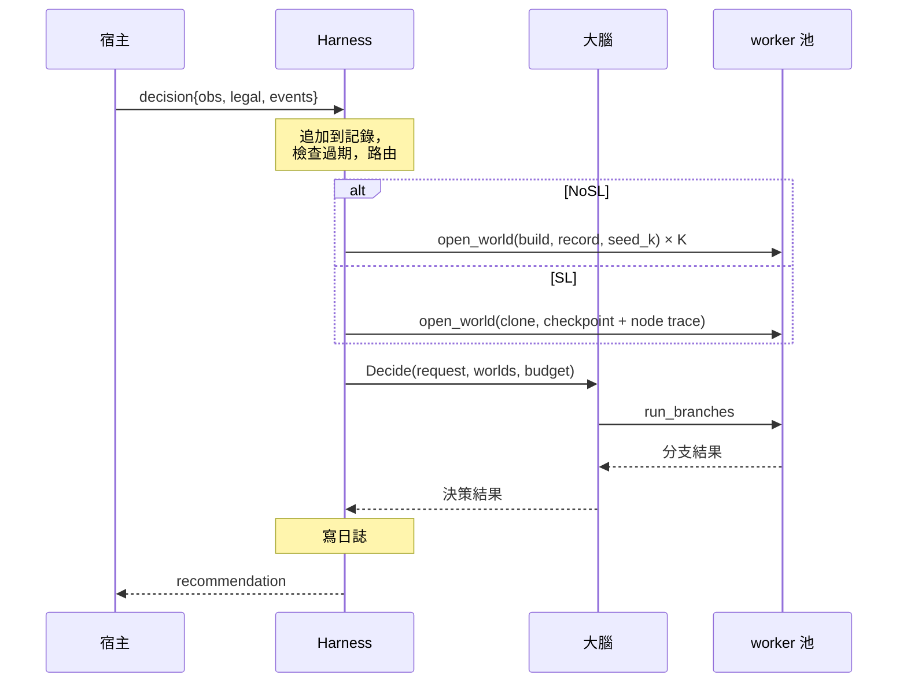

import { Aside } from '@astrojs/starlight/components';

Harness 是決策行程裡的排程器。它的一邊是**宿主**，也就是真正執行遊戲的一方：真實遊戲裡是 Mod，模擬時是負責跑這一局的宿主 worker 行程。另一邊是各個大腦，以及執行搜尋的 SimWorker 行程池。Harness 自己沒有任何策略，也不碰任何遊戲物件，只使用 Protocol 型別。它做的是記帳類的工作：AI 到目前為止看到了什麼，哪個決策介面交給哪個大腦，一個決策能用多少算力，以及要記哪些日誌。

<Aside title="狀態">

部分實作。`Sts2Ai.Harness` 裡有 worker 行程池（[模擬器 §8](/zh-tw/arch/simulator/#sec-8)）、`PooledPimc`（在行程池裡搜尋世界的 PIMC 戰鬥大腦，NoSL 或 SL）、`PooledPlanner`（在行程池裡搜尋各個回合的 SL 規劃器）和 `Dispatcher`：它把一局裡的決策路由給大腦，抽取大腦的種子，並寫決策日誌（[§4](#sec-4)–[§6](#sec-6)）。SimWorker 的 `run` 讓每一局都經過它，可以在行程內，也可以走傳輸協定：`BrainServer` 是 Harness 這一端的宿主–brain 訊息處理（[協定 §2](/zh-tw/arch/protocol/#sec-2)），按順序回答決策。規劃中：公開記錄的其餘部分（[§3](#sec-3)；目前只記錄敵人每回合的意圖，[§6](#sec-6)）；搜尋進行中的過期請求和取消；掛鐘時間預算和基於 CI 的分配；降級回答。

</Aside>

## 1. 職責

Harness 負責六件事：

1. 處理 Protocol 訊息：按 `decision_id` 排序，丟棄過期請求，也就是針對遊戲已經離開的狀態發出的請求（[協定 §2](/zh-tw/arch/protocol/#sec-2)）。
2. 為每一局維護公開記錄（[§3](#sec-3)）。在 NoSL 下，這份記錄是信念的輸入；信念就是 AI 對隱藏狀態的認識。在 SL 下，Harness 還要儲存節點檢查點和節點軌跡。
3. 透過 `IWorldSource` 為當前環境開啟世界（[環境 §5](/zh-tw/arch/environments/#sec-5)、[協定 §7](/zh-tw/arch/protocol/#sec-7)）。
4. 把每個決策介面路由給一個大腦，沒有後備（[§4](#sec-4)）。
5. 設定預算（[§5](#sec-5)），並保證搜尋種子是確定性的。
6. 寫決策日誌（[§6](#sec-6)）。

Harness 不做的事：

- 讀取或執行遊戲：這是宿主裡 GameBridge 的工作；
- 建構或確定化狀態：這是 worker 行程的工作，因為它需要遊戲程式碼；
- 評判動作的好壞：這是各個大腦的工作（[戰鬥大腦](/zh-tw/arch/combat-brain/)、[宏觀大腦](/zh-tw/arch/macro-brain/)）。

## 2. 行程與流程

一次決策的過程如下。宿主發來一條 `decision` 訊息，裡面有觀測、合法動作，以及自上一個決策以來的事件。Harness 把它們追加到記錄裡，檢查請求是否過期，然後為這個決策介面選定大腦。接著它在 worker 池裡開啟世界：NoSL 下是從記錄建構的 K 個世界，每個世界有自己的搜尋種子 `seed_k`；SL 下是由節點檢查點加節點軌跡得到的 1 個複本。大腦在預算內搜尋這些世界，用 `run_branches` 把分支交給 worker 池執行。Harness 記錄結果，再把推薦（recommendation）發回宿主。



- 宿主是 Mod（R4，真實遊戲）或者負責這一局的宿主 worker 行程（R1–R3，模擬）；R1–R4 是[模擬到實機階梯](/zh-tw/arch/evaluation/#sec-1)的各級。Harness 分辨不出這兩者，這正是專案的原則「換世界，不換大腦」（swap the world, not the brain）。SimWorker 的 `brain` 命令單獨執行 Harness，在 socket 後面等待宿主；`run --brain` 作為宿主連上它跑整局（[模擬器 §5](/zh-tw/arch/simulator/#sec-5)）。
- 搜尋用的 worker 行程與宿主行程是分開的。自我對弈時，宿主 worker 只持有真實的這一局，搜尋在其他 worker 上進行。
- 單行程模式（bench、selftest）：Harness 和一個 worker 在同一個行程裡，介面相同，沒有行程間通訊（IPC）。

## 3. 公開記錄

公開記錄就是 NoSL 下的信念：AI 對這一局的全部瞭解都來自它。

Harness 不維護一個與真實亂數保持同步的鏡像遊戲。這種鏡像正是 spire-mentor 的結構性 bug；spire-mentor 是本設計借鑑過的先行專案。取而代之的做法是：每次決策都從記錄重新建構世界。

```csharp
// Planned. Protocol types only.
public sealed class PublicRecord
{
    public RunHeader Header { get; }                    // character, ascension, game version, env
    public IReadOnlyList<RecordEntry> Entries { get; }  // observations, events, own decisions, in order
    public Observation Latest { get; }
}
```

- 記錄是 NoSL 世界的唯一輸入。worker 拿到（記錄，搜尋種子），用遊戲程式碼取樣出一個與記錄一致的狀態。所需的規則（怪物狀態機、各種池、獎勵權重）都在 worker 裡。
- 記錄必須支援的推斷，按優先順序排列：
  1. 抽牌堆的多重集，以及位置已知的牌（需要 `move{pos}` 事件）；
  2. 每個怪物下一步動作的後驗分布（根據已見資訊得到的機率分布），依據它的意圖歷史和效果歷史。目前的重取樣是在意圖相同的動作之間均勻抽取；
  3. 本回合的歷史，由此推出能力和遺物的內部計數器；
  4. 整局層面：至今見過的獎勵、商店和事件，由此推出隱藏的機率計數器。
- 記錄隨這一局的日誌一起儲存。崩潰恢復就是重播日誌，不需要遊戲存檔。
- SL：記錄照樣保留，用於日誌和解說，但搜尋用的世界來自節點複本（[模擬器 §7](/zh-tw/arch/simulator/#sec-7)）。Harness 儲存最新的節點檢查點和節點軌跡；每次進入新節點時，軌跡清空重來。`Dispatcher` 從宿主的 `node_checkpoint` 和 `node_action` 訊息裡儲存它們，NoSL 下拒收，並在每個戰鬥決策時把複本交給戰鬥大腦；加上 `--afterstates clone` 時，也在每個宏觀決策和每個戰鬥外的選牌提示處把它交給 L0，L0 的試探由 `PooledClone` 在 worker 行程池裡打（[宏觀大腦：搜尋 §6](/zh-tw/arch/macro-brain/search/#sec-6)）。還沒收到任何檢查點就來了 SL 決策，會拋出例外。

## 4. 決策介面路由

每個決策介面（surface）只交給一個大腦：

| 決策介面 | 大腦 |
|---|---|
| `combat` | 戰鬥大腦 |
| 戰鬥中的 `card_choice`（棄牌、消耗、選擇、放到牌堆頂……） | 戰鬥大腦（帶 `ChoiceContext`） |
| 戰鬥外的 `card_choice`（升級、轉化、附魔、移除） | 宏觀大腦 |
| `map`、`rewards`、`card_reward`、`bundle`、`event`、`shop`、`rest`、`treasure`、`potion_full` | 宏觀大腦 |

- 戰鬥大腦取決於環境：NoSL 用 PIMC，SL 用 SL 規劃器（`--policy plan`，[戰鬥大腦 §3](/zh-tw/arch/combat-brain/#sec-3)），它在節點複本上規劃，在 NoSL 裡拒絕執行。在複本上跑 PIMC（SL 下的 `--policy pimc`）保留下來，作為規劃器的基線：它只搜尋本回合。宏觀大腦在兩種環境裡是同一個（[環境 §5](/zh-tw/arch/environments/#sec-5)）。每個宿主在 `hello` 裡報出自己的環境，所以 `brain` 命令同時服務兩種：NoSL 宿主用 `--policy` 的戰鬥大腦，SL 宿主用 `--sl-policy` 的，預設是 SL 規劃器（[Mod §5](/zh-tw/arch/mod/#sec-5)）。
- `Dispatcher` 為一局實作這張表。宿主把它作為自己的戰鬥策略、選牌提示策略和宏觀策略。它為每一側各持有一個大腦（戰鬥、戰鬥中的提示、宏觀、戰鬥外的提示），並按 `ChoiceContext.InCombat` 把選牌提示交給對應的一側（[協定 §4](/zh-tw/arch/protocol/#sec-4)）。目前戰鬥中的提示交給 `p0`（[戰鬥大腦 §2](/zh-tw/arch/combat-brain/#sec-2) 第 7 條），宏觀一側和它的提示交給 L0 或隨機佔位策略。
- 找不到路由時回報錯誤「uncovered surface」（未覆蓋的決策介面）：決策介面不在 `Dispatcher.MacroSurfaces` 裡，或大腦的回答不合法，`Dispatcher` 都會拋出例外。宿主暫停，請求人工操作，並記錄一個覆蓋率 bug。絕不用隨機選擇當後備。評估要求後備次數為 0（[評估 §3](/zh-tw/arch/evaluation/#sec-3)）。
- 決策介面清單及其遊戲入口：[模擬器 §5.2](/zh-tw/arch/simulator/#sec-5.2)、[GameBridge §4](/zh-tw/arch/gamebridge/#sec-4)。

## 5. 預算與確定性

預算按分支數計（一個分支就是在某個世界裡模擬的一條打法），或者按掛鐘時間計，取決於模式：

| 模式 | 單位 | 原因 |
|---|---|---|
| 自我對弈、評估 | 固定的分支數 | 可重現：相同請求 + 大腦種子 + 預算 → 相同推薦 |
| 輔助模式 | 掛鐘時間，隨時可停（anytime） | 有人在等：先發出目前最好的答案，再逐步改進 |
| 自動遊玩（R4） | 掛鐘時間上限 + 最少分支數 | 既不卡住，也不搜得太淺 |

「隨時可停」是指搜尋在任何時刻被打斷，都有一個當前最好的答案可以給出。

- 並行算出的結果按固定順序合併（先按世界編號，再按候選編號），絕不按完成的先後順序，這樣時序就改變不了答案。
- 大腦的亂數由 Harness 提供：`brainSeed = SplitMix64(Hash(runId), decisionIndex)`，其中決策序號計入這一局的每個決策（包括選牌提示），run id 是這一局種子的雜湊，所以大腦看不到種子（[協定 §2](/zh-tw/arch/protocol/#sec-2)）。大腦絕不從遊戲自己的亂數流裡取數。等大腦有了版本，冠軍版本號也加入雜湊。PIMC 的建構種子就是大腦種子的十六進位形式。
- 分配：當排名前兩位的候選之差超出各自的信賴區間（CI）時停止；否則增加樣本或深度（[戰鬥大腦 §5](/zh-tw/arch/combat-brain/#sec-5)）。

## 6. 決策日誌

每個決策一行 JSON：

```json
{"run": "97eef296cd6717a2", "decision_id": 4, "env": "NoSL", "surface": "combat", "brain": "pimc",
 "obs_hash": "67f99089ea94de49", "legal": 7, "chosen": "play:2", "plan": ["play:3:1", "play:5", "end_turn"],
 "candidates": [{"action": "play:2", "value": 0.673, "ci": 0.0, "samples": 8,
                 "values": [0.673, 0.673, …], "nodes": [37, 35, …]}, …],
 "budget": {"worlds": 8, "nodes_per_world": 300, "elite": 1, "boss": 1, "halving": false, "follow": false}, "seed": 16058448958323553205, "elapsed_ms": 104.6,
 "obs": {"encounter": "NIBBITS_WEAK", "room": "Monster", …}}
```

- `obs_hash` 是大腦看到的內容的雜湊：戰鬥觀測、整局觀測或選牌提示。`legal` 是合法動作的個數（對提示而言是選項個數）。`chosen` 是文字形式的動作，或選中的選項索引。
- 會搜尋的大腦還會加上 `plan`（`chosen` 之後本回合剩下的動作，取第一個世界裡的；SL 規劃器則是整場戰鬥剩下的動作）、`candidates`（每個首個動作的平均估值、信賴區間半寬 `ci` 和世界數，最好的在前；然後是它在每個世界裡的估值，按世界順序，以及搜尋在每個世界裡花在它下面的節點數；SL 規劃器則是它保留的路線裡出現過的每個首個動作，估值取其中最好的路線）和 `budget`。沿用計畫打出的一步（[戰鬥大腦 §5](/zh-tw/arch/combat-brain/#sec-5)）有 `plan` 而沒有 `candidates`，和只有一個合法動作的決策一樣。佔位策略兩者都不記。各個世界的估值就是 ExIt 的 policy 目標裡的 Q（[學習 §2](/zh-tw/arch/learning/#sec-2)）。
- 在地圖上，L0 也會加上 `plan`：`chosen` 之後本幕剩下的路線（[宏觀大腦：搜尋 §1](/zh-tw/arch/macro-brain/search/#sec-1)）。
- `explored: true` 標出自我對弈的探索抽中的、不是大腦最佳選擇的一步，且大腦給它的估值比最佳低出溫度的百分之一以上（[學習 §5](/zh-tw/arch/learning/#sec-5)）。差距比這更小就算平手（例如同一回合換了個出牌順序），不標。用均勻抽取（`--explore ε`）時，每個抽出的答案都會標出，即使它碰巧就是大腦自己的首選。其他步驟沒有 `explored`。沒有選搜尋首選的戰鬥步驟保留 `candidates`，但沒有 `plan`，因為那個計畫是首選的。
- `replanned: true` 標出因為大腦計畫裡的一步對不上（戰鬥沒有出現計畫預期的觀測）而重新搜尋的戰鬥步驟（[戰鬥大腦 §5](/zh-tw/arch/combat-brain/#sec-5)）。用 PIMC 的 `--follow` 時，這是回合裡揭示了新東西；用 SL 規劃器時，說明複本和真實戰鬥不同（[戰鬥大腦 §3](/zh-tw/arch/combat-brain/#sec-3)）。對局那一行統計它們的次數（`replans`）。
- 一局的戰鬥決策按戰鬥分塊，每場戰鬥一塊，塊與塊之間隔著宏觀決策，順序與對局記錄裡的戰鬥一致。決策靠這個找到它那場戰鬥的結局（[評估 §6](/zh-tw/arch/evaluation/#sec-6)）。
- 戰鬥決策還會加上 `obs`，即大腦看到的戰鬥觀測（[協定 §1](/zh-tw/arch/protocol/#sec-1)）：學習得到的戰鬥部件和融合測試集的輸入（[戰鬥大腦 §8](/zh-tw/arch/combat-brain/#sec-8)）。約 1.6 KB。
- 戰鬥決策還會加上 `history`：這場戰鬥裡每個敵人在至今每一回合開始時顯示的意圖，包括本回合，按 uid 分組，每項是 `{round, intents}`。這是目前已實作的那部分公開記錄（[§3](#sec-3)）：Harness 從它看到的戰鬥觀測裡收集，每次宏觀決策後重新開始。戰鬥網路讀它和回合數，這樣每個怪物的出招順序能從資料裡學到，而不是靠手寫的規則（[學習 §1](/zh-tw/arch/learning/#sec-1)）。Brain 裡的 `MoveRecord` 儲存這份記錄，Harness 每個決策都把它交給戰鬥大腦（戰鬥路由的最後一個參數），搜尋再把它發給 worker，供葉節點使用（[戰鬥大腦 §4](/zh-tw/arch/combat-brain/#sec-4)）。
- 宏觀決策還會加上 `features`：大腦看到的整局觀測上 V 的特徵（[學習 §1](/zh-tw/arch/learning/#sec-1)），不管是哪個大腦做的決策。V v0 的擬合和 V v2 的訓練讀的就是它們；兩者都已刪除，純 V 不讀它們（[學習 §2](/zh-tw/arch/learning/#sec-2)）。
- 宏觀決策還會加上 `run_view`：整局觀測本身，約 6 KB，V v2 就用它訓練（[學習 §2](/zh-tw/arch/learning/#sec-2)）。
- `run --log FILE` 寫出日誌，每個決策一行（[模擬器 §5](/zh-tw/arch/simulator/#sec-5)）；它和對局記錄一起放在 `data/`（[學習 §6](/zh-tw/arch/learning/#sec-6)）。
- `degraded` 標記 worker 故障之後給出的回答，它和在其他 worker 上重新開啟世界一起規劃（[§7](#sec-7)）。崩潰或卡住的 worker 會被重啟，請求再發一次，得到的回答相同，所以目前沒有降級的回答。

誰讀這份日誌：

- 學習：價值目標和 ExIt 標籤（ExIt，專家迭代：訓練學到的部分去模仿搜尋的選擇）；
- 評估：後備次數、每個決策的算力、保守程度；
- 輸出層：解說只根據候選和事實（facts）生成。

## 7. 故障處理

| 情況 | 處理 |
|---|---|
| 過期請求（已有更新的 `decision_id`） | 取消搜尋，不回覆 |
| worker 崩潰或超時 | 在另一個 worker 上從快照重新開啟世界；用已完成的分支作答；`degraded=true` |
| 從觀測建構失敗 | 報告 `BuildDifferences`；不搜尋；宿主暫停；記錄 bug。絕不隨機 |
| 宿主認為動作不合法而拒絕 | 宿主重新請求；連續 2 次 → 暫停 |

目前：死掉的 worker，或 5 分鐘內沒有回答的 worker，會被殺掉、重啟，請求再發一次；第二次失敗就讓這個決策失敗（[模擬器 §8](/zh-tw/arch/simulator/#sec-8)）。一個請求是一個世界的搜尋，最多幾秒，所以超時抓的是卡住的 worker，不是慢的 worker。沒有按觀測建構出來的戰鬥會讓這個決策失敗，並帶上差異（`SimWorlds.NoSL`），在 `run` 裡這會讓這一局失敗。大腦給出不合法的回答時，`Dispatcher` 拋出例外。

## 8. 測試

1. 路由覆蓋：N 局模擬覆蓋到所有決策介面，後備次數為 0。已有：`run` 列出從未到達的決策介面，遇到未覆蓋的介面時 `Dispatcher` 拋出例外。
2. 可重現性：重播一份決策日誌，得到完全相同的推薦。部分已有：`run --check` 對每個種子打兩遍，第二遍走傳輸協定，連到同一行程裡的 Harness，然後比較兩份決策日誌中除 `elapsed_ms` 外的每個欄位。
3. Harness 層面的 NoSL 反事實測試：公開記錄相同、隱藏狀態不同 → 推薦相同（[環境 §7](/zh-tw/arch/environments/#sec-7)）。
4. 過期處理：請求被打亂順序或重複傳送 → 只回答最新的一個。

## 9. 未決問題

1. 記錄裡事件的粒度：先滿足 [§3](#sec-3) 列出的推斷，有需要再加。
2. 同一回合內的多個決策之間，是複用已經建構好的世界（增量方式：建構後做一個快照，再把執行過的動作追加到軌跡上），還是每次都重新建構？
