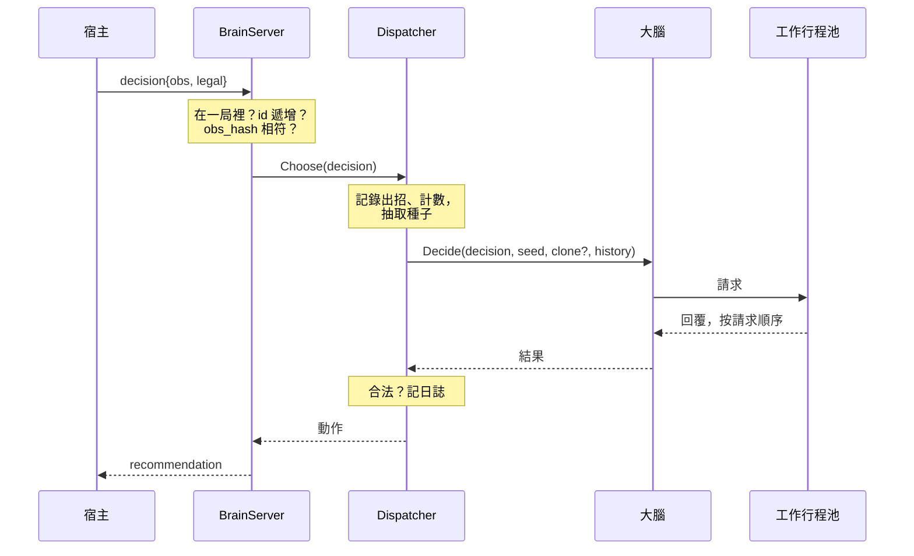

import { Aside, Badge } from '@astrojs/starlight/components';

一個決策從**宿主**開始，宿主就是承載這一局的行程：自我對弈時是模擬器，真實遊戲裡是 Mod。它在**大腦**結束，大腦負責評判各個選項：戰鬥大腦或宏觀大腦。兩者之間是 Harness（`src/Sts2Ai.Harness`）。它沒有自己的策略，也不碰任何遊戲物件：它只透過 Protocol 型別看到遊戲（[協定](/zh-tw/arch/protocol/)）。它做的是記帳：哪個大腦回答哪個畫面，這一局到目前為止顯示了什麼，一個決策拿到哪個種子，回答是否合法，以及什麼要寫進日誌。

<Aside title="狀態">

已有：`Dispatcher`，每局一個，負責路由、保存敵人出招紀錄和 SL 節點、抽取種子、檢查回答並寫決策日誌；`BrainServer`，Harness 這一端的宿主–大腦線路；工作行程池和在其中搜尋的大腦（`PooledPimc`、`PooledPlanner`、`PooledClone`）；以及評估用到的型別（對局記錄、報告、晉級門檻、冠軍檔案，[評估](/zh-tw/arch/evaluation/)）。SimWorker 的 `run` 讓每一局都經過它，在行程內或走線路。規劃中：公開紀錄的其餘部分（[§4](#sec-4)）；搜尋進行時丟棄過期請求；掛鐘時間預算；降級回答（[路由、預算與種子 §4](/zh-tw/arch/harness/routing/#sec-4)、[§6](/zh-tw/arch/harness/routing/#sec-6)）。

</Aside>

## 1. Harness 做什麼，不做什麼

Harness 做八件事：

1. 給每一局一個 `Dispatcher`，宿主把它當作自己的戰鬥策略、選牌提示策略和宏觀策略來詢問（[§2](#sec-2)）。
2. 按決策介面（surface）把每個決策路由給恰好一個大腦，沒有後備（[路由、預算與種子 §1](/zh-tw/arch/harness/routing/#sec-1)）。
3. 保存這一局已經顯示、而搜尋需要的東西：敵人出招紀錄，以及 SL 下當前節點的檢查點和軌跡，它用這兩者做出節點的複本（[§4](#sec-4)）。
4. 從 run id 和決策的編號抽取每個決策的種子，從不取自遊戲（[路由、預算與種子 §5](/zh-tw/arch/harness/routing/#sec-5)）。
5. 檢查每個回答是否合法，不合法就拋出例外。
6. 寫決策日誌（[決策日誌](/zh-tw/arch/harness/decision-log/)）。
7. 服務宿主–大腦線路：`BrainServer`（[§5](#sec-5)）。
8. 把搜尋送到其他行程：工作行程池，以及把自己的搜尋拆成池請求的大腦（[模擬器：工作行程池](/zh-tw/arch/simulator/pool/)）。

Harness 不做的事：

- **讀取或執行遊戲**：那是宿主裡的 GameBridge（[GameBridge](/zh-tw/arch/gamebridge/)）；
- **建構或確定化世界**：這由工作行程做，因為它需要遊戲程式碼。池化的大腦送出自包含的請求，工作行程用請求帶來的東西建構世界；Harness 自己從不開啟世界（[協定：世界與工作行程訊息 §4](/zh-tw/arch/protocol/worlds/#sec-4)）；
- **評判動作**：這由各個大腦做（[戰鬥大腦](/zh-tw/arch/combat-brain/)、[宏觀大腦](/zh-tw/arch/macro-brain/)）；
- **丟棄過期請求**：這由 Mod 做。搜尋進行時畫面變了，它就送出 `cancel`，等回答到來再把它丟掉；Harness 按順序回答每個請求（[Mod：主迴圈 §3](/zh-tw/arch/mod/loop/#sec-3)）。

## 2. 一個決策，一步一步



1. **宿主發問**。走線路時，宿主送出一條 `decision` 訊息：觀測、它的雜湊和合法動作（[協定：線路 §3](/zh-tw/arch/protocol/wire/#sec-3)）。`BrainServer` 檢查它屬於一局、它的 id 大於上一個，並且雜湊確實是這個觀測的，然後把它作為戰鬥決策、選牌提示或宏觀決策交給這一局的 `Dispatcher`（[§5](#sec-5)）。在行程內時，模擬器直接詢問 `Dispatcher`。
2. **Harness 記下它**。戰鬥決策的觀測加入敵人出招紀錄（`MoveRecord.Witness`）；宏觀決策結束這場戰鬥的紀錄（[§4](#sec-4)）。決策得到它在這一局裡的編號，它的大腦的計數加一，並抽取它的種子（`Dispatcher.cs:208-213`）。
3. **一個大腦做決定**。這個決策介面的路由拿到決策、種子、SL 下節點的複本，以及這場戰鬥至今的出招。會搜尋的大腦把搜尋拆成工作行程請求，再合併回覆，回覆按請求順序回來（[路由、預算與種子 §2](/zh-tw/arch/harness/routing/#sec-2)）。
4. **Harness 檢查並記錄**。不合法的回答會拋出例外。大腦的名字、計畫和候選成為這個決策的註記（`Dispatcher.Last`），記錄日誌時也成為決策日誌的一行。
5. **宿主拿到推薦**：動作、大腦、它的計畫和候選，並回送請求的 id 和雜湊（[協定：線路 §7](/zh-tw/arch/protocol/wire/#sec-7)）。

**行程內與走線路**。不帶 `--brain` 的 `run` 在它自己的行程裡給每一局一個 `Dispatcher`。`run --brain SOCKET` 和 Mod 則透過 Unix socket 把每個決策送給 `brain` 指令，在那裡 `BrainServer` 同樣給這一局一個 `Dispatcher`。回答是一樣的：`run --check` 把每個種子走線路再打一遍並加以比較（[決策日誌 §8](/zh-tw/arch/harness/decision-log/#sec-8)）。宿主會說明自己是 Mod 還是模擬的一局（`hello.role`），但建立冠軍時不讀它：大腦分辨不出真實遊戲和模擬器。這就是專案的規則「換世界，不換大腦」（[總覽 §3](/zh-tw/#sec-3)）。

## 3. Harness 為一局保存什麼

| 內容 | 用於 | 何時重新開始 |
|---|---|---|
| 決策計數器 | 每個決策在日誌裡的編號和它的種子；戰鬥決策、選牌提示和宏觀決策共用它，從 0 開始 | 一局內從不 |
| 每個大腦的決策數（`Brains`） | 對局記錄的 `brains` | 一局內從不 |
| `Replans` | 因為計畫不成立而重新搜尋的戰鬥步驟 | 一局內從不 |
| `Last` | 最近一個決策的大腦、計畫和候選：推薦帶的內容 | 每個決策 |
| 敵人出招紀錄（`History`） | 戰鬥大腦的葉節點，以及世界裡怪物的出招日誌（[§4](#sec-4)） | 宏觀決策時，或回合數倒退時 |
| SL 節點：檢查點和軌跡 | 節點的複本，交給戰鬥大腦，加上 `--afterstates clone` 時也交給宏觀一側 | 每個節點檢查點 |
| 決策日誌 | 這一局的各行，在記憶體裡保存到這一局結束 | 一局內從不 |
| 各路由自己的狀態 | PIMC 照著打的計畫（`TurnPlan`）和 SL 規劃器的路由（`SlRoute`），每局一個 | 從不：戰鬥結束時不會，宏觀決策時也不會 |

## 4. 公開紀錄

**想法**。在 NoSL 下，AI 對一局能知道的一切，就是這一局已經顯示的東西：**公開紀錄**。搜尋不會在真實遊戲旁邊保持一份同時執行的遊戲副本。這樣一個與真實亂數流保持同步的鏡像，正是 spire-mentor 的結構性 bug；spire-mentor 是本設計借鑑過的先行專案。取而代之的是，每個決策都從公開的東西重新建構它的世界，由工作行程用遊戲程式碼取樣其餘隱藏的部分（[環境：世界 §2](/zh-tw/arch/environments/worlds/#sec-2)）。

**已實作：敵人出招紀錄**。公開紀錄裡已有一部分：每個敵人顯示過的東西。`MoveRecord`（`Brain/Combat/MoveRecord.cs`）由 `Dispatcher` 保存，每局一個：

- 在每個回合的第一個決策時，每個有 uid 和意圖的活著的敵人，加入這個回合和它的意圖。這個回合之後的決策不再加入任何東西。
- 一個條目是敵人的 uid、它的怪物 id 和它的各個回合，最早的在前：`{uid, id, turns: [{round, intents}]}`（[協定：世界與工作行程訊息 §2](/zh-tw/arch/protocol/worlds/#sec-2)）。
- 宏觀決策會清空它，回合數倒退也會，這表示一場新的戰鬥。選牌提示不會。
- 每個戰鬥決策都把它交給戰鬥大腦，戰鬥大腦的請求再把它帶到工作行程。它在那裡做兩件事：葉節點裡的戰鬥網路讀取它和回合數，從而能從資料學到每個怪物的出招順序（[戰鬥大腦：葉節點 §3](/zh-tw/arch/combat-brain/leaf/#sec-3)）；從觀測建構的 NoSL 世界把每個怪物顯示過的出招作為它的出招日誌（[模擬器：戰鬥 §5](/zh-tw/arch/simulator/combat/#sec-5)）。
- 它作為 `history` 寫進決策日誌的每一行戰鬥決策（[決策日誌 §7](/zh-tw/arch/harness/decision-log/#sec-7)）。

**已實作：SL 節點**。在 SL 下，宿主還會送出當前節點進入時的檢查點，以及此後在節點裡做出的每個決策（[協定：線路 §6](/zh-tw/arch/protocol/wire/#sec-6)）。`Dispatcher` 保存它們：

- `Checkpoint` 拒收 NoSL 下的檢查點，以及節點索引沒有遞增的檢查點；它讓節點的軌跡重新開始。
- `Act` 拒收 NoSL 下的動作，以及不屬於當前節點、或序號不等於軌跡長度的動作；它把動作加到軌跡上。
- 在需要它的決策處，節點的複本由檢查點的存檔、軌跡的一份拷貝，以及菁英連戰的規則（如果這一局按它打）組成（`NodeClone`）。在任何檢查點之前就需要複本的 SL 決策會拋出例外。需要複本的是每個 SL 戰鬥決策，加上 `--afterstates clone` 時還有每個宏觀決策和每個戰鬥外的選牌提示（[路由、預算與種子 §3](/zh-tw/arch/harness/routing/#sec-3)）。

**規劃中：紀錄的其餘部分** <Badge text="規劃中" variant="caution" />。NoSL 下一個不只關於怪物出招的信念，需要更多公開過的東西：

```csharp
// Planned. Protocol types only.
public sealed class PublicRecord
{
    public RunHeader Header { get; }                    // character, ascension, game version, env
    public IReadOnlyList<RecordEntry> Entries { get; }  // observations, events, own decisions, in order
    public Observation Latest { get; }
}
```

- 紀錄將是 NoSL 世界的唯一輸入：工作行程收到紀錄和一個搜尋種子，用遊戲程式碼取樣一個與紀錄一致的狀態。這需要的規則（怪物狀態機、各種池、獎勵權重）都在工作行程裡。
- 紀錄必須支援的東西，按優先順序：
  1. 抽牌堆的多重集，加上位置已知的牌（這需要 `move{pos}` 事件，[協定：觀測與動作 §8](/zh-tw/arch/protocol/observation/#sec-8)）；
  2. 每個怪物下一步出招的後驗（根據已見資訊得到的機率分布），由它的意圖和效果歷史得出。目前世界裡排入的出招，是在顯示相同意圖的各個出招之間均勻抽取的（[模擬器：戰鬥 §5](/zh-tw/arch/simulator/combat/#sec-5)）；
  3. 本回合的歷史，由此得到能力和遺物的內部計數器；
  4. 整局層面：至今見過的獎勵、商店和事件，由此得到隱藏的機率計數器。
- 紀錄將隨這一局的日誌一起儲存，於是從崩潰中恢復就是重播日誌；不需要遊戲存檔。
- 在 SL 下紀錄照樣保留，用於日誌和解說，但搜尋在節點的複本上打。

## 5. 大腦伺服器

`BrainServer`（`BrainServer.cs`）是線路的大腦端（[協定：線路](/zh-tw/arch/protocol/wire/)）。建立它時要給它一個工廠，用宿主的 `hello` 做出一局的 `Dispatcher`；還可以再給它每個 `run_end` 時要做的事、一個日誌記錄器，以及一個看得到每條訊息的鉤子。

**監聽**。`Listen(path)` 服務連到一個 Unix socket 的宿主，一次一個，永不停止。連線失敗的宿主（I/O 錯誤、格式錯誤的訊息、壞掉的 JSON、不相符的協定版本）會被丟棄並留下一條警告，然後服務下一個。`Bind(path)` 建立 socket：以 NUL 位元組開頭的路徑指名一個抽象 socket，它沒有檔案；已經不在的大腦留下的 socket 檔案會被取代，還有大腦在監聽的則拋出例外；socket 所在的目錄建立時只有使用者本人可讀。

**訊息迴圈**（`BrainServer.cs:75-136`）：

| 宿主送來的訊息 | 伺服器做什麼 |
|---|---|
| `hello` | 向工廠要一個新局的 `Dispatcher`，回答 `ready{champion}`；工廠拒絕這一局（拋出例外）時，回答 `error`。第二個 `hello` 不經 `run_end` 就開始新的一局 |
| `decision` | 回答一條 `recommendation`；以下情況則回答 `error`：沒有開著的一局、這一局的某條 SL 節點訊息曾被拒收、它的 id 不大於上一個、它的觀測與雜湊不符（「Mod 和大腦是用同一個 commit 建置的嗎？」）、戰鬥決策或選牌提示決策沒有對應種類的畫面，或 Harness 拋出例外（不合法的選擇、未覆蓋的決策介面）。宿主隨後結束這一局 |
| `node_checkpoint`、`node_action` | 交給這一局的 `Dispatcher`；從不回答。拒收會被記住，並讓這一局的下一個決策失敗 |
| `run_end` | 把這一局的 `Dispatcher` 交給 `ended` 回呼，並關閉這一局 |
| `executed`、`cancel` | 忽略：每個決策都在讀下一條訊息之前回答，所以沒有可以丟棄的搜尋 |
| 其他任何訊息 | `error` |

**回答**（`BrainServer.cs:138-154`）。戰鬥決策的合法動作被解析成戰鬥動作，大腦看到的是它畫面上的戰鬥觀測；選牌提示的回答寫成 `pick:i,j`；其他每種決策介面都是宏觀決策。推薦回送請求的 id 和雜湊，並帶著這個決策的註記：它的大腦、計畫和候選（選牌提示的推薦只帶大腦）。

**`brain` 指令**包裝它（[模擬器：參考 §4](/zh-tw/arch/simulator/reference/#sec-4)）。它用自己的選項做出兩個冠軍，每種環境一個：NoSL 宿主得到 `--policy` 的戰鬥大腦，SL 宿主得到 `--sl-policy` 的，預設是 SL 規劃器（[環境 §5](/zh-tw/arch/environments/#sec-5)）。兩者共用一個工作行程池。`--log FILE` 在每一局的 `run_end` 時寫出它的決策日誌，所以沒送出這條訊息就斷線的宿主不會留下任何一行；`--wire FILE` 記錄宿主送來的每條訊息，`clones` 據此檢查 Mod 的 SL 記錄（[Mod：SL 紀錄 §8](/zh-tw/arch/mod/sl-record/#sec-8)）。

## 6. 程式碼

`Sts2Ai.Harness` 引用 Brain（並透過它引用 Protocol）和 `Microsoft.Extensions.Logging.Abstractions` 9.0.22，不引用遊戲的任何東西；`selftest` 檢查它編譯後的引用（[模擬器：參考 §5](/zh-tw/arch/simulator/reference/#sec-5)）。

| 檔案 | 型別 | 內容 |
|---|---|---|
| `Dispatcher.cs` | `CombatRoute`、`Route<T>`、`DecisionEntry`、`DecisionNote`、`Dispatcher` | 一局的路由、種子、檢查、SL 節點和日誌（[路由、預算與種子](/zh-tw/arch/harness/routing/)、[決策日誌](/zh-tw/arch/harness/decision-log/)） |
| `BrainServer.cs` | `BrainServer` | 線路的大腦端（[§5](#sec-5)） |
| `WorkerPool.cs` | `WorkerPool` | 搜尋用的工作行程（[模擬器：工作行程池](/zh-tw/arch/simulator/pool/)） |
| `PooledPimc.cs` | `PooledPimc` | 在行程池裡搜尋各個世界的 PIMC，NoSL 或 SL |
| `PooledPlanner.cs` | `PooledPlanner` | 在行程池裡搜尋各個回合的 SL 規劃器 |
| `PooledClone.cs` | `PooledClone` | 給宏觀一側用的節點複本，它的試探在行程池裡打 |
| `RunRecords.cs` | `RunConfig`、`RunRecord`、`CombatEntry`、`CombatEnd` | 對局記錄（[評估 §6](/zh-tw/arch/evaluation/#sec-6)） |
| `Reports.cs` | `Rate`、`BossEntry`、`Metrics`、`EvalReport`、`Leaderboard` | 報告和排行榜（[評估 §6](/zh-tw/arch/evaluation/#sec-6)） |
| `Gate.cs` | `Gate`、`ChampionFile` | 配對的晉級門檻和冠軍檔案（[評估 §5](/zh-tw/arch/evaluation/#sec-5)） |

**`Dispatcher`**（`Dispatcher.cs:82-228`）建立時需要 run id、環境、四條路由、是否記錄日誌，以及在 `--afterstates clone` 下如何為宏觀一側開啟節點的複本：

| 成員 | 內容 |
|---|---|
| `static MacroSurfaces` | 戰鬥外有路由的決策介面：map、rewards、card_reward、bundle、event、shop、rest、treasure、crystal_sphere |
| `Choose(CombatDecision)` → `CombatAction` | 一個戰鬥決策（[§2](#sec-2)） |
| `Choose(ChoiceDecision)` → 選中的選項 | 一個選牌提示：如果是在戰鬥中問的（`ChoiceContext.InCombat`），交給戰鬥一側，否則交給宏觀一側；回答必須是提示接受的 |
| `Choose(MacroDecision)` → 動作 | 一個戰鬥外的決策；未覆蓋的決策介面會拋出例外 |
| `Checkpoint(NodeCheckpoint)`、`Act(NodeAction)` | SL：節點的檢查點和在其中做出的每個決策（[§4](#sec-4)） |
| `Log` | 記錄日誌時，這一局到目前為止的決策日誌 |
| `Env`、`Last`、`Brains`、`Replans`、`History` | 環境，以及 [§3](#sec-3) 的狀態 |
| `Champion` | 報告裡對這一局各個大腦的稱呼：`combat B[ budget], combat prompts B, macro B, macro prompts B`（[路由、預算與種子 §1](/zh-tw/arch/harness/routing/#sec-1)） |

**Harness 呼叫的 Brain 部分**（`Brain/Decisions.cs`、`Brain/Combat/`）：

| 型別 | 內容 |
|---|---|
| `ICombatPolicy`、`IChoicePolicy`、`IMacroPolicy` | 每種決策一種策略；`IChoicePolicy` 和 `IMacroPolicy` 還會說明它們上一個回答是否經過探索，`IMacroPolicy` 還會說明它在回答之後的計畫 |
| `CombatDecision`、`ChoiceDecision`、`MacroDecision` | 一個決策：它的合法動作（或它的提示）、按需建構的觀測，以及宏觀一側在有開啟的複本時的節點複本（`IMacroClone`） |
| `CombatDecisionResult` | 戰鬥大腦的回答：第一個動作、它之後的計畫、候選、計畫的觀測雜湊、是否經過探索、是否重新規劃 |
| `Budget`、`TurnPlan`、`SlRoute`、`MoveRecord` | 搜尋預算、照計畫打、規劃器的路由、敵人出招紀錄 |

## 7. 本章

| 頁面 | 說明的內容 |
|---|---|
| [路由、預算與種子](/zh-tw/arch/harness/routing/) | 路由表和每條路由、預算、種子與確定性，以及出問題時會怎樣 |
| [決策日誌](/zh-tw/arch/harness/decision-log/) | 每個決策一行、每個欄位、候選與計畫、誰讀它，以及測試 |

未決問題：

1. 公開紀錄裡的事件該有多細：先滿足 [§4](#sec-4) 裡的推斷，有需要再加。
2. 同一回合的多個決策之間，是複用已經建構好的世界（建構後做一個快照，再把每個打出的動作追加到軌跡上），還是像現在這樣每次都重新建構？
