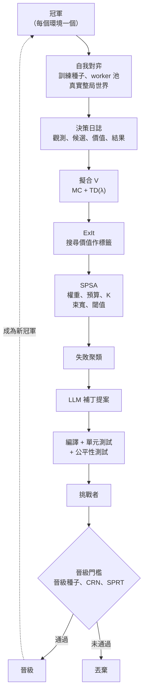

import { Aside } from '@astrojs/starlight/components';

本頁定義兩個大腦用來給局面評分的價值函式 V，以及不斷改進它的離線循環。策略透過自我對弈從零學起，不從使用者的對局裡學。線上時，每個決策都是「搜尋 + 學到的價值」。改進循環照搬 Stockfish（開源西洋棋引擎，這裡借鑑它的開發流程）的做法：自我對弈、擬合價值、調參、提出補丁，只有通過晉級門檻（gate）的改動才保留。LLM 只參與離線環節（提出補丁、分析失敗），從不參與線上決策。這個循環離線執行，所在行程與決策行程分開。

<Aside title="狀態">

V v0 已經實作：Brain 裡的 `RunValue`，17 個手寫的對局觀測特徵乘以線性權重，初始權重是手設的（[§1](#sec-1)）。宏觀大腦的 L0 用它估值（[宏觀大腦 §2](/zh-tw/arch/macro-brain/#sec-2)）。`learn/fit_value.py` 從自我對弈資料擬合權重，`learn/spsa.py` 用 SPSA 調這些權重或 PIMC 的葉節點權重，`run --value` 用這兩種權重來打，`learn/challenge.py` 讓挑戰者過晉級門檻（[§2](#sec-2)）；還沒有擬合或調出的權重晉升為冠軍。V v2 也已實作：Brain 裡的 `RunNet`，一個讀整局的卡牌、遺物、藥水和上下文的網路（[§1](#sec-1)），由 `learn/train_value.py` 訓練（[§2](#sec-2)）；`run --value` 也能讀它的檔案，`run --macro-explore` 和 `--combat-explore` 給自我對弈加上探索（[§5](#sec-5)）。它的 n2-b0.03 從 2026-10-28 起是 NoSL 冠軍的 V（[§2](#sec-2)）。戰鬥網路也已實作：Brain 裡的 `CombatNet`，PIMC 學到的葉節點（`--combat-net`），由 `learn/train_combat.py` 從自我對弈的回合開始局面訓練（[§1](#sec-1)、[§2](#sec-2)）；它的第一代 c2 自 2026-10-27 起是 NoSL 冠軍的葉節點（[戰鬥大腦 §7.2](/zh-tw/arch/combat-brain/#sec-7.2)）。`learn/` 是學習循環用的 Python 專案（uv、PyTorch）。

</Aside>

## 1. 價值函式

**V(obs) = P(由當前冠軍繼續打，從此處贏下本局)**。價值函式估計一個局面有多好。這裡的估計值是一個機率：如果由當前的**冠軍**（目前已接受的最好版本的 AI）打完剩下的部分，從這個觀測出發贏下本局的機率。

- 戰鬥葉節點、宏觀後狀態和地圖共用同一個尺度（[戰鬥大腦 §4](/zh-tw/arch/combat-brain/#sec-4)、[宏觀大腦 §2](/zh-tw/arch/macro-brain/#sec-2)）。因為所有價值都是勝率，一場戰鬥裡掉的血和獎勵裡拿的一張牌可以直接比較。
- 輸入只有觀測。訓練時可以把隱藏狀態當作輔助輸入（[§4](#sec-4)），但部署的模型絕不以它為輸入。
- 兩種環境共用一個 V。SL 策略在之後每個節點都打得更好，所以從同一個觀測出發，它真實的勝率更高；共用的 V 有意忽略這一點（[環境 §5](/zh-tw/arch/environments/#sec-5)）。它用戰鬥由 SL 戰鬥大腦來打的對局訓練，包括自我對弈和分叉推演（2026-10-28 決定）；宏觀大腦在兩種環境裡看到的資訊一樣。

規劃中的版本：

| 版本 | 形式 | 訓練方式 |
|---|---|---|
| v0 | 手寫特徵乘以線性權重（初始權重之間拉開很大間距，保留字典序的意圖） | SPSA |
| v1 | 手寫特徵 + 小型 MLP | 監督學習：MC + TD(λ) |
| v2 | 觀測編碼器（卡牌 / 遺物 / 藥水 / 上下文的嵌入向量，牌組用集合編碼器）+ V v0 的特徵；每層一個風險值的輸出頭 | 監督學習：MC（TD(λ) 和 ExIt 在規劃中） |

表中的術語：

- **字典序的意圖**（v0）：起步的特徵清單來自 bottled_ai（一個前人的殺戮尖塔 AI 專案），它按嚴格的重要性順序比較特徵：先比第一個，相同時才比下一個（[戰鬥大腦 §4](/zh-tw/arch/combat-brain/#sec-4)）。初始線性權重之間拉開很大間距，就能重現這個順序，調參從這裡開始。
- **已實作的 V v0**（`RunValue`）：生命值、最大生命值、金幣、藥水、遺物、牌組大小、不能打出的牌、升級數；能打出的牌的平均傷害（含中毒）、格擋和抽牌；以及地圖上前方預計的菁英、休息處、商店、財寶房和 `?` 數；還有層數，它沒有初始權重：同一個決策的所有選項層數都相同，但擬合需要它，免得把進度的功勞記到隨進度而來的東西（遺物、金幣）頭上。它的權重以 1 點生命值為單位，而不是拉開間距：整局層面的特徵之間要互相權衡（一件遺物換多少生命值），嚴格的先後順序表達不了這一點。這些權重只是假設，留給調參來替換。
- **已實作的 V v2**（`RunNet`，由 `learn/train_value.py` 訓練）：輸入是整局觀測的詞元（token）和標準化後的 V v0 特徵。一張牌的向量是它 id 的向量，加上升級次數（最多算 3）乘以它 id 的升級向量，再加上它的附魔和詛咒的向量。一個小 MLP（phi）逐張處理每張牌，牌組取結果的平均值和總和（乘以 1/16）：這是集合編碼器，能讀任意牌組，也不管牌的順序。遺物（用完的遺物算作單獨的 id）、藥水和上下文（角色、幕、頭目、本幕的 Ancient）都是各自向量之和。牌和遺物上的數值按下面戰鬥網路的方式讀入：一張牌加上它的費用、修飾的數值、星費和 X 費，以及按名字讀的每個數值；一個遺物加上它的計數、是否顯示計數、是否熔化，以及它的狀態。晉階等級併入特徵。之後兩層 256 寬的網路給每一層輸出一個 logit：**風險值**（hazard），即活著到達這一層時死在這一層的機率。訓練中出現不到 3 次的 id 都讀作同一個未知 id。總共幾十萬個權重。
  - 從風險值可以讀出：從這裡起每一層都活下來的機率就是 P(win)；起始層數加上活過每一層的機率，就是**期望到達層數**。在對局偶爾能贏之前，P(win) 沒有訊號，所以 V v2 的價值取期望到達層數（網路檔案裡 objective 為 `floor`）；能贏之後改用同一個輸出頭讀出的 P(win)（objective 為 `win`）。
  - 期望到達層數把每一層看得一樣重。它可能偏向穩定打到第二幕的穩妥路線，而不是偶爾能贏的冒險路線，所以它只是過渡。
- **牌感**：`ranks --logs LOGS [--value FILE]` 可以讀出任一版 V 對卡牌的偏好：每一幕裡，給日誌中各個卡牌獎勵時的牌組再加一張某牌，V 平均變化多少。V v0 遠遠把 GRAND_FINALE 排在第一（它傷害很高，但要抽牌堆空了才能打出），而 FOOTWORK 這類能力牌接近 0，因為它們不帶傷害、格擋或抽牌。
- **MLP** 是小型全連線神經網路。**嵌入向量**（embedding）是學出來的向量，每個卡牌、遺物或能力 id 各一個，這樣編碼器能讀任意牌組。
- **SPSA**（同時擾動隨機逼近）只靠帶雜訊的結果來調參。每一步把所有參數同時朝一個隨機方向微調，分別測量「加」和「減」兩個版本，再把參數往更好的那邊挪。不管參數有多少個，每步只需要兩次測量，也不需要梯度，適合那些只能靠打遊戲來檢驗的權重。
- **MC**（蒙地卡羅）目標：本局的真實結果（贏為 1，輸為 0），作為局內每個決策的標籤。它是無偏的，但雜訊大：一局的運氣會落到它的所有決策上。
- **TD(λ)**（時間差分）目標：把真實結果和 V 自己在後續決策（k+1、k+2……）上的估計混合起來。λ 取 0 到 1 之間，決定混合比例：λ = 1 就是純 MC，λ = 0 只往後看一個決策。它的雜訊比 MC 小，而且每一步轉移都有學習訊號。
- **ExIt**（專家迭代）：由 V 引導的搜尋比單獨的 V 打得更好，於是把搜尋得到的價值當作下一版 V 的訓練標籤。更好的 V 又讓下一輪搜尋更強，如此往復。

**輸出頭**（v1 及以後）。輸出頭是神經網路的一個輸出，網路主體由所有輸出共享：

- 主輸出頭：P(win)；已實作的 V v2 裡是風險值輸出頭，P(win) 和期望到達層數都從它讀出；
- 輔助輸出頭，只幫助網路學到好的表示，從不用來做決策：下一場戰鬥掉的血、到達層數的分布、每個頭目的擊殺機率；
- 戰鬥輸出頭，用於戰鬥葉節點：戰鬥結局的分布，即一個死亡類別（death class）加上戰鬥結束時剩餘生命值的分桶，可選再加剩餘藥水數（做法同 STS2 的先行專案 r33hab 和 ytcs）。它不直接預測 P(win)：每場戰鬥由局外 V 給它的各個結局定一次價（[§3](#sec-3)）。兩個訓練目標通過晉級門檻比較：
  - 戰鬥內的 TD(λ ≈ 0.95)，用這個輸出頭在下一個決策上的分布自舉，終點的結局桶用 HL-Gauss 向相鄰的桶平滑（約 0.75 個桶寬的高斯），這是 ytcs 的做法；ytcs 發現 λ = 1 更差；
  - 0.3 × 搜尋得到的分布 + 0.7 × 實際結局，這是 r33hab 的做法。

**已實作的戰鬥網路**（`CombatNet`，由 `learn/train_combat.py` 訓練）：戰鬥輸出頭，放在一個單獨的網路上，給一個回合的開始估值（[戰鬥大腦 §4](/zh-tw/arch/combat-brain/#sec-4)）。

- 卡牌：四個牌堆（手牌、抽牌堆、棄牌堆、消耗堆）裡的每張牌都是一個詞元：它 id 的向量，加上升級次數乘以它 id 的升級向量、它的附魔和詛咒的向量、它所在牌堆的向量，以及費用 / 3 乘以一個費用向量。一個小 MLP 逐張處理每張牌，每個牌堆是其中各牌之和（乘以 1/8）。
- 玩家：生命值比例、生命值、最大生命值、格擋、能量、最大能量、星辰和回合數，以及它的能力之和（每個能力是 id 的向量加上層數 / 10 乘以 id 的層數向量，再過一個小 MLP）。
- 每個活著的敵人：它 id 的向量，加上它的生命值比例、生命值、最大生命值、格擋和已經出過幾回合招的線性投影；它的能力，演算法同玩家；以及它的意圖槽：現在顯示的意圖，然後是它前 3 回合的意圖，最近的在前。一個槽是其中各意圖之和，每個意圖是型別的向量，加上每段傷害 / 10 和總傷害 / 20 乘以該型別的向量。一個 MLP 逐個處理每個敵人，再把所有敵人加起來。
- 遺物、藥水和上下文（角色、遭遇戰、房間型別、幕）都是各自向量之和。每個縮放後的數值都截斷在 ±10 以內，因為少數局面會出現極大的數（噴發中的 WATERFALL_GIANT 的生命值）。
- 最初的網路（c1、c2）沒讀、自 2026-10-27 起讀入的內容。編碼完全相同的兩個局面，資料再多也分不開，所以觀測裡的這些數值都要進來：
  - 牌上的數值：附魔和詛咒的數值 / 10（各乘以對應修飾的數值向量）、星費 / 3 和是否 X 費，以及每個數值（`vars`）/ 10 乘以它名字的向量；
  - 能力的層數（只在提示裡與圖示數字分開寫出時，例如 Sloth），乘以它 id 的層數向量；以及它保留的那張牌（Nightmare），用那張牌的向量；
  - 遺物的計數 / 10 乘以它 id 的計數向量（Pen Nib、Nunchaku、Happy Flower、Stone Calendar），是否顯示計數、是否熔化，以及它的狀態；
  - 球（id、被動和激發數值 / 10）和活著的盟友（id、生命值比例、生命值、最大生命值、格擋和能力，過一個小 MLP），各自求和；
  - 晉階等級 / 10、球槽數 / 10 和金幣 / 100。

  在此之前做出的網路檔案不宣告這些輸入，而 `CombatNet` 和 `RunNet` 只喂圖裡宣告的輸入，所以 c2 的打法不變。每個新輸入的一致性都用隨機權重的網路檢查過，權重經過放大，讓每個輸入都能明顯改變輸出：訓練器給出的測試局面能通過載入檢查，而只改其中任何一個輸入的副本都會在載入時被拒絕。
- 之後兩層 256 寬的網路給出 51 個類別，即死亡，或者從現在起還要再掉的生命值（佔最大生命值的比例）落在 50 個桶中的哪一個（從 −0.25，即戰鬥中回了血，到 1），以及勝利前還要用掉的藥水數。
- 輸出頭預測的是「之後還會發生什麼」，而不是「最後還剩多少」。第一個網路（c1）預測的是戰鬥結束時剩餘的生命值比例，結果只學到了現在的生命值在結局裡一半的分量：現在少 1 點血，它的估值只降 0.0038，而最後實際會少整整 1 點血，按 `LeafValue` 的定價是 0.0078。於是它的搜尋太輕易地拿血去換別的，普通戰和菁英戰比冠軍掉血更多（每場勝利掉 7.8 對 6.5、26.4 對 18.0），過門檻時在第 32 對就被判不通過（層數 −1.41）。改成預測從現在起還要掉的血以後，現在的生命值被完整計入（同樣那些局面上每點血 0.0083），留出集上估值的平方誤差也從 0.0090 降到 0.0077。
- 怪物的出招沒有一條是手寫的。網路從它的 id、回合數、它出過幾回合招和它最近的意圖裡，可以從資料中學到每個怪物的出招順序，以及它現在走到了順序裡的哪一步。這份歷史來自 Harness（[Harness §6](/zh-tw/arch/harness/#sec-6)）。
- 作為葉節點，進行中的局面價值是 Σₖ p(k) × (WinBase + PerHp × (現在的生命值比例 − 第 k 個桶的中點)) + P(勝) × PerPotion × (現有藥水數 − 要用掉的藥水數)，即 `LeafValue` 給打贏的戰鬥定的價。改由 V 給各個結局定價是計畫中的做法（[§3](#sec-3)）。

## 2. 自我對弈循環

自我對弈時，冠軍在真實的整局世界裡（即 worker 池中無頭執行的真實遊戲程式碼）自己打完整局。這個循環把這些對局變成一個**挑戰者**，再由晉級門檻決定它能否取代冠軍：

1. **自我對弈**：冠軍用訓練種子打完整局，帶探索（[§5](#sec-5)）。日誌格式見 [Harness §6](/zh-tw/arch/harness/#sec-6)。
2. **擬合**：目標是 MC 結果與 TD(λ)（從決策 k 到決策 k+1）的混合。早期一局都贏不了，P(win) 的 MC 目標全是 0；V v2 的風險值輸出頭改從每局死在哪一層學習，在對局能贏之前，它的價值取期望到達層數（[§1](#sec-1)）。絕不在同一次反向傳播裡混合生命值目標和勝負目標（r33hab 的教訓）。

   「到達層數」這類稠密目標只是過渡。它帶來的改動，只有用真實結局過了晉級門檻、並且在多個訓練種子上覆現之後才接受：在一項摜蛋研究（arXiv 2610.29411）裡，有一個譜系看起來很強，但它預先登記的 5 個重現種子沒有一個是正的。

   v0 的擬合是 `learn/fit_value.py`。決策日誌裡每個宏觀決策都帶著 V 的特徵（[Harness §6](/zh-tw/arch/harness/#sec-6)），對局記錄給出這一局到達的層數，兩者按對局 id 對上，每份日誌只和它的 `run` 在旁邊寫下的那份記錄檔案對（`--logs` 和 `--records` 按同樣的順序列出）。對局 id 只是種子的雜湊，所以同一種子的另一局（換了策略，或探索掃描）可能在別的檔案裡；同一份記錄檔案裡出現兩次的對局 id 會被拒絕。擬合用的是在標準化特徵上的嶺迴歸（嶺迴歸：最小二乘加上對權重大小的一點懲罰，免得相關的特徵拿到極端的權重）。每局權重相同，不管它有多少個決策；每五局（按對局 id）留出一局。它報告留出對局上的 R²（R²：擬合解釋了層數變異數的多少，最好為 1，比直接用平均值還差時低於 0），並和只用層數的擬合對比。權重寫到 `weights/CHARACTER/NAME.json`（[§6](#sec-6)）；`run --value FILE` 讓 L0 用它來打，冠軍名裡顯示為 `l0 NAME`。

   V v2 的訓練是 `learn/train_value.py`。決策日誌裡每個宏觀決策也帶著它的整局觀測（[Harness §6](/zh-tw/arch/harness/#sec-6)），像 v0 的擬合那樣對上它的對局，它的目標就是所在對局的結局：從決策所在的層一直活到死亡的那一層，然後死在那裡；如果這局贏了，就是每一層都活了下來。被截斷的對局從最後一層起不提供資訊；失敗的對局不用。損失是這些層上風險值的交叉熵。每局權重相同，每五局（按對局 id）留出一局，用於提前停止（AdamW，學習率 3e-5；最多 40 輪，連續 5 輪留出損失沒有改善就停）和報告。輸出頭從基線的風險值（見下）開始，所以網路學的是局面讓每一層的風險值偏離基線多少。報告給出留出損失，以及期望到達層數對實際到達層數的 R²，並和只知道層數的基線（訓練對局裡每一層的風險值）對比。網路檔案寫到 `weights/CHARACTER/NAME.json`，附帶幾個留出的整局觀測和訓練器給它們的價值；`RunNet` 載入時逐個核對，這保證訓練和對局時的編碼與前向計算一致（[§7](#sec-7)）。`run --value FILE` 讓 L0 用它來打，冠軍名裡顯示為 `l0 NAME`。第二個頭只在訓練時用：預測這一局接下來六場戰鬥各自花掉多少比例的最大生命（來自對局記錄）；它的平方誤差以 `--aux-weight`（預設 3）計入損失。它塑造兩個頭共同讀取的主體，網路檔案裡只有風險值。

   第一批測量，在 g0 和 g1 上（859 局，60,480 個宏觀決策），一折：留出損失 1.229，基線是 1.291；R² 0.368，基線是 0.313。V v0 的 17 個特徵在同樣的對局上重新擬合（`fit_value.py`）得到 0.315，不比基線好。同一局的決策共享這一局唯一的結局，所以可學的結局只有大約 700 個，網路很快過度擬合。從隨機的輸出頭、學習率 1e-3 開始，它一輪之內就記住了各局：第一輪後 1.331，第六輪後 4.12。從基線開始，學習率 1e-3 是 1.573，1e-4 是 1.235，3e-5 是 1.229；權重衰減從 1e-4 改成 0.1 沒有變化。它的卡牌感（用 `ranks` 跑 g1 的日誌）在第 0 幕把毒系牌排在最前：多一張 OUTBREAK 值 0.77 層，其次是 SNAKEBITE、BUBBLE_BUBBLE、BOUNCING_FLASK 和 DEADLY_POISON。第 1 幕到達的對局少得多，那裡是雜訊：詛咒太少見，沒有自己的 id，以 +0.1 排在前面。n1 訓練時沒有第二個頭。加上它（權重 3），在同樣的對局、三個訓練種子上，留出損失是 1.222 對 1.235（1.208、1.237、1.222 對 1.229、1.246、1.232），R² 0.384 對 0.371，每個種子都是損失更低、R² 更高；權重 1 和 10（一個種子）是 1.224 和 1.210。

   n1 的門檻（L0 用 n1，對冠軍那個用 V v0 初始權重的 L0，戰鬥相同，都是 c2）在 200 個種子中的 157 個之後不通過。200 個種子全部打完：21.97 層對 22.58（配對 −0.61 ± 1.32）。它的打法不一樣：2,261 次卡牌獎勵只略過 15 次（冠軍 2,081 次略過 906 次），每局打 0.94 場菁英（冠軍 0.39）。它贏第 1 幕頭目更多（打到頭目的 171 局裡贏 100 局，冠軍 190 局裡贏 94 局），但在去頭目的路上和第 2 幕死得更多，而它的訓練對局很少走到第 2 幕：22 局打到第 2 幕頭目，冠軍 45 局。幾乎每張牌都拿，是訓練對局裡的相關，不是某張牌本身的作用：贏的戰鬥越多的局拿的牌越多、走得也越深，於是牌組大看上去就像層數深。探索和更多的對局能給網路把兩者分開所需的對比。

   **反事實配對**。同類對局再多也拆不開它：每一局裡選擇和運氣都是一起出現的。拆得開的是同一個局面、同樣的運氣、兩個不同的選擇，也就是 [§5](#sec-5) 的反事實實驗室，為 V v2 的下一代而建。決策日誌只記錄每個決策之前的局面和選了什麼，所以兩個命令都要回到那個局面。它們從種子重播日誌裡的一局，按日誌回答每個決策（戰鬥和選牌提示也一樣），並把每個觀測的雜湊和日誌裡的對比。g1 的 508 局全部逐位重播；g0 的 356 局在同樣的介面上走到同樣的結局，但多數雜湊不同，因為觀測後來加了欄位。重播一局約 0.7 秒。
   - `afterstates --log LOGS --records RECORDS --out FILE [--start I] [--n N] [冠軍選項]` 寫出每個宏觀決策的所有選項，按 L0 用冠軍的 V 估值的樣子：每個選項的後續狀態（它改變的那些局面欄位）和值，以及 V v0 對它算的特徵（V v2 也讀這些特徵）。
   - `fork --log LOGS --records RECORDS --out FILE [--per-run K] [--surfaces map,card_reward,rest,shop] [--act 0] [冠軍選項]` 從日誌的每一局裡，按介面輪流抽這一幕的 K 個決策，把這一局重播到那裡，然後從那裡打兩次：一次用 L0 的最佳動作，一次用這個介面上均勻抽的另一個動作（不抽藥水動作，每個介面都有）。兩條分支都由冠軍打到這一幕結束（打過頭目）。決策之前，兩條分支的遊戲隨機狀態和大腦種子完全相同；決策之後，遊戲的隨機流只在選擇改變了它們的地方錯開。每個分叉記錄兩條分支的結局（死了還是活著、層數、血量、金幣）和到達終點時的局面。
   - 步驟 0，g1 的局上 27 個分叉：兩條分支到達的層數相關 ρ = 0.66（算上剩餘血量比例 0.64），所以差值的變異數約為兩局獨立對局的三分之一。27 個裡有 20 個抽在獎勵畫面，那裡的選擇大多是先拿哪個獎勵，其中 17 個結果相同；之後預設不抽獎勵畫面，各介面輪流抽。多數配對在這一幕的結局一樣（都死在頭目，或都活過），區分它們的是幕末的血量和牌組。一個分叉的兩條分支共約 70 秒（一個行程）。

   `train_value.py` 兩者都讀。`--forks FILES`：每條分支的後續狀態是一個樣本，和決策的樣本一樣，活過這一幕的在幕末刪失（`--fork-weight`，預設 1）；兩個後續狀態的期望層數之差擬合配對實際打出的差（`--pair-weight`，預設 1，以實際差值的均方為單位）：死了的分支到達它死的那一層，活著的分支取 V 對它終點局面的期望，不傳梯度（n 步自舉，幕末局面按 V 現在的估值；早停不看這一項，因為它的目標隨 V 的學習而變）。`--afterstates FILES --kl-weight β` 把 V 在每個日誌決策上對各選項的 softmax 往打出這些日誌的策略拉，即按日誌自己的探索溫度對打出日誌的 V 的值取 softmax：這是保守更新，和資料覆蓋窄時的離線強化學習一樣（BCQ、CQL、TD3+BC），讓 V 的 argmax 停在資料覆蓋到的地方。V 自己的 softmax 用和日誌策略相當的溫度：V v0 的日誌用 `--kl-temperature`（單位是層）；V v2 網路的日誌用日誌自己的溫度，因為這種網路和 V 一樣以層數估值。後續狀態必須由日誌所寫的那個 V 估值。日誌標為沒探索的選擇，離最佳不到 T / 100，所以對每個大腦，如果這類選擇裡超過 1% 不是後續狀態裡的最佳，就發出警告：g1 和 g2 分別是 0.1% 和 0%，g0 是 12%，因為它的觀測後來加了欄位。分叉和決策和其它資料一樣按局 id 劃分。報告另外給出：留出的分叉上，V 預測的差和實際差（到達層數加剩餘血量比例，每對按差的大小加權，相同的不算）符號一致的比例，旁邊是 V v0 的；留出的決策上，按介面給出相對日誌策略的 KL、V 的最佳和 V v0 的最佳一致的比例，以及卡牌獎勵上各自略過的比例；同一決策內 V 的值對 V v0 的值的斜率（V v0 的溫度乘以它，就是以層為單位的同一溫度）；在哪個溫度下 V 探索的比例和日誌的策略一樣（`explore_temperature`）；以及一個離策略檢驗（逆傾向加權）：在 V v0 的最佳選項被抽中的機率在 2% 到 98% 之間的決策上，抽到其它選項後到達的層數對比抽到最佳的，各按其機率的倒數加權，旁邊是 V 對同一件事的預期。

   **n2**，在 g0–g2 上訓練（1,198 局，85,089 個宏觀決策；g2 的 339 局由 c2 加 V v0 打，探索溫度 0.25）：
   - 只用結局訓練的網路（同 n1，加第二個頭，g0 和 g1）重現了 n1 的問題：卡牌獎勵上它的最佳選項是「略過」的只有留出決策的 0.2%，V v0 是 14.4%；它的最佳和 V v0 的最佳一致的比例是 56%，卡牌獎勵上 35%，商店裡 26%。
   - 拉力的溫度來自同一決策內 V 的值對 V v0 的值的斜率 0.031：V v0 的 0.25 約等於 0.008 層，所以拉力用 0.01。在這個溫度下，拉力的梯度約為結局損失的 β / 0.01 倍。β = 1 時留出的結局損失三輪都不動：V 照抄了 V v0 的排序。β = 0.1 時為 1.319，只看層數的基線 1.350（R² 0.330 對 0.312）；V 的最佳與 V v0 的一致 93.5%，卡牌獎勵略過 13.1%（V v0 13.8%）。β = 0.03 時：1.318、89.9% 和 15.9%。β = 0.01 時：1.317、84.4% 和 14.1%（R² 0.335）。
   - 分叉：在 g1 和 g2 的局上共 651 個，三台機器兩小時（每個約 111 秒，一個行程）。兩條分支的「到達層數加剩餘血量比例」相關 ρ = 0.62；303 對兩條都死（幾乎都死在第 1 幕頭目），226 對都活，122 對一死一活。L0 的最佳比另一個動作好的幅度（這一幕內到達的層數加剩餘血量比例）：地圖 0.24、篝火 0.10、卡牌獎勵 0.08、商店 0.07：在這一幕之內，單個選擇的影響很小。留出分叉上，V 預測的差和實際差符號一致的比例：β = 0.1 為 0.605，β = 0.03 為 0.658，同樣的分叉上 V v0 分別是 0.605 和 0.615（分別是 54 個和 74 個分叉：這兩個網路訓練時分叉還沒打完）；β = 0.01 在全部 114 個上為 0.698，V v0 為 0.643。
   - 分叉和拉力一起用（β = 0.1，分叉和配對的權重都是 1）：留出的結局損失 1.359，高於只看層數的基線 1.350（R² 0.273），雖然留出分叉的符號一致率是 0.685，V v0 為 0.643。分叉為什麼讓自我對弈結局的擬合變差，還沒有定論；一個猜測是：分支由貪心的冠軍打，死亡率和帶探索的自我對弈不同。沒有對它跑門檻。
   - 離策略檢驗分不出這幾個網路的高下：在 4,703 個留出決策上，抽到 V v0 最佳之外的選項，比抽到最佳少走 0.37 ± 1.23 層，而每個網路的預期都約為 −0.02。
   - n2-b0.1 的門檻（L0 用它，對冠軍的 L0，戰鬥相同，都是 c2）在 200 個種子中的 122 個之後通過，+2.00 層（LLR 2.95）。200 個種子全部打完：23.96 層對 22.58（配對 +1.39 ± 0.65）。打到第 1 幕頭目的 186 局裡贏 117 局，冠軍 190 局裡贏 94 局；62 局打到第 2 幕頭目，冠軍 45 局；卡牌獎勵略過 36%，冠軍 44%；每局打 0.44 場菁英，冠軍 0.39。種子 0–59 在主機上打，60–139 在 cshinnku，140–199 在 hostc。它從 2026-10-28 起是 NoSL 冠軍，同一天被 n2-b0.03 取代。
   - n2-b0.03 的門檻（對 n2-b0.1）在 200 個種子中的 136 個之後通過，+1.78 層（LLR 2.99）。200 個種子全部打完：26.16 層對 23.96（配對 +2.20 ± 0.63）。打到第 1 幕頭目的 190 局裡贏 137 局，對方 186 局裡贏 117 局；83 局打到第 2 幕頭目，對方 62 局；卡牌獎勵略過 34%，對方 36%。第一次在三台機器、兩個修復之前的建構上打，有一局失敗、兩局被截斷：篝火選了鍛造，V 卻不想升級任何牌，於是退回篝火又選鍛造；建構器無法把 WATERFALL_GIANT 的爆發值設到 99 以上（[宏觀大腦 §2](/zh-tw/arch/macro-brain/#sec-2)、[模擬器](/zh-tw/arch/simulator/)）。在修復後的建構上、只用主機重打，判定相同；凡是主機或 cshinnku 打過的種子，結局都一樣；結局不同的 18 個全是 hostc 打的，那台機器不能逐位重現（[評估 §5](/zh-tw/arch/evaluation/#sec-5)）。它從 2026-10-28 起是 NoSL 冠軍。每個都只有一個訓練種子；消融（只用拉力、只用分叉、兩者都用，對比只用結局的網路）每個要三個訓練種子。

   戰鬥網路的訓練是 `learn/train_combat.py`。一個樣本是決策日誌裡每個回合的第一個戰鬥決策：這正是搜尋葉節點所處的局面，因為搜尋的葉節點是下一回合的開始（[戰鬥大腦 §2](/zh-tw/arch/combat-brain/#sec-2)）。它之前的敵人歷史，按 Harness 的做法從前面各回合的觀測重建，所以沒有 `history` 欄位的舊日誌也能用。目標是對局記錄裡這場戰鬥的結局（[評估 §6](/zh-tw/arch/evaluation/#sec-6)），像 v0 的擬合那樣按對局、再按戰鬥的先後順序對上：結局的類別（由這個局面到結束之間掉的生命值比例決定），以及勝利前用掉的藥水數。這是打這些對局的策略下的 MC 目標。損失是交叉熵加上 0.1 × 勝利後藥水數的平方誤差。按對局 id 留出五分之一的對局（由 `--fold` 選哪一份），用於提前停止（AdamW；最多 60 輪，連續 6 輪留出損失沒有改善就停）和報告：留出集上的交叉熵，與一個先驗（訓練集裡各結局的頻率）對比；以及網路的價值和 `LeafValue` 的價值相對於真實結局價值的平方誤差和相關係數。`--lags 0` 和 `--no-round` 分別去掉意圖歷史和回合數，`--train-share` 只用一部分訓練對局，`--width` 按比例調整每一層的寬度，都用來做消融實驗。`--next-weight W` 加一個只在訓練時使用的輸出頭：從每個敵人自己的向量預測它在下一回合開始時的意圖（型別和總傷害）；報告裡會給出它猜對型別的比例，並和「敵人重複當前意圖」這一猜法對比。

   第一批測量，用 315 局自我對弈（13,954 個回合開始局面），三折：
   - 限制網路的是資料，不是規模。分別用四分之一、一半和全部訓練對局，留出交叉熵是 1.446、1.379 和 1.337。寬度減半時相同（1.337），寬度加倍也沒有更好（1.340）。
   - 網路能從資料裡學到怪物的出招。加上預測下回合意圖的輸出頭後，它對 57.7% 的敵人猜對了下回合意圖的型別，而重複當前意圖的猜法只有 28.9%；下回合總傷害平均差 4.15，後者差 7.65。大部分只需要知道是哪個怪物和它當前的意圖：去掉歷史和回合數後是 56.7%。歷史幫助最大的是少數幾個怪物，比如 LAGAVULIN_MATRIARCH（43% 對 33%）和 NIBBIT（41% 對 35%）。猜錯的很多是遊戲隨機挑選的招式。
   - 這個輸出頭對結局的留出交叉熵和估值誤差的影響都在雜訊範圍內，所以預設關閉；它用來檢查每一代有沒有學會出招。網路檔案寫到 `weights/CHARACTER/NAME.json`，附帶幾個留出的回合開始局面和訓練器給它們的結局，`CombatNet` 載入時逐個核對。`--combat-net FILE` 讓 PIMC 用它來打，冠軍名裡顯示為 `pimc NAME`。
   c3 在 g1 的 505 局（27,909 個回合開始局面，由 c2 打出）上訓練，三折：
   - 寬度仍然無關緊要。寬度 1 時留出交叉熵是 1.348、1.348 和 1.334，寬度減半時是 1.356、1.327 和 1.317（先驗：2.041、1.973 和 2.014），在各折的差異之內相同。它也不改變搜尋的速度：在一個 8 場第 1 幕戰鬥的固定面板上並排跑，寬度 0.5、1、2 的網路和 c2 每個動作花 1.58–1.76 秒，因為遊戲模擬的開銷遠大於網路。c3 保持寬度 1，讓它的門檻只檢驗資料這一項改動。最佳化器的設定也無關緊要：在第 0 折上，學習率用 3e-4 或 1e-4 代替 1e-3，或權重衰減用 1e-2 代替 1e-4，得到 1.346–1.348，而原來是 1.348。
   - 網路的估值與真實結局的估值相關係數是 0.960，`LeafValue` 是 0.829。
   - c3 的門檻（其餘選項同冠軍）在 200 個種子中的 160 個之後作廢：它有一局在 Sozu 下的商店裡反覆買同一瓶藥水，直到被截斷，這是已修復的框架 bug（提交 `c5ee8de`）。到那時為止，它平均比冠軍多到 0.58 層（LLR −0.65，未定）。這麼大的提升遠低於門檻的 δ（1.5 層）。
3. **ExIt**：搜尋得到的價值成為 V 和先驗（搜尋優先嘗試哪些動作）的標籤。老師是同一環境下的公平搜尋，即遵守該環境資訊規則的搜尋。不要對全知的老師做行為複製（訓練模型去模仿老師的動作）：這在好幾個專案裡都失敗了。

   戰鬥的 policy 目標是 softmax(先驗 logits + c · minmax(Q))，不用造訪次數。Q 是每個第一個動作在各個世界上的平均估值，PIMC 已經算出來了；minmax 把一個決策的 Q 縮放到 [0, 1]；先驗是均勻的時候，先驗 logits 為 0。c 按這個目標預測「大得多的預算下搜尋的選擇」的對數似然來調。造訪次數不適合當目標：根上的 CRN 會把它壓平（r33hab），而 mctx（一個 Gumbel MuZero 函式庫）的變換在我們每個世界 300 個節點下，目標幾乎是 one-hot。所以決策日誌要記下：每個戰鬥決策裡，每個第一個動作在每個世界上的估值和花掉的節點數；每場戰鬥的結局（死亡、生命值、藥水）。兩樣都已記下：各個世界的估值和節點數在每個候選裡（[Harness §6](/zh-tw/arch/harness/#sec-6)），每場戰鬥的結局在對局記錄裡（[評估 §6](/zh-tw/arch/evaluation/#sec-6)）。

   兩個前提。學到的先驗只有在晉級門檻裡贏過均勻先驗之後，才能引導搜尋。學到的葉節點只有同時贏過 `LeafValue` 和推演到戰鬥結束（rollout）之後，才能替換 `LeafValue`：r33hab 在 15 次模擬時，value 頭比 rollout 多掉 10.6 點生命值。
4. **SPSA**：調 v0 的權重和搜尋參數。

   V 的權重由 `learn/spsa.py` 來調。它從一個權重檔案出發（預設是 V 的初始權重，由 `weights` 輸出）。每一步給每個權重隨機抽一個正負號，把所有權重按這些符號同時加上、再同時減去它們尺度的 c 倍，兩個版本在同一批新的訓練種子上各打一遍（`run --macro l0 --value`，外加給定的對局選項，例如戰鬥策略）。有了 CRN，兩邊在不多的種子上就能比較。然後權重朝平均層數更高的那邊挪，步長按 Spall 的遞減序列，每步最多挪各自尺度的十分之一。權重的尺度就是它的初始大小。層數的權重不動，因為它不改變任何選擇。結果是一個權重檔案，供 `run --value` 使用。

   搜尋參數方面，`--param leaf` 用同樣的辦法調 PIMC 的葉節點權重（[戰鬥大腦 §4](/zh-tw/arch/combat-brain/#sec-4)）：兩邊用 `--leaf` 傳權重，起點是預設葉節點權重（`weights --leaf`）；這些權重始終保持為正，因為每個都是速率、比例或高於失敗的價值。這時對局得用 `--policy pimc`，很慢，所以 `--objective panel` 改打面板戰鬥（`panel --player pimc --leaf`，[戰鬥大腦 §7](/zh-tw/arch/combat-brain/#sec-7)）：贏下的戰鬥得分為剩餘 HP 佔開戰時 HP 的比例，其他結局得 −1。面板得分的範圍是 2，而一局的層數範圍約 50，所以它的預設步長更大（0.5 對 0.02）。結果是一個葉節點權重檔案，供 `--leaf` 使用，最終仍由整局門檻決定。
5. **LLM**：輸入是預先聚合好的失敗聚類和死亡摘要；輸出是 K 個候選補丁（特徵、剪枝規則、參數）。候選先經過編譯、單元測試和公平性測試的篩選，再過晉級門檻。只透過 LLM 閘道器使用便宜的模型。
6. **晉級門檻**：見[評估 §5](/zh-tw/arch/evaluation/#sec-5)。`learn/challenge.py` 帶一個挑戰者（由它的對局選項給出）過門檻：在冠軍的種子集上分批打，每批之後過一次門檻。結論是不通過或作廢就停下；通過之後把種子集剩下的打完並讓它晉級，也就是改寫冠軍檔案、重建排行榜。挑戰者的對局記錄留在 `--records-dir`，即 `data/CHARACTER/ENV/eval/日期-gate-名字/`（[§6](#sec-6)）。

**循環怎麼跑**（計畫）：

- 戰鬥的探索只加在自我對弈搜尋的根上，評估時關掉。它已經實作（[§5](#sec-5)）：打出的動作按根上各動作的價值 Q，以 ∝ exp(Q / T) 的機率抽取，等價於給 Q / T 加上 Gumbel 雜訊再取最大。
- PCR（playout cap randomization，來自 KataGo）：25% 的決策用全預算，提供 policy 目標；另外 75% 只用四分之一預算，只提供 value 目標。
- Reanalyse（來自 MuZero）：每出一版新網路，從種子和 trace 重播一部分舊局面，用它重新搜尋，更新這些局面的 policy 目標和自舉的 value 目標。
- 每一代都要過晉級門檻。AlphaZero 去掉門檻，是因為它的訊號乾淨、對局多；這裡一局的變異數大，局數又少。

## 3. 獎勵與信用分配

獎勵只有一局的結果。難點不是缺少訊號，而是信用分配（credit assignment：一局裡眾多決策中，到底是哪些導致了輸贏）和變異數（運氣掩蓋了單個決策的效果）。

1. 分層縮短了鏈條。戰鬥由搜尋解決，它的結果是一個結局分布 p(k)：死亡，或者戰鬥結束時剩餘生命值落在第 k 個桶。局外 V 每場戰鬥給它定一次價：開戰時算 u[k] = V（戰鬥之後的後狀態，生命值取第 k 個桶），藥水或遺物變了再重算，死亡時 u = 0；葉節點的值就是 Σₖ p(k) · u[k]。所以戰鬥網路不隨 V 的版本變：換了 V 只需重新定價，而戰鬥和局外仍然在同一個尺度上拿生命值和其他東西做取捨。V v0 對生命值是線性的，用它定價時就退化成 P(死亡) 和生命值的期望。這樣整局層面的信用分配只需要跨越大約 50 個宏觀決策，再加上各場戰鬥的結果。
2. TD(λ) 在每一步轉移上都給出梯度。
3. 輔助獎勵項只能是基於勢函式的形式：F = Φ(s') − Φ(s)（Ng、Harada、Russell，1999），見下文。
4. 輔助輸出頭提供密集的監督，只用於學習表示。
5. 變異數：反向課程（從靠近頭目的地方開始），以及在關鍵決策上用 CRN 配對的分叉（[§5](#sec-5)）。

**基於勢函式的獎勵塑形**。獎勵塑形是加上一些中間獎勵，讓學習者在一局結束之前就得到回饋。在基於勢函式的形式裡，有一個函式 Φ 給每個狀態評分，從 s 走到 s' 的獎勵是 Φ(s') − Φ(s)。整局加起來，這些獎勵逐項相消（telescope），只剩 Φ(終點) − Φ(起點)：獎勵只取決於一局從哪裡開始、到哪裡結束，與中間走哪條路無關。Ng、Harada 和 Russell 證明了這種形式的塑形不會改變最佳策略。直接按生命值扣分就不會這樣相消：它會禁止「第一幕賣血、換第三幕取勝」這樣的打法。

**反向課程**。訓練先從接近結尾的局面開始（頭目戰前的快照），那裡結果近在眼前，訊號清楚；然後把起點逐步往前推（[§5](#sec-5)）。

**CRN**（公共亂數）：兩條路線用同樣的隨機種子來打，它們共有的運氣就從差值裡抵消了。在一個決策點**分叉**，就是從同一個點出發，分別打它的兩個選項。

## 4. 訓練時的特權資訊

特權資訊指玩家看不到的隱藏狀態。公平規範（本地筆記 `tmp/notes/fair-play-spec.md`）允許在訓練時使用它，前提是部署的策略只讀觀測：

- **神諭評論家**（oracle critic）分支是一個只在訓練時使用的價值分支，它能看到隱藏狀態（真實的抽牌順序、怪物動作），用來降低訓練目標的變異數。部署的只有觀測分支。
- 反事實標籤：在同一個決策點、用同樣的隨機性分叉，兩條路線都打到底，得到兩者差值的無偏標籤。
- 這些只存在於離線管線中，組件和行程都與決策行程分開。

## 5. 局部最佳解與全域最佳解

自我提升的循環可能陷入局部最佳解：一種打法，任何小改動都會讓它變差，但另一種截然不同的打法其實贏得更多（例如永遠保守）。下面這些機制用來對抗它：

| 機制 | 作用 |
|---|---|
| 價值目標只用一局的結果 | 生命值值多少，從資料中學出來 |
| 反向課程 | 先用第二、三幕和頭目戰前的快照池；先學會後期的價值，再往前推 |
| 反事實實驗室 | 在抽樣出的關鍵宏觀決策上，用 CRN 分叉兩條路線並都打到底，得到無偏的 ΔP(win)；用來檢驗「第一幕賣血」這類假設 |
| 種群 / 存檔庫 | 每個風格描述符一個冠軍（MAP-Elites），防止坍縮成「永遠保守」 |
| 探索 | 自我對弈時用 Thompson 取樣或 softmax 抽樣做決策；後狀態的 MC 目標對此是穩健的。softmax 已實作（見下）；評估時從不開啟 |
| 保守性監控 | 打菁英次數、跳過率、到達頭目時的生命值、囤積金幣/藥水（[評估 §3](/zh-tw/arch/evaluation/#sec-3)） |
| 反常識假設 | 人工或 LLM 提出的想法 → 受約束的策略變體 → 模擬器 A/B 測試；結果拿回來討論 |

- **MAP-Elites** 保留一個存檔庫，而不是只保留一個最好的策略。每個策略按它的風格描述符（幾個描述它怎麼打的數字）放進一個格子，每個格子保留自己最好的冠軍。暫時不是最好的風格也能存活，種群就不會坍縮成單一風格。
- **Thompson 取樣**的探索方式是：根據每個選項的不確定性，為它抽一個可能的價值，選抽到最高的那個；一個選項被嘗試的頻率，大致等於它真正是最好選項的機率。
- **softmax 探索**（已實作）按大腦給各選項的估值，以 ∝ exp((v − 最佳) / T) 的機率抽取每個選項：接近最佳的常被嘗試，差的很少，一樣好的機會均等。它取代了均勻的 ε 探索，後者嘗試差選項和好選項一樣頻繁。`run --macro-explore T` 讓 L0 在每個戰鬥外的決策（含選牌提示；提示裡的每次選取和是否停下都算）上按 V 的估值這樣抽取；`--combat-explore T` 讓 pimc 的首個動作按搜尋的候選估值這樣抽取。冠軍名裡會顯示（`l0 explore T`、`pimc c2 explore T`）；晉級門檻拒絕帶探索的挑戰者（[評估 §5](/zh-tw/arch/evaluation/#sec-5)）。決策日誌標出抽到比最佳差的步驟（`explored`，[Harness §6](/zh-tw/arch/harness/#sec-6)）；`train_value.py` 讀這個標記，檢查後續狀態是否由打出日誌的 V 估值（[§2](#sec-2)）。
- **溫度**的單位分別是 V 的和葉節點的，所以它們一變，溫度就要重選。選法：pimc 每場戰鬥約損失 1 HP；L0 取讓它約 4–5% 的決策被探索的溫度。只計有兩個及以上合法選項的決策，並且只計抽到比最佳差的選項：平局不算，`p0` 的選牌提示不探索。
  - pimc 用 c2 葉節點：按搜尋自己的估值，T = 0.003 每場戰鬥約損失 1.0 HP（自我對弈的 54 場戰鬥；T = 0.002 時 0.5 HP，0.005 時 2.3 HP）。在 g1 的日誌裡，普通戰鬥每場 0.85 HP，搜尋的 22 個決策裡探索 3.1 個；菁英每場 1.13 HP；頭目每場 1.85 HP，34 個裡探索 8.3 個。
  - L0 用 V v0 的初始權重（單位是 HP），戰鬥用 T = 0.003 的 pimc c2，每個溫度 8 局：T = 0.25 探索 L0 決策的 4.8%（49 次卡牌獎勵裡 7 次），0.4 探索 7.1%，0.7 探索 13.5%。選 T = 0.25。層數差（−1.75、−2.00、−4.38）在 8 局下只是雜訊。V v2 的溫度將按同樣的規則選，單位是層數。
  - L0 用 n2-b0.03（單位是層數）：它各選項的估值比 V v0 的近約 40 倍，所以 T = 0.25 在 g3 最初的對局裡探索了 45% 的宏觀決策（2026-10-28），接近隨機，這些對局已停下。按 n2-b0.03 對其中 2,355 個決策的估值，被探索的比例：T = 0.01 為 8.5%，0.008 為 6.9%，0.006 為 5.3%，0.005 為 4.5%；V v0 在 g2 的決策上 T = 0.25 時為 5.4%。選 T = 0.006。`train_value.py` 對它訓練的每個網路報告：在哪個溫度下，網路探索的比例和日誌的策略一樣（`explore_temperature`，[§2](#sec-2)），也就是下一代的 `--macro-explore`。
  - L0 以前的規則是取最多少 1 層的最高溫度，在佔位戰鬥策略 `play` 下選出 T = 2：按種子配對的 600 局裡平均少 0.90 ± 0.39 層。pimc 下牌組更要緊，T = 2 的代價更大。g1 最初的對局用戰鬥 0.003、宏觀 2，平均到達 17.1 層，而 c2 冠軍 199 局平均 21.80 層（第 1 幕頭目 181 次裡贏 85 次）。在 g1 最初的 56 個種子上配對：
    - 不探索：21.68 層，第 1 幕頭目 51 次裡贏 25 次；
    - 只探索戰鬥，T = 0.003：少 0.89 ± 1.82 層，頭目 53 次裡贏 17 次，在規則之內；
    - 只探索宏觀，T = 2：40 局裡少 3.10 ± 2.10 層，頭目 35 次裡贏 9 次；
    - 兩者都探索，即 g1 的打法：少 4.65 ± 2.01 層，頭目 48 次裡贏 5 次。

    宏觀 T = 2 時探索了 3,009 個 L0 決策的 24.9%，卡牌獎勵的 55%。
  - 自我對弈用戰鬥 T = 0.003、宏觀 T = 0.25（V v0；n2-b0.03 用 0.006），隨著對局進來，用冠軍的報告檢查它的平均層數。g1 最初在宏觀 T = 2 下打的 56 局留在資料裡，用它們自己的冠軍名（`macro l0 explore 2`）。
- **模擬器 A/B 測試**：兩個策略變體在模擬器裡用同一組種子各打一遍，比較結果。

## 6. 基礎設施

從對局到權重的管線（一**代**就是 [§2](#sec-2) 中循環的一輪）：

- 算力：8 個實體核心 / 16 執行緒。8 個行程約 1,860 場戰鬥/秒，單行程為 275 場/秒（[模擬器 §4](/zh-tw/arch/simulator/#sec-4)）。GPU（RTX 5070 Ti）只用於訓練價值網路。
- 訓練用 Python，由 uv 管理，讀取 JSONL 日誌。推論在 Brain 裡用 C# 完成：`RunNet` 把整局觀測轉成計算圖的輸入，再用 ONNX Runtime（`Microsoft.ML.OnnxRuntime`）在 CPU 上單執行緒執行訓練器匯出的 ONNX 計算圖，每個宏觀決策約 0.9 毫秒。`CombatNet` 在 worker 裡對每個搜尋葉節點做同樣的事。網路結構只在 Python 裡定義一次。網路檔案是 JSON：base64 編碼的計算圖，加上詞表、特徵的標準化參數和測試用的對局。
- 程式碼：`learn/` 裡的腳本用 Typer 讀選項（`--help`），用 loguru 把日誌寫到 stderr，級別由 `LOG_LEVEL` 決定（預設 INFO），所以 stdout 只輸出結果。`LearnError`（輸入有錯、檔案擋路、模擬器失敗）讓腳本報一行資訊後以結束代碼 1 結束；其他例外都是 bug，帶著 traceback 結束。模擬器的命令列也是這樣（[模擬器 §1](/zh-tw/arch/simulator/#sec-1)）。
- 資料：對局記錄和決策日誌是原始資料，不進 git，放在 `data/CHARACTER/ENV/`（ENV 是 `sl` 或 `nosl`），每個任務一個資料夾。資料夾裡的 `manifest.json` 說明誰打的（提交、對局選項、權重名）、打的哪些種子、為什麼打、留下了多少局。檔案是 `rec-SHARD.jsonl`（對局記錄）、`log-SHARD.jsonl`（決策日誌）和 `out-SHARD.txt`（模擬器的輸出），每個行程各一份。
  - 自我對弈放在 `selfplay/gN/bK/`。第 N 代是循環的第 N 輪（[§2](#sec-2)），兩個環境用同一套編號：`sl/selfplay/g3/` 和 `nosl/selfplay/g3/` 是第三輪分別在兩個環境裡打的。第 K 批是一次啟動，最多幾個小時。一批的後續狀態（`afterstates` 的輸出）放在它自己的資料夾裡。
  - 評估放在 `eval/日期-種類-對象/`：種類是 `gate`、`rebaseline`、`eval`、`panel` 或 `bench`，對象照它的權重名或選項原樣寫，例如 `2026-10-28-gate-n2-b0.01`。分叉放在 `forks/日期-對象/`，真實遊戲裡助手模式的日誌放在 `assist/日期-對象/`（[Mod §8](/zh-tw/arch/mod/#sec-8)）。
  - 不能用的資料（選項用錯、停得太早）移到 `data/CHARACTER/void/` 下原來的路徑，附一個 `VOID.txt` 寫明原因。
- 帳本：`eval/CHARACTER/ledger.md` 在 git 裡，用來理清來龍去脈。它列出每一批自我對弈（代、環境、打它的大腦、訓練種子、局數、用不用）和每一個權重檔案（種類、從哪幾代學的、門檻結果）。每一批從這裡領一段新的訓練種子，寬 100,000（`run --seed 1 --start K`），所以兩批永遠不會用到同一個種子。
- 權重：每個角色單獨訓練、單獨評判，各有自己的大腦；同一個角色的所有晉階等級都由這一個大腦來打，它逐級往上爬。所以每個角色的檔案有自己的資料夾。訓練腳本（`fit_value.py`、`spsa.py`、`train_value.py`、`train_combat.py`）寫出的每個檔案，除非 `--out` 另行指定，都寫到 `weights/CHARACTER/NAME.json`（寂靜獵手是 `weights/silent/`），並且永不覆蓋，所以一個名字只用一次，永遠指同一份權重。訓練腳本的 `--character`（預設 SILENT）指定角色：記錄裡有別的角色的對局就拒絕，檔案裡也記下這個角色。名字是種類加編號，變體寫在短橫線後面：戰鬥網路是 `cN`，V v2 的網路是 `nN`（`n2-b0.03`）。冠軍檔案直接引用權重檔案所在的路徑（[評估 §5](/zh-tw/arch/evaluation/#sec-5)）。`weights/` 進 git：一個檔案 1–2 MB，而且不會改，所以一個提交就同時確定了程式碼、權重和冠軍檔案。沒有被任何保留下來的對局用到的試驗檔案，用 `--out` 放到別處。
- 儲存：每局約 50 個宏觀決策加幾百個戰鬥決策，大部分位元組在戰鬥觀測和宏觀決策的整局觀測裡；目前還沒有壓縮。舊的代按需清理。

## 7. 測試

1. 在留出的種子上檢驗校準。校準指預測與現實相符：V 說 30% 的那些局面裡，應該大約有 30% 贏下來。用可靠性圖來檢查（把預測分箱，畫出預測勝率與實際勝率的對比）。Brier 分數（預測機率與 0/1 結果之間的均方誤差）必須優於常數預測；ytcs（一個前人的殺戮尖塔 2 求解器專案）的整局模型就沒通過這一項。
2. 勢函式輔助項精確地逐項相消。
3. 訓練與部署的輸入一致：部署的模型只讀協定觀測，訓練讀的是同樣的 JSON。V v2 的網路檔案帶有測試用的對局，`RunNet` 載入時逐個核對；戰鬥網路的檔案帶有測試用的回合開始局面，`CombatNet` 同樣逐個核對。如果改動某個輸入讓輸出的變化小於容差，檢查照樣會通過，所以新輸入還要在一個讓每個輸入都起作用的網路上再檢查一次（[§1](#sec-1)）。
4. 晉級門檻的 A/A 測試：挑戰者就是冠軍自己時，本來就沒有提升可言，所以門檻讓它晉級的頻率不能高於 SPRT 的偽陽性率。
5. 腳本的單元測試：在 `learn/` 裡執行 `uv run pytest`（共用的輔助函式、戰鬥網路的目標和輸入、權重檔案寫到哪裡），以及 `uv run ruff check`。C# 一側有自己的單元測試（[模擬器 §9](/zh-tw/arch/simulator/#sec-9)）。

## 8. 未決問題

1. v0 特徵集：V v0 從 17 個特徵起步；是否往 bottled_ai 的 42 個特徵擴展，尚未決定。
2. V v2 的價值什麼時候從期望到達層數換成 P(win)：要先有多少局勝利，用什麼辦法檢查輸出頭的校準。
3. 一個網路加一個環境位元，還是分開的網路（先分開）。
