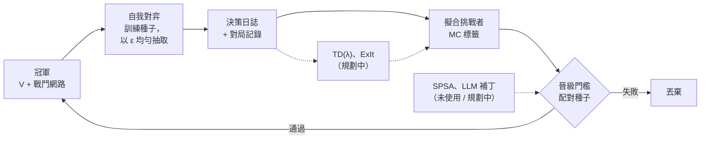

import { Aside, Badge } from '@astrojs/starlight/components';

本章講 AI 中靠學習而不是靠手寫得來的部分，以及讓它們變得更好的循環。學習的東西有兩個：宏觀大腦的價值函數 V，它給戰鬥外的每個局面評分；以及戰鬥網路，它告訴戰鬥搜尋，前瞻到盡頭時的狀態值多少。兩者都從 AI 自己打的對局裡學習。對其中任何一個的改動，只有通過晉級門檻才會取代現行的版本：晉級門檻是在固定種子上、和正在使用的版本做的配對測試。

先讀：[宏觀大腦](/zh-tw/arch/macro-brain/)，了解 V 用在哪裡；[戰鬥大腦：葉節點](/zh-tw/arch/combat-brain/leaf/)，了解戰鬥網路在搜尋裡做什麼。宏觀大腦一章也詳細解釋了 V 的網路和它的訓練標籤（[宏觀大腦：價值網路](/zh-tw/arch/macro-brain/network/)、[宏觀大腦：從風險值到價值](/zh-tw/arch/macro-brain/value/)）；本章連結到那裡而不重複，講的是那裡沒有的內容：戰鬥網路的訓練、整個循環以及它用到或打算用的方法，還有檔案和腳本。

<Aside title="狀態">

已實作：V 的訓練器 `learn/v/`（`v.train`）和戰鬥網路的訓練器 `learn/combat/`（`combat.train`），兩者都用蒙地卡羅目標（每個決策都以它那一局實際的結局作標籤）；自我對弈的均勻抽取探索（`run --explore ε`）；`learn/gauntlet.py`，一個 V 的對局的報告和配對門檻；`learn/challenge.py`，它驅動模擬器的序列門檻；`learn/bosslab.py`，頭目戰的標籤。規劃中、尚未實作：TD(λ) 目標、專家迭代、LLM 補丁提案、獎勵塑形、特權訓練，以及均勻抽取之外對抗局部最佳解的機制（[循環](/zh-tw/arch/learning/loop/)）。

</Aside>

## 1. 學到什麼

**宏觀大腦的 V**。在戰鬥外，宏觀大腦把一個決策的每個選項都打一遍，看緊接在它之後的局面（*後狀態*），選後狀態被 V 估得最高的那個選項（[宏觀大腦 §2](/zh-tw/arch/macro-brain/#sec-2)）。V 是一個神經網路，讀這一局是什麼（它的卡牌、遺物、藥水、幕和頭目的 id，以及前方的地圖）和六個原始數字，傳回一個數字，即從這裡贏下這一局的機率（[宏觀大腦：從風險值到價值 §1](/zh-tw/arch/macro-brain/value/#sec-1)）。同一個 V 給每種決策介面（surface）評分，所以一張牌、一件遺物、一次回血和地圖上的一條路線都在同一個尺度上比較，不需要手寫的換算比例。

**戰鬥網路**。戰鬥搜尋往前看一個回合或一整場戰鬥，然後必須說出它走到的狀態值多少：這就是它的*葉節點價值*。戰鬥網路讀一個回合的開始，預測戰鬥會怎樣結束：死亡，或者還要失去多少比例的最大生命值（分成 50 個桶），以及每瓶持有的藥水在勝利後已經不在的機率（[戰鬥網路](/zh-tw/arch/combat-brain/network/)、[戰鬥大腦：葉節點 §4](/zh-tw/arch/combat-brain/leaf/#sec-4)）。它的訓練見[訓練戰鬥網路](/zh-tw/arch/learning/combat-net/)。

**兩種單位**。V 的單位是這一局的勝率。戰鬥葉節點保留自己的單位：它用手設的數字給網路的結局定價（[戰鬥大腦：葉節點 §5](/zh-tw/arch/combat-brain/leaf/#sec-5)）。

**策略是學出來的，不是寫出來的**。兩個網路裡都沒有任何手寫的打法：沒有哪張牌被說成好牌，也沒有列出哪個怪物的出招順序。手寫的是遊戲規則（模擬器跑的是真實的遊戲）和目標（一局怎樣結束、一場戰鬥怎樣結束）。V 從零學起，從 AI 自己的對局學，不從人類的對局學。

**只在離線時學習**。訓練在獨立的行程裡、在其他機器上、從記錄下來的對局進行。線上時，每個決策都是搜尋加上學到的價值；決策進行中沒有任何東西在學習。語言模型原本只參與離線環節，提出補丁交給晉級門檻評判，從不參與決策；這一部分還在規劃中（[循環 §7](/zh-tw/arch/learning/loop/#sec-7)）。

## 2. 一張圖看循環

這個循環仿照開源西洋棋引擎 Stockfish 的開發方式。Stockfish 的開發者提出一個改動，一個分散式框架（Fishtest）讓改動後的引擎和目前的引擎對下幾千盤，一個序列檢定（SPRT）只在改動可量測地更強時才接受它；它的評估網路用引擎自己對局裡的局面訓練，搜尋參數則用 SPSA 調校。這裡的核心想法相同：**自我對弈、擬合、門檻**。目前最好的版本，即*冠軍*，自己打對局；新版本，即*挑戰者*，擬合這些對局；只有在從未用來訓練的種子上贏下配對比較，挑戰者才取代冠軍。

1. **自我對弈**。冠軍在訓練種子上打對局，其中 ε 比例的宏觀決策隨機抽取，讓資料呈現其他選項會導向什麼（[循環 §2](/zh-tw/arch/learning/loop/#sec-2)、[§9](/zh-tw/arch/learning/loop/#sec-9)）。
2. **擬合**。在這些對局上訓練一個新的 V（或戰鬥網路）。每個決策的標籤是它那一局實際的結局，即*蒙地卡羅*目標（[循環 §3](/zh-tw/arch/learning/loop/#sec-3)）。TD(λ) 和專家迭代還會從搜尋算出的價值中學習，它們在規劃中（[§4](/zh-tw/arch/learning/loop/#sec-4)、[§5](/zh-tw/arch/learning/loop/#sec-5)）。
3. **門檻**。挑戰者在固定的評估種子上打，逐個種子和冠軍的對局配對，只有差值明顯大於零才通過（[循環 §8](/zh-tw/arch/learning/loop/#sec-8)）。

一*代*就是這個循環轉一圈（[宏觀大腦：自我對弈 §4](/zh-tw/arch/macro-brain/selfplay/#sec-4)）。

## 3. 哪些已實作，哪些在規劃中

| 部分 | 狀態 | 位置 |
|---|---|---|
| 自我對弈：整局，以 ε 均勻抽取 | 已實作 | `run --explore`，[循環 §2](/zh-tw/arch/learning/loop/#sec-2) |
| 按 V 的估值的對數或搜尋的估值做 softmax 探索 | 已實作；L0 的在 `v7g2` 裡和均勻抽取並用 | `run --macro-explore`、`--combat-explore`，[循環 §9](/zh-tw/arch/learning/loop/#sec-9) |
| V 的訓練，蒙地卡羅標籤 | 已實作 | `learn/v/`，[宏觀大腦：從風險值到價值 §5](/zh-tw/arch/macro-brain/value/#sec-5) |
| 戰鬥網路的訓練，蒙地卡羅標籤 | 已實作 | `learn/combat/`，[訓練戰鬥網路](/zh-tw/arch/learning/combat-net/) |
| V 的頭目戰標籤（頭目模擬戰、門前狀態） | 已實作，未使用 | `learn/bosslab.py`，[參考 §9](/zh-tw/arch/learning/reference/#sec-9) |
| 反事實分叉 | 已實作為指令；目前沒有訓練器讀它們 | `fork`、`afterstates`，[循環 §10](/zh-tw/arch/learning/loop/#sec-10) |
| 晉級門檻：模擬器的 SPRT，以及勝場的配對下界 | 已實作 | `gate`、`learn/challenge.py`、`learn/gauntlet.py`，[循環 §8](/zh-tw/arch/learning/loop/#sec-8) |
| TD(λ) 目標 | <Badge text="規劃中" variant="caution" /> | [循環 §4](/zh-tw/arch/learning/loop/#sec-4) |
| 專家迭代（以搜尋的估值作標籤，學到的先驗） | <Badge text="規劃中" variant="caution" /> | [循環 §5](/zh-tw/arch/learning/loop/#sec-5) |
| 用 SPSA 調校手設的權重 | 未使用 | [循環 §6](/zh-tw/arch/learning/loop/#sec-6) |
| LLM 補丁提案 | <Badge text="規劃中" variant="caution" /> | [循環 §7](/zh-tw/arch/learning/loop/#sec-7) |
| 基於位能函數的獎勵塑形、特權訓練、對抗局部最佳解的存檔庫 | <Badge text="規劃中" variant="caution" /> | [循環 §11](/zh-tw/arch/learning/loop/#sec-11)–[§13](/zh-tw/arch/learning/loop/#sec-13) |

## 4. 本章

- [訓練戰鬥網路](/zh-tw/arch/learning/combat-net/)：簡述它讀什麼、預測什麼，它的樣本、標籤和訓練，以及它的量測結果。
- [循環](/zh-tw/arch/learning/loop/)：自我對弈、蒙地卡羅、TD(λ)、專家迭代、SPSA、LLM 補丁和晉級門檻、探索、信用分配、獎勵塑形、特權資訊和局部最佳解，每一項都附上已實作的部分。
- [參考](/zh-tw/arch/learning/reference/)：算力、資料目錄、清單、帳本、權重名稱、網路檔案、C# 推論、每個腳本及其選項、測試和未解決的問題。

冠軍見[評估：冠軍與基線 §1](/zh-tw/arch/evaluation/champions/#sec-1)。本專案打兩個網路，V v8-2 和戰鬥網路 c8-2，建立在五個角色共用的一個結構上，權重按角色分開；網路和資料的歷史在帳本 `eval/silent/ledger.md` 裡。
