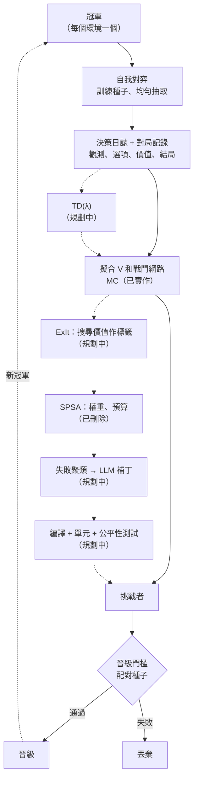

import { Aside, Badge } from '@astrojs/starlight/components';
import TdTargets from '../../../../../components/book/TdTargets.svelte';
import ShapingToy from '../../../../../components/book/ShapingToy.svelte';

循環把冠軍自己打的對局變成一個挑戰者，再由晉級門檻決定挑戰者能否取代冠軍。本頁按設計時的樣子一步一步走過這個循環，並逐步說明哪些已經實作。有幾步建立在強化學習的方法上（蒙地卡羅目標、TD(λ)、專家迭代、SPSA、獎勵塑形）；每種方法都在第一次出現的地方從頭解釋。學的是什麼，請先讀[學習](/zh-tw/arch/learning/)；計畫 v6 實際執行時循環在宏觀大腦這一邊的樣子，見[宏觀大腦：自我對弈](/zh-tw/arch/macro-brain/selfplay/)。

<Aside title="狀態">

已實作：以均勻抽取探索的自我對弈、V 和戰鬥網路的蒙地卡羅擬合，以及三種晉級門檻（模擬器的 SPRT，透過 `learn/challenge.py` 執行；以及 `learn/gauntlet.py` 在進度或勝局上的配對下界）。已刪除：SPSA。規劃中：TD(λ)、專家迭代、PCR 和 Reanalyse、LLM 補丁提案、基於位能函數的獎勵塑形、特權訓練、MAP-Elites 存檔庫、Thompson 取樣和反向課程。

</Aside>

## 1. 設計時的循環

| 步驟 | 做什麼 | 狀態 |
|---|---|---|
| 自我對弈（[§2](#sec-2)） | 冠軍在訓練種子上打對局，帶探索 | 已實作 |
| 擬合（[§3](#sec-3)） | 用對局的結局訓練 V 和戰鬥網路 | 已實作：蒙地卡羅 |
| TD(λ)（[§4](#sec-4)） | 把結局和 V 之後的價值混在一起的目標 | <Badge text="規劃中" variant="caution" /> |
| ExIt（[§5](#sec-5)） | 以搜尋的價值作為 V 和先驗的標籤 | <Badge text="規劃中" variant="caution" /> |
| SPSA（[§6](#sec-6)） | 靠實際對局來調手設的數字 | 已刪除 |
| LLM 補丁（[§7](#sec-7)） | 從聚類後的失敗提出程式碼改動 | <Badge text="規劃中" variant="caution" /> |
| 晉級門檻（[§8](#sec-8)） | 只有在配對種子上贏過冠軍的挑戰者才保留 | 已實作 |

循環離線執行，所在的行程和機器都與任何決策分開；按設計，LLM 從不參與決策。每一代都要過晉級門檻。AlphaZero 去掉了門檻，因為它的訊號乾淨、對局又多；這裡一局的變異數大，局數又少。

## 2. 自我對弈

自我對弈時，冠軍自己在*訓練種子*上打對局；訓練種子與晉級門檻所用的評估種子分開（[參考 §5](/zh-tw/arch/learning/reference/#sec-5)）。每一局都是在模擬器裡無頭執行的真實遊戲：宿主行程執行這一局唯一一個活的遊戲，工作行程池負責搜尋（[模擬器：整局](/zh-tw/arch/simulator/runs/)、[模擬器：工作行程池](/zh-tw/arch/simulator/pool/)）。每個決策都寫進決策日誌，包括觀測、選項和大腦給的價值（[Harness：決策日誌](/zh-tw/arch/harness/decision-log/)）；每局的結局寫進它的對局記錄，連同每場戰鬥怎麼結束（[評估：指標、種子與報告 §8](/zh-tw/arch/evaluation/metrics/#sec-8)）。兩者按對局 id 對上，就是訓練資料。

自我對弈打的內容隨計畫而變：

| 自我對弈 | 對局 | 戰鬥 | 打的 V | 資料 |
|---|---|---|---|---|
| g0–g2（2026-10-27/28） | 整局 NoSL | PIMC 用 `LeafValue`，之後用 c2 | V v0 | 1,198 局 |
| g3（2026-10-28） | 整局 SL | SL 規劃器用 c2 | n2-b0.03 | 419 局 |
| 頭目連戰試點（2026-10-29） | 每場戰鬥一開始就判贏；頭目在門前開打 | SL 規劃器，低預算 | 第二批是 pure-1-g（第一批的不在帳本裡） | 門前狀態，只作標籤 |
| 計畫 v6（2026-10-29/30） | 菁英連戰：怪物一開始就判贏，菁英和頭目真打 | SL 規劃器，低預算 | pure-1-g、v6-1、v6-2 | 三代共 26,683 局 |
| 計畫 v7（2026-10-30 起） | 整局 SL | SL 規劃器，低預算 | v6-3-2 | 第 1 代正在打 |

**探索**。自我對弈故意抽取一部分決策，而不選 V 的最佳，讓資料能看到其他選項會帶來什麼（[§9](#sec-9)）。

**最新的一代**。從計畫 v6 的第三代起，網路只用最新一代的對局訓練：較弱的 V 打出的對局，給狀態的標籤會比冠軍現在來打時低（[宏觀大腦：自我對弈 §3](/zh-tw/arch/macro-brain/selfplay/#sec-3)）。每一代的對局是每個探索檔一個限時作業，共用一個截止時間，打的過程中可以挪動（[參考 §1](/zh-tw/arch/learning/reference/#sec-1)）。

**預算**。自我對弈讓 SL 規劃器用它的低預算（`--effort low --nodes 150 --beam 4 --easy-beam 0 --loss-plans 0 --replan 0`），晉級門檻則用冠軍的中預算（[SL 規劃器：預算、開銷與結果 §2](/zh-tw/arch/sl-planner/budget/#sec-2)）。

## 3. 擬合：蒙地卡羅目標

訓練價值函數，每個訓練狀態都需要一個目標：它在那裡本該預測出的數字。最簡單的是**蒙地卡羅（MC）目標**：把這一局打到底，用它真實的結局 $G$（贏為 1，輸為 0；或用代理目標，即到達的層數）當作其中每個決策 $k$ 的標籤，

$$
y_k = G .
$$

對這一局其餘部分的運氣取期望，它恰好就是決策 $k$ 的狀態在打這局的策略下的價值，所以這個目標是*無偏的*。但它*雜訊大*：一局的運氣，也就是決策 $k$ 之後的每一次抽取和每一場戰鬥，同樣落在這一局的所有決策上，而一局的宏觀決策（計畫 v6 第一代平均每局 108 個，第三代 146 個，本書的範例對局 181 個；[宏觀大腦 §1](/zh-tw/arch/macro-brain/#sec-1)）全都共享它唯一的結局。

**實作上，兩個訓練器都只用 MC 目標**。V 的目標是每局結束所在那一層的遮罩風險值標籤（[宏觀大腦：從風險值到價值 §2](/zh-tw/arch/macro-brain/value/#sec-2)）；戰鬥網路的目標是每場戰鬥怎麼結束（[訓練戰鬥網路 §3](/zh-tw/arch/learning/combat-net/#sec-3)）。`learn/` 裡沒有任何東西在價值上自舉。有兩項措施壓住 MC 的雜訊：

- **每局權重相同**，不管它有多少個決策（每個樣本的權重是它那一局決策數的倒數），留出的對局也按局劃分，而不是按決策；
- **第二個輸出頭**用更稠密的目標，即接下來六場戰鬥各自的生命消耗，來塑造主幹（[價值函數 §9](/zh-tw/arch/learning/value/#sec-9)）。設計裡有一條來自 r33hab（一個先前的 STS2 專案）的規則：絕不在同一次反向傳播裡混合生命值目標和勝負目標。純 V 的訓練確實混合了兩者，第二個輸出頭的平方誤差以權重 3 加進風險值的損失（`learn/v/train.py:376`）；在試過的每個訓練種子上，它都降低了留出損失（[實驗紀錄 §3](/zh-tw/arch/learning/experiments/#sec-3)）。

**代理目標只能透過晉級門檻被接受**。到達層數這類稠密目標只是權宜之計（[價值函數 §2](/zh-tw/arch/learning/value/#sec-2)）。它帶來的改動，只有通過以真實結局判定的晉級門檻、並且在多個訓練種子上重現之後才被接受：在一項摜蛋研究（arXiv 2610.29411）裡，有一個譜系看起來很強，而它預先登記的 5 個重現種子沒有一個是正的。

## 4. TD(λ) 目標 <Badge text="規劃中" variant="caution" />

**時序差分（TD）學習**把真實結局的一部分換成 V 自己的估計。一局的狀態 $s_0, s_1, \dots, s_{N-1}$ 就是它的宏觀決策；結束之前沒有任何獎勵，結束時的結局是 $G$。把 V 在決策 $k$ 的價值記作 $V_k$。於是：

- **TD(0)**，一步：$y_k = V_{k+1}$，而 $y_{N-1} = G$。標籤就是 V 自己在一個決策之後的看法。它的變異數小（只有一步的運氣），但會被 V 的誤差帶偏。
- **$n$ 步**：$y^{(n)}_k = V_{k+n}$，一旦 $k + n \ge N$ 就取 $G$。
- **TD(λ)** 對所有的 $n$ 取平均，每個以 $(1-\lambda)\lambda^{n-1}$ 加權，所有 $n \ge N-k$ 的權重都歸給 $G$。這就是 *λ 回報*：

$$
G^\lambda_k = (1-\lambda)\sum_{n=1}^{N-1-k} \lambda^{n-1}\, V_{k+n} \;+\; \lambda^{N-1-k}\, G,
\qquad
G^\lambda_k = (1-\lambda)\, V_{k+1} + \lambda\, G^\lambda_{k+1}, \quad G^\lambda_{N-1} = G .
$$

$\lambda$ 介於 0 和 1 之間，決定混合的比例。$\lambda = 1$ 給出 $G^\lambda_k = G$，即純 MC；$\lambda = 0$ 給出 TD(0)。介於兩者之間時，標籤大約往前看 $1/(1-\lambda)$ 個決策：$\lambda = 0.9$ 時約十個。重點在變異數：標籤往前看得越遠，帶的運氣就越多，而一個決策的標籤應該主要反映它之後不久發生的事。TD 也在每一步轉移上給出學習訊號，這有助於信用分配（[§10](#sec-10)）。

下圖在本書的範例對局上計算這些目標：v6-3-2 在種子 `0SSL7NS01MU6` 上打的那一局整局 SL，在第 48 層獲勝（[宏觀大腦 §1](/zh-tw/arch/macro-brain/#sec-1)）。每個點是它 181 個宏觀決策之一的 λ 回報，與 V 自己的價值對照。

<TdTargets client:visible lang="zh-TW" />

這一局贏了，所以它的 MC 目標 49 遠高於 V 早期的價值：V 從 33 開始，而 MC 標籤把整局的運氣都記到每個早期決策頭上（前 60 個決策平均比 V 自己的價值高 12.1）。$\lambda = 0.9$ 時，這些標籤平均只比 V 高 1.2：大部分功勞歸給 V 的價值上升之前的那些決策，也就是第 1 幕和第 2 幕的頭目前後（第 16–17 層和第 32–33 層）。$\lambda = 0$ 時，每個標籤就是 V 的下一個價值。

**規劃的內容**。按原計畫，V v1 要用 MC 和 TD(λ) 混合的目標訓練，戰鬥輸出頭則在一場戰鬥之內用 TD(λ ≈ 0.95)（[訓練戰鬥網路 §7](/zh-tw/arch/learning/combat-net/#sec-7)）。現在 `learn/` 裡沒有任何東西計算 λ 回報；圖中的目標是在頁面裡計算的（`components/book/td.ts`），並在同樣的 181 個價值上與上面的顯式求和核對過。

## 5. 專家迭代 <Badge text="規劃中" variant="caution" />

**專家迭代**（ExIt）把搜尋當作老師。由 V 引導的搜尋比 V 單獨打得好，因為它會往前看；所以搜尋找到的價值和選擇，就成為下一個 V 的訓練標籤，也成為*先驗*的訓練標籤，先驗是一個告訴搜尋先試哪些動作的策略。更好的 V 讓下一次搜尋更強，如此循環。AlphaZero 是最知名的例子。

- **公平的老師**。老師是同一環境裡的搜尋，遵守該環境的資訊規則。不對全知的老師做行為複製（訓練模型去模仿老師的動作）：這在好幾個專案裡都失敗了。
- **戰鬥的策略目標**是 $\mathrm{softmax}(\text{prior logits} + c \cdot \mathrm{minmax}(Q))$，而不是搜尋的造訪次數。$Q$ 是每個第一步動作在各個世界上的平均價值，PIMC 已經算出來了；minmax 把一個決策的 $Q$ 縮放到 $[0, 1]$；先驗是均勻的時候，先驗 logits 為 0；$c$ 按這個目標對預算大得多的搜尋所做選擇的預測好壞（對數似然）來調。造訪次數不適合當目標：根上的共同亂數會把它們壓平（r33hab），而用 mctx（一個 Gumbel MuZero 函式庫）的變換，在我們每個世界 300 個節點下，目標幾乎是 one-hot。
- **日誌現在為它存了什麼**。決策日誌裡 PIMC 的候選帶著每個第一步動作在每個世界上的價值和花在它上面的節點數（[Harness：決策日誌 §5](/zh-tw/arch/harness/decision-log/#sec-5)），每場戰鬥的結局在對局記錄裡。SL 規劃器負責打 SL 冠軍的戰鬥，它每個候選只記一個價值，不記節點數（`Brain/Combat/SlPlanner.cs:214-215`），所以 SL 的資料沒有逐世界的 Q。
- **兩個前提**。學到的先驗只有在晉級門檻裡贏過均勻先驗之後，才能引導搜尋。學到的葉節點只有同時贏過 `LeafValue` 和推演到戰鬥結束（rollout）之後，才能取代 `LeafValue`：在 r33hab 裡，15 次模擬時，價值輸出頭比 rollout 多掉 10.6 點生命。c2 通過了其中前一半（對 `LeafValue`，[訓練戰鬥網路 §5](/zh-tw/arch/learning/combat-net/#sec-5)）；rollout 葉節點還沒有實作。
- **PCR**（playout cap randomization，來自 KataGo）：25% 的決策用全部預算，提供策略目標；另外 75% 只用四分之一的預算，只提供價值目標。
- **Reanalyse**（來自 MuZero）：每出一個新網路，就有一部分舊局面從種子和軌跡重播，並用新網路重新搜尋，藉此更新它們的策略目標和自舉的價值目標。

## 6. SPSA <Badge text="已刪除" variant="note" />

**SPSA**（simultaneous perturbation stochastic approximation，同時擾動隨機逼近）只靠帶雜訊的結果來調參數。每一步給每個參數抽一個隨機正負號 $\Delta_i = \pm 1$，量出 $\theta + c\Delta$ 和 $\theta - c\Delta$ 兩者的結果 $J$，然後同時挪動所有參數：

$$
\hat g_i = \frac{J(\theta + c\Delta) - J(\theta - c\Delta)}{2c\,\Delta_i}, \qquad \theta \leftarrow \theta + a\,\hat g .
$$

不管參數有多少個，它每一步只需要兩次量測，也不需要梯度，適合那些只能靠打對局來檢驗的權重；Stockfish 就是這樣調它的搜尋的。

`learn/spsa.py` 曾這樣調 V v0 的權重，加 `--param leaf` 時調 PIMC 的葉節點權重（[戰鬥大腦：葉節點 §2](/zh-tw/arch/combat-brain/leaf/#sec-2)）：每一步兩邊都在同一批新的訓練種子（或測試集戰鬥）上打。調出的權重沒有晉級過，這個腳本已在 `9b9d170` 刪除（它留在 git 的歷史裡）。現在沒有工具調這些權重：策略交給網路，`LeafValue` 將由學到的價值取代，而不是手調。搜尋本身的參數（預算、K、束寬、閾值）原本也要這樣調；一個都沒有調。

## 7. LLM 補丁提案 <Badge text="規劃中" variant="caution" />

輸入會是預先聚合的失敗聚類（按怎麼輸、在哪裡輸分組的對局）加上死亡摘要；輸出是 K 個候選補丁（特徵、剪枝規則、參數）。候選先經過編譯、單元測試和公平性測試的篩選，再像任何挑戰者一樣過晉級門檻。只透過專案的 LLM 閘道使用便宜的模型，而且絕不用在決策裡。這些都還沒有實作。

## 8. 晉級門檻

晉級門檻是挑戰者要取代冠軍必須通過的檢驗：它在從沒訓練過的種子上打，逐個種子與冠軍的對局配對，讓一局的運氣大部分由兩邊共享、在差值裡抵消（共同亂數，[評估：晉級門檻 §2](/zh-tw/arch/evaluation/gates/#sec-2)）。帶探索的挑戰者會被拒絕：探索是給自我對弈用的（`SimWorker/Commands/EvalCommands.cs:92-93`）。已實作的晉級門檻有三種。

**模擬器的 SPRT**（`gate`，`Harness/Gate.cs`；計畫 v6 之前的每一次晉級門檻）。在 `promotion-1` 的 200 個種子上做的序貫檢定，一出現明確的判定就停：按層數（δ = 1.5 層）或按勝局，α = β = 0.05，或者用 `--not-worse` 做非劣效檢定（[評估：晉級門檻 §6](/zh-tw/arch/evaluation/gates/#sec-6)）。`learn/challenge.py` 帶挑戰者過這道門檻：它把冠軍的種子集分批打（預設每批 40 個），每批之後跑一次門檻，判定為失敗或作廢就停下，通過之後把種子集剩下的打完並讓挑戰者晉級，也就是改寫冠軍檔案、重建排行榜（[參考 §9](/zh-tw/arch/learning/reference/#sec-9)）。V v2 的網路和 c2 都是這樣過門檻的。

**進度上的配對下界**（`learn/gauntlet.py --against`，計畫 v6）。在菁英連戰裡，用它的 500 個評估種子、以訓練預算來打：對種子 $i$，$d_i$ 是挑戰者的進度減去冠軍的進度；在兩邊都打完的種子上有 $n$ 對時，

$$
\bar d = \frac1n \sum_i d_i, \qquad \mathrm{SE} = \frac{\mathrm{sd}(d)}{\sqrt n}, \qquad \text{promote if } \bar d - 1.645\, \mathrm{SE} > 0,
$$

也就是 95% 單側下界高於 0（`learn/gauntlet.py:136-161`；[宏觀大腦：自我對弈 §4](/zh-tw/arch/macro-brain/selfplay/#sec-4)）。

**勝局上的配對下界**（同一份程式碼用在整局上，計畫 v7）。$d_i$ 是 1 − 0、0 − 1 或 0：挑戰者是否贏下種子 $i$，減去冠軍是否贏下。在 `promotion-1-500` 的 500 個種子上、用冠軍的中預算，勝局平均差的下界高於 0 時挑戰者通過；在 500 個種子上，這大約要多贏 2–3 個百分點；報告也對層數做配對。已在 v6-3-2 和 v6-2 的整局報告上核對：300 對，贏 23 局對 1 局，勝局 +0.073 ± 0.016，下界 +0.047，層數 +2.20 ± 0.62（提交 `7ce03bd`）。

**晉級**。模擬器的門檻在通過時寫冠軍檔案。`learn/gauntlet.py` 只給出判定：計畫 v6 和 v7 的晉級都是手動改寫冠軍檔案，而 v6-3-2 是憑它的整局報告、沒有過門檻就成為兩個冠軍的 V（提交 `dc4ee30`；[評估：冠軍與基線 §2](/zh-tw/arch/evaluation/champions/#sec-2)）。晉級門檻的 A/A 測試，即讓冠軍對自己，量出在毫無提升可言時門檻有多常通過，還在規劃中（[參考 §11](/zh-tw/arch/learning/reference/#sec-11)）。

## 9. 探索

V 只從對局實際做過的事裡學。如果自我對弈總是選 V 最好的選項，資料就永遠看不到其他選項會帶來什麼，V 也永遠發現不了自己對它們估錯了。所以自我對弈有時會故意選另一個選項；怎麼挑那個選項很重要（[宏觀大腦：自我對弈 §2](/zh-tw/arch/macro-brain/selfplay/#sec-2)，有一張以真實決策畫的圖）。

**均勻抽取**（`run --explore ε`，已實作，提交 `7a9f845`；`Uniform`，`Brain/Exploration.cs:47-65`）是菁英連戰以來 V 的探索方式。以機率 ε，一個宏觀決策的答案在它的 $n$ 個選項之間均勻抽取，不管 V 怎麼說；否則 L0 選 V 的最佳 $a^\ast$：

$$
P(a) = (1-\varepsilon)\,[a = a^\ast] + \frac{\varepsilon}{n} .
$$

它涵蓋戰鬥之外的每個決策：卡牌獎勵在它的牌和略過之間的結果（抽到略過就從不打開，抽到一張牌就打開並拿取）；選牌提示的選取（先均勻抽選幾張，再抽選哪些）；其他每個畫面的選項，但藥水欄的選項，以及會回到已經決定過的狀態的選項除外。ε 每局固定。抽到什麼既不取決於 V，也不取決於這一局有多強，所以它的結果是關於這些選項的因果證據，而且每一種決策被抽到的頻率都一樣。每個抽出的答案在日誌裡都標為 `explored`（[Harness：決策日誌 §6](/zh-tw/arch/harness/decision-log/#sec-6)），冠軍的名字以 `eps ε` 結尾。

- **檔位**。一代的對局分成三個 ε 檔，各佔三分之一：計畫 v6 的第 1–2 代是 1.0、0.5 和 0.15，從它的第 3 代起以及在計畫 v7 裡是 0.3、0.15 和 0.05。
- **標籤帶著之後的抽取**。一個決策的標籤是它那一局怎麼結束，包括它之後的抽取，而 V 不知道這一局的 ε；同一個狀態在探索較多的對局裡會被標得較低。每局設一個*切點*就能消除這一點（切點之前抽取，切點之後用 V 的最佳，只在切點之後的決策上訓練，就像 AlphaGo 的價值網路每盤只用一個局面來訓練）；這還沒有做，計畫 v7 再次把它延後（[宏觀大腦：弱點與下一步 §4](/zh-tw/arch/macro-brain/next/#sec-4)）。
- **檢查**。自我對弈中，在有兩個或更多選項的決策裡，`explored` 決策的比例應該約為 ε：計畫 v7 的第一次測試裡，2,347 個決策上 ε = 0.15 時是 0.161。

**softmax 探索**（已實作；`Softmax`，`Brain/Exploration.cs:9-40`）以如下機率抽取每個選項

$$
P(a) = \frac{\exp\big((v_a - v_{a^\ast})/T\big)}{\sum_b \exp\big((v_b - v_{a^\ast})/T\big)}
$$

這是按大腦給各選項的價值計算，溫度 $T$ 以價值的單位計：接近最佳的選項常被嘗試，差的很少，一樣好的機會均等。抽到的選項比最佳低超過 $T/100$ 時才算作探索，更接近的視同平手。`run --macro-explore T` 讓 L0 在戰鬥外的每個決策上這樣做，包括選牌提示（每次選取以及是否停下），按 V 的價值；`--combat-explore T` 則用於 PIMC 的第一步動作，按搜尋的候選，只在自我對弈搜尋的根上。這等同於給 $v/T$ 加上 Gumbel 雜訊再取最大。冠軍的名字會顯示它（`l0 explore T`、`pimc c2 explore T`）。

- 菁英連戰之前，V 的探索用的就是它，後來 V 的資料改用均勻抽取：softmax 在 V 的選項彼此接近的地方（選牌）探索得遠比選項拉開的地方（休息處、商店）多，而且它跟著 V 自己的信念走，所以資料裡永遠沒有這些信念的反例（用 V v0、生命 75% 時，T = 2 的 softmax 選鍛造而不選多值 18 點生命的休息，大約 8,000 次才一次）。
- 它留給較早的作業和戰鬥。`--combat-explore` 需要 `--policy pimc`（`SimWorker/Commands/Args.cs:259`），所以 SL 自我對弈的戰鬥由 SL 規劃器來打，不做任何戰鬥探索。
- **溫度**的單位分別是 V 的和葉節點的，所以兩者一變，溫度就要重選。規則：PIMC 按搜尋自己的價值，每場戰鬥約讓出 1 點生命；L0 取讓約 4–5% 的決策被探索的溫度，只計有兩個或更多合法選項的決策，並且只計抽到比最佳差的選項。給了日誌各決策的選項時，`v.train --afterstates` 報告在哪個溫度下，新網路在留出決策上探索的頻率和打出日誌的大腦一樣（`explore_temperature`，`learn/v/train.py:147-174`）。量出的溫度見[實驗紀錄 §6](/zh-tw/arch/learning/experiments/#sec-6)。

**卡牌抽取**（已刪除）：`run --card-explore P` 曾以機率 P 在卡牌獎勵的牌和略過之間均勻抽取結果；頭目連戰試點就帶著它打。均勻抽取取代了它。

**Thompson 取樣** <Badge text="規劃中" variant="caution" /> 會根據 V 的不確定性為每個選項抽一個可能的價值，選抽到最好的那個，讓一個選項被嘗試的頻率大致等於它真正是最佳選項的機率。V 目前還沒有可供抽取的不確定性估計。

## 10. 信用分配

唯一的獎勵是一局的結局。難點不是缺少訊號，而是*信用分配*（一局的眾多決策裡，是哪些導致了輸贏）和*變異數*（掩蓋任何單個決策效果的運氣）。設計同時對付這兩者：

1. **分層縮短了鏈條**。戰鬥由搜尋解決，它的結果是一個結局分布 $p(k)$：死亡，或者剩餘生命落在第 $k$ 個桶。宏觀的 V 每場戰鬥為它定價一次：開戰時，$u_k$ = 戰鬥之後、生命落在第 $k$ 個桶的後狀態的 V，藥水或遺物改變時重算，另加死亡的價格；葉節點的價值是 $\sum_k p(k)\, u_k$。這樣戰鬥網路就不依賴 V 的版本：新的 V 只需重新定價，而戰鬥和宏觀在同一個尺度上拿生命和其他一切做取捨。於是整局層面的信用只需跨越宏觀決策再加上各場戰鬥的結果。**實作上**，這是 SL 規劃器的 `--leaf-prices v`（`PricedLeaf`，`Brain/Combat/PricedLeaf.cs:16-26`；[戰鬥大腦：葉節點 §5](/zh-tw/arch/combat-brain/leaf/#sec-5)），沒有過晉級門檻，也沒有冠軍用它來打。它把死亡定價為這一局所在的層數，也就是在 `floor` 和 `progress` 單位下 V 對一局在那裡結束的估值（`PricedLeaf.cs:25`）；`win` 網路的估值在 $[0, 1]$ 內，在那裡死亡值 0。
2. **TD(λ)** <Badge text="規劃中" variant="caution" /> 在每一步轉移上給出學習訊號（[§4](#sec-4)）。
3. **輔助獎勵項必須基於位能函數** <Badge text="規劃中" variant="caution" />（[§11](#sec-11)）。
4. **輔助輸出頭**提供稠密的監督，只用於表示：已實作的是第二個輸出頭（[價值函數 §9](/zh-tw/arch/learning/value/#sec-9)）。
5. **變異數**：每道晉級門檻都用共同亂數（已實作），關鍵決策上的反事實分叉（指令已實作，見下），以及反向課程（規劃中，[§13](#sec-13)）。

### 反事實分叉

同類的對局再多，也無法把一個選擇和伴隨它的運氣拆開：在每一局裡兩者都是一起出現的。拆得開的是同一個狀態用兩個選擇、同樣的運氣繼續打下去。**CRN**（共同亂數）：兩條路線用同樣的隨機種子來打，它們共有的運氣就從差值裡抵消了。在一個決策上*分叉*，就是從同一個點出發打它的兩個選項。

決策日誌只保存每個決策之前的對局和選了什麼，所以有兩個模擬器指令會回到那裡。兩者都從種子重播日誌裡的一局，按日誌的答案回答每個決策，戰鬥和選牌提示也一樣，並把每個觀測的雜湊和日誌裡的核對；重播一局約 0.7 s。

- `afterstates --log LOGS --records RECORDS --out FILE [--start I] [--n N] [champion options]` 寫出每個宏觀決策的選項，就像 L0 用冠軍的 V 衡量它們那樣：每個選項的後狀態（它改變的那些整局觀測欄位）和價值，以及 V v0 對它算的特徵（`SimWorker/Commands/Forks.cs:84`）。
- `fork --log LOGS --records RECORDS --out FILE [--per-run 2] [--surfaces map,card_reward,rest,shop] [--act 0] [--max-decisions 20000] [champion options]` 從日誌的每一局裡抽這一幕的 K 個決策，各決策介面輪流，把這一局重播到每個決策，然後從那裡打兩次：一次用 L0 的最佳動作，一次用這個畫面上均勻抽取的另一個動作（不抽藥水動作，每個畫面都有）。兩條分支都由冠軍繼續打到這一幕結束，打過它的頭目。到決策為止，兩條分支共用遊戲的隨機狀態和大腦的種子；決策之後，遊戲的亂數流保持同步，除了選擇讓它們錯開的地方。每個分叉記錄兩條分支的結局（死了還是活著、層數、生命、金幣）以及到達視野邊界時的對局（`Forks.cs:137-145`）。

V v2 的訓練器讀分叉；現在的訓練器都不讀。分叉量出了什麼，見[實驗紀錄 §4](/zh-tw/arch/learning/experiments/#sec-4)和 [§5](/zh-tw/arch/learning/experiments/#sec-5)。

## 11. 基於位能函數的獎勵塑形 <Badge text="規劃中" variant="caution" />

*獎勵塑形*是加上一些小的中間獎勵，讓學習者在一局結束之前就得到回饋。做得太天真，它會改變最佳策略是什麼：每失去一點生命就扣分，會禁止「第 1 幕賣血、換第 3 幕取勝」這樣的打法。**基於位能函數**的形式避免了這一點（Ng、Harada 和 Russell，1999）。一個函數 $\Phi$ 給每個狀態評分，從 $s$ 走到 $s'$ 這一步的獎勵是

$$
F(s, s') = \Phi(s') - \Phi(s), \qquad \Phi(\text{end of run}) = 0 .
$$

整局加起來，這些獎勵會*逐項相消*（telescope）：每個中間項都抵消，總和是 $\Phi(\text{end}) - \Phi(s_0) = -\Phi(s_0)$，從同一個起點出發的每種打法都一樣。所以任何策略塑形後的回報，就是它真實的回報減去同一個常數，最佳策略不變；Ng、Harada 和 Russell 證明了，對每一個任務都有這種保證的，只有基於位能函數的項。終止狀態的位能對每一種結局都必須相同（這裡是 0）；否則總和就會取決於這一局怎麼結束。

<ShapingToy client:visible lang="zh-TW" />

`learn/` 裡沒有任何東西做獎勵塑形：V 的標籤只有結局。等塑形項實作時，檢驗它們精確逐項相消的測試也要一起加上（[參考 §11](/zh-tw/arch/learning/reference/#sec-11)）。

## 12. 特權資訊 <Badge text="規劃中" variant="caution" />

*特權資訊*是玩家看不到的隱藏狀態：抽牌順序、怪物排定的招式、亂數流。專案的公平遊戲規範（一份本地筆記 `tmp/notes/fair-play-spec.md`，不在 git 裡）允許在訓練時使用它，只要部署的策略只讀觀測（[環境：資訊與節點](/zh-tw/arch/environments/information/)）：

- **神諭評論家**（oracle critic）是一個只在訓練時使用的價值分支，它會看到隱藏狀態，以降低目標的變異數；部署的只有觀測分支；
- **反事實標籤**：在同一個決策上用同樣的隨機性分叉，兩條路線都打到底，得到差值的無偏標籤（[§10](#sec-10)）；
- 這一切都只存在於離線管線裡，所在的組件和行程都與決策行程分開。

現在沒有訓練器讀隱藏狀態：V 讀整局觀測（`learn/v/data.py`），戰鬥網路讀觀測（`learn/combat/data.py`）。

## 13. 局部最佳解

自我提升的循環可能停在*局部最佳解*：一種任何小改動都會讓它變差的打法，而一種截然不同的打法其實會贏得更多（例如永遠打得保守）。下面這些機制用來對抗它：

| 機制 | 作用 | 狀態 |
|---|---|---|
| 價值目標只用一局的結局 | 生命值多少是從資料學出來的，不是設定的 | 已實作 |
| 均勻抽取 | 每一種決策都會被嘗試，與 V 無關（[§9](#sec-9)） | 已實作 |
| 對決策做 softmax 或 Thompson 取樣 | 按 V 認為選項有多好、或可能有多好的比例來嘗試它們 | softmax 已實作；Thompson 規劃中 |
| 反事實實驗室 | 在抽樣出的關鍵決策上，用 CRN 分叉兩條路線並都打到底，得到無偏的差值；檢驗「第 1 幕賣血」這類假設（[§10](#sec-10)） | 指令已實作；沒有訓練器讀分叉 |
| 反向課程 | 先在接近結尾的情境上訓練（頭目戰前的快照），那裡結局近、訊號清楚，再把起點往前移 | 規劃中；頭目連戰試點的門前狀態最接近 |
| 種群 / 存檔庫 | 每個風格描述符一個冠軍（MAP-Elites），不會坍縮成單一風格 | 規劃中 |
| 保守性監控 | 打的菁英數、略過率、到頭目時的生命、囤積金幣和藥水（[評估：指標、種子與報告 §3](/zh-tw/arch/evaluation/metrics/#sec-3)） | 部分：`learn/gauntlet.py` 報告菁英以及休息、地圖和商店的選擇；對局報告列出菁英、略過和金幣 |
| 反常識假設 | 人或 LLM 的想法 → 受約束的策略變體 → 在模擬器裡做 A/B；結果拿回來討論 | 規劃中 |

- **MAP-Elites** 保留一個存檔庫，而不是單一的最佳策略。每個策略按它的*風格描述符*（幾個描述它怎麼打的數字，例如每局打的菁英數和略過的牌數）放進一個格子，每個格子保留自己的最佳。不是最佳的風格仍能存活，種群就不會坍縮成單一風格。
- **模擬器 A/B**：在模擬器裡用同一組種子打兩個策略變體並比較結果，就像晉級門檻做的那樣。
