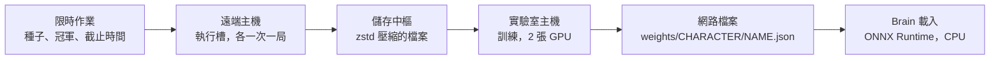

import { Badge } from '@astrojs/starlight/components';
import NetFileAnatomy from '../../../../../components/book/NetFileAnatomy.svelte';

本頁供查閱。前面的頁面解釋學習循環；這一頁列出它的機制。所有內容都對照撰寫本頁時那個提交的程式碼核對過（`learn/`、`src/Sts2Ai.Brain`、`src/Sts2Ai.SimWorker`、`weights/`、`eval/`）；程式碼若有不同說法，以程式碼為準。Python 檔案的路徑相對於儲存庫，C# 路徑相對於 `src/Sts2Ai.*`。

## 1. 算力

- **模擬**。模擬器靠多行程擴展：8 個行程約 1,860 場戰鬥/秒，單一行程是 275 場（[模擬器：戰鬥 §7](/zh-tw/arch/simulator/combat/#sec-7)）。以低預算，一局整局 SL 在一台主機上佔一個執行槽 43–52 s，在另一台上 83 s；一局菁英連戰 45–53 s（[實驗紀錄 §11](/zh-tw/arch/learning/experiments/#sec-11)）。自我對弈和晉級門檻同時在幾台遠端主機上跑。
- **限時作業**。一個作業拿到的是截止時間，而不是局數，種子也給得比打得完的多；每台主機到截止時間就停下，作業就是已經打完的那些。從 `4c36cad` 起，截止時間是每台主機上的一個檔案 `~/sts2/deadline/NAME.txt`（一行註解，然後一個時間）；用同一個 `NAME` 啟動的作業共用它，所以改一次就能挪動一代的所有作業（計畫 v7：三個檔都用 `DEADLINE=v7gN`）。每個執行槽在每批之前讀它，對局進行中則由一個監看程式每 10 s 讀一次；到截止時間還在打的對局會被結束並丟棄，所以只保留完整打完的對局。作業怎麼啟動、挪動、停止和取回，寫在專案技能 `.claude/skills/fleet/SKILL.md` 裡；SL 自我對弈、晉級門檻和評估怎麼跑（選項、探索、檢查），寫在另一個技能 `.claude/skills/sl-selfplay/SKILL.md` 裡。
- **資料去哪裡**。作業結束時，每台主機把它的檔案用 zstd 壓縮後送到一台儲存主機（日誌縮小 40–80 倍）。這些檔案在一台有兩張 RTX 4080 的實驗室主機上解壓、分析並用來訓練，每張 GPU 跑一個訓練；只有結果（權重、報告文字）回到開發機，開發機負責建置、測試和提供大腦服務。在實驗室主機上，訓練器用從 `git archive REV learn/` 建立的 uv 虛擬環境執行，所以一次訓練的程式碼就是一個提交。
- **訓練**用 Python 和 PyTorch，有空閒的 GPU 時在 GPU 上跑（`device = "cuda" if torch.cuda.is_available()`）。推論用 C#，在 CPU 上，在決策行程和工作行程裡（[§8](#sec-8)）。

## 2. `learn/` 專案

`learn/` 是循環的 Python 專案，用 uv 管理（`learn/pyproject.toml`、`uv.lock`）：`sts2-learn` 0.1.0，Python ≥ 3.12，相依套件 loguru ≥ 0.7.3、onnx ≥ 1.23.2、torch（來自 PyTorch 的 CUDA 12.8 索引）和 typer ≥ 0.27.3；開發用 pytest ≥ 9.1.1 和 ruff ≥ 0.17.3（行長 120，規則 E、F、W、I、B、UP）。在 `learn/` 裡用 `uv run python -m v.train …` 或 `uv run python gauntlet.py …` 執行腳本。

**慣例**（`learn/common.py`）：

- 除了 `bosslab.py`，每個腳本都有一個 Typer 指令，說明文字就是它的 docstring（`common.app`，`:25-27`），所以 `--help` 顯示的是 docstring。
- 日誌透過 loguru 寫到 stderr，級別由 `LOG_LEVEL` 決定（預設 INFO），格式是 `HH:mm:ss LEVEL message`；stdout 只輸出結果，報告是一行 JSON（`common.run`，`:30-42`）。
- `LearnError`（輸入有錯、檔案擋路、模擬器失敗）讓腳本只印一行就以結束代碼 1 結束；其他任何錯誤都是 bug，帶著 traceback 結束。模擬器的命令列也是這樣（[模擬器：參考 §2](/zh-tw/arch/simulator/reference/#sec-2)）。
- `bosslab.py` 只用標準函式庫和 argparse，輸出到 stdout，也沒有 `LearnError`：打它的任務的主機用單純的 `python3` 執行它。

## 3. 資料目錄

對局記錄和決策日誌是原始資料，不進 git，放在 `data/CHARACTER/ENV/`（`ENV` 是 `sl` 或 `nosl`；`.gitignore:8-9`），每個作業一個資料夾。自從有了限時作業，完整的檔案都放在儲存主機上；開發機只保留每個作業的 `manifest.json` 和小檔案。

| 資料夾 | 內容 | 範例 |
|---|---|---|
| `selfplay/gN/bK/` | 自我對弈第 N 代第 K 批（一次啟動，最多幾個小時）；它的後狀態放在它自己的資料夾裡 | `nosl/selfplay/g2/b1`、`sl/selfplay/g3/b1` |
| `selfplay/v6gN/eXXX/`、`eXXX-b`、`-c`、`-d` | 菁英連戰的第 N 代，每個 ε 一個資料夾（`e030` 是 ε = 0.3），一代裡之後的限時作業加上後綴 | `sl/selfplay/v6g3/e015-b` |
| `selfplay/v7gN/eXXX/` | 計畫 v7 的第 N 代，每個 ε 一個作業 | `sl/selfplay/v7g1/e030` |
| `eval/DATE-KIND-SUBJECT/` | 評估；KIND 是 `gate`、`rebaseline`、`eval`、`panel`、`bench`、`gauntlet`、`gauntlet-ref`、`gauntlet-smoke`，或用 `train` 表示一次訓練的清單、腳本和日誌；SUBJECT 照受測對象的權重名或選項原樣命名 | `sl/eval/2026-10-30-eval-v6-3-2-clone`、`sl/eval/2026-10-30-gauntlet-v6-2`、`sl/eval/2026-10-29-train-pure1`、`nosl/eval/2026-10-28-gate-n2-b0.03` |
| `forks/DATE-SUBJECT/` | 反事實分叉、頭目連戰試點，以及測試 | `sl/forks/2026-10-29-gauntlet`、`sl/forks/2026-10-31-deadline-test` |
| `assist/DATE-SUBJECT/` | 真實遊戲裡輔助模式的日誌（[Mod：自動遊玩與安全 §3](/zh-tw/arch/mod/auto/#sec-3)） | – |
| `data/CHARACTER/void/` | 不能用的資料（用錯了選項、停得太早），放在它原來的路徑下，附一個寫明原因的 `VOID.txt` | `void/sl/selfplay/g3/t025` |
| `data/CHARACTER/lists/` | 共用的訓練集（[§4](#sec-4)） | `lists/v-g0-g3-logs.txt` |

第 N 代在兩個環境裡用同一套編號：`sl/selfplay/g3/` 和 `nosl/selfplay/g3/` 是第三輪，分別在兩個環境裡打。

**檔案**。固定分片的作業有 `rec-SHARD.jsonl`（對局記錄）、`log-SHARD.jsonl`（決策日誌）和 `out-SHARD.txt`（模擬器的輸出），每個行程各一份。限時作業每個執行槽一組：`rec-`、`log-`、`out-` 和 `done-HOST-i`（每個執行槽每批種子啟動一個新的 `run` 行程），另加每台主機的 `queue-`、`counts-`、`stored-` 和 `push-` 檔案。以低預算，一局整局的決策日誌約 1.6 MB，一局連戰約 1 MB；大部分位元組是戰鬥觀測和宏觀決策的整局觀測。

**manifest**（`manifest.json`，每個作業一份）說明打的是什麼、為什麼打：`job`、`kind`、`character`、`env`、`owner`、`purpose`、`rev`（建置模擬器所用的提交）、`game`（遊戲版本）、`options`（對局選項）、`inputs`（作業讀取的 `eval/` 和 `weights/` 的副本，在模擬器的提交較舊時才有）、`shards`、`launched`、`status`，限時作業還有 `box`：截止時間（UTC 和 epoch、檔案、它的變更）、種子範圍、每批大小、每台主機的執行槽、速度、時鐘偏差和佇列。取回時再加上 `done`（打完的局數）、`prefix`（範圍裡完整的開頭一段）、每個執行槽的結束，以及各執行槽停下的時間相差多少。

## 4. 清單

共用的訓練集是 `data/CHARACTER/lists/` 裡成對的清單：`NAME-logs.txt` 和 `NAME-recs.txt` 每行一個路徑，相對於儲存庫的根目錄（或絕對路徑），一份的第 i 行，就是另一份第 i 行那些對局記錄的決策日誌（`common.lists`，`learn/common.py:90-101`）。`v.train --list PREFIX` 和 `combat.train --list PREFIX` 讀一對清單；訓練器只把每份日誌和同一行的記錄檔案對上（[實驗紀錄 §2](/zh-tw/arch/learning/experiments/#sec-2)）。資料夾裡的 `manifest.json` 說明每份清單裝的是什麼。

| 清單 | 內容 | 讀取者 |
|---|---|---|
| `v-g0-g3` | V 的整局自我對弈：NoSL g0–g2 和 SL g3 各自的第 1 批，分別是 1,198 局和 419 局，另有 g0–g2 裡 5 局訓練時排除的失敗對局；69 對 | pure-1、pure-1-b、pure-1-d、pure-1-g |
| `sl-combat` | SL 的戰鬥訓練集：SL g3 的第 1 批（419 局），加上由規劃器用 c2、medium 力度打的 SL 評估（`promotion-1` 160 局；`promotion-1b` 40 局；n3-free-ctl 的晉級門檻 200 局），共 819 局、54,405 個回合開始局面；89 對 | 沒有網路 |
| `c7` | 戰鬥網路的訓練集：完整的 SL 自我對弈和 `promotion-301-500` 上 600 局 medium 預算對局，放在資料旁邊；`--skip-seeds` 排除 `promotion-1-300` | c7-2 |
| `v6-1`、`v6-2`、`v6-3-1`、`v6-3-2` | 每個連戰網路的各代 | 在實驗室主機上，`sl/eval/2026-10-29-train-v6/lists/` 裡 |

fix68 的重跑不算在 `sl-combat` 裡，因為它們的種子就是 `promotion-1` 的種子。

## 5. 帳本和種子

`eval/CHARACTER/ledger.md` 在 git 裡，記錄譜系（[實驗紀錄 §1](/zh-tw/arch/learning/experiments/#sec-1)）。由執行訓練循環的那個工作階段維護它：

- 一段說明現在和以前的冠軍，以及菁英連戰的冠軍；
- **種子區段**：訓練種子是 `run --seed 1 --start K`；每個計畫在開始之前登記一個 100,000 寬的區段，它的作業取其中的子範圍，所以兩批永遠不會共用一個種子。計畫 v6 用了 200000–299999 中的 205400–276999（頭目連戰試點用了 200000–205399）；計畫 v7 用 100000–199999（199000–199999 給它最初的測試，第 1 代用 100000–159999）；300000–399999 裝著菁英連戰的評估種子 300000–300499，固定不變，從不用來訓練；下一個空閒的區段是 400000–499999；
- **批次表**：批次、環境、打它的大腦、提交、訓練種子、局數、是否使用，以及它的資料夾；
- **權重表**：名稱、種類、在什麼上訓練、它的晉級門檻、它現在的角色。

評估種子檔案在 `eval/seeds/`：`promotion-1`（200 個）、`promotion-1-300`（按順序是它的 200 個，再加接下來的 100 個）、`promotion-1-500`（`seeds --base 2 --n 500`，前 300 個就是 `promotion-1-300`，在 `7ce03bd` 加入）和 `final-1`（[評估：指標、種子與報告 §5](/zh-tw/arch/evaluation/metrics/#sec-5)）。`eval/CHARACTER/gauntlet-leaderboard.md` 列出連戰的冠軍，手動維護；`eval/CHARACTER/leaderboard.md` 由 `leaderboard` 從整局報告產生。

## 6. 權重

每個角色單獨訓練、單獨評判，各有自己的大腦；同一個角色的每個晉階等級都由這一個大腦來打，它逐級往上爬。所以每個角色的檔案有一個資料夾 `weights/CHARACTER/`（寂靜獵手是 `weights/silent/`；`learn/weights.py`）。

- **永不覆蓋**。訓練器寫到 `weights/CHARACTER/NAME.json`，除非 `--out` 另行指定；任何角色資料夾裡已有同名檔案時，它拒絕這個名字（`out_path`，`learn/weights.py:18-25`），所以一個名字只用一次，永遠指同一份權重。沒有任何保留下來的對局會用到的試驗檔案，用 `--out` 放到別處。
- **角色**。訓練器的 `--character`（預設 SILENT）指定角色：記錄裡有別的角色的對局會被拒絕（`learn/common.py:83-84`），檔案裡也記下這個角色。
- **名稱**。種類加編號，變體寫在短橫線後面：`cN` 是到目前為止的戰鬥網路（都是 NoSL 的），`sl-cN` 是 SL 的（規劃中），`nN` 是 V v2 的網路（`n2-b0.03`：第 2 代，牽引項 β 0.03），`pure-N` 是整局上的純 V（`pure-1-g`：加上試點的門），`v6-N` 是菁英連戰的第 N 代（`v6-3-2`：它的第二個網路），以及計畫 v7 的 `v7-N`、`v7-Ne`（編碼器網路）、`v7-1e2`（編碼器網路，在更早的幾代上預先訓練）和 `v7-1f`（選路讀入要進入的點）。`vNgM` 指一代的資料，從不指網路。
- **在 git 裡**。`weights/` 在 git 裡：一個檔案 1.3–2.0 MB，而且從不改變，所以一個提交就同時確定了程式碼、權重和冠軍檔案；冠軍檔案直接引用權重所在的路徑（[評估：冠軍與基線 §1](/zh-tw/arch/evaluation/champions/#sec-1)）。`weights/silent/history/` 和 `weights/silent/nosl/` 是舊布局被忽略的副本（`.gitignore:11-13`）。
- **環境**。戰鬥網路檔案記下它學習的環境（`env`）。SL 和 NoSL 打同一個檔案（[戰鬥大腦：葉節點 §6](/zh-tw/arch/combat-brain/leaf/#sec-6)）。

`weights/silent/` 裡現在的檔案：c1–c4；n1、n2-b0.1、n2-b0.03、n2-b0.01、n3-ctl、n3-free-ctl；pure-1、pure-1-b、pure-1-d、pure-1-g；v6-1、v6-2、v6-3-1、v6-3-2。

## 7. 網路檔案

網路檔案是 JSON：以 base64 編碼的 ONNX 計算圖，加上 C# 餵它輸入所需的東西，以及測試輸入和訓練器給出的輸出，供載入時核對。網路只在 Python 裡定義一次；C# 只負責把一局或一個回合開始局面轉成計算圖的輸入（[§8](#sec-8)）。

**V 的檔案**（`learn/v/export.py:43-66`）：

| 欄位 | 內容 | C# 是否讀取 |
|---|---|---|
| `name` | 網路的名字，和冠軍顯示的一樣（`l0 NAME`） | 是 |
| `character` | 角色，例如 `SILENT` | 否 |
| `objective` | `floor`、`win` 或 `progress`（任何帶比例輸出頭的網路） | 是 |
| `floors` | 64 | 是 |
| `vocab` | 每張表的 id，第 0 項是 `<unk>`：`cards`、`modifiers`、`relics`、`potions`、`context`、`map`，編碼器網路另有 `route` | 是 |
| `state` | `names`（floor、hp、max_hp、gold、ascension、potion_slots）、`mean`、`std` | 是 |
| `fit` | 訓練報告（[§9](#sec-9)） | 否 |
| `onnx` | 計算圖：輸入按 `learn/v/encode.py` 的 `INPUTS` 或 `ENCODER_INPUTS` 命名，批次和長度維度不固定；輸出 `hazards`（batch × 64，帶比例時 × 128）；opset 20 | 是 |
| `tests` | 按訓練種子抽出的最多 8 個留出樣本：`run`（整局觀測）和 `value`（訓練器在 CPU 上給的價值） | 是 |

V v2 的檔案（n1、n2-\*、n3-\*）用 `features`（17 個或 9 個 V v0 特徵名）、`mean` 和 `std` 代替 `state`，它們的計算圖接受 `features`、`costs`、`mod_amounts`、`card_scalars`、`vars`、`var_values`、`var_mask`、`relic_values`、`relic_status` 和 `extra`，沒有地圖袋。

**戰鬥網路的檔案**（`learn/combat/export.py:59-85`）：

| 欄位 | 內容 | C# 是否讀取 |
|---|---|---|
| `name` | 和冠軍顯示的一樣（`pimc NAME`、`plan NAME`） | 是 |
| `character` | 角色 | 否 |
| `env` | 它學習的對局所屬的環境 | 否 |
| `target`、`buckets`、`loss_min` | `each_potion`；從 −0.25 起的 50 個桶：網路預測什麼 | 是 |
| `lags`、`round` | 前 3 回合的意圖，以及是否讀回合數 | 是 |
| `vocab` | 每張表：`cards`、`modifiers`、`powers`、`enemies`、`intents`、`relics`、`potions`、`context`、`orbs`、`allies`、`relic_status`；`context` 只含遭遇 | 是 |
| `fit` | 訓練報告 | 否 |
| `onnx` | 輸入按 `learn/combat/encode.py` 的 `INPUTS` 命名；輸出 `outcome`（batch × 51，softmax，關閉的桶為 0）和 `potion_used`（batch × 藥水 id，sigmoid） | 是 |
| `tests` | 最多 16 個留出的回合開始局面，其中有多段攻擊、持有藥水和低生命值的狀態：`obs`、`history`、`outcome`、`potion_used` | 是 |

下圖逐欄打開兩個網路檔案 v7-1f.json 和 c7-2.json：大小、計算圖的輸入和輸出及其形狀、它的初始化器（權重張量，只列形狀）和運算子，以及訓練報告。

<NetFileAnatomy client:visible lang="zh-TW" />

## 8. C# 中的推論

- **用哪個 V**。`run --value FILE`（配合 `--macro l0`，`SimWorker/Commands/Args.cs:249-253`）讀 V v0 的權重或一個網路：帶 `onnx` 的檔案是網路（`RunNet.Load`），否則是 V v0 的 `{name, weights}`（`RunValue.Read`，`Brain/Macro/RunValue.cs:52-58`）。這個選項的說明文字仍寫著「V v0's weights or a net file of V v2」（`Args.cs:216`）。`run --combat-net FILE` 載入戰鬥網路（`CombatNet.Load`）。
- **`RunNet`**（`Brain/Macro/RunNet.cs`）用 ONNX Runtime（`Microsoft.ML.OnnxRuntime`）執行計算圖，intra-op 和 inter-op 都只用一個執行緒（`:71`），因為模擬器同時跑很多行程，而一個宏觀決策只估值少數幾個小輸入。它按 `learn/v/encode.py` 的做法從整局觀測建構輸入，只餵計算圖它宣告的輸入（`NetNumbers.Declared`，`:247`），路線只在計算圖有 `route` 輸入時才餵（`:225`），V v2 的特徵、卡牌和遺物數字以及 `extra` 只餵給接受它們的計算圖。未知的 id 讀作第 0 項。`Value` 讀取目標（`:93-106`）。
- **載入檢查**。`RunNet.Load` 給每個測試對局估值，只要有一個值偏差超過 10⁻³ × max(1, |value|) 就拒絕這個檔案（`:78-91`）；`CombatNet.Load` 預測每個測試狀態，只要有一個類別或藥水機率偏差超過 10⁻³，或某個輸出的長度不同，就拒絕它（`Brain/Combat/CombatNet.cs`）。這保證訓練時和對局時的編碼與前向計算相同。
- **`CombatNet`** 讀網路的兩個輸出，並用 `LeafValue` 的價格定價（[戰鬥大腦：葉節點 §5](/zh-tw/arch/combat-brain/leaf/#sec-5)）。
- **開銷**。v6-3-2 每次呼叫 0.093 ms，完整大小的編碼器網路 0.44 ms，而用複本時一個宏觀決策要 70–90 ms（提交 `b0ec4b7`）；V v2 每個宏觀決策約 0.9 ms（`648026c`）。
- **V v0**（`RunValue`，`Brain/Macro/RunValue.cs`）：整局觀測的 17 個特徵乘以線性權重，`run --value` 沒有指定檔案時，它就是宏觀大腦的 V。特徵（`RunValue.cs:68-92`）：層數、生命值、最大生命值、金幣、持有的藥水、遺物、牌組裡的牌、不能打出的牌、升級過的牌；能打出的牌的平均傷害（含中毒）、格擋和抽牌；以及如果每一步都隨機選路，從目前的點到頭目為止，預期會遇到的菁英、休息處、商店、財寶和 `?` 點的數量。無論由哪個 V 做決策，它們仍然寫進決策日誌的每一行宏觀決策和每個後狀態（`RunValue.cs:15-16`；[Harness：決策日誌 §7](/zh-tw/arch/harness/decision-log/#sec-7)）。沒有冠軍用它打。
- **`OLD NETS`**。`src/` 裡只有 V v0、V v2 和戰鬥網路 c1–c4 用到的程式碼標著 `OLD NETS`（提交 `28fc273`），只要還有冠軍用其中之一就留著。從 2026-10-30 起，沒有冠軍再用 V v0 或 V v2；讀 `costs` 的 c2（`CombatNet.cs:130-132`）是兩個冠軍的葉節點。V v0 的特徵仍寫進每一行宏觀日誌和每個後狀態。

## 9. 腳本

### `learn/common.py` 和 `learn/weights.py`

| 函式 | 做什麼 |
|---|---|
| `read_lines(paths, needle)` | 逗號分隔的那些檔案裡含有 needle 的 JSON 行；空行和還在寫的行會跳過；檔案不存在是 `LearnError`（`:45-59`） |
| `runs_by_log(logs, records, character)` | 把第 i 份日誌和第 i 份記錄檔案配對（份數必須相同）；每份記錄檔案按對局 id 列出它的對局；拒絕同一檔案裡出現兩次的對局 id 和別的角色的對局（`:62-87`） |
| `lists(prefix)` | 一對清單，以兩個用逗號連起來的字串給出（`:90-101`） |
| `start_sim`、`wait_sims` | 啟動模擬器指令，輸出寫到日誌檔案；失敗時給出第一個失敗者日誌的最後 12 行（`:104-119`） |
| `out_path(name, out, character)` | 權重檔案寫到哪裡（[§6](#sec-6)） |

### `v.train`：V

`uv run python -m v.train --list PREFIX --name NAME [options]`（`learn/v/train.py:177-209`）。

| 選項 | 預設 | 意義 |
|---|---|---|
| `--list` | 必填 | 清單對 `PREFIX-logs.txt` 和 `PREFIX-recs.txt` |
| `--name` | 必填 | 網路的名字，冠軍將以此顯示 |
| `--out` | `weights/CHARACTER/NAME.json` | 檔案寫到哪裡 |
| `--character` | SILENT | 這些對局所屬的角色 |
| `--boss-sims` | – | 頭目模擬戰（`bosslab.py collect`），逗號分隔；只能配合 `--boss-afterstates` |
| `--boss-afterstates` | – | 頭目模擬戰出發所用的後狀態（`afterstates`） |
| `--boss-states` | – | 門前狀態（`bosslab.py states`，已彙總） |
| `--door-logs` | – | 頭目連戰試點的日誌（`run --auto-win`），`--boss-states` 存的就是它們的門前狀態 |
| `--afterstates` | – | 日誌各決策的選項，只用於 `explore_temperature` |
| `--gauntlet` | 關 | 菁英連戰的 V，只用它的對局（比例輸出頭，目標 `progress`） |
| `--objective` | `floor` | 整局的價值：`floor` 或 `win` |
| `--encoders` | 關 | 編碼器網路（`net.EncoderNet`） |
| `--init` | – | 接著訓練的網路檔案：它的表、state 縮放和權重 |
| `--seed` | 0 | torch 和 Python 的種子；也決定 8 個測試對局 |

**拒絕的情況**（`:211-230`）：`floor` 或 `win` 以外的目標；`--gauntlet` 配上 `--objective win`，或配上頭目模擬戰、門前狀態、門的日誌或後狀態；頭目模擬戰配上 `win`；`--init` 的目標不對（連戰需要 `progress`）或不是 64 層；`--init` 和 `--encoders` 不匹配；state 名稱不同；有 `--boss-sims` 沒有 `--boss-afterstates`，或反過來；訓練或留出的樣本太少。

**常數**（`:67-74`）：64 層；出現不到 3 次的 id 讀作未知；最多 40 輪，連續 5 輪留出總和沒有降低 10⁻⁴ 就停；每批 256 個決策，每步另加 64 個頭目模擬戰決策和 64 扇門；AdamW，學習率 3 × 10⁻⁵，權重衰減 10⁻⁴；第二個輸出頭權重 3，頭目模擬戰和門權重 1。網路的大小是 `Net` 的：嵌入 32，單牌網路 128，主幹 256（`learn/v/net.py:142-157`）。

**流程**。讀樣本（只有用到頭目模擬戰、門前狀態或後狀態時才保留整局觀測）；按對局 id 劃分；從訓練樣本建表（或沿用 `--init` 的），並算出 state 的加權平均和標準差；以基線風險值，即每一層的 $(\text{deaths} + 0.5)/(\text{alive} + 1)$ 截斷到 $[10^{-4}, 1 - 10^{-4}]$，作為輸出頭的偏差（比例輸出頭取平均比例）；訓練；保留留出總和最好的那一輪。提前停止的總和是留出的風險值（和比例）損失加上頭目模擬戰和門的項；第二個輸出頭的「接下來的戰鬥」項每輪都記進日誌，但不加進去（`:388-391`）。模組的 docstring 說留出對局對各項的加權「和損失相同」；程式碼並沒有加上那一項。然後是報告和檔案。

**報告**（一行 JSON，`:429-459`）：

| 欄位 | 何時 | 內容 |
|---|---|---|
| `runs`、`held_out_runs`、`samples`、`won` | 總是 | 讀到的對局和決策，以及獲勝的局數 |
| `gauntlet`、`objective`、`encoders`、`vocab` | 總是 | 訓練的是什麼，每張表的大小 |
| `held_out_loss`、`held_out_loss_floor_only` | 總是 | 每局的留出風險值（和比例）損失，對比基線的 |
| `held_out_next_combats` | 總是 | 第二個輸出頭的留出平方誤差 |
| `r2_held_out`、`r2_held_out_floor_only` | 總是 | V 的價值（期望層數或進度）對實際到達層數（或進度）的 $R^2$ |
| `won_held_out_runs`、`brier_held_out`、`brier_held_out_floor_only` | 整局 | 留出對局中獲勝的局數，以及獲勝機率的 Brier 分數，對比基線的 |
| `boss_sims`、`held_out_boss_sims`、`boss_worth`、`held_out_boss_loss`、`boss_decisions`、`boss_agree`、`boss_corr` | 頭目模擬戰 | [§9](#sec-9) |
| `doors`、`held_out_doors`、`held_out_door_loss`、`door_corr` | 門前狀態 | 同上 |
| `explore_decisions`、`explore_share_logs`、`explore_temperature` | 後狀態 | 留出的日誌決策、打出日誌的大腦探索的比例，以及讓這個 V 探索得一樣頻繁的溫度 |

v6 網路的檔案比 `objective`、`encoders` 和 Brier 欄位更早，所以它們的報告裡沒有這些欄位。

### `combat.train`：戰鬥網路

`uv run python -m combat.train --list PREFIX --env SL|NoSL --name NAME [--skip-seeds FILE] [--test-list PREFIX] [--out FILE] [--character SILENT] [--seed 0]`。它的樣本、損失、常數和報告見[訓練戰鬥網路 §3](/zh-tw/arch/learning/combat-net/#sec-3)–[§4](/zh-tw/arch/learning/combat-net/#sec-4)。

### `learn/gauntlet.py`：V 的報告和晉級門檻

`uv run python gauntlet.py --records R1,R2 [--logs L1,L2] [--against C1,C2]`（`learn/gauntlet.py:164-183`）。它讀打完的對局（失敗的排除，截斷的保留），全部屬於同一種：菁英連戰的或整局的，從不混在一起（`:42-48`）。輸出一行 JSON，`{"gauntlet": …, …}`：

- **來自記錄**（`runs_report`，`:51-78`）：`runs`、`floor` 和 `floor_se`；連戰另有 `progress` 和 `progress_se`；`won`；每幕的 `boss`（到達、打贏、比率）；`elites_per_run`、`elite_deaths`；`died_in`，每幕裡每局敗局死在哪種房間的戰鬥中，或 `outside combat`；
- **來自日誌**（`logs_report`，`:107-133`），只算有記錄的對局：`rest`，休息處的選擇，按生命比例分（0–40%、40–70%、70–90%、90–100%）；`monster_or_rest`，地圖上同時可選怪物和休息處時的選擇，按同樣的比例分；`shop`，商店賣出了什麼（遺物、卡牌、藥水，以下一個決策的整局觀測為準），以及移除和離開；
- **配合 `--against`**（`paired`，`:136-161`），在兩邊都打完的種子上按種子配對：連戰給出 `pairs`、`diff`、`diff_se`、`lower_95`（平均 − 1.645 SE）和 `promote`；整局給出 `pairs`、`won`、`champion_won`、`wins_diff`、`wins_diff_se`、`wins_lower_95`、`floor_diff`、`floor_diff_se` 和 `promote`，按勝局判定。

### `learn/challenge.py`：模擬器的晉級門檻，分批進行

`uv run python challenge.py --sim CMD --champion FILE --records-dir DIR [--chunk 40] [--processes 4] [--metric floor|win] [--not-worse] [--promote PATH] -- RUN OPTIONS`（`learn/challenge.py:91-161`）。

- 它讀取冠軍檔案和冠軍的報告：種子集、它的大小，以及第一局的角色和晉階等級，挑戰者也用同樣的角色和晉階等級來打。
- 每一批它打 `run --seeds eval/seeds/SET.txt --start A --n N --records DIR/AAAA-BBBB.jsonl --character C --asc A RUN OPTIONS`，分給各個行程，每個行程把日誌寫到它的記錄檔案名加 `.log`；然後執行 `gate --champion FILE --records … --metric M [--not-worse] RUN OPTIONS` 並讀取它的判定。
- 判定為失敗或作廢時，或打完整個種子集仍沒有判定時，它以結束代碼 1 停下。通過之後，若有 `--promote`，它把種子集剩下的打完，再用 `--promote PATH` 跑一次門檻，並重建排行榜（`leaderboard --character C`）。它只寫對局記錄，不寫決策日誌。
- 記錄寫到 `--records-dir`，即 `data/CHARACTER/ENV/eval/DATE-gate-NAME/`。路徑都相對於儲存庫的根目錄，也就是模擬器執行的地方。

### `learn/bosslab.py`：頭目標籤

`python3 bosslab.py SUBCOMMAND …`（只用標準函式庫；`learn/bosslab.py:423-472`）。`tasks`、`doors` 和 `states` 共有的選項：`--seeds 2`（每個選項或每個生命等級打幾場）、`--budget`（預設 `--effort low --nodes 150 --beam 4 --easy-beam 0 --loss-plans 0 --replan 0`，每場約 9 s）、`--combat-net weights/silent/c2.json`、`--results res`（輸出放在哪裡，以打它的主機看到的路徑為準）、`--out`（必填）。每個子指令寫出 `OUT/tasks.txt`，每個選項一行 `panel --player plan --env SL BUDGET --combat-net NET --n SEEDS --seed S --out RES/KEY.jsonl LOADOUT`（種子：對局 id 除以 100000 的餘數加上決策 id，同一決策的每個選項都一樣），以及 `OUT/decisions.jsonl`。

| 子指令 | 選項 | 做什麼 |
|---|---|---|
| `tasks` | `--logs`、`--afterstates`、`--acts 1`、`--every 1` | 每個卡牌獎勵的選項，每個選項的後狀態以這一幕的生命比例（0.96、0.81、0.6）和這一幕的頭目打 |
| `doors` | `--logs`、`--records`、`--afterstates`、`--act 1`、`--acts`、`--max-runs` | 每個選項在頭目門前打：用這一局頭目戰之前的配置、進場時的生命，把選中的那個換成這個選項 |
| `states` | `--logs`、`--records`、`--act 1`、`--hp-shares 0.4,0.7,1`、`--max-runs` | 只用各局在頭目門前的配置，以進場時的生命和各個比例來打，每扇門一行 |
| `play SIM TASKS PROCS [--root]` | – | 打輸出還不存在的任務行，同時 PROCS 個，nice 19，同一決策的各選項一起打，各決策按固定的打亂順序；中途停下不會留下不完整的檔案 |
| `collect` | `--decisions`、`--results`、`--out` | 把輸出接回去：每個選項的 `fights`（勝負、生命、開始時的生命、敵人的生命和最大生命、回合數）和 `failed` |
| `compare DECISIONS RESULTS` | – | 在每個選項都打了兩次的決策上：戰鬥結果最好的有多常就是 V 的最佳和這一局的選擇，種子 1 的最佳有多常就是種子 2 的最佳，以及分數上的遺憾值 |

**頭目模擬戰**（`v.train --boss-sims FILES --boss-afterstates FILES`；`tasks`、`play`、`collect`）。在卡牌獎勵處，每個選項的後狀態用 SL 規劃器和本幕的頭目打幾次，生命值固定在最大生命值的某個比例，同一個決策的每個選項都用相同的種子。模擬戰的絕對勝算和真實對局相差很遠，所以它們不提供風險值標籤，只有同一決策內各選項之間的差異才算數。**頭目分數**（`bosslab.py:378-383`）：勝利是 0.5 加上剩餘最大生命值比例的一半，失敗是打掉的頭目生命值比例的一半。V 的期望層數減去該決策的平均值，擬合到分數減去該決策的平均值、再乘以每單位分數 $2k$ 層；其中 $k$ 每幕一個，是打贏那一幕頭目的對局的平均到達層數，減去頭目所在的層（`boss_worth`，`learn/v/data.py:149-156`）。這個分數也是第二個輸出頭的第七個目標。`win` 網路拒收頭目模擬戰，因為它們的目標是層數。

**門前狀態**（`v.train --boss-states FILES`；`doors`、`states`）。一局在一幕頭目門前的整套配置，以它進入時的生命值、以及最大生命值的若干比例和頭目對打。第二個輸出頭學習它們的頭目分數，這只塑造主幹。門前狀態大多來自頭目連戰試點（`run --auto-win`，[模擬器：整局 §7](/zh-tw/arch/simulator/runs/#sec-7)），它的記錄從不算作對局（`--door-logs FILES` 只讀它們的整局觀測）。

配置是後狀態的牌組、遺物和藥水；卡牌保留升級等級和附魔；用完或失效的遺物不算在內（`loadout`，`:70-93`）。

### 已刪除的腳本

它們留在 git 的歷史裡；它們訓練的網路仍能載入。

| 腳本 | 刪除於 | 它做過什麼 |
|---|---|---|
| `learn/fit_value.py` | `9b9d170` | V v0 特徵對到達層數的脊迴歸（[實驗紀錄 §2](/zh-tw/arch/learning/experiments/#sec-2)） |
| `learn/spsa.py` | `9b9d170` | 對 V v0 權重的 SPSA，加 `--param leaf` 時對 `LeafValue` 的權重（[循環 §6](/zh-tw/arch/learning/loop/#sec-6)） |
| `learn/curselab.py` | `9b9d170` | 一次性的研究：知識惡魔的「知識詛咒」選擇，在重播的第 2 幕頭目戰裡，每種選擇都在每次提示時被強制選取 |
| `learn/train_value.py` | `9b9d170` | V v2：n1、n2-\*、n3-\* |
| `learn/train_combat.py` | `455d437` | c1–c4，帶預測下一回合意圖的輸出頭、與 `LeafValue` 的比較，以及 `--width`、`--train-share`、`--fold`、`--lags`、`--no-round` |

`train_value.py` 的選項（在 `9b9d170^`）：`--logs`、`--records`、`--name`、`--out`、`--character`、`--floors 64`、`--objective floor|win`、`--min-count 3`、`--epochs 40`、`--patience 5`、`--batch 256`、`--lr 3e-5`、`--weight-decay 1e-4`、`--aux-weight 3`（0：沒有第二個輸出頭）、`--aux-act`（第二個輸出頭還學這一局有沒有打贏這一幕最後一場頭目戰，以及打完後剩下的生命比例）、`--width 1`（按比例調整寬度）、`--attention 0`（匯總之前在牌組的牌上加的自注意力區塊數）、`--boss-sims`、`--boss-afterstates`、`--boss-weight 1`、`--boss-states`、`--boss-state-weight 1`、`--state-out FILE`（另外存下帶兩個輸出頭的 torch 網路，供分析用）、`--forks`、`--fork-weight 1`、`--pair-weight 1`、`--afterstates`、`--kl-weight 0`、`--kl-temperature 1`（單位是層）、`--side-batch 64`、`--train-share 1` 和 `--train-start 0`（只用訓練對局裡、按對局 id 排位落在 [A, A + S) 的那些，用於學習曲線和折半檢驗）、`--features`（讀哪些 V v0 特徵）、`--seed 0`。它的報告另外給出：在留出的分叉上，V 預測的差和實際打出的差符號一致的比例（到達層數加剩餘生命比例，每對按差的大小加權，平手不算），旁邊是 V v0 的作為對比；在留出的決策上，按決策介面給出相對日誌策略的 KL、V 的最佳和 V v0 的最佳相同的比例，以及卡牌獎勵上各自多常略過；同一決策內 V 的價值對 V v0 的價值的斜率；`explore_temperature`；一個逆傾向分數加權的離策略檢驗；以及在頭目模擬戰上打出日誌的 V 的一致率（`boss_agree_logged`）。

## 10. 循環用到的模擬器指令

所有指令及其全部選項見[模擬器：參考 §4](/zh-tw/arch/simulator/reference/#sec-4)。循環呼叫的有這些：

| 指令 | 用途 |
|---|---|
| `run --explore ε` | 自我對弈的均勻抽取（[循環 §9](/zh-tw/arch/learning/loop/#sec-9)）；需要 `--macro l0` |
| `run --macro-explore T`、`--combat-explore T` | softmax 探索；後者需要 `--policy pimc` |
| `run --value FILE`、`--combat-net FILE` | 用哪個 V、哪個葉節點來打 |
| `run --gauntlet`、`run --auto-win` | 菁英連戰和頭目連戰試點（[模擬器：整局 §7](/zh-tw/arch/simulator/runs/#sec-7)） |
| `run --log FILE --records FILE` | 決策日誌和對局記錄 |
| `afterstates`、`fork` | 每個日誌決策的選項及其價值；反事實配對（[循環 §10](/zh-tw/arch/learning/loop/#sec-10)） |
| `panel` | 由某個策略打的一場固定戰鬥，`bosslab.py` 的任務就是這種 |
| `report`、`gate`、`leaderboard` | 報告、SPRT 門檻、排行榜（[評估：晉級門檻 §6](/zh-tw/arch/evaluation/gates/#sec-6)、[評估：指標、種子與報告 §7](/zh-tw/arch/evaluation/metrics/#sec-7)） |
| `ranks` | V 的卡牌感：`ranks --logs LOGS [--value FILE] [--per-act 200] [--top 30]`（`SimWorker/Commands/EvalCommands.cs:175-232`）：每一幕裡，從日誌的卡牌獎勵中抽一批樣本，在它們的牌組裡再加一張某牌時 V 的平均變化。這是供閱讀的平均值，不是檢驗 |
| `weights` | 把 V v0 的初始權重寫成權重檔案（`--leaf`：葉節點權重）；它的說明文字仍寫著「for tuning to start from」 |

## 11. 測試

**Python**（在 `learn/` 裡 `uv run pytest`，7 個檔案共 69 個測試；`uv run ruff check`）：

| 檔案 | 測試數 | 內容 |
|---|---|---|
| `test_common.py` | 9 | `read_lines` 跳過空行和不完整的行、讀每個檔案、找到 needle、檔案不存在時失敗；`wait_sims` 失敗時的日誌尾和成功；`runs_by_log` 配對日誌和記錄檔案、每份日誌一份記錄檔案、拒絕重複的對局 id 和別的角色 |
| `test_weights.py` | 3 | 預設路徑；在角色資料夾裡從不替換；別處的明確路徑可以 |
| `test_v_encode.py` | 7 | 可到達的地圖及前方層數，選路時要進入的點，在任何造訪之前和在頭目處；只用 id；state 的順序；路線 |
| `test_v_train.py` | 32 | 選路的樣本，以及 `--init` 下地圖表的增長；清單對；樣本和每局權重；保留整局觀測；拒絕頭目連戰試點；整局和連戰對局互相拒絕；連戰的標籤和比例；`boss_worth`；門前狀態；頭目分數；從大腦名稱取溫度；風險值標籤和刪失；期望層數、獲勝機率、期望進度；`explored`、`centred`；floor、win、編碼器和連戰網路的 ONNX 與 torch 對照；權重讀回；`--init` 保留表和縮放；整局可從連戰網路接著訓練，反過來不行；報告的欄位；門的日誌只提供整局觀測；編碼器網路的訓練，以及 `--init` 只能從編碼器網路開始 |
| `test_combat.py` | 8 | 卡牌詞元、縮放後的 state、意圖最新的在前、結局的桶、帶歷史的回合開始樣本、拒絕另一個環境、ONNX 與 torch 對照、訓練寫出帶自己環境的網路檔案 |
| `test_gauntlet.py` | 6 | 進度、頭目、菁英和死亡；按生命分的休息選擇和商店購買；按生命分的怪物或休息；整局按勝局和層數配對、按勝局晉級；連戰和整局從不配對；連戰按種子配對 |
| `test_bosslab.py` | 7 | 有效的遺物和這一幕的生命比例；升級和附魔；每個決策用同樣的種子；門前的替換；門的任務；贏的分數高於輸；各生命等級的門前狀態 |

**C#**（[模擬器：參考 §7](/zh-tw/arch/simulator/reference/#sec-7)），網路在訓練和部署之間的一致性，用 `Sts2Ai.Tests/Fixtures/` 裡的固定資料：

- `RunNetTests`（8 個）：要進入的點只在選路時才讀入，詞元表裡沒有它的網路把它略去；一個極小、未訓練、帶三個真實整局觀測的純 V 網路（`pure-v-tiny.json`），估值和訓練器一樣；一個 win 網路（`pure-v-tiny-win.json`，同一個網路把風險值輸出頭的偏差降低 6：測試對局在 0.63、0.18 和 0.03），給出和訓練器相同的獲勝機率；一個極小的編碼器網路（`pure-v-tiny-encoders.json`，權重 × 3），路線失去連線或前方層數時，它的值移動載入檢查容差的 10 倍，每個類型都讀作未知時移動 3 倍；n2-b0.03 仍能載入；共用測試地圖上的地圖詞元和路線。
- `CombatNetTests`：一個極小的未訓練網路，它的測試狀態（同一個 id 的兩瓶藥水、表外的 id、低生命值和多段攻擊）讀出來和訓練器一樣；進行中的狀態是它的結局加上留下的藥水；結束的狀態和上界是 `LeafValue` 的。
- 改動某個輸入、而輸出的變化小於容差時，檢查照樣會通過，所以每個新輸入都在一個權重讓每個輸入都起作用的網路上再檢查了一次（[戰鬥網路 §9](/zh-tw/arch/combat-brain/network/#sec-9)）。

**規劃** <Badge text="規劃中" variant="caution" />：

1. 在留出種子上檢驗**校準**：V 說 30% 的那些狀態裡，應該大約有 30% 贏下來。可靠性圖（把預測分箱，畫出預測勝率對實際勝率）還沒有實作；Brier 分數（預測機率與 0/1 結果之間差距的平方平均）已實作，在 `v.train` 的整局報告裡，而且必須優於基線的（ytcs 是一個先前的 STS2 求解器，它的整局模型就沒通過這一項）。
2. **獎勵塑形精確逐項相消**，等塑形項存在之後（[循環 §11](/zh-tw/arch/learning/loop/#sec-11)）。
3. **晉級門檻的 A/A 測試**：挑戰者就是冠軍自己時，通過的頻率不能高於門檻的偽陽性率。`Sts2Ai.Tests/Harness/GateTests.cs` 檢查 200 個零差值的配對不會通過（`NoGainFails`），這是確定性的檢查，不是量出的比率。

## 12. 未決問題

1. 計畫 v7 行不行得通：整局自我對弈、按 P(win) 決策的 V 和按勝局判定的晉級門檻，目前還沒有訓練出任何網路（[宏觀大腦：自我對弈 §1](/zh-tw/arch/macro-brain/selfplay/#sec-1)）。
2. 一旦 V 按 P(win) 做決策，除了 Brier 分數之外，怎麼檢查它的校準。
3. 每個決策的標籤都帶著它那一局之後的抽取。每局設一個切點就能去掉它們：切點之前抽取，切點之後用 V 的最佳，只在切點之後的決策上訓練，就像 AlphaGo 的價值網路那樣訓練（[循環 §9](/zh-tw/arch/learning/loop/#sec-9)）。在計畫 v7 中再次延後。
4. TD(λ) 或專家迭代是否對 V 有幫助，V 的標籤目前只有蒙地卡羅目標。
