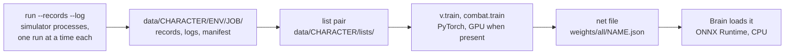

import { Badge } from '@astrojs/starlight/components';
import NetFileAnatomy from '../../../../../components/book/NetFileAnatomy.svelte';

本頁供查閱。前面的頁面解釋學習循環；這一頁列出它的機制。本頁和程式碼（`learn/`、`src/Sts2Ai.Brain`、`src/Sts2Ai.SimWorker`、`weights/`、`eval/`）不一致時，以程式碼為準。Python 檔案的路徑相對於儲存庫，C# 路徑相對於 `src/Sts2Ai.*`。

## 1. 行程與輸出

- **模擬**。自我對弈和評估都是模擬器的 `run` 行程（[§10](#sec-10)）。每個行程一次打一局，依序打它的種子，搜尋在它自己的工作行程上（`--workers`）；一個作業的種子分給幾個這樣的行程，各自寫自己的檔案（[§3](#sec-3)）。模擬器靠多行程擴展：8 個行程約 1,860 場戰鬥/秒，單一行程是 275 場（[模擬器：戰鬥 §7](/zh-tw/arch/simulator/combat/#sec-7)）。以冠軍的 medium 預算，一局整局 SL 佔一個行程 5 到 17 分鐘，視角色而定（[評估：冠軍與基線 §2](/zh-tw/arch/evaluation/champions/#sec-2)）。
- **輸出**。`--records FILE` 和 `--log FILE` 寫對局記錄和決策日誌，每筆一行 JSON，寫完一行就清空緩衝，所以行程中途停下最多丟掉正在寫的那一行。一個作業的檔案放進 `data/` 底下它自己的資料夾，不進 git（[§3](#sec-3)）。
- **訓練**用 Python 和 PyTorch，有 GPU 時在 GPU 上跑（`device = "cuda" if torch.cuda.is_available()`），讀一對清單（[§4](#sec-4)）；結果是 `weights/all/` 裡的一個網路檔案，它在 git 裡（[§6](#sec-6)）。推論用 C#，在 CPU 上，在決策行程和工作行程裡（[§8](#sec-8)）。

## 2. `learn/` 專案

`learn/` 是循環的 Python 專案，用 uv 管理（`learn/pyproject.toml`、`uv.lock`）：`sts2-learn` 0.1.0，Python ≥ 3.12，相依套件 loguru ≥ 0.7.3、onnx ≥ 1.23.2、torch（來自 PyTorch 的 CUDA 12.8 索引）和 typer ≥ 0.27.3；開發用 pytest ≥ 9.1.1 和 ruff ≥ 0.17.3（行長 120，規則 E、F、W、I、B、UP）。在 `learn/` 裡用 `uv run python -m v.train …` 或 `uv run python gate.py …` 執行腳本。

**慣例**（`learn/common.py`）：

- 每個腳本都有一個 Typer 指令，說明文字就是它的 docstring（`common.app`，`:24-26`），所以 `--help` 顯示的是 docstring。
- 日誌透過 loguru 寫到 stderr，級別由 `LOG_LEVEL` 決定（預設 INFO），格式是 `HH:mm:ss LEVEL message`；stdout 只輸出結果，報告是一行 JSON（`common.run`，`:29-41`）。
- `LearnError`（輸入有錯、檔案擋路、模擬器失敗）讓腳本只印一行就以結束代碼 1 結束；其他任何錯誤都是 bug，帶著 traceback 結束。模擬器的命令列也是這樣（[模擬器：參考 §2](/zh-tw/arch/simulator/reference/#sec-2)）。

## 3. 資料目錄

對局記錄和決策日誌是原始資料，不進 git，放在 `data/CHARACTER/ENV/`（`ENV` 是 `sl` 或 `nosl`；`.gitignore:10-11`），每個作業一個資料夾。

| 資料夾 | 內容 | 例子 |
|---|---|---|
| `selfplay/vNgM/aAA-eXXX/` | 一代的作業，每個晉階和 ε 一個資料夾（`a00-e030` 即晉階 0、ε = 0.3）；`vNgM` 指資料，從不指網路 | `sl/selfplay/vNgM/a00-e030` |
| `eval/DATE-SUBJECT/` | 評估和晉級門檻，每個角色每一方一個資料夾；SUBJECT 寫出打的是什麼，即晉階和兩個網路 | `sl/eval/DATE-a0-V-C` |
| `forks/DATE-SUBJECT/` | 試打的對局，例如對一個建置或一組選項的冒煙測試 | – |
| `data/CHARACTER/void/` | 不能用的資料（選項用錯、停得太早），保持原本的路徑，附一個 `VOID.txt` 寫明原因 | `void/sl/selfplay/vNgM/a00-e030` |
| `data/CHARACTER/lists/` | 共用的訓練集（[§4](#sec-4)） | `lists/NAME-logs.txt` |

**檔案**。作業的資料夾裡每批種子一組檔案，檔名是打這批的分片（即那個行程）加這批的第一個序號：`rec-SHARD-INDEX.jsonl`（對局記錄）、`log-SHARD-INDEX.jsonl`（決策日誌）、`out-SHARD-INDEX.txt`（模擬器的輸出）、`tally-SHARD-INDEX.txt`（每局的結局、幕和層數）、`counts-SHARD-INDEX.txt`（每個檔案的行數），最後寫 `done-SHARD-INDEX.txt`（這批對局的序號）。所以一批要麼完整，要麼不存在；讀作業時，沒有 `done-` 檔案的批會被排除。決策日誌和同名的記錄檔案成對，清單對把這兩個檔案放在同一行（[§4](#sec-4)）。決策日誌的大部分位元組是戰鬥觀測和宏觀決策的整局觀測。

**manifest**（`manifest.json`，每個作業一份）說明打的是什麼、為什麼打：`job`、`kind`、`character`、`env`、`owner`、`purpose`、`rev`（建置模擬器所用的提交）、`game`（遊戲版本）、`options`（對局選項，種子檔案或訓練種子也在其中）、`inputs`（作業讀取的 `eval/` 和 `weights/` 檔案從哪裡來）、`launched` 和 `status`。

## 4. 清單

共用的訓練集是 `data/CHARACTER/lists/` 裡成對的清單：`NAME-logs.txt` 和 `NAME-recs.txt` 每行一個路徑，相對於儲存庫的根目錄（或絕對路徑），一份的第 i 行，就是另一份第 i 行那些對局記錄的決策日誌（`common.lists`，`learn/common.py:84-95`）。`v.train --list PREFIX` 和 `combat.train --list PREFIX` 讀一對清單；訓練器只把每份日誌和同一行的記錄檔案對上。網路訓練所用的清單裝的是一代裡每個角色的自我對弈（[循環 §2](/zh-tw/arch/learning/loop/#sec-2)）；用 `combat.train --test-list` 讀的清單只報告，從不訓練。資料夾裡的 `manifest.json` 說明每份清單裝的是什麼。

## 5. 種子

- **訓練種子**是 `run --seed 1 --start K`，即從序號 K 起的種子 `MakeSeed(1, i)`（[評估：指標、種子與報告 §6](/zh-tw/arch/evaluation/metrics/#sec-6)）。每個資料集打自己的一個 100,000 寬的區段，它的每個作業打其中自己的一段，所以沒有兩局共用一個種子。
- **規則**：訓練種子和測試種子從不相遇。自我對弈作業打訓練種子，評估作業打 `eval/seeds/` 裡的檔案；序號低於 40,134,134 的訓練種子都不會給出評估種子的產生器種子（[評估：指標、種子與報告 §6](/zh-tw/arch/evaluation/metrics/#sec-6)），兩個訓練器也都拒絕含有評估作業對局的清單（`common.train_lists`）。

評估種子檔案在 `eval/seeds/`：`promotion-1`（200 個）、`promotion-1-300`（按順序是它的 200 個，再加接下來的 100 個）、它的切片 `promotion-1-100`、`promotion-1-200` 和 `promotion-101-300`、`final-1` 和 `a10-check-1`；`eval/seeds/retired/` 存放 `promotion-1-500`，它後 200 個種子在訓練資料裡（[評估：指標、種子與報告 §5](/zh-tw/arch/evaluation/metrics/#sec-5)）。`eval/CHARACTER/leaderboard.md` 由 `leaderboard` 從整局報告產生。

## 6. 權重

戰鬥網路和 V 各是一個網路，用於每個角色、每個晉階和兩種環境，所以它們的檔案共用一個資料夾 `weights/all/`（`learn/weights.py`）。每個角色仍然單獨評判：它的報告和排行榜在 `eval/CHARACTER/` 裡，資料在 `data/CHARACTER/` 裡（[§3](#sec-3)）；冠軍檔案是所有角色共用的，在 `eval/champions/` 裡。

`weights/all/` 裡有 V 的檔案 `v9-0.json`、`v9-1.json` 和 `v9-2.json`，以及戰鬥網路的 `c9-0.json`、`c9-1.json` 和 `c9-2.json`。兩個冠軍檔案，SL 的和 NoSL 的，都為每個角色指明冠軍的兩個檔案 `weights/all/v9-2.json` 和 `weights/all/c9-2.json`（[評估：冠軍與基線 §1](/zh-tw/arch/evaluation/champions/#sec-1)）。

- **永不覆蓋**。訓練器寫到 `weights/all/NAME.json`，除非 `--out` 另行指定；`weights/all/` 裡已有同名檔案時，它拒絕這個名字（`out_path`，`learn/weights.py:14-20`），所以一個名字只用一次，永遠指同一份權重。沒有任何保留下來的對局會用到的試驗檔案，用 `--out` 放到別處。
- **每個角色**。兩個訓練器都讀清單裡每個角色的對局（`runs_by_log`，`learn/common.py:61-81`），因為網路是共用的；網路檔案不記錄角色。
- **名稱**。`vN-M` 是 V，`cN-M` 是戰鬥網路，有變體時在編號後面加字母（`vN-Ma`）。`vNgM` 指一代的資料，從不指網路。
- **在 git 裡**。`weights/` 在 git 裡：一個檔案 6.0–9.6 MB，而且從不改變，所以一個提交就同時確定了程式碼、權重和冠軍檔案；冠軍檔案直接引用權重所在的路徑。
- **環境**。戰鬥網路檔案記下它學習的環境（`env`），C# 不讀它：SL 和 NoSL 打同一個檔案（[戰鬥大腦：葉節點 §6](/zh-tw/arch/combat-brain/leaf/#sec-6)）。冠軍的戰鬥網路從 SL 的對局學習；在 NoSL 下它能載入、能打，但從沒在那裡訓練過或過過門檻。

## 7. 網路檔案

網路檔案是 JSON：以 base64 編碼的 ONNX 計算圖，加上 C# 餵它輸入所需的東西，以及測試輸入和訓練器給出的輸出，供載入時核對。網路只在 Python 裡定義一次；C# 只負責把一局或一個回合開始局面轉成計算圖的輸入（[§8](#sec-8)）。

**V 的檔案**（`learn/v/export.py:44-64`）：

| 欄位 | 內容 | C# 是否讀取 |
|---|---|---|
| `name` | 網路的名字，和冠軍顯示的一樣（`l0 NAME`） | 是 |
| `floors` | 64 | 是 |
| `vocab` | 每張表列出這個遊戲版本的每個 id（`learn/game_ids.py`），第 0 項是 `<unk>`：`cards`、`modifiers`、`relics`、`potions`、`context`、`map`、`relic_status` | 是 |
| `state` | `names`（floor、hp、max_hp、gold、ascension、potion_slots）、`mean`、`std` | 是 |
| `fit` | 訓練報告（[§9](#sec-9)） | 否 |
| `onnx` | 計算圖：輸入按 `learn/v/encode.py` 的 `INPUTS` 命名，在 `state` 之後是遺物的 `relic_values` 和 `relic_status`，以及保留的牌的 `held` 和 `held_mask`，批次和長度維度不固定；輸出 `hazards`（batch × 64）；opset 20 | 是 |
| `tests` | 按訓練種子抽出的最多 8 個留出樣本：`run`（整局觀測）和 `value`（訓練器在 CPU 上給的價值） | 是 |

**戰鬥網路的檔案**（`learn/combat/export.py:72-106`）：

| 欄位 | 內容 | C# 是否讀取 |
|---|---|---|
| `name` | 和冠軍顯示的一樣（`pimc NAME`、`plan NAME`） | 是 |
| `env` | 它學習的對局所屬的環境，僅作記錄 | 否 |
| `buckets`、`loss_min` | 從 −0.25 起的 50 個桶：網路預測什麼 | 是 |
| `potion_groups` | 5：桶每相鄰 10 個為一組，藥水的機率按組給出 | 是 |
| `lags` | 前 3 回合的意圖 | 是 |
| `vocab` | 每張表列出這個遊戲版本的每個 id：`cards`、`modifiers`、`powers`、`enemies`、`intents`、`relics`、`potions`、`context`、`orbs`、`allies`、`relic_status`；`context` 只含遭遇 | 是 |
| `fit` | 訓練報告 | 否 |
| `onnx` | 輸入按 `learn/combat/encode.py` 的 `INPUTS` 命名；`extra` 有 4 個數；輸出 `outcome`（batch × 51，softmax，關閉的桶為 0）和 `potion_used`（batch × 5 組 × 藥水 id，sigmoid） | 是 |
| `tests` | 最多 16 個留出的回合開始局面，其中有多段攻擊、持有藥水和低生命值的狀態：`obs`、`history`、`outcome`、`potion_used`（5 × 66 個數，一組接一組） | 是 |

下圖逐欄打開兩個網路檔案，一個 V 的和一個戰鬥網路的：大小、計算圖的輸入和輸出及其形狀、它的初始化器（權重張量，只列形狀）和運算子，以及訓練報告。

<NetFileAnatomy client:visible lang="zh-TW" />

## 8. C# 中的推論

- **用哪些網路**。`run --value FILE` 讀 V 的網路檔案（`RunNet.Read`）；`--value` 和 `--macro l0` 或 `--combat-net` 一起用，兩者都需要它（`SimWorker/Commands/Args.cs:235`）。`run --combat-net FILE` 載入戰鬥網路（`CombatNet.Load`），每個戰鬥搜尋的葉節點，它的結局由那個 V 定價：`--combat-net` 和 `--policy pimc` 或 `plan` 一起用（`:234`）。
- **`IRunValue`**（`Brain/Macro/RunValue.cs`）是宏觀大腦眼中的 V：一個名字，加上對整局觀測的估值。`RunNet` 實作它。
- **`RunNet`**（`Brain/Macro/RunNet.cs`）用 ONNX Runtime（`Microsoft.ML.OnnxRuntime`）執行計算圖，intra-op 和 inter-op 都只用一個執行緒（`:53-54`），因為模擬器同時跑很多行程，而一個宏觀決策只估值少數幾個小輸入。它按 `learn/v/encode.py` 的做法從整局觀測建構輸入，遺物的數值和狀態由兩個網路共用的 `CombatNet.RelicInputs` 建構。未知的 id 讀作第 0 項。`Value` 是從這一局目前的層起每一層都活下來的機率（`:80-87`）。
- **`CombatNet`**（`Brain/Combat/CombatNet.cs`）對狀態做同樣的事，也只用一個執行緒。`Graph` 從 `Cards`、`Player`、`Enemies`、`PowerNumbers`、`RelicNumbers`、`Allies`、`Bag` 和 `Powers` 建構輸入，和 `learn/combat/encode.py` 讀取狀態的方式相同，並回傳兩個輸出；`Outcome` 把每種結局按它會留下的那一局用 V 定價，死亡為 0，每瓶持有的藥水按它在結局的桶所在那一組的機率保住（[戰鬥大腦：葉節點 §5](/zh-tw/arch/combat-brain/leaf/#sec-5)）。
- **載入檢查**。`RunNet.Load` 給每個測試對局估值，只要有一個值的偏差超過 10⁻³ × |value| 和 10⁻⁶ 中較大的那個，就拒絕這個檔案（`:64-78`）；`CombatNet.Load` 預測每個測試狀態，只要有一個類別或藥水機率偏差超過 10⁻³，或某個輸出的長度不同，就拒絕它。這保證訓練時和對局時的編碼與前向計算相同。

## 9. 腳本

### `learn/common.py` 和 `learn/weights.py`

| 函式 | 做什麼 |
|---|---|
| `read_lines(paths, needle)` | 逗號分隔的那些檔案裡含有 needle 的 JSON 行；空行和還在寫的行會跳過；檔案不存在是 `LearnError`（`:44-58`） |
| `runs_by_log(logs, records)` | 把第 i 份日誌和第 i 份記錄檔案配對（份數必須相同）；每份記錄檔案按對局 id 列出它的對局；拒絕同一檔案裡出現兩次的對局 id；讀每個角色的對局（`:61-81`） |
| `lists(prefix)` | 一對清單，以兩個用逗號連起來的字串給出（`:84-95`） |
| `train_lists(prefix)` | 網路訓練用的一對清單：和 `lists` 一樣，但拒絕評估作業裡的路徑（`:98-104`） |
| `out_path(name, out)` | 權重檔案寫到哪裡（[§6](#sec-6)） |

### `v.train`：V

`uv run python -m v.train --list PREFIX --name NAME [options]`（`learn/v/train.py:48-59`）。

| 選項 | 預設 | 意義 |
|---|---|---|
| `--list` | 必填 | 清單對 `PREFIX-logs.txt` 和 `PREFIX-recs.txt` |
| `--name` | 必填 | 網路的名字，冠軍將以此顯示 |
| `--out` | `weights/all/NAME.json` | 檔案寫到哪裡 |
| `--init` | – | 接著訓練的網路檔案：它的 state 縮放和權重，第二個輸出頭重新開始 |
| `--seed` | 0 | torch 和 Python 的種子；也決定 8 個測試對局 |

**拒絕的情況**（`:70-71`、`:81-82`）：訓練或留出的樣本太少；`--init` 的表和遊戲的不同，或缺少網路的某個權重、形狀不對（`export.weights`，`learn/v/export.py:97-98`）。

**常數**（`:40-44`）：64 層；最多 40 輪，連續 5 輪留出損失沒有降低 10⁻⁴ 就停；每批 256 個決策；AdamW，學習率 3 × 10⁻⁵，權重衰減 10⁻⁴；第二個輸出頭權重 3。網路的大小是 `Net` 的：嵌入 64，單牌網路 256，主幹 512（`learn/v/net.py:86-111`）。

**流程**。讀樣本；按對局 id 劃分；取遊戲的表（`learn/game_ids.py`），以及 state 的加權平均和標準差（或沿用 `--init` 的）；以基線風險值，即每一層的 $(\text{deaths} + 0.5)/(\text{alive} + 1)$ 截斷到 $[10^{-4}, 1 - 10^{-4}]$，作為輸出頭的偏差；訓練；保留留出風險值損失最好的那一輪。第二個輸出頭的「接下來的戰鬥」項每輪都記進日誌，但不加進去（`:145-148`）。模組的 docstring 說提前停止對各項的加權「和損失相同」；程式碼並沒有加上那一項。然後是報告和檔案。

**報告**（一行 JSON，`:165-177`）：

| 欄位 | 何時 | 內容 |
|---|---|---|
| `runs`、`held_out_runs`、`samples`、`won` | 總是 | 讀到的對局和決策，以及獲勝的局數 |
| `vocab` | 總是 | 每張表的大小 |
| `held_out_loss`、`held_out_loss_floor_only` | 總是 | 每局的留出風險值損失，對比基線的 |
| `held_out_next_combats` | 總是 | 第二個輸出頭的留出平方誤差 |
| `won_held_out_runs`、`brier_held_out`、`brier_held_out_floor_only` | 總是 | 留出對局中獲勝的局數，以及獲勝機率的 Brier 分數，對比基線的 |
| `init_held_out_loss`、`init_brier_held_out` | 有 `--init` 時 | 訓練前檔案自己的留出風險值損失和 Brier 分數 |

### `combat.train`：戰鬥網路

`uv run python -m combat.train --list data/CHARACTER/lists/NAME --env SL --name NAME`，另有可選的 `--test-list LIST`、`--out`、`--init`（接著訓練的網路檔案）和 `--seed`（0）；它讀每個角色的對局。`--list` 含有評估作業的對局就拒絕；`--test-list` 指明一對清單，其中的對局只報告，標為 `medium`。`learn/combat/report.py` 負責報告（`ranks`、`rank_within`、`auc_within`、`potion_rates`、`log_loss`、`predict`、`summary`）。它的樣本、損失、常數和報告見[訓練戰鬥網路 §3](/zh-tw/arch/learning/combat-net/#sec-3)–[§4](/zh-tw/arch/learning/combat-net/#sec-4)。

### `learn/gate.py`：V 的報告和晉級門檻

`uv run python gate.py --records R1,R2 [--logs L1,L2] [--against C1,C2]`（`learn/gate.py:154-170`）。它讀打完的對局，失敗的排除，截斷的保留（`:40-42`）。輸出一行 JSON：

- **來自記錄**（`runs_report`，`:45-72`）：`runs`、`floor` 和 `floor_se`；`won`；每幕的 `boss`（到達、打贏、比率）；`elites_per_run`、`elite_deaths`；`died_in`，每幕裡每局敗局死在哪種房間的戰鬥中，或 `outside combat`；
- **來自日誌**（`logs_report`，`:101-127`），只算有記錄的對局：`rest`，休息處的選擇，按生命比例分（0–40%、40–70%、70–90%、90–100%）；`monster_or_rest`，地圖上同時可選怪物和休息處時的選擇，按同樣的比例分；`shop`，商店賣出了什麼（遺物、卡牌、藥水，以下一個決策的整局觀測為準），以及移除和離開；
- **配合 `--against`**（`paired`，`:130-151`），放在 `against` 底下，在兩邊都打完的種子上按種子配對：`pairs`、`won`、`champion_won`、`wins_diff`、`wins_diff_se`、`wins_lower_95`（平均 − 1.645 SE）、`floor_diff`、`floor_diff_se` 和 `promote`，按勝局判定。

## 10. 循環用到的模擬器指令

所有指令及其全部選項見[模擬器：參考 §4](/zh-tw/arch/simulator/reference/#sec-4)。循環呼叫的有這些：

| 指令 | 用途 |
|---|---|
| `run --explore ε` | 自我對弈的均勻抽取（[循環 §9](/zh-tw/arch/learning/loop/#sec-9)）；需要 `--macro l0` |
| `run --value FILE`、`--combat-net FILE` | 用哪個 V、哪個葉節點來打 |
| `run --log FILE --records FILE` | 決策日誌和對局記錄 |
| `report`、`gate`、`leaderboard` | 報告、SPRT 門檻、排行榜（[評估：晉級門檻 §6](/zh-tw/arch/evaluation/gates/#sec-6)、[評估：指標、種子與報告 §7](/zh-tw/arch/evaluation/metrics/#sec-7)） |

## 11. 測試

**Python**（在 `learn/` 裡 `uv run pytest`，7 個檔案共 59 個測試；`uv run ruff check`）：

| 檔案 | 測試數 | 內容 |
|---|---|---|
| `test_common.py` | 11 | `train_lists` 拒絕任一環境中評估作業的對局，接受自我對弈和分叉；`read_lines` 跳過空行和不完整的行、讀每個檔案、找到 needle、檔案不存在時失敗；清單對按同樣的順序給出日誌和記錄；`runs_by_log` 把每份日誌和它自己的記錄對上、每份日誌一份記錄檔案、拒絕重複的對局 id，並讀每個角色的對局 |
| `test_weights.py` | 3 | 預設路徑在 `weights/all/` 裡；那裡的檔案從不替換；別處的明確路徑可以 |
| `test_v_encode.py` | 9 | 可到達的地圖及前方層數，選路時要進入的點（只在那時讀入），在任何造訪之前和在頭目處；只用 id；遺物連同它的計數、狀態和保留的牌，讀法和戰鬥網路一樣；牌的關鍵字和 Tinker Time 把它做成的樣子；一局在牌上長大的數字；state 的順序 |
| `test_v_train.py` | 11 | 樣本和每局權重；輸掉的對局最後一場沒有結束的戰鬥，代價是剩下的生命值；風險值標籤和刪失；獲勝機率；ONNX 與 torch 對照；權重從網路檔案讀回，第二個輸出頭重新開始，匯出時被合併成相同的權重也分開讀回；`--init` 沿用表和 state 縮放，並拒絕其他的表；網路檔案和它的報告；選路的樣本 |
| `test_game_ids.py` | 3 | 每張表以 `<unk>` 開頭，每個 id 只出現一次，且有序；每個角色和網路讀的東西都在；沒有遊戲的測試模型 |
| `test_combat.py` | 18 | 卡牌詞元：id、升級、牌堆、修飾詞元、費用和數字；牌的關鍵字、Tinker、用掉的附魔和彙整的數字；能力被移動的數字和偷走的牌、遺物的效果已用掉；玩家和每個敵人縮放後的原始狀態；意圖最新的在前；結局的桶；戰鬥後從觀測中消失的藥水；生命值排除掉的桶；牌的數字和修飾詞元以及充能球的數字和順序會改變輸出；勝利後持有藥水的藥水損失；一場勝利的藥水機率取它那一組桶的；帶歷史的回合開始樣本；拒絕另一個環境；ONNX 與 torch 對照；訓練寫出帶自己環境的網路檔案；`c9-0.json` 的權重讀回後給出它的測試狀態；從網路檔案接著訓練並保留它，除非某個 epoch 勝過它；對局在第一個決策之前就死去的戰鬥 |
| `test_gate.py` | 4 | 頭目、菁英和死亡；按生命分的休息選擇和商店購買；按生命分的怪物或休息；整局按勝局和層數配對、按勝局晉級 |

**C#**（[模擬器：參考 §7](/zh-tw/arch/simulator/reference/#sec-7)），網路在訓練和部署之間的一致性，用 `Sts2Ai.Tests/Fixtures/` 裡的固定資料和兩個網路檔案本身：

- `RunNetTests`（4 個）：一個極小、未訓練的網路（`pure-v-tiny-win.json`，風險值輸出頭的偏差降低 6），給三個真實的整局觀測按訓練器的獲勝機率估值，其中一個帶遺物的計數、一個狀態、一件熔化的遺物和保留著牌的佩爾之牙；`v9-0.json` 能載入，它的測試對局給出訓練器的值；共用測試地圖上的地圖詞元；要進入的點只在選路時才讀入。
- `CombatNetTests`（6 個）：`c9-0.json` 能載入，它的 16 個測試狀態讀出來和訓練器一樣；一個極小的未訓練網路（`combat-tiny.json`），它的測試狀態是真實的 SL 回合開始局面，帶四個回合的敵人歷史、一個盟友、同一個 id 的兩瓶藥水、一瓶表外的藥水、一個生命值 5% 的狀態、一次多段攻擊、帶傷害的牌，以及表內和表外、超過網路能區分的位置的充能球，讀出來和訓練器一樣，每組桶各有自己的藥水機率；進行中的狀態是它的結局所留下的各局的 V；每瓶藥水按它自己在桶那一組的機率保住；持有的生命值排除掉的桶沒有權重；贏下的戰鬥是它那一局的 V，輸掉的是 0。
- 改動某個輸入、而輸出的變化小於容差時，檢查照樣會通過，所以每個新輸入都在一個權重讓每個輸入都起作用的網路上再檢查了一次（[戰鬥網路 §9](/zh-tw/arch/combat-brain/network/#sec-9)）。

**規劃** <Badge text="規劃中" variant="caution" />：

1. 在留出種子上檢驗**校準**：V 說 30% 的那些狀態裡，應該大約有 30% 贏下來。可靠性圖（把預測分箱，畫出預測勝率對實際勝率）還沒有實作；Brier 分數（預測機率與 0/1 結果之間差距的平方平均）已實作，在 `v.train` 的整局報告裡，而且必須優於基線的（ytcs 是一個先前的 STS2 求解器，它的整局模型就沒通過這一項）。
2. **獎勵塑形精確逐項相消**，等塑形項存在之後（[循環 §11](/zh-tw/arch/learning/loop/#sec-11)）。
3. **晉級門檻的 A/A 測試**：挑戰者就是冠軍自己時，通過的頻率不能高於門檻的偽陽性率。`Sts2Ai.Tests/Harness/GateTests.cs` 檢查 400 個各由一方單獨獲勝、兩方輪流的配對不會通過（`NoGainFails`），這是確定性的檢查，不是量出的比率。

## 12. 未決問題

1. 冠軍的網路在 NoSL 下值多少：兩者都沒在那裡訓練過，也沒過過門檻，NoSL 的冠軍檔案也沒有指明報告（[評估：冠軍與基線 §2](/zh-tw/arch/evaluation/champions/#sec-2)）。
2. 這兩個網路各是五個角色共用的一組權重，它們是否需要為此加寬；網路可以在保持輸出不變的情況下加寬。
3. 一旦 V 按 P(win) 做決策，除了 Brier 分數之外，怎麼檢查它的校準。
4. 每個決策的標籤都帶著它那一局之後的抽取。每局設一個切點就能去掉它們：切點之前抽取，切點之後用 V 的最佳，只在切點之後的決策上訓練，就像 AlphaGo 的價值網路那樣訓練（[循環 §9](/zh-tw/arch/learning/loop/#sec-9)）。這件事沒有做。
5. TD(λ) 或專家迭代是否對 V 有幫助，V 的標籤目前只有蒙地卡羅目標。
