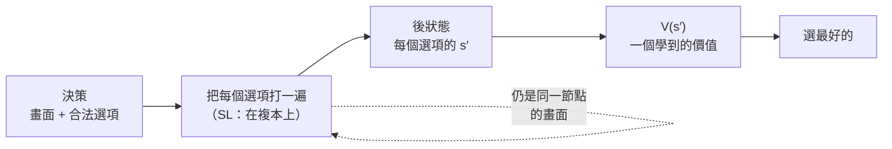

import { Aside } from '@astrojs/starlight/components';

**宏觀大腦**負責戰鬥之外的每個決策：下一步去哪個地圖點、領取哪些獎勵、拿哪張牌、買什麼，以及在事件、休息處或財寶房的寶箱前選哪個選項。它和[戰鬥大腦](/zh-tw/arch/combat-brain/)一起執行在決策行程裡。Harness 把每個不是戰鬥的決策介面都交給它（[Harness：路由、預算與種子 §1](/zh-tw/arch/harness/routing/#sec-1)）。

它的方法一句話就能說完：把每個選項都打一遍，看看打完之後當下的局面，問一個學到的價值函式 V 這個局面有多好，然後選最好的。本章從基本原理出發，逐一解釋這句話的每個部分：選項有哪些、「打完之後當下的局面」是什麼意思、選項怎麼打、V 讀什麼又算什麼、它的訓練標籤從哪裡來，以及每個新的 V 如何被接受或拒絕。

<Aside title="狀態">

L0 已經實作：Brain 裡的 `MacroBrain`，用 `run --macro l0` 來打（[模擬器：整局 §5](/zh-tw/arch/simulator/runs/#sec-5)）。它回答每個宏觀決策介面和戰鬥外的選牌提示，用從網路檔案讀出的 V 給選項估值（[價值網路](/zh-tw/arch/macro-brain/network/)）。SL 下加上 `--afterstates clone` 時，L0 在節點複本上把每個選項打一遍，並在節點的各個畫面裡繼續往下搜尋（[搜尋 §2](/zh-tw/arch/macro-brain/search/#sec-2)）；NoSL 下它根據畫面預測每個後狀態（[搜尋 §1](/zh-tw/arch/macro-brain/search/#sec-1)）。自我對弈時，`--explore ε` 把它 ε 比例的決策改為均勻抽取（[自我對弈 §3](/zh-tw/arch/macro-brain/selfplay/#sec-3)）。規劃中：NoSL 下從對局世界得到後狀態和多步搜尋、L1 推演複核，以及 `IMacroBrain` 介面（[弱點與下一步 §2](/zh-tw/arch/macro-brain/next/#sec-2)）。

</Aside>

## 1. 它決定什麼

宏觀大腦處理的決策畫面（*決策介面*，surface）如下。「選擇後的隨機性」是選項選定之後才揭曉的東西。「影響範圍」是這個選擇的效果能延續多遠（「整局」指本局剩下的全部）。

| 決策介面 | 選項 | 選擇後的隨機性 | 影響範圍 |
|---|---|---|---|
| 地圖（下一個點） | 1–4 | `?` 擲骰、遭遇、獎勵 | 本幕剩餘部分 |
| 獎勵（領取順序 / 略過） | ≤6 | 無（金幣、藥水、遺物都已顯示） | 整局 |
| 卡牌獎勵 | 3–4 + 略過/重骰 | 重骰結果 | 整局 |
| 牌組提示：升級 / 刪除 / 附魔 | 牌組大小 | 無 | 整局 |
| 轉化 | 牌組大小 | 變出的牌 | 整局 |
| 選一張牌 / 卡包 | ≤3 | 無 | 整局 |
| 事件 / Ancient 選項 | 1–4 | 事件結果、下一頁 | 整局 |
| 商店 | 貨品 + 刪牌 + 離開 | 無（貨品可見） | 整局 |
| 休息處 | 休息/鍛造/鍛鍊/挖掘/… | 挖掘等 | 整局 |
| 財寶房 | 選遺物/略過 | 無 | 整局 |
| 藥水欄滿 | 丟棄/使用/略過 | 無 | 短 |

這些介面的共同點：選項少、影響遠、執行便宜、難以估值。一個戰鬥回合可能有上千種動作序列；這裡一個決策只有寥寥幾個選項，每個都能在模擬世界裡以幾乎為零的成本試一遍。難的是，一個選擇的效果要過很多層才顯現出來。第 2 層拿的一張牌，到第 3 幕頭目時還在牌組裡；第 43 層為了多打一場怪物戰而跳過的休息處，可能決定這一局能不能到達第 48 層。

一局裡這種決策很多，贏下的一局裡就有 174 個，而它們全都共用自己那一局的同一個結果。這個比例，許多決策對應一個結果，是學習 V 的核心難題（[從風險值到價值 §3](/zh-tw/arch/macro-brain/value/#sec-3)）。

## 2. 一張圖看懂方法

1. **選項**：Harness 列出的這個畫面的合法動作。
2. **後狀態**：每個選項都執行一遍，執行完、還沒有任何隨機的事發生時的局面，就是它的*後狀態*（[後狀態 §1](/zh-tw/arch/macro-brain/afterstates/#sec-1)）。SL 下，選項在當前節點的複本上、在真實遊戲裡打出；如果遊戲接著顯示同一個節點的另一個畫面（購買之後的商店、事件的下一頁），搜尋就繼續穿過它（[搜尋 §3](/zh-tw/arch/macro-brain/search/#sec-3)）。
3. **一個價值**：V 讀一個後狀態，回傳一個數字。同一個 V 給每個介面的每個選項評分，所以一張牌、一件遺物、一次升級、一次回血和地圖上的一條路，都在同一個尺度上比較，不需要手寫的換算率（[後狀態 §2](/zh-tw/arch/macro-brain/afterstates/#sec-2)）。
4. **最好**：L0 選價值最高的選項，打平時選第一個合法的。自我對弈有時故意抽另一個，為了學到它會帶來什麼（[自我對弈 §3](/zh-tw/arch/macro-brain/selfplay/#sec-3)）。

V 本身是一個神經網路，只讀這一局是什麼（它的牌、遺物、藥水、幕和頭目的 id，以及前方地圖上的點）、牌上長大的數字、遺物的計數和狀態、遺物保留的牌和六個原始數字，並對每一層預測這一局在那一層結束的機率；這些機率合起來給出獲勝的機率（[價值網路](/zh-tw/arch/macro-brain/network/)、[從風險值到價值 §2](/zh-tw/arch/macro-brain/value/#sec-2)）。它從自我對弈中學習：每個決策的標籤就是它那一局實際上怎麼結束的（[從風險值到價值 §3](/zh-tw/arch/macro-brain/value/#sec-3)）。

## 3. 本章內容

| 節 | 解釋什麼 | 圖 |
|---|---|---|
| [後狀態與單一價值函式](/zh-tw/arch/macro-brain/afterstates/) | 為什麼大腦給選項之後的狀態估值，為什麼一個 V 能服務每個決策介面，NoSL 和 SL | – |
| [搜尋](/zh-tw/arch/macro-brain/search/) | 從畫面預測後狀態；SL 複本上的 L0：beam、試探、選牌提示、不走回頭路 | – |
| [價值網路](/zh-tw/arch/macro-brain/network/) | 網路從輸入到輸出：每個輸入張量、牌組的集合網路，遺物、藥水、上下文和地圖這幾個袋，遺物保留的牌，MLP 主幹、風險值輸出頭，以及它的大小和限制 | 架構圖；地圖上的一個岔路；一局真實的對局走過每一層 |
| [從風險值到價值](/zh-tw/arch/macro-brain/value/) | V 是什麼意思、風險值和 P(win)；記錄下來的決策如何成為樣本、它的標籤和損失；訓練和報告 | – |
| [自我對弈](/zh-tw/arch/macro-brain/selfplay/) | 整局對局、均勻抽取、各代、以配對勝局為準的晉級門檻 | – |
| [弱點與下一步](/zh-tw/arch/macro-brain/next/) | 已知的弱點、規劃了但還沒實作的部分、未決問題 | – |
