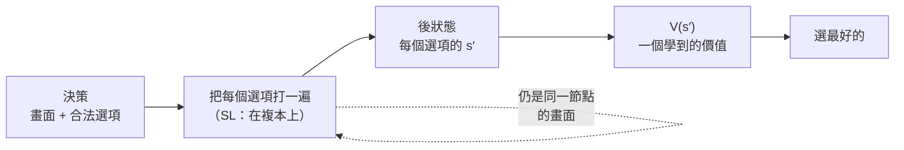

import { Aside } from '@astrojs/starlight/components';
import RunTrajectory from '../../../../../components/v/RunTrajectory.svelte';

**宏觀大腦**負責戰鬥之外的每個決策：下一步去哪個地圖點、領取哪些獎勵、拿哪張牌、買什麼，以及在事件、休息處或財寶房的寶箱前選哪個選項。它和[戰鬥大腦](/zh-tw/arch/combat-brain/)一起執行在決策行程裡。Harness 把每個不是戰鬥的決策介面都交給它（[Harness §4](/zh-tw/arch/harness/#sec-4)）。

它的方法一句話就能說完：把每個選項都打一遍，看看打完之後當下的局面，問一個學到的價值函式 V 這個局面有多好，然後選最好的。本章從基本原理出發，逐一解釋這句話的每個部分：選項有哪些、「打完之後當下的局面」是什麼意思、選項怎麼打、V 讀什麼又算什麼、它的訓練標籤從哪裡來，以及每個新的 V 如何被接受或拒絕。

下圖跟著一局由目前的 V 打贏的對局：一整局 SL，種子 `0SSL7NS01MU6`。在它的 181 個宏觀決策上，圖中畫出 V 對實際打出的答案的估值，單位是 V 自己的單位（期望*進度*：大致就是這一局預計到達的樓層，[價值網路](/zh-tw/arch/macro-brain/network/)），下方是玩家生命值佔最大生命值的比例。V 從 33 開始，這一局每撐過一幕就往上爬；這一局結束在 V 結束的地方，最後一個頭目的那一層，獲勝（進度 49）。標出的四個決策是本章貫穿始終的範例。

<RunTrajectory client:visible lang="zh-TW" />

<Aside title="狀態">

L0 已經實作：Brain 裡的 `MacroBrain`，用 `run --macro l0` 來打（[模擬器：整局 §5](/zh-tw/arch/simulator/runs/#sec-5)）。它回答每個宏觀決策介面和戰鬥外的選牌提示，用 V 給選項估值：V v0（手寫），或網路檔案裡的 V v2 或純 V（[學習 §1](/zh-tw/arch/learning/#sec-1)）。自 2026-10-30 起，兩個冠軍的 V 都是純 V 網路 v6-3-2。SL 下加上 `--afterstates clone` 時，L0 在節點複本上把每個選項打一遍，並在節點的各個畫面裡繼續往下搜尋（[搜尋 §2](/zh-tw/arch/macro-brain/search/#sec-2)）；NoSL 下對局世界還不存在，它根據畫面預測每個後狀態（[搜尋 §1](/zh-tw/arch/macro-brain/search/#sec-1)）。自我對弈時，`--explore ε` 把它 ε 比例的決策改為均勻抽取（[自我對弈 §2](/zh-tw/arch/macro-brain/selfplay/#sec-2)）。規劃中：NoSL 下從對局世界得到後狀態和多步搜尋、L1 推演複核，以及 `IMacroBrain` 介面（[弱點與下一步 §3](/zh-tw/arch/macro-brain/next/#sec-3)）。

</Aside>

## 1. 它決定什麼

宏觀大腦處理的決策畫面（*決策介面*，surface）如下。「選擇後的隨機性」是選項選定之後才揭曉的東西。「影響範圍」是這個選擇的效果能延續多遠（「整局」指本局剩下的全部）。

| 決策介面 | 選項 | 選擇後的隨機性 | 影響範圍 |
|---|---|---|---|
| 地圖（下一個點） | 1–4 | `?` 擲骰、遭遇、獎勵 | 本幕剩餘部分 |
| 獎勵（領取順序 / 略過） | ≤6 | 無（金幣、藥水、遺物都已顯示） | 整局 |
| 卡牌獎勵 | 3–4 + 略過/重骰 | 重骰結果 | 整局 |
| 牌組提示：升級 / 刪除 / 附魔 | 牌組大小 | 無 | 整局 |
| 轉化 | 牌組大小 | 變出的牌 | 整局 |
| 選一張牌 / 卡包 | ≤3 | 無 | 整局 |
| 事件 / Ancient 選項 | 1–4 | 事件結果、下一頁 | 整局 |
| 商店 | 貨品 + 刪牌 + 離開 | 無（貨品可見） | 整局 |
| 休息處 | 休息/鍛造/鍛鍊/挖掘/… | 挖掘等 | 整局 |
| 財寶房 | 選遺物/略過 | 無 | 整局 |
| 藥水欄滿 | 丟棄/使用/略過 | 無 | 短 |

這些介面的共同點：選項少、影響遠、執行便宜、難以估值。一個戰鬥回合可能有上千種動作序列；這裡一個決策只有寥寥幾個選項，每個都能在模擬世界裡以幾乎為零的成本試一遍。難的是，一個選擇的效果要過很多層才顯現出來。第 2 層拿的一張牌，到第 3 幕頭目時還在牌組裡；第 43 層為了多打一場怪物戰而跳過的休息處，可能決定這一局能不能到達第 48 層。

一局裡這種決策很多。上面那一局做了 181 個；在訓練 V 的菁英連戰裡（[自我對弈 §1](/zh-tw/arch/macro-brain/selfplay/#sec-1)），第 1 代平均每局 108 個，第 3 代 146 個，而它們全都共用自己那一局的同一個結果。這個比例，許多決策對應一個結果，是學習 V 的核心難題（[從風險值到價值 §2](/zh-tw/arch/macro-brain/value/#sec-2)）。

## 2. 一張圖看懂方法

1. **選項**：Harness 列出的這個畫面的合法動作。
2. **後狀態**：每個選項都執行一遍，執行完、還沒有任何隨機的事發生時的局面，就是它的*後狀態*（[後狀態 §1](/zh-tw/arch/macro-brain/afterstates/#sec-1)）。SL 下，選項在當前節點的複本上、在真實遊戲裡打出；如果遊戲接著顯示同一個節點的另一個畫面（購買之後的商店、事件的下一頁），搜尋就繼續穿過它（[搜尋 §3](/zh-tw/arch/macro-brain/search/#sec-3)）。
3. **一個價值**：V 讀一個後狀態，回傳一個數字。同一個 V 給每個介面的每個選項評分，所以一張牌、一件遺物、一次升級、一次回血和地圖上的一條路，都在同一個尺度上比較，不需要手寫的換算率（[後狀態 §2](/zh-tw/arch/macro-brain/afterstates/#sec-2)）。
4. **最好**：L0 選價值最高的選項，打平時選第一個合法的。自我對弈有時故意抽另一個，為了學到它會帶來什麼（[自我對弈 §2](/zh-tw/arch/macro-brain/selfplay/#sec-2)）。

V 本身是一個神經網路，只讀這一局是什麼（它的牌、遺物、藥水、幕、頭目和前方地圖的 id）和六個原始數字，並對每一層預測這一局在那一層結束的機率（[價值網路](/zh-tw/arch/macro-brain/network/)、[從風險值到價值 §1](/zh-tw/arch/macro-brain/value/#sec-1)）。它從自我對弈中學習：每個決策的標籤就是它那一局實際上怎麼結束的（[從風險值到價值 §2](/zh-tw/arch/macro-brain/value/#sec-2)）。

## 3. 本章內容

| 節 | 解釋什麼 | 圖 |
|---|---|---|
| [後狀態與單一價值函式](/zh-tw/arch/macro-brain/afterstates/) | 為什麼大腦給選項之後的狀態估值，為什麼一個 V 能服務每個決策介面，NoSL 和 SL | 四個真實決策，由 V 即時估值 |
| [搜尋](/zh-tw/arch/macro-brain/search/) | L0 v0 從畫面做的預測；SL 複本上的 L0：beam、試探、選牌提示、不走回頭路 | 一次搜尋，一步一步 |
| [價值網路](/zh-tw/arch/macro-brain/network/) | V 讀什麼（只有 id 和原始狀態）、牌組上的集合編碼器、詞元袋、主幹 | 詞元和地圖；整個前向計算，可編輯 |
| [從風險值到價值](/zh-tw/arch/macro-brain/value/) | 風險值輸出頭、期望樓層、進度和 P(win)；標籤和損失；訓練 | 風險值與存活；一個樣本的標籤 |
| [自我對弈](/zh-tw/arch/macro-brain/selfplay/) | 菁英連戰、均勻抽取探索對比 softmax、各代與晉級門檻，附實測數字 | 真實決策上的探索；各代 |
| [弱點與下一步](/zh-tw/arch/macro-brain/next/) | 整局對局顯示了什麼、下一個計畫、規劃了但還沒實作的部分 | – |

每個互動圖都在頁面裡執行冠軍的 V，v6-3-2：用它真實的權重，在建置時從它的網路檔案讀出，加上一個用 TypeScript 寫的前向計算，`pnpm check` 會拿它和訓練器的值核對（[價值網路 §2](/zh-tw/arch/macro-brain/network/#sec-2)）。卡牌、遺物和藥水顯示遊戲自己的名字，括號裡是網路讀的 id。

## 4. 現況

在 300 局整局 SL 上（種子 `promotion-1-300`，SL 冠軍的戰鬥規劃器用 medium 強度），v6-3-2 平均到達第 33.56 層，贏下 23 局（7.7%），是第一個能贏的 V（[評估 §5](/zh-tw/arch/evaluation/#sec-5)）。它的譜系如下，每一步都在各自的設定下測量：

| V | 是什麼 | 整局 SL（樓層） |
|---|---|---|
| V v0 | 17 個手寫特徵乘以以生命值為單位的權重 | –（到 2026-10-28 為止的 NoSL 冠軍） |
| n2-b0.03 | 一個也讀 V v0 特徵、被拉向 V v0 選擇的網路 | promotion-1 上 28.25 |
| pure-1-g | 純 V：只有 id 和原始狀態，在整局上訓練 | promotion-1 上 25.69 |
| v6-2 | 在菁英連戰裡訓練的純 V，第 1–2 代 | 31.37，300 局贏 1 局 |
| v6-3-2 | 第 3 代，從 v6-2 的權重接著訓練 | 33.56，300 局贏 23 局 |

連戰的各代見[自我對弈 §3](/zh-tw/arch/macro-brain/selfplay/#sec-3)；為什麼 V 在頭目戰表現好、卻仍然在頭目之間輸掉對局，見[弱點與下一步 §1](/zh-tw/arch/macro-brain/next/#sec-1)。
