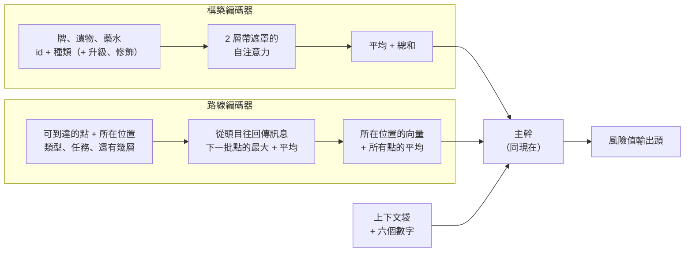

import { Aside } from '@astrojs/starlight/components';

## 1. 整局對局顯示了什麼

v6-3-2 在 300 局整局 SL 裡贏 23 局。它輸掉的 277 局，以及之前 v6-2 的對局，顯示了宏觀大腦最弱的地方。

- **大多數輸局發生在頭目之間**：v6-3-2 輸掉的 277 局裡，約 144 局輸在兩個頭目之間（10 局在第 1 幕頭目之前，約 105 局在第 2 幕、它的頭目之前，約 29 局在第 3 幕、它的頭目之前），約 133 局輸在頭目處。在訓練 V 的菁英連戰裡，頭目之間的怪物戰不花代價。
- **V 在怪物戰之前幾乎不考慮生命值**：v6-2 的整局對局裡，299 局輸局中有 106 局死在普通怪物戰。地圖上同時可選一場怪物戰和一個休息處時，v6-2 在生命不超過最大生命 40% 時有 46% 選了怪物戰（52 次中 24 次），在 70–90% 時是 50%。貫穿範例也有同樣的選擇：第 43 層、生命 24/66 時，v6-3-2 給怪物戰的估值比休息處高 0.12 層（[後狀態 §2](/zh-tw/arch/macro-brain/afterstates/#sec-2)）。在連戰裡這是對的：怪物戰不花代價。
- **連戰的排序不是整個遊戲的排序**：v6-3-1 在連戰裡勝過 v6-2（+1.73 ± 0.54），整局贏 13 局對 v6-2 的 1 局，到達的樓層卻沒有更高（−0.26 ± 0.70）（[自我對弈 §5](/zh-tw/arch/macro-brain/selfplay/#sec-5)）。
- **標籤帶著之後的抽取**：在探索更多的對局裡，一個狀態的標籤更低，而 V 不知道這一局的 ε（[自我對弈 §2](/zh-tw/arch/macro-brain/selfplay/#sec-2)）。
- **編碼器把地圖看成一個袋，牌和遺物很晚才相遇**：V 分不出一個休息處是不是在同一條路徑上、排在菁英之後；牌和遺物的協同必須先穿過匯聚後的牌組，才能遇到遺物袋（[價值網路 §1](/zh-tw/arch/macro-brain/network/#sec-1)、[§3](/zh-tw/arch/macro-brain/network/#sec-3)）。

## 2. 下一步

下一個計畫（v7）處理前三點和最後一點；標籤暫時維持原樣。這些步驟是規劃中的，還沒實作。

**回到整局**。V 的自我對弈和它的晉級門檻都打整個遊戲：普通怪物戰也由 SL 規劃器來打。自我對弈維持低預算和 ε 0.3 / 0.15 / 0.05 的均勻抽取；門檻用冠軍的規劃器、medium 強度來打。菁英連戰不再用於訓練或評判 V。

**P(win)，以及以勝局為準的門檻**。V 在整局上用[從風險值到價值 §2](/zh-tw/arch/macro-brain/value/#sec-2) 的標籤訓練：死在第 $e$ 層的對局在那裡結束，贏下的對局撐過每一層，停下的對局只標到它停下的地方。於是它的價值就是撐過每一層的機率，$P(\text{win}) = S_{63}$（objective 為 `win`），從同一個風險值輸出頭讀出；比例頭拿掉。第二個輸出頭保留接下來六場戰鬥的生命值花費，現在包括怪物戰。門檻在 500 個種子上（`promotion-1-500`，它的前 300 個就是 `promotion-1-300`）把挑戰者和冠軍的對局按種子配對，比較勝負，1 或 0：當平均差的 95% 單側下界大於 0 時挑戰者通過，在 500 個種子上這大約需要多贏 2–3 個百分點。報告保留樓層、各幕頭目的打贏比例、對局死在哪裡（頭目、菁英、怪物、戰鬥之外，按幕分）、每局打的菁英數，以及按生命值分組的怪物戰或休息處的選擇。

**在同一個 V 裡加入構築編碼器和路線編碼器**。單一的 V 和它的單一分數不變（[後狀態 §4](/zh-tw/arch/macro-brain/afterstates/#sec-4)）；只有它的輸入端改變。主幹、輸出頭、`IRunValue`、`MacroBrain` 和 `CloneSearch` 都不變。



- **構築編碼器**：牌、遺物和藥水放進同一個集合，每個元素帶一個表示它種類（牌、遺物或藥水）的嵌入；牌保留它的 id、升級和修飾。兩層帶遮罩的自注意力讓每個元素在匯聚之前都能看到其他每個元素，所以小刀能看到手裏劍和苦無，然後整個集合像現在的牌組一樣，按平均和總和匯聚。這是 Set Transformer 的想法（Lee 等人，2019），套用到整套配裝上。它取代 $\varphi$ 以及遺物袋和藥水袋，而且只讀 id，沒有手寫的「攻擊」或「技能」標記。
- **路線編碼器**：節點是本幕還走得到的點，加上玩家自己的位置，每個都由它的類型、任務標記和還有幾層來嵌入；邊就是地圖自己的連線。訊息從頭目往回傳固定的輪數，每一輪對應一幕的一層：每個點根據它自己，以及它通往的那些點的最大值和平均值來更新。輸出是玩家所在位置的向量加上所有點的平均。它取代地圖袋，只讀地圖的類型和連線，沒有「前方菁英數」這類計數。
- `learn/v/encode.py` 仍是唯一的規格，`RunNet` 依它建出同樣的張量，網路檔案的測試對局核對兩邊。

**各代**。每一代的自我對弈都在一個截止時間內跑完；在這一代的對局上訓練兩個網路，只用這一代的資料：現有架構從冠軍的權重接著訓練，新的編碼器從它們自己的上一代接著訓練（第一代從零開始）；兩者在同一個晉級門檻裡對冠軍。通過的網路取代兩個冠軍檔案裡的 V。

## 3. 規劃了，還沒實作

宏觀大腦設計裡的這些部分早於目前的計畫，都還沒實作。

### L1：推演複核

L0 每次都做決定；L1 會是給難分高下的選擇加的一道額外複核，使用評估時的預算。當 L0 排前兩位的價值落在它們的信賴區間之內，L0 分不出兩者時，它才啟動。**推演**（rollout）是用快速策略把遊戲往後打，看一個選項會帶到哪裡。對每個候選：

1. 從它的後狀態出發，在取樣的對局世界裡進行（[模擬器 §6](/zh-tw/arch/simulator/#sec-6)）。
2. 用快速策略往後打 H 個節點（預設打到下一個頭目）：戰鬥用推演策略或淺層搜尋，戰鬥之外用 L0。
3. 用公共亂數給候選配對：每個候選都在同一組世界種子裡打，所以它們之間的差值比各自獨立取樣時雜訊小得多。
4. 候選的價值是視野邊界處 V 的平均值；如果這一局先結束了，就用最終結果。
5. 按配對差值及其信賴區間做選擇。

這些反事實的配對推演，也會成為 V 在關鍵決策上的訓練訊號。在 SL 裡，越過當前節點的推演仍然使用取樣世界（[環境：資訊與節點 §3](/zh-tw/arch/environments/information/#sec-3)）。在地圖上，決策只有下一個點，每走一步都重新決定；那裡難分高下的選擇是 L1 的第一個用途。

### NoSL：對局世界

NoSL 還沒有對局世界，所以它的 L0 從畫面預測後狀態（[搜尋 §1](/zh-tw/arch/macro-brain/search/#sec-1)）。有了對局世界之後，它會在 K 個取樣世界裡套用每個選項，對 V 取平均，並像 SL 的複本那樣搜尋多步的畫面，按觀測去除重複的狀態。

### 介面

規劃中的 C# 介面。一個入口服務所有非戰鬥的決策介面；Harness 按決策介面名稱分派（[Harness §4](/zh-tw/arch/harness/#sec-4)）。

```csharp
// Planned. One entry for every non-combat surface; routing by surface name (docs: harness §4).
public interface IMacroBrain
{
    MacroDecisionResult Decide(MacroRequest request, IWorldSource worlds, Budget budget);
}

public sealed record MacroDecisionResult(
    string First,                          // one of legal[]
    IReadOnlyList<string> Plan,            // rest of this screen (shop buys, reward claims), or of the act's route on the map
    IReadOnlyList<Candidate> Candidates,   // value, CI, samples per first action
    IReadOnlyList<Fact> Facts);            // e.g. deck delta, expected HP at boss, P(win) delta
```

`First` 是現在就要執行的動作，`Plan` 是這個畫面剩下的步驟（在地圖上是本幕剩下的路線），`Candidates` 是每個可能的第一步的價值、信賴區間和樣本數，`Facts` 是用來解釋這個選擇的陳述。戰鬥外的選牌提示和戰鬥內的一樣，經由 `card_choice` 決策介面到來；`ChoiceContext.Purpose` 說明一個提示的用途，Harness 按是否正在戰鬥中來分派。推演裡的宏觀策略是 K 更小的 L0，絕不是 L1。

### 預算

- **自我對弈**：固定的分支數，讓對局可以重現；L0 一律執行，L1 只在抽樣的一部分難分高下的選擇上執行，其結果成為訓練資料。
- **輔助**：L0 立即回答；玩家看著答案時，L1 繼續細化。搜尋是*隨時可停*的（anytime）：任何時刻都可以停下，仍然回傳目前最好的答案。
- **自動**：L0 + L1，有掛鐘時間上限。

### 測試

1. 覆蓋：模擬對局能到達每一個宏觀決策介面，後備次數為 0。
2. 決策測試集：一組固定的（局面，選項）案例，標準答案來自大規模配對推演；L0 在每個決策介面上的一致率，顯示 V 在哪裡最弱。
3. NoSL 反事實：相同的公開記錄、不同的隱藏狀態（`RoomSet` 尾部、機率、亂數流）給出相同的決策。
4. 在固定預算下結果確定。

## 4. 未決問題

1. 每局一個切點，讓一個決策的標籤不帶之後的抽取：切點之前抽取，之後用 V 的最佳，只在切點之後的決策上訓練，就像 AlphaGo 的價值網路那樣訓練。
2. 一旦 V 按 P(win) 做決定，怎麼檢查 P(win) 的校準：V 給 30% 的那些狀態，大約 30% 應該贏下（[學習 §7](/zh-tw/arch/learning/#sec-7)）。
3. 有了路線編碼器，V 能從地圖學到多少路徑規劃，相比詞元袋又如何。
4. L1 的視野 H（下一個頭目還是下一幕），以及推演的戰鬥策略需要多強。
5. 在 NoSL 裡，把商店當作一個決策還是一串；在 SL 裡，複本把它當作一串來搜尋。
