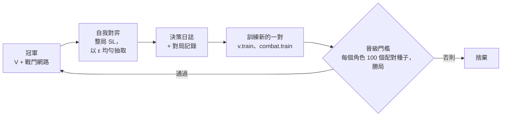

import { Aside } from '@astrojs/starlight/components';

V 從冠軍自己打的對局中學習。本節一步一步描述這套流程：對局、它們怎麼探索、一代怎麼打和怎麼訓練，以及新的網路怎麼接受評判。一般的循環，以及戰鬥網路那一邊，見[學習：循環](/zh-tw/arch/learning/loop/)。

## 1. 循環



## 2. 對局

自我對弈打整個遊戲，SL：每個宏觀決策都由節點複本上的 L0 來做（[搜尋 §2](/zh-tw/arch/macro-brain/search/#sec-2)），每場戰鬥，包括普通怪物戰，都由 SL 戰鬥規劃器配它的戰鬥網路來打。它照冠軍原樣來打，只多加一個選項 `--explore`：

```text
run --champion eval/champions/sl.json --character CHARACTER --asc N --workers 4 \
    --explore ε --seed 1 --start K --n RUNS --log DIR/log.jsonl --records DIR/rec.jsonl
```

- `--champion` 採用冠軍檔案裡的選項：SL、medium 預算的規劃器、複本上的 L0、冠軍的 V 和戰鬥網路（[評估：冠軍與基線 §1](/zh-tw/arch/evaluation/champions/#sec-1)）。命令列上給的選項優先於檔案裡的。
- `--character` 和 `--asc` 由作業自己給：每個角色，晉階 0 到 10 的每一級（[§4](#sec-4)）。
- `--explore ε` 是均勻抽取的宏觀決策的比例（[§3](#sec-3)）。
- `--seed 1 --start K --n RUNS` 打索引 K 到 K + RUNS − 1 的訓練種子（[§4](#sec-4)）。
- `--log` 和 `--records` 寫出決策日誌和對局記錄，每個決策、每一局各一行 JSON（[Harness：決策日誌](/zh-tw/arch/harness/decision-log/)，[評估：指標、種子與報告 §8](/zh-tw/arch/evaluation/metrics/#sec-8)）。`DIR` 是這個作業在 `data/CHARACTER/sl/` 下的資料夾（[學習：參考 §3](/zh-tw/arch/learning/reference/#sec-3)）。
- `--workers` 是一局用多少個搜尋行程（預設 8 個）。

模擬器怎麼建置和啟動，見[模擬器：參考 §1](/zh-tw/arch/simulator/reference/#sec-1)。

**預算**。自我對弈用冠軍自己的預算 medium 來打，也就是評判它時用的預算。V 是照冠軍的打法贏下的機率（[從風險值到價值 §1](/zh-tw/arch/macro-brain/value/#sec-1)），所以它的標籤來自照冠軍的打法打出來的對局。

## 3. 探索：均勻抽取

V 只從對局實際做過的事裡學。如果自我對弈總是選 V 最好的選項，資料就永遠看不到其他選項會帶來什麼，V 也永遠發現不了自己對它們估錯了。所以自我對弈有時會故意打另一個選項。

**均勻抽取**（`run --explore ε`）。以機率 ε，一個宏觀決策的答案在它的選項之間均勻抽取，不管 V 怎麼說；否則 L0 選 V 的最佳。若有 $n$ 個選項、V 的最佳為 $a^\ast$：

$$
P(a) = (1 - \varepsilon)\,[a = a^\ast] + \frac{\varepsilon}{n} .
$$

這涵蓋戰鬥之外的每個決策：卡牌獎勵在它的牌和略過之間的結果（抽到略過就不打開，抽到一張牌就打開並拿取）；選牌提示的選取（先均勻抽選幾張，再抽選哪些）；以及其他每個畫面的選項，藥水的選項也在其中，但那些會回到已經決定過的狀態的選項除外（[搜尋 §5](/zh-tw/arch/macro-brain/search/#sec-5)）。藥水的選項就是 L0 權衡的那些：戰鬥之外可用的藥水（果汁、血液藥水、熵之釀、龍涎香、在商人面前的惡臭藥水），以及丟棄，只在它能為畫面提供的藥水騰出位置時才有（[搜尋 §1](/zh-tw/arch/macro-brain/search/#sec-1)）。ε 每局固定。每個抽出的答案在決策日誌裡都標為 `explored`，冠軍的名字以 `eps ε` 結尾，晉級門檻拒絕帶探索的挑戰者。

**為什麼要均勻**。抽到什麼既不取決於 V，也不取決於這一局打得多好，所以被抽取的決策的結局，是關於這些選項的因果證據，包括 V 認為差的選項，而且每一種決策被抽到的頻率都一樣。按 V 自己的估值加權的抽取，嘗試的是 V 本來就喜歡的選項，很少碰到能糾正它的反例。

**檔位**。一代的對局分成三個 ε 檔位，各佔三分之一：0.3、0.1 和 0.02。ε 越高，每局涵蓋的選項越多；ε 越低，越能打到後面的樓層，而贏下一局的決策就在那裡。

<Aside>

**標籤帶著之後的抽取**。一個決策的標籤是它那一局怎麼結束，這包括它之後所做的抽取。V 不知道這一局的 ε，所以同一個狀態，在探索更多的對局裡標籤更低（[弱點與下一步 §1](/zh-tw/arch/macro-brain/next/#sec-1)）。

</Aside>

## 4. 一代

一*代*是循環轉一圈：一份資料集，由一個冠軍打出來。

1. **打**：冠軍按角色、檔位和晉階等級各打一個作業（5 × 3 × 11 個作業），同時進行，每個都用 [§2](#sec-2) 的指令。對局數不固定：一個作業拿到的種子可以比它打完的多，這一代就是各作業打完的那些對局。
2. **種子**：訓練種子是 `run --seed 1 --start K`，也就是索引為 K 的種子。每一代佔用自己的一段 100,000 個索引，每個作業打其中自己的一個區間，所以一代裡沒有兩局共用一個種子。評估的種子檔案由其他基數產生，訓練器也拒收含有評估作業對局的清單（`common.train_lists`），所以訓練種子絕不會碰上測試種子（[學習：參考 §5](/zh-tw/arch/learning/reference/#sec-5)）。
3. **清單**：各作業的決策日誌和對局記錄寫進一對清單 `PREFIX-logs.txt` 和 `PREFIX-recs.txt`，每行一個檔案，一份的第 i 行就是另一份第 i 行那些記錄的日誌（[學習：參考 §4](/zh-tw/arch/learning/reference/#sec-4)）。
4. **訓練**：新的 V 和新的戰鬥網路只用這一代的對局訓練，各自從冠軍的檔案接著訓練（`--init`），在 `learn/` 下執行：

   ```text
   uv run python -m v.train --list PREFIX --name NAME --init ../VALUE
   uv run python -m combat.train --list PREFIX --env SL --name NAME --init ../COMBAT_NET
   ```

   `VALUE` 和 `COMBAT_NET` 是冠軍檔案裡的 `value` 和 `combat-net`，也就是從儲存庫根目錄算起的路徑；`NAME` 是一個新名字，從不重用已有的名字（[學習：參考 §6](/zh-tw/arch/learning/reference/#sec-6)）。兩者各寫出 `weights/all/NAME.json`（[從風險值到價值 §5](/zh-tw/arch/macro-brain/value/#sec-5)，[學習：訓練戰鬥網路 §4](/zh-tw/arch/learning/combat-net/#sec-4)）。較弱的冠軍打出的對局，給狀態的標籤會低於現在的冠軍會打出的，所以不混入更舊的各代。
5. **晉級門檻**：新的一對網路對上冠軍的那一對（[§5](#sec-5)）。
6. **晉級**：通過的一對網路取代兩個冠軍檔案裡的 V 和戰鬥網路（[評估：冠軍與基線 §1](/zh-tw/arch/evaluation/champions/#sec-1)），下一代就用它們來打。

失敗的對局在讀取樣本時就被丟棄（[從風險值到價值 §3](/zh-tw/arch/macro-brain/value/#sec-3)）。

## 5. 晉級門檻

新的 V 連同用同一份資料訓練的戰鬥網路一起接受評判：冠軍的那一對網路和新的那一對都用每個角色打 `promotion-1-100` 的同樣 100 個種子，不探索，每個角色的對局按種子配對、按勝局比較。五個角色一起讀，因為一個冠軍打它們全部。流程、指令和判定規則見[評估：晉級門檻 §10](/zh-tw/arch/evaluation/gates/#sec-10)。

門檻要實際對打，是因為沒有哪個留出分數能做這個決定：Brier 分數衡量 V 區分不同對局的狀態有多好，而不是它能不能把同一個狀態的各選項排對順序（[從風險值到價值 §6](/zh-tw/arch/macro-brain/value/#sec-6)）。
