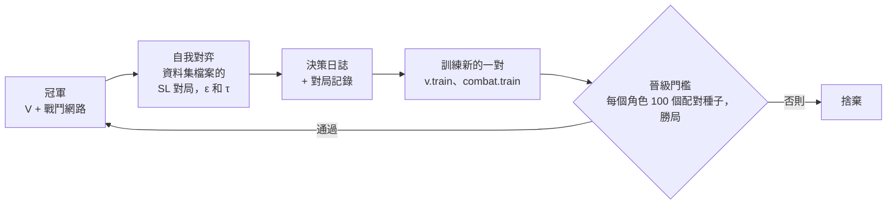

import { Aside } from '@astrojs/starlight/components';

V 從冠軍自己打的對局中學習。本節一步一步描述這套流程：對局、它們怎麼探索、一代怎麼打和怎麼訓練，以及新的網路怎麼接受評判。一般的循環，以及戰鬥網路那一邊，見[學習：循環](/zh-tw/arch/learning/loop/)。

## 1. 循環



## 2. 對局

自我對弈打 SL：每個宏觀決策都由節點複本上的 L0 來做（[搜尋 §2](/zh-tw/arch/macro-brain/search/#sec-2)），它打的每場戰鬥都由 SL 戰鬥規劃器配它的戰鬥網路來打。它照冠軍原樣來打，加上只有自我對弈才用的選項：

```text
run --champion eval/champions/sl.json --character CHARACTER --asc N --workers 4 \
    --effort medium --elite-effort medium --boss-effort high [--auto-win 1,2] \
    --explore ε [--macro-explore τ] --seed 1 --start K --n RUNS --log DIR/log.jsonl --records DIR/rec.jsonl
```

- `--champion` 採用冠軍檔案裡的選項：SL、medium 預算的規劃器、複本上的 L0、冠軍的 V 和戰鬥網路（[評估：冠軍與基線 §1](/zh-tw/arch/evaluation/champions/#sec-1)）。命令列上給的選項優先於檔案裡的。
- `--character` 和 `--asc` 由作業自己給：任何角色，晉階 0 到 10 的任何一級（[§4](#sec-4)）。
- `--effort`、`--elite-effort` 和 `--boss-effort` 是規劃器在其他戰鬥、菁英戰和頭目戰裡的等級（[SL 規劃器：預算 §1](/zh-tw/arch/sl-planner/budget/#sec-1)）。
- `--auto-win ACTS` 讓這一局成為自動勝利規則的一局：在這些幕裡（從 1 起編號），普通怪物戰在開打時就贏下，所以那裡只打菁英和頭目（[模擬器：整局 §8](/zh-tw/arch/simulator/runs/#sec-8)）。沒有它，這一局就是整個遊戲。
- `--explore ε` 和 `--macro-explore τ` 是它的探索：均勻抽取的宏觀決策的比例，以及其餘決策的 softmax 溫度（[§3](#sec-3)）。
- `--seed 1 --start K --n RUNS` 打索引 K 到 K + RUNS − 1 的訓練種子（[§4](#sec-4)）。
- `--log` 和 `--records` 寫出決策日誌和對局記錄，每個決策、每一局各一行 JSON（[Harness：決策日誌](/zh-tw/arch/harness/decision-log/)，[評估：指標、種子與報告 §8](/zh-tw/arch/evaluation/metrics/#sec-8)）。`DIR` 是這個作業在 `data/CHARACTER/sl/` 下的資料夾（[學習：參考 §3](/zh-tw/arch/learning/reference/#sec-3)）。
- `--workers` 是一局用多少個搜尋行程（預設 8 個）。

這些選項全都由資料集的檔案按作業設定（[§4](#sec-4)）。模擬器怎麼建置和啟動，見[模擬器：參考 §1](/zh-tw/arch/simulator/reference/#sec-1)。

**兩種遊戲**。整局和自動勝利規則的一局是不同的遊戲。在後者裡，第 1、2 幕的一場普通怪物戰什麼都不花，仍然給它的獎勵，所以那裡的一個狀態，獲勝的機率和整局裡同樣的狀態不同。V 讀得到一個狀態屬於哪種遊戲，就是它九個數字裡的三個（[價值網路 §2](/zh-tw/arch/macro-brain/network/#sec-2)），所以一個 V 從兩者學習，並在各自的遊戲裡給每個狀態估值；晉級門檻和真實遊戲都是整局，讀到的規則是 0、0、0。戰鬥網路不需要這樣的輸入：它的目標是這場戰鬥自己的結局，在兩種遊戲裡都一樣（[學習：訓練戰鬥網路 §3](/zh-tw/arch/learning/combat-net/#sec-3)）。這條規則的一局打的戰鬥是菁英和頭目，它們決定了大多數對局，所以花同樣的對弈時間，它給戰鬥網路更多這類戰鬥。

**預算**。自我對弈用冠軍自己的預算 medium 來打，也就是評判它時用的預算，除非資料集給某種房間自己的等級，例如頭目戰用 high。V 是在做出它的標籤的那套打法下贏下的機率（[從風險值到價值 §1](/zh-tw/arch/macro-brain/value/#sec-1)），所以它的標籤來自照冠軍的打法打出來的對局，只是那種房間打得更用力。

## 3. 探索：均勻抽取和 softmax

V 只從對局實際做過的事裡學。如果自我對弈總是選 V 最好的選項，資料就永遠看不到其他選項會帶來什麼，V 也永遠發現不了自己對它們估錯了。所以自我對弈有時會故意打另一個選項，方式有兩種。

**均勻抽取**（`run --explore ε`）。以機率 ε，一個宏觀決策的答案在它的選項之間均勻抽取，不管 V 怎麼說；否則 L0 按 V 來回答。若有 $n$ 個選項、V 的最佳為 $a^\ast$，且沒有 softmax：

$$
P(a) = (1 - \varepsilon)\,[a = a^\ast] + \frac{\varepsilon}{n} .
$$

這涵蓋戰鬥之外的每個決策：卡牌獎勵在它的牌和略過之間的結果（抽到略過就不打開，抽到一張牌就打開並拿取）；選牌提示的選取（先均勻抽選幾張，再抽選哪些）；以及其他每個畫面的選項，藥水的選項也在其中，但那些會回到已經決定過的狀態的選項除外（[搜尋 §5](/zh-tw/arch/macro-brain/search/#sec-5)）。藥水的選項就是 L0 權衡的那些：戰鬥之外可用的藥水（果汁、血液藥水、熵之釀、龍涎香、在商人面前的惡臭藥水），以及丟棄，只在它能為畫面提供的藥水騰出位置時才有（[搜尋 §1](/zh-tw/arch/macro-brain/search/#sec-1)）。

**softmax**（`run --macro-explore τ`）。均勻抽取留給 V 的每個答案，改由 V 抽出，而不是直接取最佳：選項 $a$ 的機率隨它估值的對數增長，溫度為 τ，

$$
P(a \mid \text{left to V}) = \frac{\exp(\log V(a) / \tau)}{\sum_b \exp(\log V(b) / \tau)} = \frac{V(a)^{1/\tau}}{\sum_b V(b)^{1/\tau}} .
$$

V 是一個在一局之內跨越好幾個數量級的機率（在 A10 從 $10^{-3}$ 降到 $10^{-7}$），所以溫度作用在它的比值上，在任何 V 都一樣：τ = 0.05 時，價值為最佳的 0.97 的選項被抽到的頻率是最佳的 $0.97^{20} \approx 0.54$ 倍，價值為最佳一半的選項大約一百萬次才一次。它用在宏觀決策處，也用在選牌提示的回答的每一步（`MacroBrain.Pick`，`Brain/Macro/MacroBrain.cs:362-371`；`Softmax`，`Brain/Exploration.cs:33-56`）。價值為零的選項，或會回到已經決定過的狀態的選項，從不被抽到，除非全部都是這樣。兩者都有時，$P(a) = \varepsilon / n + (1 - \varepsilon)\,P(a \mid \text{left to V})$；τ = 0 時第二項就只有 V 的最佳，即上面的公式。

ε 和 τ 每局固定。每個均勻抽出的答案在決策日誌裡都標為 `explored`，softmax 抽出的、在對數上比最佳低超過 τ / 100 的答案也是（更接近的，就和平手一樣好）。冠軍的名字以 `explore τ eps ε` 結尾，晉級門檻拒絕帶探索的挑戰者。

**為什麼要均勻，又為什麼也要 softmax**。均勻抽取取什麼，既不取決於 V，也不取決於這一局打得多好，所以被抽取的決策的結局，是關於這些選項的因果證據，包括 V 認為差的選項，而且每一種決策被抽到的頻率都一樣。按 V 自己的估值加權的抽取，嘗試的是 V 本來就喜歡的選項，很少碰到能糾正它的反例。這正是 softmax 的用處：它嘗試 V 評得接近最佳的選項，那裡順序錯了代價最大，V 的估值也最接近，而把遠的選項留給均勻抽取。

**檔位**。一份資料集的對局分成幾個探索檔位，每個檔位是一對 ε 和 τ，各有相同數量的對局，由它的檔案設定（[§4](#sec-4)），例如 ε 0.3、0.1 和 0.02。ε 越高，每局涵蓋的選項越多；ε 越低，越能打到後面的樓層，而贏下一局的決策就在那裡。

<Aside>

**標籤帶著之後的抽取**。一個決策的標籤是它那一局怎麼結束，這包括它之後所做的抽取。V 不知道這一局的 ε 或 τ，所以同一個狀態，在探索更多的對局裡標籤更低（[弱點與下一步 §1](/zh-tw/arch/macro-brain/next/#sec-1)）。

</Aside>

## 4. 一代

一*代*是循環轉一圈：一份資料集，由一個冠軍打出來。

1. **資料集檔案**：一代寫成一個檔案 `eval/datasets/NAME.toml`，`eval/datasets/example.toml` 示範了它的每個鍵。這個檔案指明種子的區段、角色、冠軍檔案和它的搜尋工作行程、探索檔位、各種遊戲，以及一列列的對局：

   ```toml
   explore = [{ epsilon = 0.3 }, { epsilon = 0.1, tau = 0.05 }, { epsilon = 0.02, tau = 0.05 }]

   [games.gauntlet]                  # acts 1 and 2: elites and bosses only
   auto_win = [1, 2]
   effort = { monster = "medium", elite = "medium", boss = "high" }

   [games.full]                      # the whole game
   auto_win = []
   effort = { monster = "medium", elite = "medium", boss = "high" }

   [[runs]]                          # for every character of the file
   game = "gauntlet"
   asc = 10
   n = 4000

   [[runs]]
   game = "full"
   asc = [0, 5, 10]
   n = [100, 300, 1000]

   [[runs]]                          # one character only, with its own tier
   characters = ["NECROBINDER"]
   game = "gauntlet"
   asc = 5
   n = 300
   explore = [{ epsilon = 0.1, tau = 0.1 }]
   ```

   一種遊戲是普通怪物戰在開打時就贏下的那些幕（整個遊戲則一幕也沒有），加上按房間決定的戰鬥等級。一列是一種遊戲、它的各個晉階和每個晉階的對局數，對檔案的每個角色或它指明的那些角色，用檔案的檔位或它自己的檔位。每一列在一個晉階的對局平均分到它的各檔位，每一份是 [§2](#sec-2) 的指令的一個作業，`aNN-GAME-eEEE`（τ 大於 0 時加上 `-tTTT`；ε 和 τ 以百分之一為單位），所以 `a10-gauntlet-e010-t005` 是晉階 10、自動勝利的遊戲、ε 0.1、τ 0.05。這些數量就是實際打的數量，所以檔案寫明了這一代的每個比例：角色、晉階、遊戲和檔位。這個檔案也是這一代的記錄：它以 `dataset.toml` 放在每個角色的資料夾裡、資料旁邊，第一行是這一代打的時候所在的提交。
2. **打**：冠軍同時打檔案裡的各個作業，每個用它自己的選項。對局數不固定：一個作業拿到的種子可以比它打完的多，這一代就是各作業打完的那些對局。
3. **種子**：訓練種子是 `run --seed 1 --start K`，也就是索引為 K 的種子。每一代佔用自己的一段 100,000 個索引，即檔案的 `seeds`：SILENT、IRONCLAD、DEFECT、REGENT 和 NECROBINDER 中的第 k 個角色從這一段的起點加 20,000 k 開始打（k 從 0 起），它的各列按檔案的順序首尾相接，所以一代裡沒有兩局共用一個種子。每個角色 20,000 個索引裡的最後 1,000 個留給試跑，每個角色、每列、每個晉階一局，在這一代之前打。評估的種子檔案由其他基數產生，訓練器也拒收含有評估作業對局的清單（`common.train_lists`），所以訓練種子絕不會碰上測試種子（[學習：參考 §5](/zh-tw/arch/learning/reference/#sec-5)）。
4. **清單**：各作業的決策日誌和對局記錄寫進一對清單 `PREFIX-logs.txt` 和 `PREFIX-recs.txt`，每行一個檔案，一份的第 i 行就是另一份第 i 行那些記錄的日誌（[學習：參考 §4](/zh-tw/arch/learning/reference/#sec-4)）。
5. **訓練**：新的 V 和新的戰鬥網路只用這一代的對局訓練，即兩種遊戲的對局，各自從冠軍的檔案接著訓練（`--init`），在 `learn/` 下執行：

   ```text
   uv run python -m v.train --list PREFIX --name NAME --init ../VALUE
   uv run python -m combat.train --list PREFIX --env SL --name NAME --init ../COMBAT_NET
   ```

   `VALUE` 和 `COMBAT_NET` 是冠軍檔案裡的 `value` 和 `combat-net`，也就是從儲存庫根目錄算起的路徑；`NAME` 是一個新名字，從不重用已有的名字（[學習：參考 §6](/zh-tw/arch/learning/reference/#sec-6)）。兩者各寫出 `weights/all/NAME.json`（[從風險值到價值 §5](/zh-tw/arch/macro-brain/value/#sec-5)，[學習：訓練戰鬥網路 §4](/zh-tw/arch/learning/combat-net/#sec-4)）。較弱的冠軍打出的對局，給狀態的標籤會低於現在的冠軍會打出的，所以不混入更舊的各代。
6. **晉級門檻**：新的一對網路對上冠軍的那一對（[§5](#sec-5)）。
7. **晉級**：通過的一對網路取代兩個冠軍檔案裡的 V 和戰鬥網路（[評估：冠軍與基線 §1](/zh-tw/arch/evaluation/champions/#sec-1)），下一代就用它們來打。

失敗的對局在讀取樣本時就被丟棄（[從風險值到價值 §3](/zh-tw/arch/macro-brain/value/#sec-3)）。

## 5. 晉級門檻

新的 V 連同用同一份資料訓練的戰鬥網路一起接受評判：冠軍的那一對網路和新的那一對都用每個角色打 `promotion-1-100` 的同樣 100 個種子，不探索，每個角色的對局按種子配對、按勝局比較。五個角色一起讀，因為一個冠軍打它們全部。流程、指令和判定規則見[評估：晉級門檻 §10](/zh-tw/arch/evaluation/gates/#sec-10)。

門檻要實際對打，是因為沒有哪個留出分數能做這個決定：Brier 分數衡量 V 區分不同對局的狀態有多好，而不是它能不能把同一個狀態的各選項排對順序（[從風險值到價值 §6](/zh-tw/arch/macro-brain/value/#sec-6)）。
