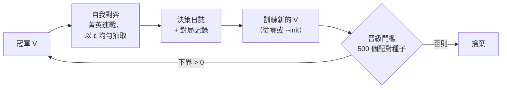

import { Aside } from '@astrojs/starlight/components';
import DecisionBars from '../../../../../components/v/DecisionBars.svelte';
import Generations from '../../../../../components/v/Generations.svelte';

V 從冠軍自己打的對局中學習。本節描述這個循環在計畫 v6 裡實際的樣子：對局在什麼遊戲裡打（菁英連戰）、自我對弈怎麼探索，以及每一代的網路怎麼訓練、怎麼過晉級門檻。一般的循環，以及戰鬥網路那一邊，見[學習：循環](/zh-tw/arch/learning/loop/)。

## 1. 菁英連戰

**菁英連戰**（`run --gauntlet`）是一種簡化的對局。每個宏觀決策都照常做，由節點複本上的 L0 來做。普通怪物戰一開始就判贏，獎勵照發。菁英和頭目由 SL 戰鬥規劃器來打，生命值和藥水帶進帶出，死亡就結束這一局。事件、商店、休息處和地圖都是遊戲原本的樣子。

為什麼用這種遊戲：

- **頭目和菁英殺死大多數對局**：當時 SL 冠軍的整局對局，200 局裡有 134 局死在頭目處，而一場普通怪物戰平均只花掉最大生命的 3%（第 1 幕）到 18%。
- **它便宜**：以訓練預算，一局連戰佔一個行程 45–53 s，只是一局整局 SL 的一小部分。
- **菁英要真打**：最早一個連菁英也一開始就判贏的版本，在執行之前就被放棄了：V 會學到菁英越多永遠越好。

**預算**。SL 規劃器用它的低預算來打（`--effort low --nodes 150 --beam 4 --easy-beam 0 --loss-plans 0 --replan 0`）。選定之前，在滿血下打了 515 扇頭目門：低預算下兩個種子的相關係數是 0.83，同一個種子上低預算和中預算的相關係數是 0.94。所以便宜的預算給配裝排序，和同一預算換一個種子一樣好。

**進度**。一局連戰的目標是它的進度：到達的樓層，輸在戰鬥裡的對局再加上那場戰鬥裡打掉的敵人生命比例；贏下的對局結束在最後一層，最後的頭目全部打掉（+1）。這就是連戰的 V 有比例頭的原因（[從風險值到價值 §1](/zh-tw/arch/macro-brain/value/#sec-1)）。整局的 V 拒收連戰的對局，連戰的 V 也拒收整局。

這種遊戲的代價是，V 學到的是一個怪物戰不花代價的遊戲。這是它帶進整局的主要弱點（[弱點與下一步 §1](/zh-tw/arch/macro-brain/next/#sec-1)）。

## 2. 探索：均勻抽取

V 只從對局實際做過的事裡學。如果自我對弈總是選 V 最好的選項，資料就永遠看不到其他選項會帶來什麼，V 也永遠發現不了自己對它們估錯了。所以自我對弈有時會故意打另一個選項。怎麼挑那個選項很重要。

**均勻抽取**（`run --explore ε`）。以機率 ε，一個宏觀決策的答案在它的選項之間均勻抽取，不管 V 怎麼說；否則 L0 選 V 的最佳。若有 $n$ 個選項、V 的最佳為 $a^\ast$：

$$
P(a) = (1 - \varepsilon)\,[a = a^\ast] + \frac{\varepsilon}{n} .
$$

這涵蓋戰鬥之外的每個決策：卡牌獎勵在它的牌和略過之間的結果（抽到略過就不打開，抽到一張牌就打開並拿取）；選牌提示的選取（先均勻抽選幾張，再抽選哪些）；以及其他每個畫面的選項，但藥水欄的選項，以及那些會回到已經決定過的狀態的選項除外（[搜尋 §5](/zh-tw/arch/macro-brain/search/#sec-5)）。ε 每局固定。每個抽出的答案在決策日誌裡都標為 `explored`，冠軍的名字以 `eps ε` 結尾，晉級門檻拒絕帶探索的挑戰者。

**softmax** 是另一種做法，以如下機率抽取每個選項：

$$
P(a) = \frac{\exp\big((V(a) - V(a^\ast))/T\big)}{\sum_b \exp\big((V(b) - V(a^\ast))/T\big)},
$$

所以接近最佳的選項常被嘗試，差的很少。在菁英連戰之前，V 的探索用的就是它，而對學習 V 來說，它有兩個缺陷：

- **它在 V 的選項彼此接近的地方探索，而不是在 V 可能錯的地方**：選牌的各選項往往只差一層的一小部分；休息處和商店的選擇差得更遠。在任何溫度下，softmax 嘗試選牌的次數都遠多於休息處。
- **它跟著 V 自己的信念走**：V 認為差的選項幾乎從不被嘗試，所以資料裡永遠沒有能糾正 V 的反例。用 V v0、生命 75% 時，T = 2 的 softmax 選鍛造而不選多回 18 點生命的休息，大約 8,000 次才一次。

均勻抽取兩個缺陷都沒有：抽到什麼既不取決於 V，也不取決於這一局打得多好，所以被抽取的決策的結局，是關於這些選項的因果證據，而且每一種決策被抽到的頻率都一樣。下圖在貫穿範例的真實決策上比較兩者：在 n2-b0.03 時代的溫度 T = 0.006 層下，選項彼此差得遠時，softmax 幾乎從不離開 V 的最佳，而 ε = 0.15 時每個選項被抽到的機會相同。

<DecisionBars client:visible lang="zh-TW" explore start="card_reward" />

**檔位**。每一代的對局分成三個 ε 檔位，各佔三分之一的對局：第 1–2 代是 1.0、0.5 和 0.15，從第 3 代起是 0.3、0.15 和 0.05。ε = 1.0 時一局幾乎不取決於 V（pure-1-g 的進度 21.8，v6-1 是 21.2，而 ε = 0.15 時從 31.9 升到 34.1），訓練權重約有 69% 落在第 1 幕，而冠軍已經有 95% 的時候打贏那一幕的頭目。ε = 0.15 時，一局連戰約有 102 個可以抽取的決策，其中 15 個被抽取；獎勵畫面佔抽取的一半以上，卡牌獎勵和地圖各約八分之一。

<Aside>

**標籤帶著之後的抽取**。一個決策的標籤是它那一局怎麼結束，這包括它之後所做的抽取。V 不知道這一局的 ε：在第 3 代的第二個限時任務裡，三個檔位的進度分別是 32.8、36.4 和 39.1。因此同一個狀態，在探索更多的對局裡標籤更低。每局一個切點可以消除這一點（切點之前抽取，之後用 V 的最佳，只在切點之後的決策上訓練），目前還沒有做（[弱點與下一步 §4](/zh-tw/arch/macro-brain/next/#sec-4)）。

</Aside>

## 3. 各代

一*代*是循環轉一圈：冠軍打一批對局，在上面訓練一個網路，網路過晉級門檻。計畫 v6 跑了三代：

| 代 | 由誰打 | 對局（決策） | ε 檔位 | 訓練資料 | 網路 | 進度 |
|---|---|---|---|---|---|---|
| 1 | pure-1-g | 5,775（624,955） | 1.0 / 0.5 / 0.15 | 第 1 代 | v6-1，從零 | 36.07 ± 0.34 |
| 2 | v6-1 | 6,080 | 1.0 / 0.5 / 0.15 | 第 1–2 代（11,855 局） | v6-2，從零 | 40.69 ± 0.38 |
| 3 | v6-2 | 14,828（2,160,792） | 0.3 / 0.15 / 0.05 | 只用第 3 代 | v6-3-1，從零 | 42.42 ± 0.43 |
| | | | | 只用第 3 代 | v6-3-2，從 v6-2 的權重接著訓練 | 43.36 ± 0.38 |

第 3 代只用它自己的對局訓練：較弱的 V 打出的對局，給狀態的標籤會低於冠軍現在會打出的。它的兩個網路測試從哪裡開始：同樣的資料，從零開始，以及從前一個網路的權重開始（`--init`）；從 v6-2 接著訓練以 +0.94 ± 0.49 勝出。

各代也改變了 V 的打法。在連戰裡，在整局上訓練的 pure-1-g 每局打 2.37 場菁英，500 局評估裡有 95 局死在菁英戰中；晚一代的 v6-1 打 1.21 場，死了 39 局。在連戰的訓練對局裡，每場菁英都花掉生命值，每一種決策都被均勻抽取，所以打不打菁英的結局都在資料裡。

## 4. 晉級門檻

新的 V 只能透過晉級門檻（gate）取代冠軍。在連戰裡，挑戰者在 500 個評估種子 300000–300499 上打，不探索，用訓練預算，在複本上；冠軍在同樣種子上的對局已經有了。對局按種子配對：對種子 $i$，$d_i$ 是挑戰者的進度減去冠軍的進度，有 $n$ 對時

$$
\bar d = \frac{1}{n}\sum_i d_i, \qquad \mathrm{SE} = \frac{\mathrm{sd}(d)}{\sqrt n}, \qquad \text{promote if } \bar d - 1.645\,\mathrm{SE} > 0,
$$

也就是說，當平均差的 95% 單側下界大於 0 時晉級。一個種子決定了地圖、遭遇和獎勵，直到兩個策略分岔為止，所以一局的大部分運氣由雙方共享，在 $d_i$ 裡相互抵消（公共亂數）。`learn/gauntlet.py` 計算這些；一次門檻在遠端主機上要 16–20 分鐘（[評估：晉級門檻 §11](/zh-tw/arch/evaluation/gates/#sec-11)）。

<Generations client:visible lang="zh-TW" />

點是 500 個評估種子上的平均進度，鬚線是 95% 信賴區間（±1.96 個標準誤）；第一張表給出到達各幕頭目的對局中打贏它的比例，以及贏下的局數。每一代都通過了門檻：v6-1 對 pure-1-g +1.60 ± 0.44（下界 +0.88），v6-2 對 v6-1 +4.62 ± 0.46（+3.86），v6-3-2 對 v6-2 +2.67 ± 0.49（+1.87）。參考線是 n2-b0.03（33.71）和每個決策都均勻抽取（21.89）：V 的選擇比隨機選擇多值大約 21 層的進度。

**在整局裡**（第二張表：SL，`promotion-1-300` 的 300 個種子，SL 冠軍的規劃器用 medium 強度，在複本上），v6-3-2 到達第 33.56 層，贏下 23 局，在到達第 1–3 幕頭目的對局中分別打贏 95%、55% 和 35%。2026-10-30，它憑這份報告成為兩個冠軍的 V（[評估：冠軍與基線 §4](/zh-tw/arch/evaluation/champions/#sec-4)）。

## 5. 連戰的排序沒能延續的地方

連戰在一個怪物不花代價的遊戲裡按進度給各個 V 排序。整局並不總是同意：

| | 連戰進度 | 整局：樓層 | 整局：300 局中的勝局 |
|---|---|---|---|
| v6-3-1 對 v6-2 | +1.73 ± 0.54 | −0.26 ± 0.70 | 13 對 1 |
| v6-3-2 對 v6-2 | +2.67 ± 0.49 | +2.20 ± 0.62 | 23 對 1 |

v6-3-1 在連戰裡明顯更好，贏下的整局也多得多，平均到達的樓層卻沒有更高。樓層和勝局意見不一，而連戰兩者都不直接衡量。這是下一個計畫在整局裡、按勝局訓練 V 並設門檻的一個原因（[弱點與下一步 §2](/zh-tw/arch/macro-brain/next/#sec-2)）。
