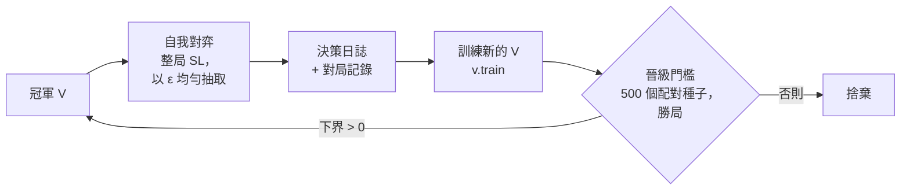

import { Aside } from '@astrojs/starlight/components';

V 從冠軍自己打的對局中學習。本節描述 V 的這個循環：對局、它們怎麼探索、一代怎麼訓練出一個網路，以及網路怎麼接受評判。一般的循環，以及戰鬥網路那一邊，見[學習：循環](/zh-tw/arch/learning/loop/)。

## 1. 循環



## 2. 對局

自我對弈打整個遊戲，SL：每個宏觀決策都由節點複本上的 L0 來做（[搜尋 §2](/zh-tw/arch/macro-brain/search/#sec-2)），每場戰鬥，包括普通怪物戰，都由 SL 戰鬥規劃器配它的戰鬥網路來打。

```text
run --env SL --policy plan --macro l0 --afterstates clone --workers 4 --character CHARACTER --asc 0 \
    --effort low --nodes 150 --beam 4 --easy-beam 0 --loss-plans 0 --replan 0 \
    --combat-net weights/all/c9-1.json --value weights/all/V.json --explore ε --seed 1
```

**預算**。最新的一代 `v9g0`，用規劃器的低預算在晉階 0 打了全部五個角色，如上。`v8g2` 用冠軍的 medium 強度在晉階 10 打寂靜獵手，晉級門檻也是這個強度，每局約 290 s；`v7g1` 用低預算打，每局佔一個行程約 45–85 s。便宜的預算在同樣的算力下給出多得多的對局，而且給配裝排序差不多一樣好：在滿血下打的 515 扇頭目門上，同一個種子上低預算和中預算的相關係數是 0.94，低預算下兩個種子的相關係數是 0.83（[SL 規劃器：預算、開銷與結果 §2](/zh-tw/arch/sl-planner/budget/#sec-2)）。

## 3. 探索：均勻抽取

V 只從對局實際做過的事裡學。如果自我對弈總是選 V 最好的選項，資料就永遠看不到其他選項會帶來什麼，V 也永遠發現不了自己對它們估錯了。所以自我對弈有時會故意打另一個選項。

**均勻抽取**（`run --explore ε`）。以機率 ε，一個宏觀決策的答案在它的選項之間均勻抽取，不管 V 怎麼說；否則 L0 選 V 的最佳。若有 $n$ 個選項、V 的最佳為 $a^\ast$：

$$
P(a) = (1 - \varepsilon)\,[a = a^\ast] + \frac{\varepsilon}{n} .
$$

這涵蓋戰鬥之外的每個決策：卡牌獎勵在它的牌和略過之間的結果（抽到略過就不打開，抽到一張牌就打開並拿取）；選牌提示的選取（先均勻抽選幾張，再抽選哪些）；以及其他每個畫面的選項，藥水的選項也在其中，但那些會回到已經決定過的狀態的選項除外（[搜尋 §5](/zh-tw/arch/macro-brain/search/#sec-5)）。藥水的選項就是 L0 權衡的那些：戰鬥之外可用的藥水（果汁、血液藥水、熵之釀、龍涎香、在商人面前的惡臭藥水），以及丟棄，只在它能為畫面提供的藥水騰出位置時才有（[搜尋 §1](/zh-tw/arch/macro-brain/search/#sec-1)）。ε 每局固定。每個抽出的答案在決策日誌裡都標為 `explored`，冠軍的名字以 `eps ε` 結尾，晉級門檻拒絕帶探索的挑戰者。

**為什麼要均勻**。抽到什麼既不取決於 V，也不取決於這一局打得多好，所以被抽取的決策的結局，是關於這些選項的因果證據，包括 V 認為差的選項，而且每一種決策被抽到的頻率都一樣。按 V 自己的估值加權的抽取，嘗試的是 V 本來就喜歡的選項，很少碰到能糾正它的反例。

**檔位**。一代的對局分成三個 ε 檔位：`v7g1` 是 0.3、0.15 和 0.05；`v7g2` 是 0.15、0.08 和 0.03；`v8g2` 是 0.06、0.03 和 0.01；`v9g0` 是 0.3、0.1 和 0.02，又放寬了，因為對其中四個角色來說這是第一批資料。ε 越高，每局涵蓋的選項越多；ε 越低，越能打到後面的樓層，而贏下一局的決策就在那裡。

<Aside>

**標籤帶著之後的抽取**。一個決策的標籤是它那一局怎麼結束，這包括它之後所做的抽取。V 不知道這一局的 ε，所以同一個狀態，在探索更多的對局裡標籤更低（[弱點與下一步 §1](/zh-tw/arch/macro-brain/next/#sec-1)）。

</Aside>

## 4. 一代

一*代*是循環轉一圈。

1. **打**：冠軍每個檔位打一個限時作業，同時進行。對局數不固定：每個行程一直打到截止時間，截止時間放在每台主機的一個檔案裡，作業執行時也能挪動。訓練種子來自作業開始前記入帳本的一個區塊，每個檔位的種子遠多於打得完的數量（20,000 個），而且絕不和晉級門檻的種子重疊。
2. **訓練**：新的 V 只用這一代的對局訓練。較弱的 V 打出的對局，給狀態的標籤會低於冠軍現在會打出的，所以不混入更舊的各代。有同樣結構的前一個網路時，它從那個網路的權重接著訓練（`--init`），否則從零開始（[從風險值到價值 §5](/zh-tw/arch/macro-brain/value/#sec-5)）。
3. **晉級門檻**：新的 V 對上冠軍（[§5](#sec-5)）。
4. **晉級**：通過的網路取代兩個冠軍檔案裡的 V（[評估：冠軍與基線 §1](/zh-tw/arch/evaluation/champions/#sec-1)），下一代就用它來打。

一代的規模，取自最近打完的一代：

| ε | 對局 |
|---|---|
| 0.06 | 3,603 |
| 0.03 | 3,283 |
| 0.01 | 3,152 |
| **全部** | **10,038**，其中贏下 165 局，沒有失敗 |

失敗的對局在讀取樣本時就被丟棄（[從風險值到價值 §3](/zh-tw/arch/macro-brain/value/#sec-3)）。

## 5. 晉級門檻

新的 V 由晉級門檻（gate）評判，連同用同一份資料訓練的戰鬥網路一起：冠軍的那一對網路對上新的那一對。冠軍的 V 是 v9-1，它和 c9-1 一起在晉階 0 的每個角色上通過了門檻（[評估：冠軍與基線 §2](/zh-tw/arch/evaluation/champions/#sec-2)）。每個角色在它的資料所打的晉階等級上打，兩對網路在相同的種子上打，不探索，在複本上：用冠軍的 medium 規劃器預算打 `promotion-1-100` 的 100 個種子，用低預算打 `promotion-1-200` 的 200 個。對局按種子配對，一次一個角色：對種子 $i$，$d_i$ 是挑戰者的勝負（1 或 0）減去冠軍的勝負（1 或 0），有 $n$ 對時

$$
\bar d = \frac{1}{n}\sum_i d_i, \qquad \mathrm{SE} = \frac{\mathrm{sd}(d)}{\sqrt n}, \qquad \text{promote if } \bar d - 1.645\,\mathrm{SE} > 0,
$$

也就是說，當平均差的 95% 單側下界大於 0 時晉級。一個種子決定了地圖、遭遇和獎勵，直到兩個策略分岔為止，所以一局的大部分運氣由雙方共享，在 $d_i$ 裡相互抵消（公共亂數）。在 500 個種子上，這大約需要多贏 2–3 個百分點。層數列在勝局旁邊，五個角色一起讀，因為一個冠軍打它們全部（[評估：晉級門檻 §10](/zh-tw/arch/evaluation/gates/#sec-10)）。

`learn/gate.py --against` 計算這些（[評估：晉級門檻 §10](/zh-tw/arch/evaluation/gates/#sec-10)）。它的報告也保留勝局顯示不出的東西：平均樓層、到達和打贏各幕頭目的次數、輸掉的對局死在哪裡（頭目、菁英、怪物或戰鬥之外，按幕分）、每局打的菁英數、按生命比例分組的休息處選擇和地圖上怪物戰與休息處之間的選擇，以及商店賣出了什麼。
